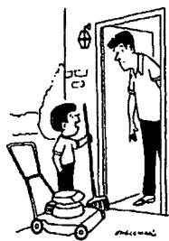
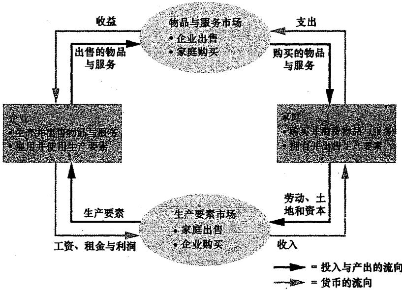
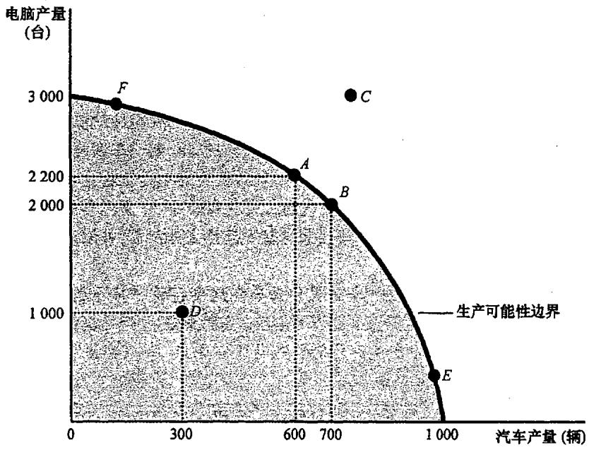

## 第1章 经济学十大原理

经济（economy）这个词来源于希腊语 oikonomos，它的意思是“**管理一个家庭的人**”。乍一看，这个来源似乎有点奇特。但事实上，家庭和经济有着许多相似之处。

一个家庭面临着许多决策。它必须决定各个家庭成员分别去做什么，以及每个家庭成员能得到什么回报：谁做晚饭？谁洗衣服？谁在晚餐时多得到一块甜点？谁来开车？简而言之，家庭必须考虑到每个成员的能力、努力和愿望，以在其各个成员间分配**稀缺资源**（时间、甜点、汽车行驶里程）。

和一个家庭一样，一个社会也面临着许多决策。社会必须找到某种方法来决定将要做哪些工作以及谁来做这些工作。社会需要一些人种粮食，一些人做衣服，还需要一些人设计电脑软件。一旦社会分配了人们（以及土地、建筑物和机器）去做各种工作，它就必然需要将他们生产的物品与服务进行分配。社会必须决定谁将吃鱼子酱而谁将吃土豆。它也必须决定谁将开特斯拉而谁将坐公共汽车。

由于资源是稀缺的，社会资源的管理就尤为重要。**稀缺性（scarcity）**是指社会拥有的资源是有限的，因此不能生产人们希望拥有的所有物品与服务。正如每个家庭成员都不可能得到他想要的每一件东西一样，社会上的每个人也不能达到他希望的最高生活水平。

**经济学（economics）**研究社会如何管理自己的稀缺资源。在大多数社会中，资源并不是由一个全权的独裁者来配置，而是通过千百万家庭和企业的共同选择来配置的。因此，经济学家研究人们如何做出决策：他们做多少工作、购买什么、储蓄多少，以及如何把储蓄用于投资。经济学家还研究人们如何相互影响。例如，经济学家考察一种物品的众多买者与卖者如何共同决定该物品的销售价格和销售量。最后，经济学家分析影响整个经济的力量和趋势，包括平均收入的增长、找不到工作的人占总人口的比例，以及价格上升的速度。

经济学的研究是多方面的，但可以用几个核心思想把这个领域统一起来。在本章中，我们将阐述经济学十大原理。即使你开始时不完全理解这些原理，或者它们并不能使你完全信服，也不必担心。我们将在以后各章中更充分地解释这些思想。

### 1.1 人们如何做出决策

由于一个经济的行为反映了组成这个经济的个人的行为，所以我们的经济学学习就从个人如何做出决策的四个原理开始。

#### 1.1.1 原理一：人们面临权衡取舍
你可能听到过这句老话：“**天下没有免费的午餐**。”抛开文法不谈，这句格言包含了相当多的真理。为了得到一件喜爱的东西，我们通常不得不放弃另一件喜爱的东西。**做出决策就是要求我们在一个目标与另一个目标之间进行权衡取舍**。

考虑一个学生必须决定如何分配她最宝贵的资源——时间。她可以把所有的时间都用于学习经济学，也可以把所有的时间都用于学习心理学，还可以把时间在这两个学科之间进行分配。对于她用于学习一门课的每一个小时，她都要放弃本来可用于学习另一门课的一小时。

当人们组成社会时，他们面临各种不同的权衡取舍。经典的权衡取舍是在“**大炮与黄油**”之间。当一个社会的支出更多地用于保卫其海岸免受外国入侵的国防（大炮）时，用在提高国内生活水平的消费品（黄油）上的支出就少了。在现代社会里，同样重要的是在**清洁的环境和高收入水平**之间的权衡取舍。

社会面临的另一种权衡取舍是**效率与平等**之间的选择。**效率（efficiency）**是指社会能从其稀缺资源中得到最大的利益。**平等（equality）**是指将这些利益平均地分配给社会成员。换句话说，效率是指经济蛋糕的大小，而平等则是指如何分割这块蛋糕。在设计政府政策的时候，这两个目标往往是相互冲突的。当政府想要把经济蛋糕切成更为均等的小块时，这块蛋糕本身也变小了。

#### 1.1.2 原理二：某种东西的成本是为了得到它所放弃的东西
由于人们面临着权衡取舍，所以做决策时就需要比较可供选择的行动方案的成本与收益。**一种东西的机会成本（opportunity cost）是为了得到这种东西所必须放弃的东西**。

考虑是否上大学的决策。主要收益是知识的丰富和更好的工作机会。但成本是什么呢？除了学费和生活费中高于平时的部分，最重大的成本是**时间**。当你把一年的时间用于听课和读书时，你就不能把这段时间用于工作。对大多数学生而言，为了上大学而不得不放弃的收入是他们接受教育的最大单项成本。

#### 1.1.3 原理三：理性人考虑边际量
经济学家通常假设人是**理性人（rational people）**。理性人系统而有目的地尽最大努力实现其目标。理性人知道，生活中的许多决策很少是黑与白之间的选择，而往往是介于其间的灰色地带。

经济学家用**边际变动（marginal change）**这个术语来描述对现有行动计划的微小增量调整。记住，“边际”指“边缘”，因此边际变动是围绕你所做的事的边缘来进行的调整。**理性人通常通过比较边际收益（marginal benefit）与边际成本（marginal cost）来做决策**。

例如，为什么航空公司愿意以低于平均成本的价格出售机票？假设一架200个座位的飞机飞行一次成本是10万美元，每个座位的平均成本是500美元。但如果飞机即将起飞仍有10个空位，而等退票的乘客愿意付300美元，航空公司应该卖给他吗？当然应该。多增加一位乘客的边际成本仅仅是这位额外乘客消费的一罐饮料成本。只要票价高于边际成本，卖票就是有利可图的。

#### 1.1.4 原理四：人们会对激励做出反应
**激励（incentive）**是引起一个人做出行动的某种东西（例如对惩罚或奖励的预期）。由于理性人通过比较成本与收益做出决策，所以他们会对激励做出反应。

在分析市场如何运行时，激励起到关键作用。例如，当苹果的价格上涨时，人们决定少吃苹果；同时，苹果园主决定雇用更多工人并多摘些苹果。换言之，**市场上的高价格提供了买者少消费和卖者多生产的激励**。

政府决策者决不能忘记激励：许多政策改变了人们面临的成本或收益，从而也改变了人们的行为。当决策者未能考虑到他们的政策如何影响激励时，他们所制定的政策通常会带来意想不到的结果。例如，有关汽车安全带的法律。安全带法律减少了缓慢而谨慎地开车的收益。人们的反应是更快速、更不谨慎地开车，结果导致了更多的车祸次数。

---

### 1.2 人们如何相互影响

前四个原理讨论了个人如何做出决策。以下三个原理是关于人们如何相互影响的。

#### 1.2.1 原理五：贸易可以使每个人的状况都变得更好
美国和中国之间的贸易并不像体育比赛一样，一方赢而另一方输。实际上，事实正好相反：**两国之间的贸易可以使两个国家的状况都变得更好**。贸易使每个人都可以专门从事自己最擅长的活动。通过与其他人开展贸易，人们可以以较低的成本获得各种各样的物品与服务。

#### 1.2.2 原理六：市场通常是组织经济活动的一种好方法
在**市场经济（market economy）**中，中央计划者的决策被千百万企业和家庭的决策所取代。企业决定雇用谁和生产什么。家庭决定为哪家企业工作，以及用自己的收入购买什么。

经济学家亚当·斯密（Adam Smith）在其 1776 年出版的著作《国富论》中提出了经济学中最著名的观察结果：家庭和企业在市场上相互交易，他们仿佛被一只“**看不见的手**”所指引，并带来了合意的市场结果。**价格就是看不见的手用来指引经济活动的工具**。作为买者与卖者决策的结果，市场价格既反映了一种物品的社会价值，也反映了生产该物品的社会成本。

*“每周只需5美元, 便可让你免去割草的困扰, 尽情地观赏棒球赛!”*

#### 1.2.3 原理七：政府有时可以改善市场结果
我们需要政府的原因之一是：只有当政府落实规则并维护对市场经济至关重要的制度时，看不见的手才能施展其魔力。最重要的是，市场经济需要实施**产权（property rights）**制度。

我们需要政府的另一个原因是：看不见的手并不是无所不能的。政府干预经济的原因大体有两类：**促进效率或促进平等**。经济学家用**市场失灵（market failure）**这个术语来指市场本身不能有效配置资源的情况。市场失灵的一个可能原因是**外部性（externality）**（如污染），另一个原因是**市场势力（market power）**（如垄断）。在这些情况下，设计良好的公共政策可以提高经济效率。

---

### 1.3 整体经济如何运行

最后三个原理涉及整体经济的运行。

#### 1.3.1 原理八：一国的生活水平取决于它生产物品与服务的能力
世界各国生活水平的差别是惊人的。这种平均收入的巨大差别反映在生活质量的各种衡量指标上。几乎所有生活水平的差别都可以归因于各国**生产率（productivity）**的差别，即每一单位劳动投入所生产的物品与服务数量的差别。

#### 1.3.2 原理九：当政府发行了过多货币时，物价上升
**通货膨胀（inflation）**是指经济中物价总水平的上升。在大多数严重或持续的通货膨胀情况下，罪魁祸首是**货币量的增长**。当一国政府发行了大量本国货币时，货币的价值就下降了。

#### 1.3.3 原理十：社会面临通货膨胀与失业之间的短期权衡取舍
大多数经济学家承认，社会面临通货膨胀与失业之间的短期权衡取舍。经济中货币量增加刺激了社会的整体支出水平，从而增加了对物品与服务的需求。需求的增加会引起企业提高物价，但同时，它也鼓励企业雇用更多的工人，并生产更多的物品与服务。雇用更多的工人意味着更少的失业。

---

## 第2章 像经济学家一样思考

每个研究领域都有自己的语言和思考方式。经济学家也没有什么不同。供给、需求、弹性、比较优势、消费者剩余和无谓损失——这些术语是经济学家语言的一部分。它的价值在于能够为你提供一种关于你所生活的世界的新的、有用的思考方式。

### 2.1 作为科学家的经济学家

经济学家努力以科学家的客观性来探讨他们的主题。他们研究经济的方法与物理学家研究物质以及生物学家研究生命的方法在很大程度上是相同的：**先提出理论，再收集数据，然后分析数据，以努力证明或批驳他们的理论**。

#### 2.1.1 科学方法：观察、理论和进一步观察
理论与观察之间的相互作用发生在经济学领域中。虽然经济学家像其他科学家那样运用理论和观察，但他们面临着一个障碍：**在经济学研究中，进行实验往往是不可能的**。经济学家通常只能使用这个世界向他们提供的数据。因此，经济学家十分关注历史所提供的**自然实验**。

#### 2.1.2 假设的作用
经济学家做出假设的原因是：**假设可以使复杂的世界简单化，从而使解释这个世界变得更为容易**。科学思考的艺术就是决定做出什么假设。为了研究不同的问题，经济学家会使用不同的假设。例如，研究货币政策的短期效应时可以假设价格是固定的，而研究长期效应时则假设所有价格都是完全可变的。

#### 2.1.3 经济模型
经济学家也用模型来了解世界，但通常是由图形和方程组成的模型。所有模型都为了加深我们对现实的理解而进行了简化，所有模型都建立在一些假设之上。

#### 2.1.4 第一个模型：循环流量图
**循环流量图（circular-flow diagram）**是一个直观的经济模型。在这个模型中，经济被简化为只由两类决策者——**企业和家庭**——组成。
*   **企业**用劳动、土地和资本（生产要素）来生产物品和服务。
*   **家庭**拥有生产要素并消费企业生产的所有物品与服务。
家庭和企业在两类市场上相互交易：在**物品与服务市场**上，家庭是买者，企业是卖者；在**生产要素市场**上，家庭是卖者，企业是买者。

#### 2.1.5 第二个模型：生产可能性边界
**生产可能性边界（production possibilities frontier）**是一个图形，它表明在生产要素和生产技术既定时，一个经济所能生产的产品数量的各种组合。
*   **有效率**：如果一个经济从它可以获得的稀缺资源中获得了它能得到的全部东西，我们就称这种结果是有效率的。边界上的各点代表了有效率的生产水平。
*   **机会成本**：生产可能性边界表明了如何用另一种物品来衡量一种物品的机会成本。一辆汽车的机会成本等于生产可能性边界的斜率。

#### 2.1.6 微观经济学与宏观经济学
*   **微观经济学（microeconomics）**研究家庭和企业如何做出决策，以及它们如何在特定市场上相互交易。
*   **宏观经济学（macroeconomics）**研究整体经济现象，包括通货膨胀、失业和经济增长。

### 2.2 作为政策顾问的经济学家

当经济学家试图去解释世界时，他们是科学家；当他们试图去帮助改善世界时，他们是政策顾问。

#### 2.2.1 实证分析与规范分析
*   **实证表述（positive statements）**是描述性的。它们试图描述世界是什么样子的。可以通过检验证据来确认或否定。
*   **规范表述（normative statements）**是规定性的。它们试图描述世界应该是什么样子的。对规范表述的评价既涉及事实也涉及价值观。

---

## 第3章 相互依存性与贸易的好处

你每天都在享用许多素不相识的人向你提供的物品与服务。这种相互依存之所以成为可能，是因为人们相互交易。

### 3.1 一个现代经济寓言

为了说明人们为什么选择在物品与服务上依靠其他人，我们看一个简单的例子：农民 Frank 和牧牛人 Ruby 的世界。他们都生产牛肉和土豆。

#### 3.1.1 生产可能性
如果 Frank 和 Ruby 选择自给自足，那么每个人消费的产品正是他所生产的。在这种情况下，**生产可能性边界也是消费可能性边界**。

#### 3.1.2 专业化与贸易
Ruby 提议进行交易：Frank 专门种土豆，Ruby 专门养牛。通过专业化和贸易，每个人都可以不增加工作时间就消费更多的牛肉和更多的土豆。贸易使每个人都可以专门从事自己最擅长的活动。

### 3.2 比较优势：专业化的动力

为什么 Ruby 样样都比 Frank 强，却还要与他贸易？

#### 3.2.1 绝对优势
当比较两个生产者的生产率时，经济学家用**绝对优势（absolute advantage）**这个术语。如果生产者生产一种物品所需要的投入较少，就可以说该生产者在生产这种物品上有绝对优势。在这个例子中，Ruby 在生产牛肉和土豆上都有绝对优势。

#### 3.2.2 机会成本和比较优势
**比较优势（comparative advantage）**是指一个生产者以低于另一个生产者的机会成本生产某种物品的能力。
*   对 Frank 来说，生产 1 盎司土豆的机会成本是 1/4 盎司牛肉。
*   对 Ruby 来说，生产 1 盎司土豆的机会成本是 1/2 盎司牛肉。
因此，**Frank 在种植土豆上有比较优势，而 Ruby 在生产牛肉上有比较优势**。

#### 3.2.3 比较优势与贸易
**专业化和贸易的好处不是基于绝对优势，而是基于比较优势**。当每个人都专门生产自己有比较优势的物品时，经济的总产量就增加了。

#### 3.2.4 贸易的价格
对于从贸易中获益的双方而言，**他们进行贸易的价格在两种机会成本之间**。在我们的例子中，每盎司牛肉的价格在 2 盎司土豆和 4 盎司土豆之间。

### 3.3 比较优势的应用

#### 3.3.1 塞雷娜·威廉姆斯应该自己修剪草坪吗？
威廉姆斯可能有绝对优势（她能比邻居孩子剪得更快），但她修剪草坪的机会成本极高（例如放弃拍商业广告的 3 万美元收入）。邻居孩子修剪草坪的机会成本很低。因此，威廉姆斯在拍广告上有比较优势，孩子在修剪草坪上有比较优势。贸易使双方获益。

#### 3.3.2 美国应该与其他国家进行贸易吗？
同样，国家也能从相互贸易中获益。**进口品（imports）**是在国外生产而在国内销售的物品；**出口品（exports）**是在国内生产而在国外销售的物品。比较优势原理说明，每种物品应该由生产这种物品机会成本较低的国家生产。

### 3.4 结论

你现在应该更充分地理解了生活在一个相互依存的经济中的好处。**比较优势原理表明，贸易可以使每个人的状况都变得更好**。虽然国际贸易可能会使国内某些人的状况变坏，但贸易使国家作为一个整体可以实现更大的繁荣。

在下一篇章中，我们将看到自由社会如何通过供给与需求的市场力量来配置这些稀缺资源。