## 第4章 供给与需求的市场力量

当寒流袭击佛罗里达时，全国超市的橙汁价格都上涨了。每年夏天，当新英格兰地区天气变暖时，加勒比地区旅店房间的价格直线下降。当中东爆发战争时，美国的汽油价格上升，并且二手凯迪拉克轿车的价格下降。这些事件的共同之处是什么呢？它们都体现了**供给与需求**的作用。

供给与需求是经济学家最经常——而且有充分理由使用的两个词。**供给与需求是使市场经济运行的力量**。它们决定了每种物品的产量及其出售的价格。如果你想知道任何一种事件或政策将如何影响经济，你就应该先考虑它将如何影响供给和需求。

### 4.1 市场与竞争

供给与需求这两个术语是指人们在竞争市场上相互交易时的行为。在讨论买者与卖者如何行为之前，让我们先更充分地考察一下“市场”和“竞争”这两个术语的含义。

#### 4.1.1 什么是市场
**市场（market）是由某种物品或服务的买者与卖者组成的一个群体**。买者作为一个群体决定了一种产品的需求，而卖者作为一个群体决定了一种产品的供给。市场有很多种形式。一些市场组织健全，如许多农产品市场，买者与卖者在特定的时间与地点聚集，甚至有拍卖者帮助确定价格。更通常的情况是，市场并没有什么组织。例如，冰淇淋市场，买者并没有聚集在一起，卖者分散在不同地点并提供略有差别的产品。尽管没有人去组织，但买者和卖者通过相互交易形成了一个市场。

#### 4.1.2 什么是竞争
经济学家用**竞争市场（competitive market）**这个术语来描述有许多买者与卖者，以至于每个人对市场价格的影响都微乎其微的市场。由于每一个卖者知道有其他卖者提供类似产品，他没有理由以低于现行价格的价格出售，而如果他提高价格，买者会去别处。

在本章中，我们假设市场是**完全竞争**的。这种最高形式的竞争必须具备两个特征：
1. **可供销售的物品是完全相同的**；
2. **买者和卖者人数众多，以至于没有任何一个买者或卖者可以影响市场价格**。
在完全竞争市场上，买者和卖者必须接受市场决定的价格，因此被称为**价格接受者**。

### 4.2 需求

我们对市场的研究从考察买者的行为开始。为了将思考集中，让我们考虑冰淇淋市场。

#### 4.2.1 需求曲线：价格和需求量之间的关系
一种物品的**需求量（quantity demanded）**是买者愿意并且能够购买的该种物品的数量。在决定需求量的诸多因素中，**价格**起着主要作用。

根据**需求定理（law of demand）**：**在其他条件不变时，一种物品的价格上升，对该物品的需求量减少；一种物品的价格下降，对该物品的需求量增加**。图 4-1 展示了冰淇淋的需求表和需求曲线。

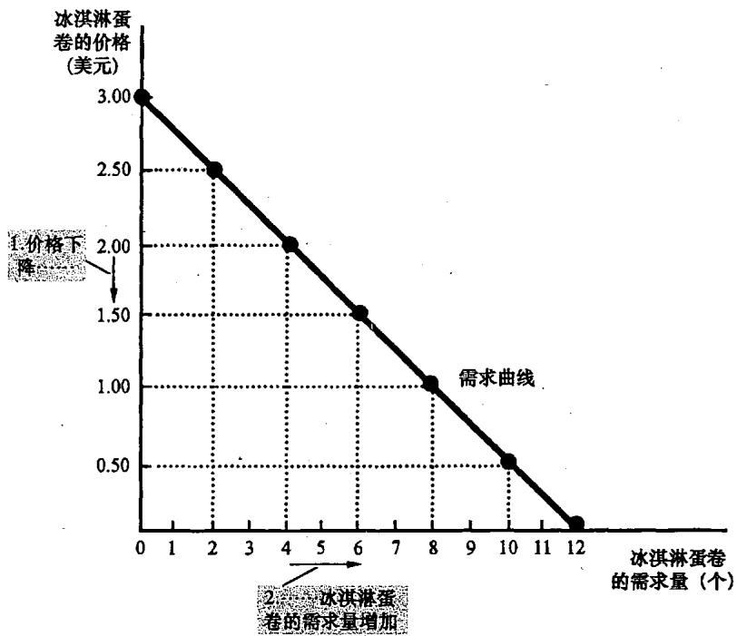

#### 4.2.2 市场需求与个人需求
市场需求是所有个人对某种特定物品或服务的需求的总和。我们将个人需求曲线**水平相加**得到市场需求曲线。由于我们要分析市场如何运行，所以我们将最经常使用市场需求曲线。

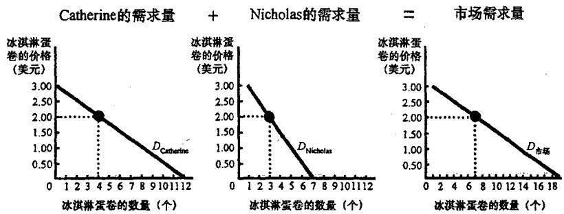

#### 4.2.3 需求曲线的移动
如果某种因素改变了任何一种既定价格水平下的需求量，需求曲线就会发生移动。
*   **收入**：如果收入增加引起需求增加，则为**正常物品（normal good）**；如果收入增加引起需求减少，则为**低档物品（inferior good）**。
*   **相关物品的价格**：当一种物品价格下降引起另一种物品需求减少时，二者互为**替代品（substitutes）**（如冷冻酸奶与冰淇淋）；当一种物品价格下降引起另一种物品需求增加时，二者互为**互补品（complements）**（如汽油与汽车）。
*   **爱好、预期、买者的数量**：这些因素的变动也会导致需求曲线整体的左右移动。

**重要提示：价格的变动表现为沿着需求曲线的变动，而其他变量（收入、偏好等）的变动将使需求曲线移动。**

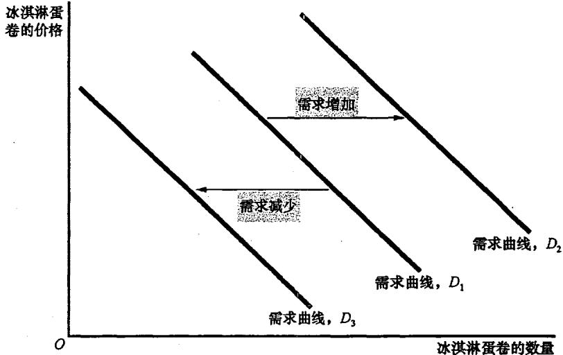

### 4.3 供给

现在我们转向市场的另一方，考察卖者的行为。

#### 4.3.1 供给曲线：价格与供给量之间的关系
一种物品的**供给量（quantity supplied）**是卖者愿意并且能够出售的该种物品的数量。根据**供给定理（law of supply）**：**在其他条件不变时，一种物品价格上升，该物品供给量增加；价格下降，该物品供给量减少**。图 4-5 展示了供给表与向右上方倾斜的供给曲线。

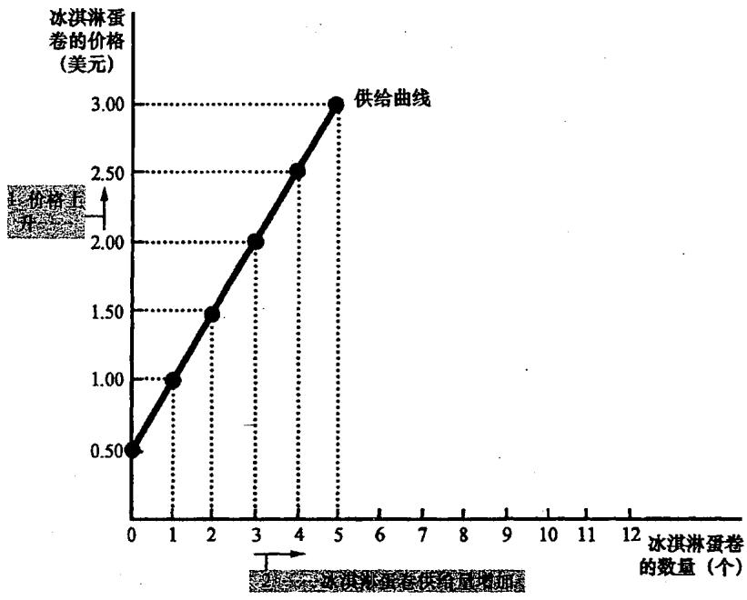

#### 4.3.2 供给曲线的移动
使任何既定价格水平下卖者愿意生产的数量发生变动的因素都会导致曲线移动：
*   **投入品价格**：如糖的价格上升，冰淇淋利润降低，供给减少。
*   **技术**：技术进步降低成本，增加供给。
*   **预期、卖者的数量**：这些因素也会导致供给曲线的移动。

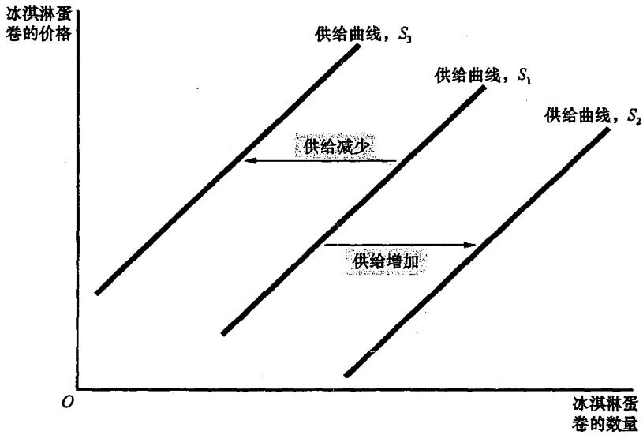

### 4.4 供给与需求的结合

#### 4.4.1 均衡
当供给曲线和需求曲线相交于一点时，市场达到了**均衡（equilibrium）**。
*   **均衡价格**：使供给与需求平衡的价格。
*   **均衡数量**：均衡价格下的供给量与需求量。

在均衡价格下，买者买到了想买的所有东西，卖者卖出了想卖的所有东西。如果价格高于均衡价格，会出现**过剩（surplus）**；如果低于均衡价格，会出现**短缺（shortage）**。市场力量会自发调整价格，使其回到均衡，这被称为**供求定理**。

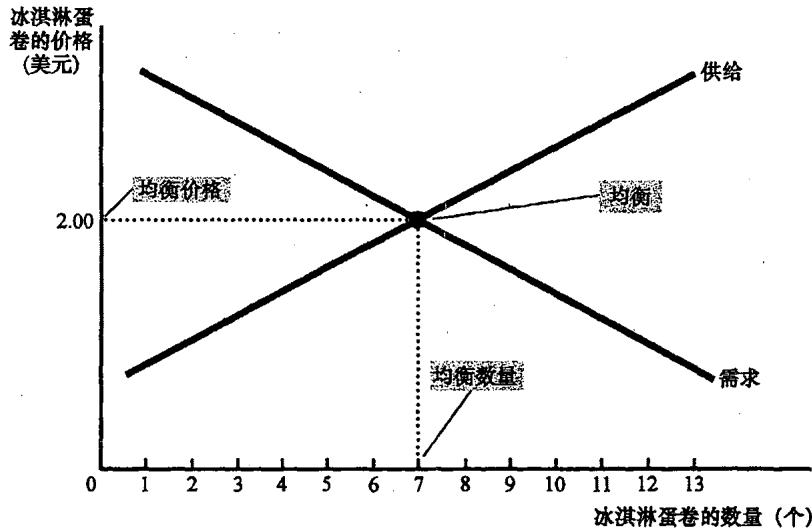

#### 4.4.2 分析均衡变动的三个步骤
1. 确定该事件是使供给曲线移动还是使需求曲线移动（或两者都移动）。
2. 确定曲线移动的方向。
3. 用供求图比较原来的均衡与新均衡。

---

## 第5章 弹性及其应用

第4章讨论了需求量变动的方向，但如果我们想知道需求量变动的大小，就需要引入**弹性（elasticity）**。

### 5.1 需求弹性

**需求价格弹性（price elasticity of demand）衡量需求量对价格变动的反应程度**。

#### 5.1.1 需求价格弹性的决定因素
*   **相近替代品的可获得性**：有相近替代品的物品需求往往较富有弹性（如黄油）。
*   **必需品与奢侈品**：必需品需求往往缺乏弹性，奢侈品需求往往富有弹性。
*   **市场的定义**：定义越窄（如香草冰淇淋），需求弹性越大。
*   **时间范围**：物品需求在长期内更富有弹性。

#### 5.1.2 中点法：计算弹性的更好方法
为了避免从A点到B点和从B点到A点计算结果不同的问题，经济学家使用**中点法**：
**弹性 = (数量变动百分比) / (价格变动百分比)**
其中百分比变动是用变动量除以原点与终点的中点值计算的。

#### 5.1.3 各种需求曲线
经济学家根据弹性大小将曲线分类：**富有弹性（弹性>1）**、**缺乏弹性（弹性<1）**、**单位弹性（弹性=1）**、**完全无弹性（弹性=0）**、**完全有弹性（弹性无限大）**。

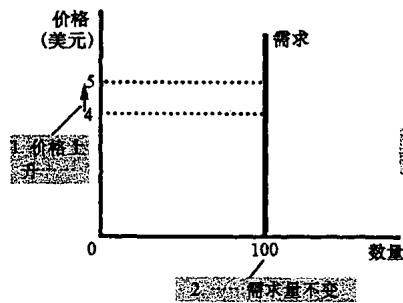
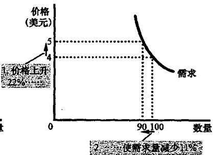

#### 5.1.4 总收益与需求价格弹性
**总收益（Total Revenue） = P × Q**。
*   **需求缺乏弹性时**：价格与总收益同方向变动。价格上升，总收益增加。
*   **需求富有弹性时**：价格与总收益反方向变动。价格上升，总收益减少。

### 5.2 供给弹性

**供给价格弹性（price elasticity of supply）衡量供给量对价格变动的反应程度**。其主要决定因素是**时间长短**。在长期中，企业可以建造新工厂或退出市场，因此供给在长期中比在短期中更富有弹性。

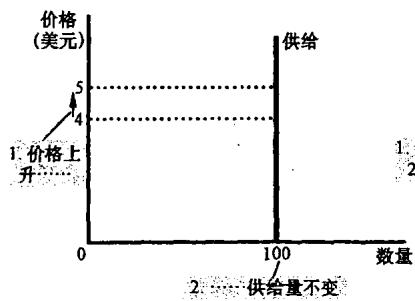

### 5.3 供给、需求和弹性的三个应用

1.  **农业的好消息可能对农民来说是坏消息**：技术进步使小麦产量增加（供给向右移），但由于小麦需求缺乏弹性，价格大幅下降导致农民总收益减少。
2.  **为什么OPEC不能保持石油高价格**：短期内石油供求缺乏弹性，减产能大幅提价；但长期内供求变得富有弹性，减产提价的策略难以持久。
3.  **禁毒的影响**：禁毒减少供给，提高价格。由于毒品需求缺乏弹性，吸毒者总支出增加，可能导致更多与毒品相关的抢劫犯罪。

---

## 第6章 供给、需求与政府政策

当决策者认为市场价格不公平时，会实施价格控制；当政府需要筹款时，会实施税收。

### 6.1 价格控制

#### 6.1.1 价格上限如何影响市场结果
**价格上限（price ceiling）是出售一种物品的法定最高价格**。
*   如果上限高于均衡价格，它是**非限制性的**，没有影响。
*   如果上限低于均衡价格，它是**限制性的**，会引起**短缺**。例如，**租金控制**在长期内会导致住房短缺、质量下降及地下交易。

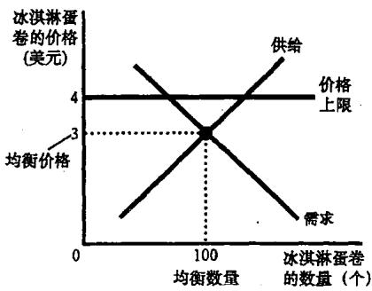
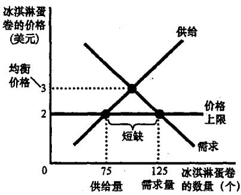

#### 6.1.2 价格下限如何影响市场结果
**价格下限（price floor）是出售一种物品的法定最低价格**。
*   如果下限高于均衡价格，它会引起**过剩**。最典型的例子是**最低工资法**，它提高了有工作者的收入，但也导致了低技能工人的失业。

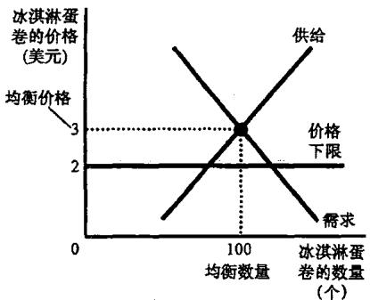

### 6.2 税收

**税收归宿（tax incidence）是指税收负担在市场参与者之间分配的方式。**

#### 6.2.1 向卖者或买者征税
无论是向卖者征税（供给曲线向上移动）还是向买者征税（需求曲线向下移动），其结果都是相同的：
1.  **税收抑制了市场活动**，新均衡时的销售量减少。
2.  **买者与卖者分摊了税收负担**。买者支付的价格高了，而卖者得到的价格低了。

#### 6.2.2 弹性与税收归宿
**税收负担更多地落在缺乏弹性的市场一方身上**。
*   如果供给富有弹性而需求缺乏弹性（如生活必需品），买者承担大部分负担。
*   如果供给缺乏弹性而需求富有弹性（如游艇），卖者承担大部分负担。

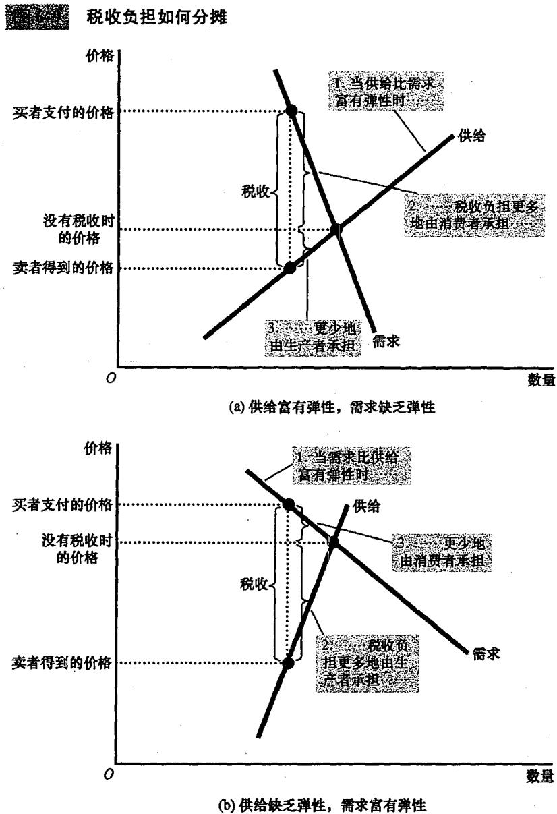

### 6.3 结论

本章分析了两种政府政策：价格控制与税收。**价格并不是某些偶然过程的结果，而是隐藏在供给与需求曲线背后的平衡。** 当政策模糊了这些信号时，资源的配置效率往往会受到损害。正如我们所看到的，看似为了保护买者的价格上限最终可能导致买者买不到东西；看似为了向富人征税的政策最终可能伤害了中产阶级工人。理解这些原理，是像经济学家一样思考的关键。