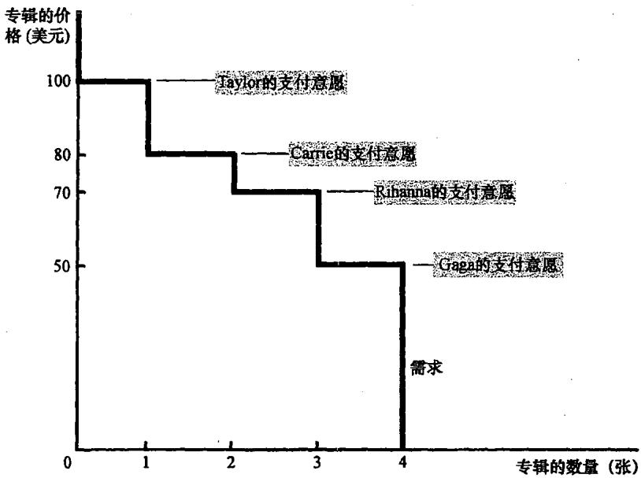
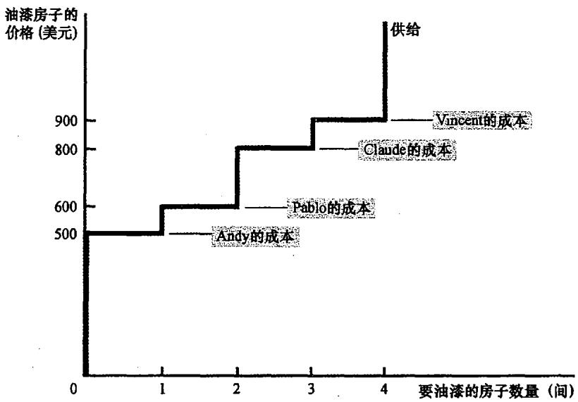
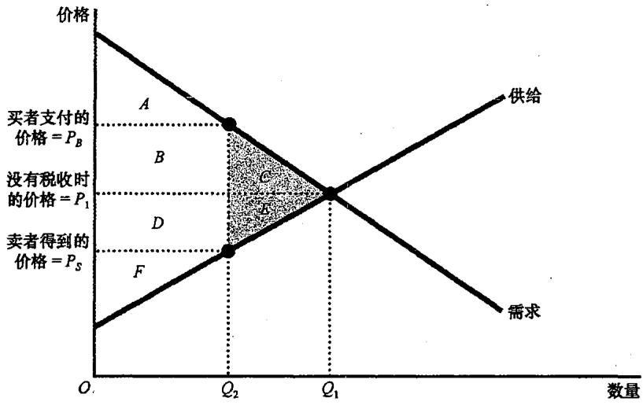
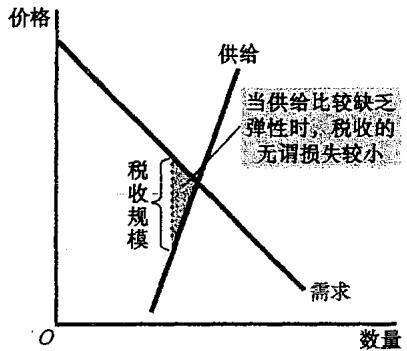
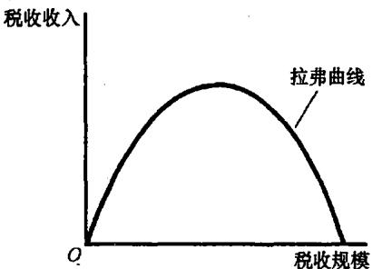
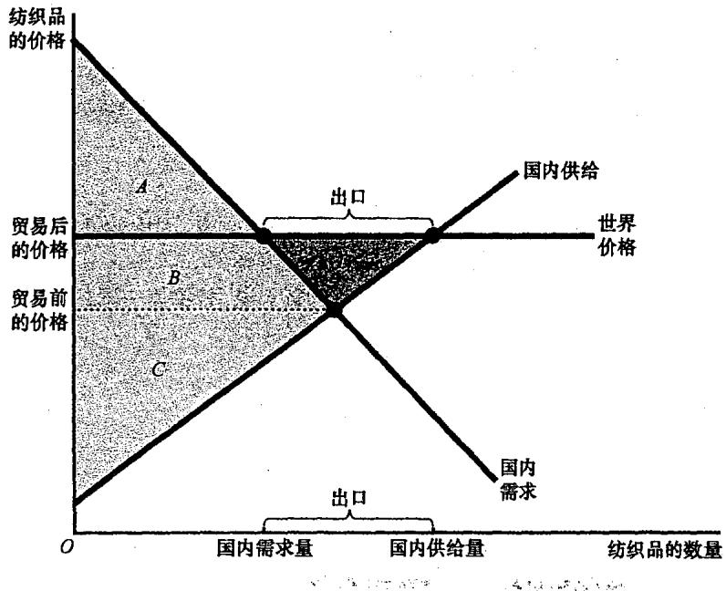
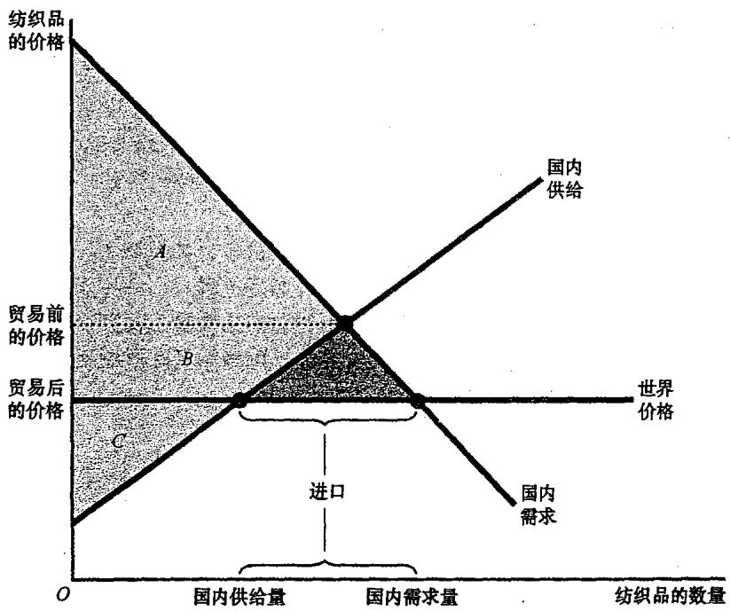
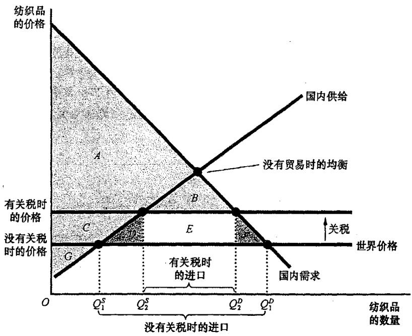

## 第7章 消费者、生产者与市场效率

当消费者到商店购买感恩节晚餐上用的火鸡时，他们可能会对火鸡的高价格感到失望。同时，当农民把饲养的火鸡送到市场时，他们可能希望火鸡的价格能再高一些。这种想法并不使人感到惊讶：买者总想少付些钱，而卖者总想多卖些钱。但是，从整个社会的角度看，存在一种火鸡的“正确价格”吗？

在前面各章中，我们描述了市场配置稀缺资源的方式，但那只是实证的分析（描述是什么）。现在，我们要转向规范的分析（探讨应该是什么）。我们要讨论**福利经济学（welfare economics）**，即研究资源配置如何影响经济福利的一门学问。

### 7.1 消费者剩余

我们从观察买者从参与市场中得到的利益开始。

#### 7.1.1 支付意愿
假设你有一张崭新的猫王首张专辑。四个猫王迷——Taylor、Carrie、Rihanna 和 Gaga 出现在你的拍卖会上。每个人愿意支付的最高价格称为**支付意愿（willingness to pay）**，它衡量买者对物品的评价。

**消费者剩余（consumer surplus）是买者愿意为一种物品支付的量减去其为此实际支付的量**。如果 Taylor 以 80 美元买到了她评价为 100 美元的专辑，她就得到了 20 美元的消费者剩余。这衡量了买者从参与市场中得到的利益。

#### 7.1.2 用需求曲线衡量消费者剩余
消费者剩余与需求曲线密切相关。在任何一种数量时，**需求曲线给出的价格表示边际买者的支付意愿**。

**重要结论：需求曲线以下和价格以上的面积衡量一个市场上的消费者剩余**。这是因为需求曲线的高度衡量买者对物品的评价，这种评价与市场价格之间的差额就是每个买者的消费者剩余。

#### 7.1.3 价格降低如何增加消费者剩余
当价格下降时，消费者剩余的增加由两部分组成：
1.  **原有买者的利益增加**：他们现在支付的钱少了。
2.  **新买者进入市场**：由于价格降低，一些原本不打算购买的人现在愿意购买并获得了剩余。

### 7.2 生产者剩余

现在我们转向卖者。

#### 7.2.1 成本与销售意愿
假设你要找人刷房子。四个油漆工竞价。**成本（cost）是卖者为了生产一种物品而必须放弃的所有东西的价值**（机会成本）。

**生产者剩余（producer surplus）是卖者得到的量减去其生产成本**。如果 Andy 的成本是 500 美元，而你支付给他 600 美元，他就得到了 100 美元的生产者剩余。这衡量了卖者从参与市场中得到的利益。

#### 7.2.2 用供给曲线衡量生产者剩余
正如消费者剩余对应需求曲线，生产者剩余也与供给曲线相关。在任何一种数量时，**供给曲线给出的价格表示边际卖者的成本**。

**重要结论：价格之下和供给曲线以上的面积衡量一个市场上的生产者剩余**。

### 7.3 市场效率

现在我们引入一个假设的角色：**仁慈的社会计划者**。他想使社会所有成员的经济福利最大化。

#### 7.3.1 衡量标准：总剩余
**总剩余 = 消费者剩余 + 生产者剩余 = 买者的评价 - 卖者的成本**。
如果资源配置使总剩余最大化，我们就说这种配置是**有效率（efficiency）**的。

#### 7.3.2 市场均衡的评价
自由市场的结果具有以下特征：
1.  **自由市场把物品的供给分配给对这些物品评价最高的买者**。
2.  **自由市场将物品的需求分配给能够以最低成本生产这些物品的卖者**。
3.  **自由市场生产出使消费者剩余和生产者剩余之和最大化的物品量**。

因此，**供求均衡使总剩余达到了最大化**。看不见的手引导着利己的买者与卖者，达到了社会福利的最优结果。

---

## 第8章 应用：税收的代价

税收是文明社会的代价，但这种代价往往超出了税单上的金额。

### 8.1 税收的无谓损失

当政府对一种物品征税时，该物品的销售量会下降。税收在买者支付的价格和卖者得到的价格之间打入了一个**楔子**。

#### 8.1.1 税收如何影响福利
税收引起了**无谓损失（deadweight loss）**：**市场扭曲（如税收）引起的总剩余减少**。
*   **消费者剩余减少**：因为买者支付的价格上升了。
*   **生产者剩余减少**：因为卖者得到的价格下降了。
*   **政府收入增加**：税收规模乘以销售量。

**关键点：买者和卖者因税收遭受的损失大于政府筹集到的收入。** 这种差额（三角形面积）就是无谓损失，它是因为税收阻止了某些互利的贸易（买者的评价高于卖者的成本，但低于含税价格）而产生的。

### 8.2 决定无谓损失的因素

什么决定了无谓损失的大小？答案是**供给和需求的价格弹性**。
*   **弹性越大，无谓损失越大**。因为弹性衡量了参与者对价格变动的反应程度。如果人们对价格变动非常敏感，税收就会导致销售量大幅缩减，从而产生巨大的无谓损失。

### 8.3 税收变动时的影响

随着税收规模的增大，无谓损失的增加速度比税收规模更快（呈平方关系）。
而**税收收入**则呈现出先增加后减少的趋势。这种关系被称为**拉弗曲线（Laffer curve）**。当税率极高时，市场规模缩减得如此严重，以至于降低税率反而可能增加税收收入。

---

## 第9章 应用：国际贸易

我们以假想的 Isoland 国纺织品市场为例，探讨开放贸易的影响。

### 9.1 决定贸易的因素

关键在于比较**国内价格**与**世界价格（world price）**。
*   如果国内价格低于世界价格，该国在生产该物品上具有**比较优势**，将成为**出口国**。
*   如果国内价格高于世界价格，外国在生产该物品上具有比较优势，该国将成为**进口国**。

### 9.2 贸易的赢家和输家

#### 9.2.1 出口国的得失
*   **国内生产者状况变好**（可以卖更高价格）。
*   **国内消费者状况变坏**（必须付更高价格）。
*   **总剩余增加**：生产者的收益超过了消费者的损失。

#### 9.2.2 进口国的得失
*   **国内消费者状况变好**（可以买更便宜的物品）。
*   **国内生产者状况变坏**（只能卖更低价格）。
*   **总剩余增加**：消费者的收益超过了生产者的损失。

### 9.3 关税的影响

**关税（tariff）是对进口物品征收的税**。
关税提高了进口物品的价格，使其接近于没有贸易时的价格。
*   **结果**：减少了进口量，增加了国内生产者的剩余，减少了国内消费者的剩余，并为政府筹集了收入。
*   **福利效应**：关税引起了**无谓损失**。它鼓励了国内高成本的生产（过度生产），并抑制了国内高评价的消费（消费不足）。

### 9.4 限制贸易的观点

尽管经济学家普遍支持自由贸易，但反对者常提出以下观点：
1.  **工作岗位论**：贸易消灭了国内岗位（反驳：贸易也创造了新岗位）。
2.  **国家安全论**：关键行业需保护以备战争。
3.  **幼稚产业论**：新产业需要暂时保护以成长。
4.  **不公平竞争论**：外国政府提供补贴。
5.  **作为讨价还价筹码的保护论**：威胁贸易伙伴以消除其壁垒。

### 9.5 结论

**比较优势原理说明，贸易可以使每个人的状况都变得更好**。虽然贸易创造了赢家和输家，但赢家的收益足以补偿输家的损失。然而，在现实政治中，输家（通常是组织严密的生产者）往往比赢家（通常是分散的消费者）更有影响力，这解释了为什么贸易壁垒依然存在。