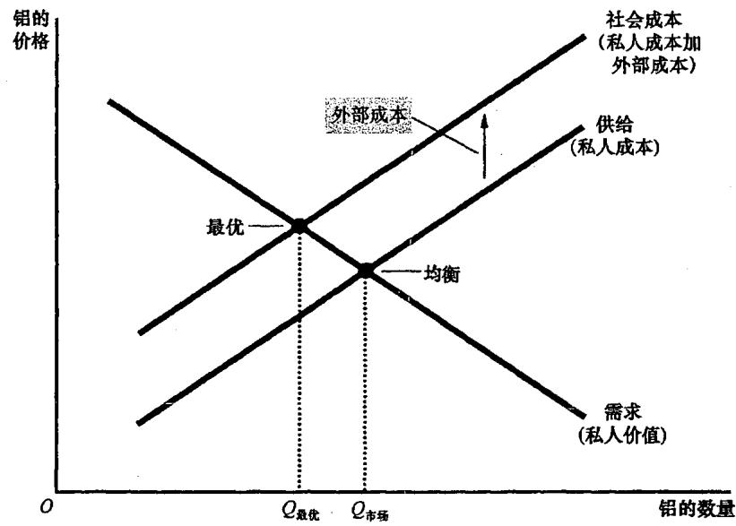
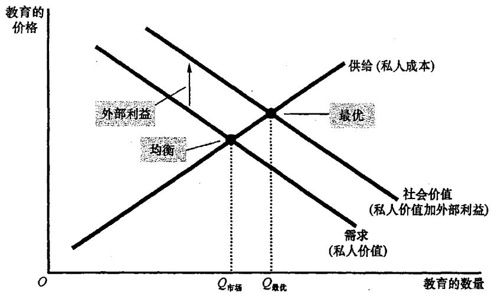
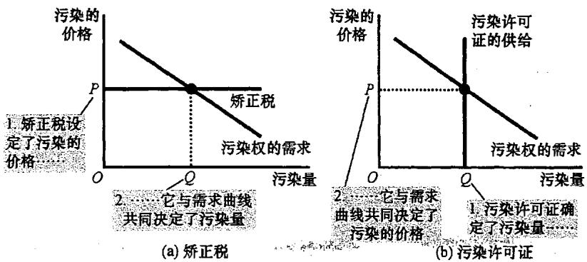
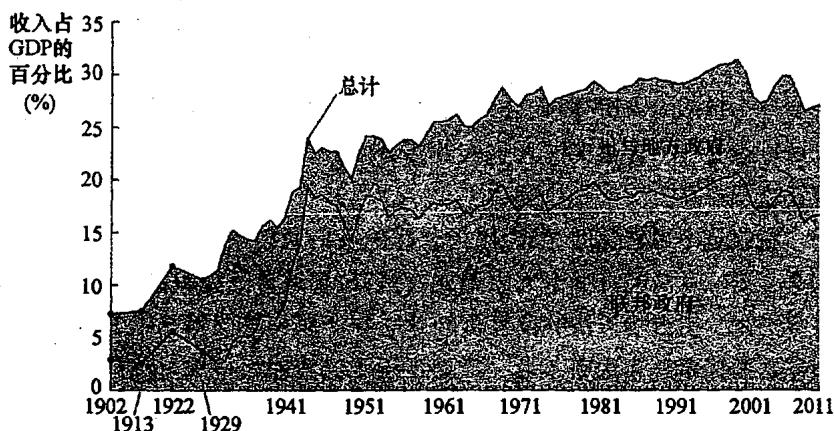

## 第10章 外部性

制造并销售纸张的企业也在生产过程中产生了副产品，这一物质在化学上被称为二噁英。科学家相信，一旦二噁英进入环境，就会增加人们患癌症、生出畸形儿以及出现其他健康问题的风险。生产并排放二噁英对社会是不是一个问题呢？

在前面的章节中，我们考察了市场如何用供求的力量配置稀缺资源，并说明了供求均衡一般是一种有效率的资源配置。但是，**市场中看不见的手并不能解决所有问题**。本章中，我们将研究政府行为如何改善市场结果。这种市场失灵属于被称为**外部性（externality）**的一般范畴。

### 10.1 外部性和市场无效率

**当一个人从事一种影响旁观者福利但对这种影响既不付报酬又不得报酬的活动时，就产生了外部性**。如果对旁观者的影响是不利的，就称为**负外部性**；如果这种影响是有利的，就称为**正外部性**。

#### 10.1.1 负外部性
以铝工厂排放污染为例。由于这种烟尘可能损害那些呼吸空气的人的健康，因此它产生了负外部性。由于存在这种外部性，**生产铝对于社会的成本大于对于铝生产者的成本**。每生产一单位铝，**社会成本**都包括铝生产者的私人成本加上受到污染不利影响的旁观者的成本。

如上图所示，社会成本曲线在供给曲线之上。**最优产量 $Q_{最优}$ 小于市场均衡数量 $Q_{市场}$**。为了使市场达到最优，政府可以对生产者征税。这种税的运用被称为**外部性内在化（internalizing the externality）**，因为它激励市场买者与卖者考虑其行为的外部影响。

#### 10.1.2 正外部性
虽然一些活动给第三方带来了成本，但也有一些活动带来了利益。例如**教育**。受教育更多的人可以促进技术进步，这给每个人都带来更高的生产率。在这种情况下，**物品的社会价值大于其私人价值**。

如上图所示，社会价值曲线在需求曲线之上。**社会最优量大于私人市场决定的数量**。为了纠正这种市场失灵，政府可以通过**补贴**来使外部性内在化。

### 10.2 针对外部性的公共政策

政府通常可以通过两种方式做出反应：**命令与控制政策**直接对行为进行管制；**以市场为基础的政策**提供激励。

#### 10.2.1 矫正税与补贴
用于纠正负外部性影响的税收被称为**矫正税（corrective taxes）**，也叫**庇古税**。经济学家对矫正税的偏爱通常大于管制，因为**税收可以以较低的社会成本减少污染**。税收激励工厂去开发更环保的技术，因为这能减少它们不得不支付的税收量。

#### 10.2.2 可交易的污染许可证
如果政府允许企业之间交易污染权，就创造了一种新的稀缺资源：**污染许可证**。看不见的手将保证这种新市场有效地配置污染权。**矫正税和污染许可证在本质上是相似的**：它们都通过使企业为其污染付出代价而把外部性内在化。

### 10.3 外部性的私人解决方法

虽然外部性往往引起市场无效率，但解决这个问题并不总是需要政府行为。

#### 10.3.1 科斯定理
根据**科斯定理（Coase theorem）**：**如果私人各方可以无成本地就资源配置进行协商，那么私人市场就总能解决外部性问题，并有效地配置资源**。无论最初的权利如何分配，有关各方总可以达成一种协议，使每个人的状况都变好。

然而，在现实中，私人解决方法并不总是有效。原因包括：
1.  **交易成本（transaction costs）**：各方在达成协议过程中发生的成本，如律师费。
2.  **谈判破裂**：各方往往为了争取更好的交易而僵持。
3.  **利益各方人数众多**：协调成千上万人的代价过于高昂。

---

## 第11章 公共物品和公共资源

一首老歌吟唱着：“生活中最美好的东西都是免费的。”当一种物品可以免费得到时，正常情况下配置资源的市场力量就不存在了。

### 11.1 不同类型的物品

我们可以根据两个特点对物品进行分类：
*   **排他性（excludability）**：可以阻止人们使用该物品吗？
*   **消费中的竞争性（rivalry in consumption）**：一个人使用该物品会减少其他人对它的使用吗？

根据这两个特点，我们可以将物品分为四类：
1.  **私人物品**：既有排他性又有竞争性（如冰淇淋）。
2.  **公共物品**：既无排他性又无竞争性（如国防）。
3.  **公共资源**：有竞争性但无排他性（如海洋中的鱼）。
4.  **俱乐部物品**：有排他性但无竞争性（如有线电视）。

### 11.2 公共物品

由于公共物品没有排他性，这就产生了**搭便车者（free rider）**问题。搭便车者是指得到一种物品的收益但没有为此付费的人。

由于人们有搭便车的激励，私人市场往往无法提供公共物品。**政府可以解决这个问题**：如果政府确信一种公共物品的总收益大于总成本，它就可以提供该物品，并用税收收入对其进行支付。一些重要的公共物品包括**国防、基础研究和反贫困计划**。

政府在决定是否提供公共物品时，必须进行**成本—收益分析（cost-benefit analysis）**。但这非常困难，因为没有价格信号可以参考，受访者往往有夸大收益或成本的激励。

### 11.3 公共资源

公共资源在消费中有竞争性，但没有排他性。这引出了一个经典寓言：**公地悲剧（Tragedy of the Commons）**。

当一个人使用公共资源时，他就减少了其他人对这种资源的享用。由于这种负外部性，**公共资源往往被过度使用**。政府可以通过管制、征税或将公共资源变为私人物品（如圈地）来解决这个问题。重要的公共资源包括**清洁的空气和水、拥挤的道路以及野生动物**。

---

## 第12章 税制的设计

“在这个世界上除了死亡和税收以外，没有什么事情是确定无疑的。”税收是不可避免的，因为我们需要政府提供公共服务。

### 12.1 美国政府的财政概况

随着经济增长，政府从税收中得到的收入增长得更快。
*   **联邦政府**：最大的收入来源是**个人所得税**和**工薪税**（社会保险税）。
*   **州与地方政府**：最重要的两类税是**销售税**和**财产税**。

### 12.2 税收和效率

设计良好的税收政策旨在使成本最小化。税收除了直接的货币转移外，还引起了两种成本：
1.  **无谓损失**：税收扭曲了激励，导致资源配置背离最优水平。例如，对利息征税会抑制储蓄。
2.  **管理负担**：纳税人为遵从税法而花费的时间和金钱（如雇用会计师）。

在讨论效率时，我们区分两个概念：
*   **平均税率**：支付的总税收除以总收入。
*   **边际税率**：增加1美元收入所支付的额外税收。**边际税率决定了税收对工作的激励有多大的扭曲**。

### 12.3 税收与平等

如何公平地分配税收负担？主要有两个原则：
1.  **受益原则**：人们应该根据他们从政府服务中得到的收益来纳税（如汽油税用于修路）。
2.  **支付能力原则**：应该根据一个人所能承受的负担来对其征税。这引出了：
    *   **纵向平等**：支付能力更强的人应多纳税。这包括**比例税、累退税和累进税**。
    *   **横向平等**：有相似支付能力的人应缴纳等量税收。

**税收归宿（tax incidence）**是评价平等的关键。正如我们之前所学，承担税收负担的人并不总是拿到税单的人。例如，公司所得税最终往往由工人和顾客承担。

### 12.4 结论

在设计税制时，决策者面临**效率与平等之间的权衡取舍**。许多关于税收政策的争论，其根源在于人们对这两个目标的侧重不同。理解这些原理，能帮助我们更好地评价政府如何筹集并使用公共资金。