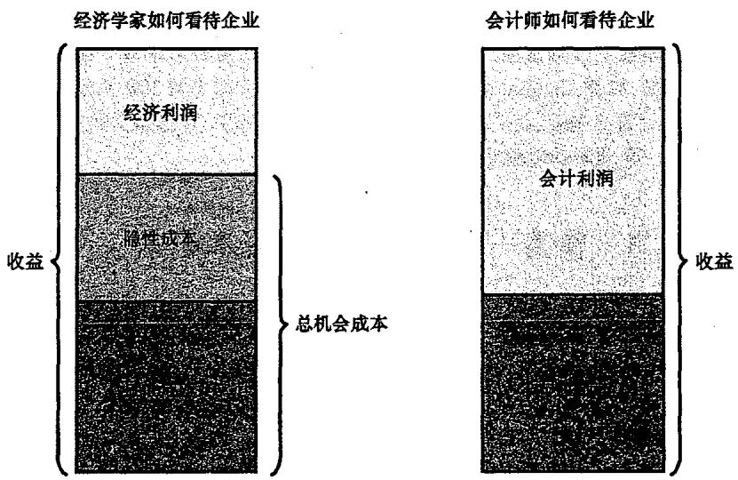
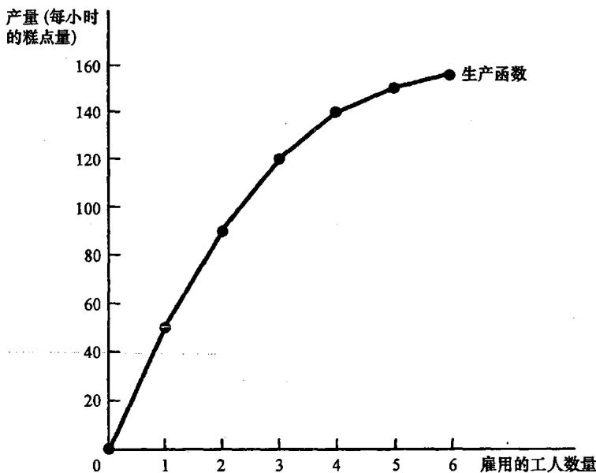
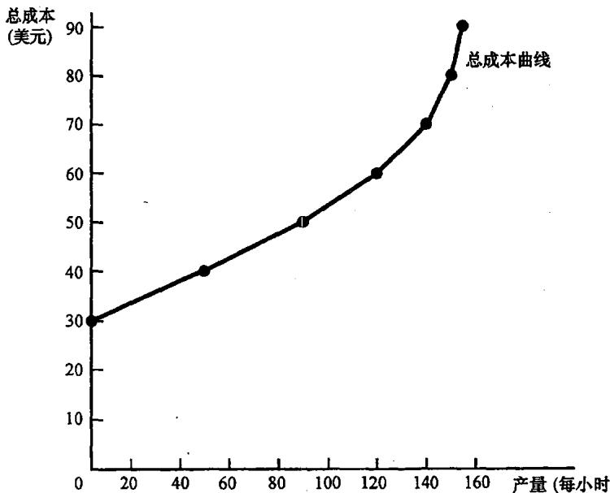
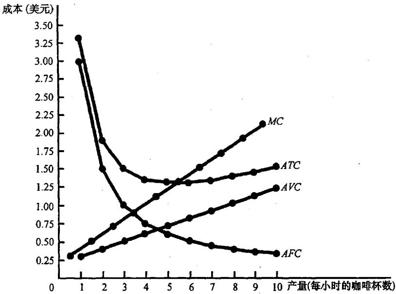
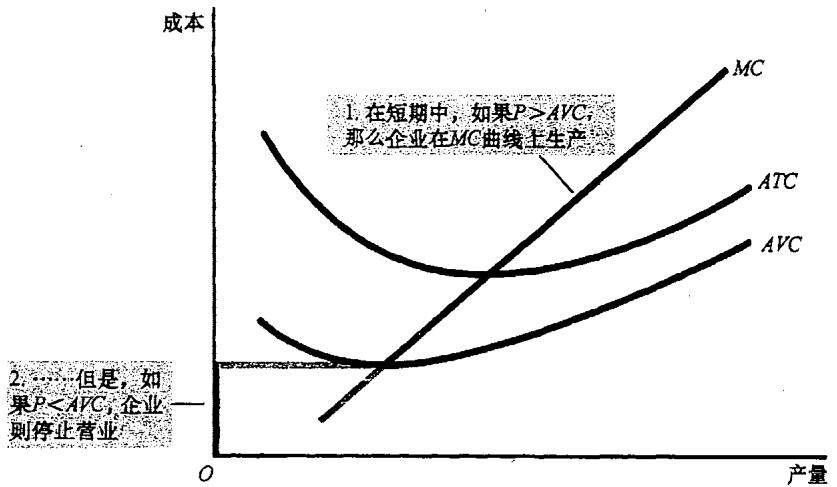
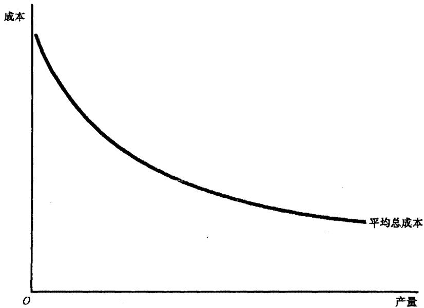
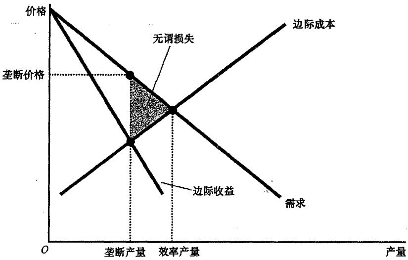
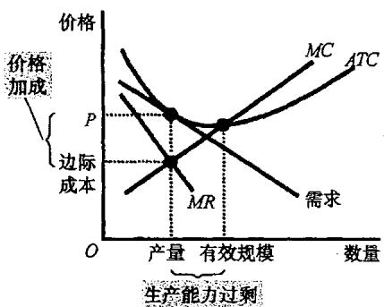
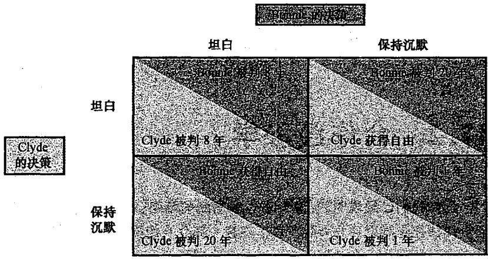

## 第13章 生产成本

在我们的经济中，存在着成千上万生产物品与服务的企业。一些企业规模宏大，如通用汽车或波音公司，它们雇用成千上万的员工；另一些则是街角的小咖啡店。尽管它们规模迥异，但都面临着一个共同的约束：**生产成本**。

### 13.1 什么是成本？

我们从 Caroline 的糕点厂开始。Caroline 经营企业的主要目标通常被假设为**利润最大化**。

#### 13.1.1 总收益、总成本和利润
*   **总收益**：企业出售其产品所得到的货币量。
*   **总成本**：企业用于生产的投入品的市场价值。
*   **利润** = 总收益 - 总成本。

#### 13.1.2 作为机会成本的成本
经济学家在衡量成本时，包含了所有**机会成本**。
*   **显性成本（Explicit costs）**：需要企业支出货币的投入成本（如面粉的货款、工人的工资）。
*   **隐性成本（Implicit costs）**：不需要企业支出货币的投入成本。例如，Caroline 如果不经营糕点厂，去当程序员每小时能赚 100 美元，这 100 美元就是隐性成本。

**会计师与经济学家的区别**：会计师只关注显性成本，而经济学家关注所有机会成本。因此，**经济利润（总收益减去显性和隐性成本）**通常小于**会计利润（总收益仅减去显性成本）**。

### 13.2 生产与成本

企业的成本反映了其生产过程。

#### 13.2.1 生产函数
**生产函数（Production function）**描述了投入量（如工人）与产量（如糕点）之间的关系。
*   **劳动的边际产量（MPL）**：增加一单位劳动所引起的产量增加。
*   **边际产量递减**：随着工人数量增加，每个新增工人带来的额外产量在减少。这在图形上表现为生产函数越来越平坦。

#### 13.2.2 从生产函数到总成本曲线
由于边际产量递减，为了多生产产品就需要投入更多劳动，因此**总成本曲线随着产量增加而变得越来越陡峭**。

### 13.3 成本的各种衡量指标

我们以 Conrad 的咖啡店为例，拆解成本结构：
*   **固定成本（FC）**：不随产量变动（如租金）。
*   **可变成本（VC）**：随产量变动（如咖啡豆、原材料）。
*   **平均总成本（ATC）** = 总成本 / 产量。
*   **边际成本（MC）** = 总成本变动量 / 产量变动量。

**成本曲线的形状特征**：
1.  **边际成本（MC）最终随产量增加而上升**。
2.  **平均总成本（ATC）曲线是 U 形的**。其最低点被称为**有效规模**。
3.  **边际成本曲线与平均总成本曲线相交于 ATC 的最低点**。

### 13.4 短期成本与长期成本

在长期中，所有成本都是可变的。企业可以调整工厂规模。
*   **规模经济**：长期 ATC 随产量增加而减少。
*   **规模不经济**：长期 ATC 随产量增加而增加。
*   **规模收益不变**：长期 ATC 不随产量变动。

---

## 第14章 竞争市场上的企业

什么是**竞争市场**？它意味着买卖双方人数众多，产品基本相同，且每个人都是**价格接受者**。

### 14.1 竞争企业的收益

对于竞争企业，**边际收益（MR）等于物品的价格（P）**。

### 14.2 利润最大化与供给曲线

企业通过生产 **MR = MC** 的产量来实现利润最大化。
*   由于 MR = P，竞争企业选择产量使 **P = MC**。
*   因此，**企业的边际成本曲线就是其供给曲线**。

#### 14.2.1 停止营业与退出
*   **短期停止营业**：如果 **P < AVC**（平均可变成本），企业暂时停产。此时固定成本是**沉没成本**。
*   **长期退出市场**：如果 **P < ATC**，企业永久离开行业。

### 14.3 竞争市场的长期均衡

在存在自由进入与退出的市场上，利润会驱动新企业进入，亏损会驱动老企业退出。
*   **长期均衡时，企业赚取零经济利润**。
*   此时 **P = ATC 且 P = MC**。这意味着企业在**有效规模**（ATC 最低点）处生产。

---

## 第15章 垄断

如果一个企业是其产品唯一的卖者，且产品没有相近替代品，它就是**垄断企业（Monopoly）**。

### 15.1 产生原因：进入壁垒
1.  **垄断资源**：如 DeBeers 控制钻石矿。
2.  **政府创造的垄断**：如专利法和版权法。
3.  **自然垄断**：一个企业能以低于多个企业的成本供给整个市场（如自来水）。

### 15.2 垄断定价与利润最大化

垄断者面临向右下方倾斜的需求曲线。因此，**边际收益（MR）总是小于价格（P）**。
*   利润最大化：生产 **MR = MC** 的产量，并根据需求曲线确定最高价格。
*   **结果：P > MR = MC**。

### 15.3 垄断的福利代价

由于垄断价格高于边际成本，导致产量低于社会最优水平，从而产生**无谓损失**。垄断企业就像一个“私人收税者”。

### 15.4 价格歧视

**价格歧视（Price discrimination）**是指以不同价格向不同顾客出售同一种物品。
*   **完全价格歧视**可以消除无谓损失，但所有剩余都归生产者所有。
*   现实例子：电影票学生价、折扣券、财务援助。

---

## 第16章 垄断竞争

**垄断竞争**描述了具有许多卖者、产品有差异且自由进入的市场（如小说、快餐）。

### 16.1 短期与长期均衡
*   **短期**：垄断竞争企业像垄断者一样定价，可能有利润或亏损。
*   **长期**：新企业进入或退出使利润趋于零。需求曲线与 ATC 曲线相切。

### 16.2 垄断竞争与完全竞争的区别
1.  **生产能力过剩**：垄断竞争企业在 ATC 向下倾斜部分生产，产量低于有效规模。
2.  **价格加成**：价格高于边际成本（P > MC）。

### 16.3 广告与品牌
由于价格高于边际成本，企业有强烈的激励通过**广告**吸引顾客。关于广告的争论在于：它是提供了有用的信息，还是仅仅操纵了消费者的偏好？

---

## 第17章 寡头

**寡头（Oligopoly）** 是只有少数几个卖者的市场。

### 17.1 勾结与纳什均衡
*   **勾结与卡特尔**：如果寡头联合起来，它们可以像垄断者一样行动。
*   **利己的诱惑**：每个成员都有违约多生产的激励。
*   **纳什均衡**：相互作用的经济主体在假定他人策略为既定时，选择自己的最优策略。

### 17.2 囚徒困境

**囚徒困境**说明了为什么即使合作对双方都有利，保持合作也是困难的。

*   **占优策略**：无论对方如何选择，对一方都最优的策略。在博弈中，利己会导致两人都“坦白”，陷入较差的结果。
*   寡头在产量博弈中也面临同样的困境。只有在**多次博弈**中，通过“一报还一报”等策略，合作才可能维持。

### 17.3 针对寡头的公共政策

政府使用**反托拉斯法**（如《谢尔曼法》）来阻止企业限制竞争。
*   **争议点**：转售价格维持、掠夺性定价和搭售。有些看似反竞争的行为实际上可能有合理的商业目的。

通过对这五章的学习，我们揭示了企业在不同市场环境下的生存法则：从成本的精算，到竞争与垄断的博弈，再到博弈论在策略选择中的应用。这构成了现代微观经济学的核心支柱。