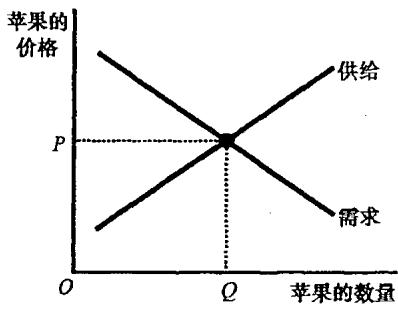
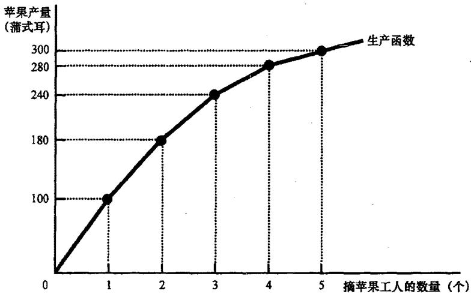
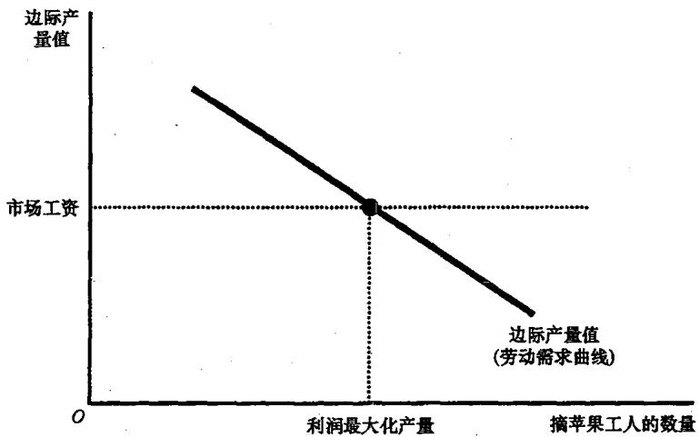
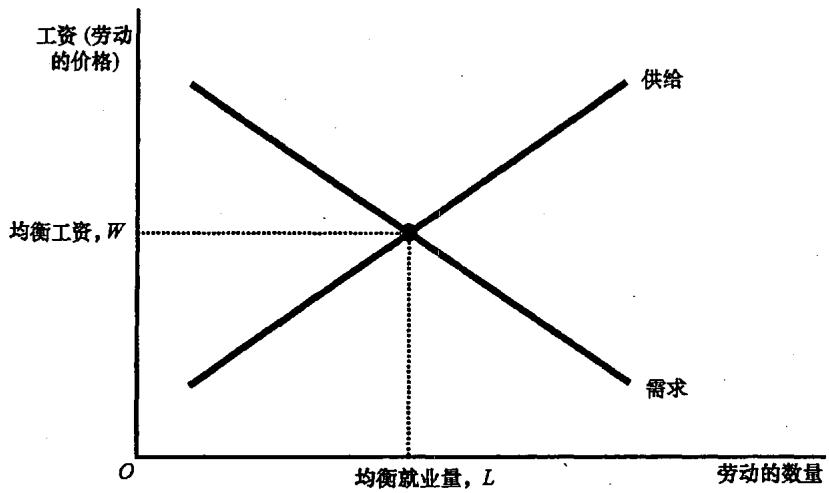
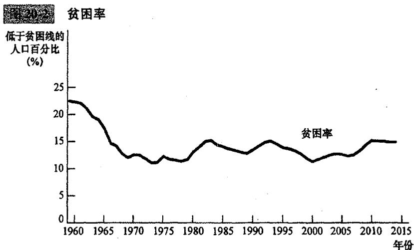

## 第18章 生产要素市场

当你毕业后，你的收入将主要取决于你所从事工作的类型。如果你成为一名电脑程序员，你将比成为一名加油站服务员赚得更多。这个事实并不让人吃惊，但其中的原因却并非显而易见。并没有哪一条法律规定电脑程序员的工资要比加油站服务员高，也没有哪一条道德规范认为程序员应该报酬更高。那么，是什么决定了不同工作的报酬呢？

这就涉及到了**生产要素市场**。**生产要素（factors of production）**是指用于生产物品与服务的投入。劳动、土地和资本是三种最重要的生产要素。在许多方面，要素市场类似于我们在前几章中分析的物品与服务市场，但两者在一个重要的方面有所不同：**生产要素的需求是派生需求**。也就是说，企业的生产要素需求是从它向另一个市场供给物品的决策派生出来的。

### 18.1 对劳动的需求

与经济中的其他市场一样，劳动市场也是由供求力量支配的。

#### 18.1.1 竞争的、以利润最大化为目标的企业
我们观察一个典型的苹果生产商。我们假设该企业在苹果市场和摘苹果工人市场上都是**竞争性**的，即它是**价格接受者**。同时，它是追求**利润最大化**的。

#### 18.1.2 生产函数与劳动的边际产量
为了做出雇佣决策，企业必须考虑工人数量如何影响产量。**生产函数（production function）**描述了这种关系。
*   **劳动的边际产量（marginal product of labor, MPL）**：增加一单位劳动所引起的产量增加量。
*   **边际产量递减**：随着工人数量增加，劳动的边际产量递减。反映在图形上，生产函数随着工人增加而变得越来越平坦。

#### 18.1.3 边际产量值和劳动需求
企业关心的是利润。为了确定工人对收益的贡献，我们需要**边际产量值（value of the marginal product）**，即该投入的边际产量乘以产品的市场价格。
**一个竞争性的、利润最大化企业雇用的工人数要达到使劳动的边际产量值等于工资的那一点。** 因此，边际产量值曲线也就是企业的**劳动需求曲线**。

### 18.2 对劳动的供给

劳动供给产生于工人对**工作与闲暇之间的权衡取舍**。
*   **机会成本**：享受一小时闲暇的代价就是放弃一小时的工资。
*   **劳动供给曲线**：反映了工人如何根据这一机会成本的变动做出决策。虽然曲线通常向右上方倾斜，但在某些情况下也可能向后弯曲（收入效应大于替代效应）。

### 18.3 劳动市场的均衡

工资会自发调整，使劳动的供求达到平衡。在均衡时，**工资必然等于劳动的边际产量值**。
*   **劳动供给移动**：例如移民涌入。这会增加供给，导致工资下降，但就业量增加。
*   **劳动需求移动**：例如苹果价格上升。这会增加边际产量值，导致工资上升，就业量也增加。

---

## 第19章 收入与歧视

为什么不同工作的报酬差距如此巨大？除了边际生产率之外，还有许多微妙的因素在起作用。

### 19.1 决定均衡工资的若干因素

#### 19.1.1 补偿性工资差别
**补偿性工资差别（compensating differential）**是指为抵消不同工作的非货币特性而产生的工资差别。例如，煤矿工人或夜班工人的工资通常较高，以补偿危险的环境或不社交的生活方式。

#### 19.1.2 人力资本
**人力资本（human capital）**是对人的投资的积累，最重要的是**教育**。受教育程度高的工人生产率更高，因此需求更大，工资也更高。近年来，由于国际贸易和技能偏向型的技术变革，**熟练工人与非熟练工人之间的收入差距一直在扩大**。

#### 19.1.3 能力、努力和机遇
有些因素是难以衡量的。天生的才能、工作的勤奋程度以及纯粹的运气都在工资决定中起着重要作用。

#### 19.1.4 教育的另一种观点：信号
**信号理论**认为，教育并不一定提高了生产率，而是向雇主发出了工人是“高能力”的信号。这种观点与人力资本理论对政策的含义完全不同。

#### 19.1.5 超级明星现象
在某些市场上（如演艺、体育），**最优生产者可以以低成本向每位顾客提供物品**（如通过电影或直播），这导致了极少数人赚取天文数字般的收入。

#### 19.1.6 高于均衡水平的工资
由于**最低工资法、工会的市场势力以及效率工资**，工资有时会高于均衡水平，这往往会导致失业。

### 19.2 歧视经济学

当市场向那些仅仅是种族、性别等特征不同的相似个人提供不同机会时，就出现了**歧视**。

*   **衡量困难**：不同群体间的工资差别并不完全等同于歧视，因为还存在人力资本和工作特性的差异。
*   **雇主歧视与利润动机**：在竞争市场上，**只关心利润的企业有消除歧视的激励**。因为雇用被歧视群体（工资较低）的企业具有成本优势，最终会取代歧视性企业。
*   **持续歧视的原因**：如果**顾客有歧视性偏好**或者**政府强制实行歧视（如种族隔离法）**，那么竞争市场也无法消除工资差别。

---

## 第20章 收入不平等与贫困

### 20.1 对不平等的衡量

*   **美国的不平等**：自 1970 年代以来，美国的收入分配变得更加不平等。最富的 5% 家庭拥有的收入份额显著增加。
*   **贫困率（poverty rate）**：家庭收入低于**贫困线**的人口百分比。贫困与种族、年龄和家庭结构（特别是单身母亲）密切相关。

#### 衡量中的问题：
1.  **实物转移支付**：标准统计不包括食品券等非现金补助。
2.  **生命周期**：年轻时穷、中年时富是正常模式，不代表真正的永久不平等。
3.  **暂时收入与持久收入**：持久收入的分配比年度收入更平等。

### 20.2 收入再分配的政治哲学

对于政府应该做什么，存在三大流派：
1.  **功利主义（Utilitarianism）**：目标是使社会总效用最大化。支持再分配，但担心扭曲激励会使“漏水的桶”流失太多水。
2.  **自由主义（Liberalism）**：罗尔斯提出“**无知之幕**”，主张**最大最小准则（maximin criterion）**，即政府应追求使社会上状况最差的人的福利最大化。
3.  **自由至上主义（Libertarianism）**：认为政府应保证过程的公平（如保护产权、机会均等），而不应干预自愿交易产生的结果。

### 20.3 减少贫困的政策

*   **最低工资法**：争议在于它可能增加失业。
*   **福利（Welfare）**：补贴穷人收入，但可能鼓励家庭破裂或非婚生育。
*   **负所得税**：向高收入征税，给低收入补贴。
*   **实物转移支付**：直接提供食物或医疗。
*   **工作激励问题**：当补助随收入增加而迅速减少时，穷人面临极高的**有效边际税率**，这可能陷入“贫困陷阱”。

### 20.4 结论

经济学十大原理告诉我们：**政府有时可以改善市场结果**，但**人们面临权衡取舍**。在试图平等地分割经济蛋糕时，往往会使蛋糕缩减。如何平衡平等与效率，是每个社会面临的终极难题。