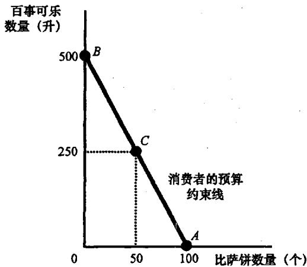
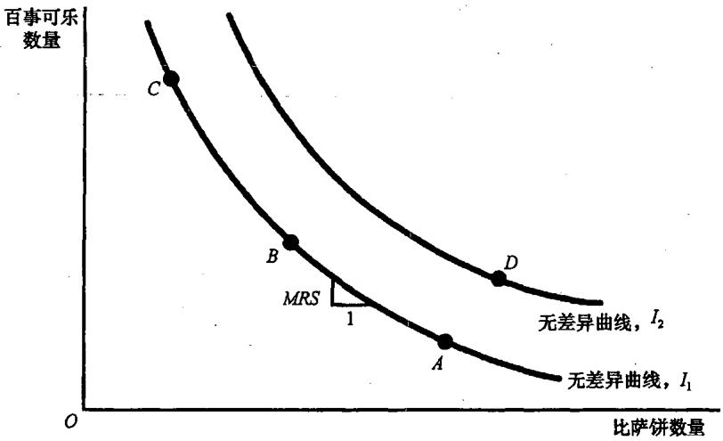
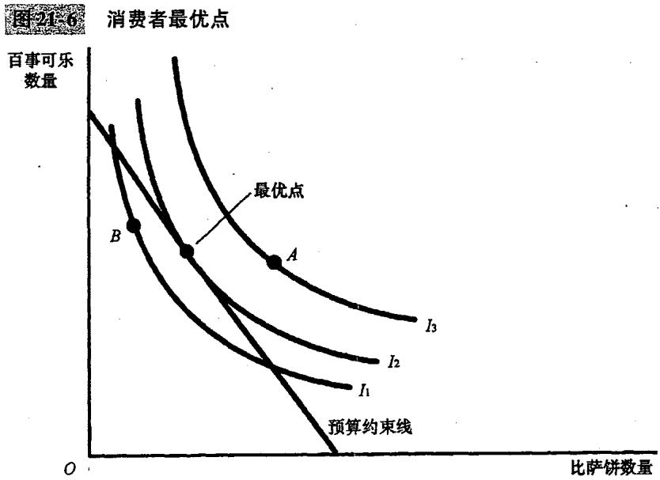
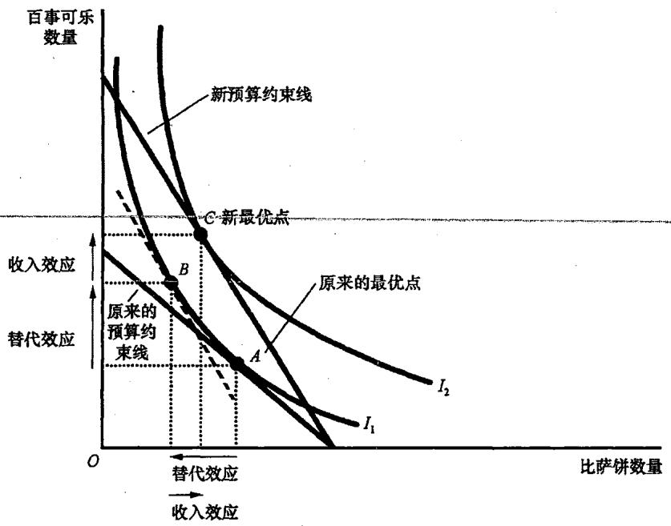
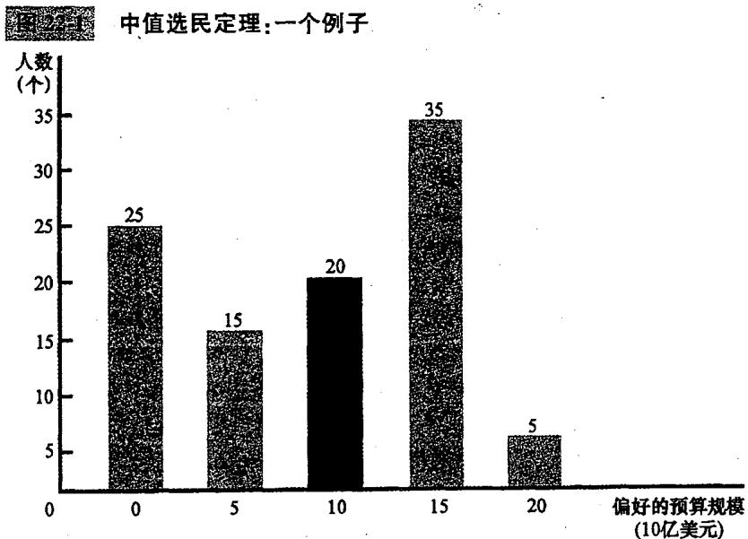

## 第21章 消费者选择理论

当你走进一家商店，面对琳琅满目的商品，你如何决定买什么？虽然我们通常用一条简单的向右下方倾斜的需求曲线来概括这种行为，但需求曲线背后的决策过程其实非常复杂。**消费者选择理论**正是要深入探讨这一过程。它不仅解释了我们如何分配有限的财力，还揭示了人类在面对权衡取舍时的深层逻辑。

### 21.1 预算约束：消费者能买得起什么

大多数人都希望提高自己的生活水平，但我们的消费受到收入的限制。为了简化分析，我们假设一个消费者只购买两种物品：**比萨饼**和**百事可乐**。

假设消费者的月收入为1000美元，比萨饼价格为10美元，百事可乐每升2美元。
*   如果全部买比萨饼，可以买100个。
*   如果全部买百事可乐，可以买500升。

连接这两个极端点的直线就是**预算约束线（budget constraint）**。它表示在收入和价格既定的情况下，消费者可以负担得起的消费组合。**预算约束线的斜率衡量了两种物品的相对价格**。在本例中，斜率为5，意味着在市场上1个比萨饼的代价是5升百事可乐。

### 21.2 偏好：消费者想要什么

预算约束线告诉我们消费者“能买得起”什么，而**无差异曲线（indifference curve）**则代表了消费者“想要”什么。无差异曲线表示给消费者带来**相同满足程度**的消费组合。

#### 21.2.1 无差异曲线的四个特征
1.  **消费者对较高无差异曲线的偏好大于较低的曲线**：更多通常比更少好。
2.  **无差异曲线向右下方倾斜**：为了保持满足程度不变，减少一种物品必须增加另一种。
3.  **无差异曲线不相交**：如果相交，将违背“偏好的一致性”。
4.  **无差异曲线凸向原点**：这反映了**边际替代率（MRS）**递减。人们更愿意放弃他们已经拥有较多数量的物品。

无差异曲线的形状取决于物品的性质。如果两种物品极其容易替代（如5美分和10美分硬币），曲线是直线，称为**完全替代品**；如果必须按固定比例使用（如左脚鞋和右脚鞋），曲线是直角形，称为**完全互补品**。

### 21.3 最优化：消费者选择什么

消费者最终会选择哪一点？答案是：**同时位于预算约束线和最高无差异曲线上的那一点**。

在这一点（最优点）上，**无差异曲线与预算约束线相切**。这意味着：
**边际替代率（MRS） = 相对价格**
此时，消费者对两种物品的评价（主观评价）正好等于市场对它们的评价（客观价格）。

#### 21.3.1 收入效应与替代效应
当一种物品的价格变动时，对消费者的影响可以分解为两种效应：
*   **收入效应（Income effect）**：价格下降使消费者感觉自己变富了，从而想购买更多的两种物品（假设它们是正常物品）。
*   **替代效应（Substitution effect）**：一种物品相对于另一种变得更便宜了，消费者倾向于用便宜的替代昂贵的。

### 21.4 三种应用

1.  **所有的需求曲线都向右下方倾斜吗？**
    理论上存在**吉芬物品（Giffen good）**，即价格上升反而需求量增加的物品。这是因为其收入效应（变穷了买不起肉，只能买更多主食）超过了替代效应。
2.  **工资如何影响劳动供给？**
    工资增加的替代效应鼓励多工作，但收入效应（变富了想享受闲暇）可能导致少工作。这就是**劳动供给曲线可能向后弯曲**的原因。
3.  **利率如何影响家庭储蓄？**
    高利率的替代效应鼓励多储蓄，但收入效应使你感觉未来更有保障，从而可能减少当下的储蓄。

---

## 第22章 微观经济学前沿

微观经济学并非停滞不前，它正通过吸收心理学、政治学和对信息的研究不断扩展边界。

### 22.1 不对称信息

在现实中，交易双方拥有的信息往往是不对称的。

*   **隐蔽性行为：道德风险（Moral Hazard）**
    当一个人（代理人）代表另一个人（委托人）办事，且委托人无法完全监督其行为时，代理人可能会不负责任。例如，有了全险的司机会开车更鲁莽。企业通过高工资或延期支付来减少工人的怠工。
*   **隐蔽性特征：逆向选择（Adverse Selection）**
    卖者对物品特征的了解比买者多。经典案例是**二手车市场（次品问题）**。高质量车主不愿低价卖，市场上留下的多是烂车，导致买者更加怀疑。
*   **应对机制**：
    *   **发信号（Signaling）**：有信息的一方披露信息（如昂贵的广告、大学学历）。
    *   **筛选（Screening）**：无信息的一方引诱对方披露信息（如保险公司提供不同免赔额的方案）。

### 22.2 政治经济学

运用经济学工具研究政府运作。

*   **康多塞投票悖论（Condorcet Paradox）**：多数原则并不能总是产生可传递的社会偏好。投票顺序往往决定了结果。
*   **阿罗不稳定性定理（Arrow's Impossibility Theorem）**：数学证明了**没有任何一种投票制度是完美的**，总会违背某些合意的特征（如独立性或非独裁）。
*   **中值选民定理（Median Voter Theorem）**：在多数原则下，政策往往会趋向于**中值选民**最偏好的点。这解释了为什么两党制的政党立场往往非常接近。

### 22.3 行为经济学

经济学假设人是理性的，但现实中的人是“智人”，而非“理性经济人”。

*   **人们并不总是理性的**：我们过分自信，过分重视细枝末节，且不愿改变既有观念。
*   **人们关注公正**：在“最后通牒博弈”中，人们宁愿一无所有也要拒绝不公平的分配。
*   **人们是前后不一致的**：我们今天制定的减肥计划，明天面对甜点时就会崩溃。**即时满足的欲望**往往战胜了长远利益。

### 22.4 结论

微观经济学前沿的研究告诉我们：**生活是杂乱的**。信息是不完全的，政府是不完善的，人也是不完美的。但这正是经济学的魅力所在——它不断修正自己的模型，以期更准确地理解和改善这个复杂的世界。

至此，我们完成了对微观经济学核心内容的探索。从供给需求的魔力，到市场结构的博弈，再到人类决策的深层心理。