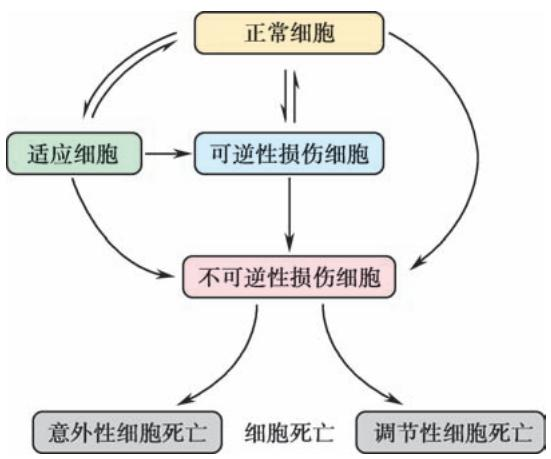

## 绪论 (Introduction)

## 1. 框架

*   **病理学的定义与任务**
    *   研究对象：病因、发病机制、病理变化、结局和转归
    *   学科属性：基础医学与临床医学的桥梁
*   **病理学在医学中的地位**
    *   医学教育：连接基础与临床
    *   医疗工作：提供“最后诊断” (Final Diagnosis)
    *   医学研究：基础研究、转化研究、新药评估
*   **病理学的研究对象和方法**
    *   人体病理学：尸体剖检、活体组织检查、细胞学检查
    *   实验病理学：动物实验、细胞/组织/类器官培养
*   **病理学的发展**
    *   器官病理学 -> 细胞病理学 -> 超微结构病理学 -> 分子病理学 -> 数字病理学/AI病理
*   **中国病理学史**
    *   古代记录与现代建立

## 2. 重要概念及解释（含英文术语）

*   **病理学 (Pathology)**: 研究和明确疾病的病因 (**etiology**)、发病机制 (**pathogenesis**)、病理变化 (**pathological change**)、结局和转归的医学学科。
*   **尸体剖检 (Autopsy)**: 对死者的遗体进行病理解剖和后续的病理学检查。
*   **活体组织检查 (Biopsy)**: 简称活检，即用局部切取、钳取、粗针穿刺和搔刮等手术方法，从活体内获取病变组织进行病理诊断。
*   **细胞学检查 (Cytology)**: 又称脱落细胞学检查，通过采集病变处的细胞，涂片染色后进行诊断。
*   **细针穿刺 (Fine Needle Aspiration, FNA)**: 通过细针穿刺病变部位采集细胞的方法。
*   **动物实验 (Animal Experiment)**: 运用动物实验的方法，在适宜动物身上复制出某些人类疾病的动物模型。
*   **类器官 (Organoid)**: 一种与体内的来源组织或器官高度相似的体外三维 (3D) 研究模型。
*   **器官病理学 (Organ Pathology)**: 认为不同的疾病都是由相应器官的病变引起的概念。
*   **细胞病理学 (Cytopathology)**: 应用光学显微镜来研究正常和病变细胞的形态变化。
*   **超微结构病理学 (Ultrastructural Pathology)**: 用电子显微镜技术观察病变细胞的超微结构变化。
*   **分子病理学 (Molecular Pathology)**: 通过分子手段检测人组织、器官和体液中的遗传与表观遗传改变。
*   **数字病理学 (Digital Pathology)**: 将病理学切片转化为全切片图像 (**Whole Slide Image, WSI**) 进行数据存储、阅片、教学和远程诊断。

## 3. 正文内容（含例子）

### 一、病理学的内容和任务
病理学内容丰富，分为**总论**和**各论**。
*   **总论**（第一至八章）：阐述不同疾病的共同规律与特征，如细胞适应与损伤、炎症、肿瘤等。
*   **各论**（第九至十八章）：解析不同器官疾病的特殊规律。例如，肝炎、肾炎、肺炎的基本病理改变均为**炎症**，但各有不同特征。
*   **其他内容**：探讨病因、发病机制、好发部位、结局和转归及其相应的临床病理联系。
*   **新技术**：第十九章介绍了组织化学、免疫组织化学、分子病理学、时空组学和人工智能等新技术。

### 二、病理学在医学中的地位
*   **医学教育中**：是基础医学和临床医学的**桥梁**。学习病理学需要解剖、组胚、生理、生化等基础，又是学习临床课程的基础。Sir William Osler 曾说：“**As is our pathology, so is our practice**”（病理学为医学之本）。
*   **医疗工作中**：**病理学诊断 (pathologic diagnosis)** 是最具可靠性和权威性的诊断之一，直接指导临床救治方案（用药、手术、放疗等）。尸体剖验是对死因最权威的终极回答。
*   **医学研究中**：是重要的基础研究领域和关键的转化研究阵地。生命科学研究进展需病理学验证；致病机制需建立病理学模型；药物临床试验效果评价离不开病理学诊断。

### 三、病理学的研究对象和方法
病理学分为**人体病理学**和**实验病理学**。

#### （一）人体病理学的研究对象和方法
1.  **尸体剖检 (Autopsy)**
    *   **作用**：确定诊断，查明死因；发现新疾病；积累病理材料；医疗事故鉴定。
    *   **现状**：我国尸检率不高且呈下降趋势，不利于医学发展。
2.  **活体组织检查 (Biopsy)**
    *   **意义**：及时准确诊断，指导治疗和判断预后；术中冷冻切片快速诊断；动态了解疗效；深入分子研究。
    *   **趋势**：不仅限于形态，更注重分子变化。
3.  **细胞学检查 (Cytology)**
    *   **来源**：脱落细胞（口腔、食管、生殖道等）、自然分泌物（痰、积液）、排泄物（尿）、FNA采集细胞。
    *   **特点**：设备简单，痛苦少，易接受，但可靠性不如活检。可用于普查、激素测定、分子诊断标本提供。

#### （二）实验病理学的研究对象和方法
1.  **动物实验 (Animal Experiment)**
    *   **优点**：可复制人类疾病模型，研究病因、发病、病理及转归；可进行人体无法做的研究（如致癌剂研究）。
    *   **缺点**：物种差异，结果仅参考，不能直接套用于人体。
2.  **细胞、组织和类器官培养**
    *   **应用**：研究因子作用下细胞病变发生发展、恶性转化、分子改变、药物影响等。
    *   **类器官 (Organoid)**：体外3D模型，高度相似来源组织，呈现细胞间相互作用和空间形态。
    *   **优缺点**：周期短、见效快、条件可控；但孤立体外环境与体内复杂环境不同，结果不能简单等同。

### 四、病理学的发展
*   **1761年**：Morgagni 提出**器官病理学 (organ pathology)**。
*   **19世纪中叶**：Virchow 创立**细胞病理学 (cytopathology)**。
*   **20世纪**：电子显微镜技术发展形成**超微结构病理学**。
*   **近几十年**：免疫学、分子生物学等进展推动形成**免疫病理学**、**分子病理学**、**遗传病理学**等新分支。
*   **现代**：
    *   **数字病理学 (Digital Pathology)**：基于全切片图像 (WSI)，实现远程诊断、会诊。
    *   **人工智能 (AI)**：2021年FDA批准首款AI辅助前列腺癌病理诊断软件，提高速度和准确率。
    *   **其他分支**：地理病理学、社会病理等。

### 五、中国病理学史
*   **古代**：《黄帝内经》记载最早人体解剖；《宋书》记载“剖腹得蛊”。
*   **近代**：1901年光绪帝颁布法令，将“病理”列为必修；1902年北洋医学堂开设病理课。
*   **现代**：20世纪初起步。徐诵明、胡正详、梁伯强等先驱在学科建设、教材编写（具有中国特色）、诊断推广、科研（传染病、地方病、肿瘤等）和人才培养方面贡献巨大。
*   **展望**：加强人体和实验病理学研究，打破学科界限，汲取新兴学科成果，达到世界领先水平。

## 4. 重要知识点总结、对比（表格）

| 研究方法 | 定义/特点 | 主要用途/意义 | 局限性/注意事项 |
| :--- | :--- | :--- | :--- |
| **尸体剖检 (Autopsy)** | 对死者遗体进行解剖检查 | 确定死因，总结经验，发现新病，积累材料，事故鉴定 | 我国尸检率低，需提高重视 |
| **活体组织检查 (Biopsy)** | 从活体获取病变组织检查 | **最后诊断**，指导治疗，术中快速诊断，动态监测 | 有创，需结合临床 |
| **细胞学检查 (Cytology)** | 采集脱落或穿刺细胞检查 | 筛查普查，痛苦小，操作简便 | 可靠性低于活检，难以判断浸润 |
| **动物实验 (Animal Exp.)** | 复制人类疾病动物模型 | 研究病因、机制、转归，进行人体禁忌研究 | **物种差异**，结果仅供参考 |
| **细胞/类器官培养** | 体外培养细胞、组织或3D模型 | 研究细胞病变、恶性转化、药物反应 | 体外环境与体内整体环境不同 |

| 病理学发展阶段 | 代表人物/时间 | 核心观点/技术 |
| :--- | :--- | :--- |
| **器官病理学** | Morgagni (1761) | 疾病由相应器官病变引起 |
| **细胞病理学** | Virchow (1858) | 疾病发生在细胞水平 |
| **超微结构病理学** | 20世纪 | 电子显微镜观察亚细胞结构 |
| **分子/数字/AI病理** | 近现代 | 基因/蛋白水平检测，WSI数字化，AI辅助诊断 |


*图 1-1 正常细胞、适应细胞、可逆性损伤细胞、不可逆性损伤细胞(细胞死亡)间的关系（注：此图虽在第一章，但体现了病理学对细胞状态连续变化的认识，此处作为病理学观察基础的示意）*


## anki

```text
病理学（Pathology）的核心任务是什么？;研究和明确疾病的病因、发病机制、病理变化、结局和转归，以阐明疾病本质与规律。
人体病理学（Human pathology）的三大基本研究方法是什么？;尸体剖检（尸检）、活体组织检查（活检）、细胞学检查。
活体组织检查（Biopsy，简称活检）的定义和临床意义是什么？;用手术、穿刺、搔刮等方法从活体获取病变组织进行病理诊断，是指导治疗和判断预后的最可靠依据。
细胞学检查（Cytology）的定义及常见标本来源有哪些？;采集病变处脱落、分泌、排泄或穿刺吸取的细胞，涂片染色后进行病理诊断；常用于肿瘤筛查和初步诊断。
病理学上的“适应”（Adaptation）包括哪些主要的形态学改变？;萎缩、肥大、增生、化生。
什么是“萎缩”（Atrophy）？;已发育正常的细胞、组织或器官的体积缩小，通常伴有实质细胞内物质丧失、功能下降及细胞数量减少。
萎缩和老化细胞的胞质内常出现的黄褐色不溶性微细颗粒是什么物质？;脂褐素（Lipofuscin，是细胞自噬溶酶体内未被彻底消化的膜包被细胞器残体）。
什么是全身营养不良性萎缩中的“恶病质”（Cachexia）？;由结核病、恶性肿瘤等慢性消耗性疾病引起的全身皮肤、脂肪和肌肉等组织的极度萎缩状态。
什么是“肥大”（Hypertrophy）？;由于功能增加、合成代谢旺盛导致细胞、组织或器官体积增大的现象。
什么是“增生”（Hyperplasia）？;由于有丝分裂活跃导致组织或器官内实质细胞和/或间质细胞数目增多的现象。
什么是“化生”（Metaplasia）？;一种分化成熟的细胞类型被另一种分化成熟的细胞类型取代的过程，通常发生在同源性的上皮或间叶细胞之间。
吸烟者支气管黏膜常出现的化生类型是什么？;假复层纤毛柱状上皮化生为复层鳞状上皮（鳞状上皮化生），减弱了气道净化能力，且具有恶变倾向。
慢性胃炎时，胃黏膜上皮常出现的化生类型是什么？;肠上皮化生（肠化，胃黏膜柱状上皮被含有杯状细胞、吸收细胞等的肠黏膜上皮取代）。
什么是“上皮-间质转化”（Epithelial-Mesenchymal Transition, EMT）？;上皮细胞通过特定程序转化为具有间质细胞表型（如丧失极性、迁移能力增强）的生物学过程，在肿瘤侵袭转移中起关键作用。
上皮-间质转化（EMT）发生时，细胞表面特征性分子标记物如何变化？;E-钙黏蛋白（E-cadherin）和细胞骨架角蛋白表达减少；波形蛋白（vimentin）、纤维粘连蛋白、N-钙黏蛋白表达增多。
什么是细胞的“可逆性损伤”（Reversible injury）？;又称变性（Degeneration），是指细胞或细胞间质受损伤后，因代谢障碍出现异常物质或正常物质的异常蓄积，病因去除后多可恢复。
细胞水肿（Cellular swelling）的病理机制是什么？;线粒体受氧受损，ATP生成减少，导致细胞膜钠-钾泵功能障碍，水和钠离子在细胞内积聚。
病毒性肝炎时，肝细胞极度水肿，胞质完全透明，这种形态称为什么？;气球样变（Ballooning degeneration，为细胞水肿的重度表现）。
心肌脂肪变性（Fatty change）在肉眼下呈现什么特征性改变？;虎斑心（脂肪变的心肌呈黄色，与正常心肌的暗红色相间，形成黄红色斑纹）。
什么是“心肌脂肪浸润”（Myocardial fatty infiltration）？;心外膜增生的脂肪组织沿间质伸入心肌细胞间，导致心肌受压萎缩，不属于心肌细胞变性（脂肪变）。
什么是“玻璃样变”（Hyaline change）？;细胞内或间质中出现半透明状、HE染色呈嗜伊红均质状的蛋白质异常蓄积。
高血压和糖尿病患者的肾、脑、脾细小动脉壁常发生的玻璃样变称为什么？;细小动脉硬化（细小动脉壁玻璃样变，管壁因血浆蛋白渗入和基底膜物质沉积而增厚、管腔狭窄）。
什么是“淀粉样变”（Amyloid change）？;细胞间质内淀粉样蛋白质和黏多糖复合物蓄积，遇碘呈棕褐色、加稀硫酸呈蓝色，刚果红染色呈橘红色。
什么是“含铁血黄素”（Hemosiderin）？;巨噬细胞吞噬、降解红细胞血红蛋白所产生并聚集的 $Fe^{3+}$ 与蛋白质复合物，镜下呈金黄色或褐色颗粒，普鲁士蓝染色呈蓝色。
什么是“营养不良性钙化”（Dystrophic calcification）？;体内钙磷代谢正常时，固态钙盐沉积于坏死、即将坏死的组织或异物中的病理性钙化（如结核灶、血栓）。
什么是“转移性钙化”（Metastatic calcification）？;由于全身钙磷代谢失调（高血钙）导致钙盐沉积于正常组织（如肺、胃、肾的间质和小血管）内的病理性钙化。
什么是“坏死”（Necrosis）？;是以酶溶性变化为特点的活体内局部组织中细胞的不可逆性死亡，基本表现为细胞肿胀、细胞器崩解和蛋白质变性。
细胞坏死（Necrosis）时细胞核有哪三种特征性形态变化？;核固缩（Pyknosis）、核碎裂（Karyorrhexis）、核溶解（Karyolysis）。
什么是“凝固性坏死”（Coagulative necrosis）？;蛋白质变性凝固且溶酶体水解作用较弱时发生的坏死，坏死区干燥质实，镜下细胞微细结构消失但组织轮廓仍保存（如心、肾梗死）。
什么是“液化性坏死”（Liquefactive necrosis）？;坏死组织中可凝固的蛋白质少，或释放大量水解酶而使组织快速溶解液化的坏死（如脑软化、化脓性感染、脂肪坏死）。
结核病灶中出现的干酪样坏死（Caseous necrosis）在镜下有什么特征？;呈无结构、颗粒状、红染的均质红染物，原有组织结构和细胞残影完全消失，坏死更为彻底。
什么是“纤维蛋白样坏死”（Fibrinoid necrosis）？;结缔组织及小血管壁发生的坏死，病变呈细丝状、颗粒状红染无结构物质，见于风湿病、急进型高血压和超敏反应性疾病。
什么是“坏疽”（Gangrene）？;局部组织发生大块坏死并继发腐败菌感染的病理过程。
坏疽分为哪三种临床病理类型？;干性坏疽（多见于肢端）、湿性坏疽（多见于与外界相通的内脏）、气性坏疽（深部创伤合并产气荚膜杆菌等厌氧菌感染）。
皮肤黏膜较深在的、突破黏膜肌层的组织坏死物脱落遗留的缺损称为什么？;溃疡（Ulcer，浅表局限于表皮的组织缺损称为糜烂 Erosion）。
连接两个内脏器官或从内脏器官通向体表的通道样坏死性缺损称为什么？;瘘管（Fistula，只开口于皮肤或黏膜表面的深在性盲管称为窦道 Sinus）。
肺、肾等内脏坏死物液化后，经自然管道（如支气管、输尿管）排出残留的空腔称为什么？;空洞（Cavity）。
什么是“机化”（Organization）？;新生肉芽组织长入并取代坏死组织、血栓、脓液、异物等的过程。
细胞凋亡（Apoptosis）在形态学上有哪些主要特征？;细胞皱缩、染色质凝聚边集、凋亡小体（Apoptotic body）形成、细胞膜和细胞器膜完整，不引起周围组织炎症反应。
细胞凋亡的生化特征，在琼脂凝胶电泳上呈现什么特征性改变？;出现 180～200bp 整倍数的 DNA 断裂片段，电泳呈特征性的梯状带（DNA ladder）。
什么是“坏死性凋亡”（Necroptosis）？;一种具有坏死形态但受基因（RIP1/RIP3复合体）调控的程序性细胞死亡，不激活caspase，可被小分子Nec-1特异性抑制。
什么是“细胞焦亡”（Pyroptosis）？;一种伴随炎症反应出现的细胞程序性死亡方式，由炎症caspase（如caspase-1）介导，以焦孔素D（GSDMD）为最终执行蛋白。
什么是“铁死亡”（Ferroptosis）？;一种依赖铁离子及活性氧（ROS）诱导脂质过氧化导致的细胞程序性死亡方式，常伴GSH耗竭和GPX4失活。
什么是“不稳定细胞”（Labile cell，又称持续分裂细胞）？;一类总在不断增殖以代替衰亡或破坏细胞的细胞，如表皮细胞、呼吸道和消化道黏膜上皮、淋巴及造血细胞。
什么是“稳定细胞”（Stable cell，又称静止细胞）？;生理情况下处于静止期（ $G_0$ 期），但受损时可迅速进入细胞周期进行较强再生的细胞，如肝、胰、肾小管上皮及各种腺体实质细胞。
什么是“永久性细胞”（Permanent cell，又称非分裂细胞）？;出生后完全丧失分裂增殖能力的细胞，如中枢神经元、骨骼肌细胞、心肌细胞（受损后主要由纤维瘢痕修复）。
毛细血管再生的“出芽式血管生成”（Sprouting angiogenesis）基本过程是什么？;在蛋白酶作用下基底膜分解，内皮细胞分裂增生向外突起形成细胞索，随后出现管腔并互相吻合形成毛细血管网。
“肉芽组织”（Granulation tissue）由哪些基本成分构成？;新生的毛细血管、增生的成纤维细胞以及浸润的炎症细胞。
在肉芽组织中，具有成纤维细胞功能又具有平滑肌收缩功能、负责拉动创口收缩的细胞是什么？;肌成纤维细胞（Myofibroblast）。
肉芽组织成熟（转化为瘢痕组织）的主要形态学标志有哪些？;间质水分吸收减少，炎症细胞减少消失，毛细血管闭塞减少，成纤维细胞产生大量胶原纤维并转化为纤维细胞。
在纤维化和组织重构过程中，负责降解I、II、Ⅲ型纤维性胶原的酶主要是什么？;基质金属蛋白酶（MMP，主要由成纤维细胞、巨噬细胞、中性粒细胞分泌）。
创伤“一期愈合”与“二期愈合”在发生条件上有何区别？;一期愈合发生于缺损少、创缘整齐、无感染、对合严密的伤口；二期愈合发生于缺损大、创缘不整、伴有感染的伤口。
骨折愈合过程经历哪四个主要阶段？;1. 血肿形成；2. 纤维性骨痂形成；3. 骨性骨痂形成（编织骨）；4. 骨痂改建或再塑（成熟板层骨）。
为什么严重的维生素C缺乏会导致创伤愈合不良？;因为维生素C是脯氨酸和赖氨酸羟化酶的辅酶，缺乏时前胶原分子无法羟化和交联，导致胶原纤维形成障碍。
器官或局部组织小动脉和毛细血管扩张，动脉输入血量增多，称为动力性充血，简称什么？;充血（Active hyperemia）。
器官或局部组织静脉血液回流受阻，血液淤积于小静脉和毛细血管内，称为静脉性充血，简称什么？;淤血（Congestion/Passive hyperemia）。
淤血时体表皮肤黏膜因还原血红蛋白增多呈现紫蓝色的现象称为什么？;发绀（Cyanosis）。
慢性左心衰竭引起的特征性肺部病变是什么？;慢性肺淤血（肺泡壁毛细血管高度扩张，肺泡腔内可见心衰细胞，晚期出现肺褐色硬化）。
什么是慢性肺淤血中出现的“心衰细胞”（Heart failure cell）？;慢性肺淤血时，肺泡腔内吞噬了漏出红细胞、胞质内充有金黄色含铁血黄素颗粒的巨噬细胞。
慢性右心衰竭引起的特征性肝脏病变是什么？;慢性肝淤血（呈现红黄相间的“槟榔肝”改变，中央静脉及肝窦扩张淤血呈红色，周边肝细胞脂肪变呈黄色）。
血液中的“瘀点”（Petechia）、“紫癜”（Purpura）和“瘀斑”（Ecchymosis）是如何根据直径大小区分的？;瘀点直径 <2mm；紫癜直径 3～5mm；瘀斑直径 >5mm（通常超过 1cm）。
在活体心脏和血管内，血液有形成析出、凝固形成固体质块的过程称为什么？;血栓形成（Thrombosis）。
促进血栓形成的三个始动条件（Virchow 三联征）是什么？;心血管内皮细胞损伤、血流状态异常（缓慢或漩涡）、血液凝固性增加（高凝状态）。
内皮细胞受损暴露内皮下胶原后，通过什么介导血小板与胶原的黏附？;血管性假血友病因子（von Willebrand factor, vWF，连接血小板整合素、糖蛋白Ib与胶原）。
主要见于心瓣膜、心腔内和动脉内，主要由血小板和少量纤维蛋白构成的血栓类型是什么？;白色血栓（White thrombus）。
静脉延续性血栓的体部，大体呈灰白与红褐色层状相间，镜下由血小板小梁及小梁间充满红细胞的纤维蛋白网构成的血栓类型是什么？;混合血栓（Mixed thrombus）。
静脉延续性血栓的尾部，局部血流停滞，血液迅速凝固形成暗红、干燥、无弹性的血栓类型是什么？;红色血栓（Red thrombus）。
主要由纤维蛋白构成，发生于微循环（主要在毛细血管），需镜下才能见到的血栓类型是什么？;透明血栓（Hyaline thrombus，又称微血栓，最常见于DIC）。
血栓机化过程中，血栓收缩裂隙被新生的内皮细胞覆盖，相互吻合、沟通部分重建血流的过程称为什么？;再通（Recanalization）。
血栓形成最严重的、也是最普遍的不良后果是什么？;脱落成为栓子阻塞相应口径的血管（栓塞），导致局部组织缺血坏死。
在循环血液中出现不溶于血液的异常物质，随血流运行阻塞血管腔的现象称为什么？;栓塞（Embolism）。
下肢深静脉（如腘静脉、股静脉、髂静脉）血栓脱落，最常引起什么部位的栓塞？;肺动脉栓塞（中、小栓子阻塞分支，大栓子或骑跨性栓子阻塞主干可导致急性右心衰猝死）。
体循环动脉栓塞的栓子（Systemic thromboembolism）主要来源于哪里？;左心腔（如亚急性感染性心内膜炎赘生物、二尖瓣狭窄左心房附壁血栓、心肌梗死内膜附壁血栓）。
长骨骨折或严重脂肪组织挫伤患者，在伤后 1～3 天容易发生什么致命性并发症？;脂肪栓塞（Fat embolism，脂滴进入血流，最常阻塞肺血管和脑血管）。
潜水员从深水高气压环境迅速升到常压，原溶于体液的氮气游离成气泡阻塞血管，这种疾病称为什么？;减压病（Decompression sickness，又称沉箱病、氮气栓塞）。
分娩时子宫收缩，羊水压入子宫壁破裂的静脉窦，引起猝死，其诊断的镜下依据是什么？;在肺小动脉和毛细血管内查见角化鳞状上皮、胎毛、胎脂、黏液等羊水成分。
什么是“梗死”（Infarction）？;器官或局部组织因血管阻塞、血流停滞导致缺氧而发生的局部缺血性坏死。
在组织结构致密、侧支循环不充分的实质器官（如心、肾、脾）发生的缺血性坏死类型是什么？;贫血性梗死（Anemic/White infarction，坏死组织水分少、色灰白，呈凝固性坏死）。
发生出血性梗死（Hemorrhagic/Red infarction）的两个必备条件是什么？;1. 原有严重淤血；2. 组织较疏松，且双重血供或侧支循环丰富（如肺、肠）。
大面积脑梗死（脑软化）后期坏死组织液化被吸收，常遗留什么病变？;囊腔形成（属于液化性坏死，周边由星形胶质细胞增生形成胶质瘢痕）。
什么是全身水肿中皮下水肿特征性的“凹陷性水肿”（Pitting edema）？;用手指按压水肿局部皮肤时留下明显凹陷且不易立即消退的病理现象。
丝虫病时，腹股沟淋巴结和淋巴管纤维化阻塞，导致下肢和阴囊发生的严重水肿称为什么？;象皮病（Elephantiasis，为典型的淋巴回流障碍引起的淋巴性水肿）。
什么是“炎症”（Inflammation）？;具有血管系统的活体组织在各种损伤因子的刺激下，所发生的以防御反应为主的基本病理过程。
炎症的基本病理变化包括哪三个方面？;变质（Alteration）、渗出（Exudation）、增生（Proliferation）。
什么是炎性“渗出”（Exudation）？;炎症局部组织血管内的液体、蛋白成分和白细胞通过血管壁进入组织间隙、体腔、体表或黏膜表面的过程。
渗出液（Exudate）与漏出液（Transudate）在蛋白量和比重上有何主要区别？;渗出液蛋白量 $>30g/L$，比重 $\geqslant 1.018$（易自凝）；漏出液蛋白量 $<30g/L$，比重 $<1.018$（不自凝）。
组织应激和功能异常时，机体发生的一种介于组织稳态与经典炎症之间的轻度、无症状的慢性炎症称为什么？;隐匿性炎症（Sub-inflammation，失调时演变为慢性非可控性炎症，促进癌症、代谢综合征发生）。
急性炎症血管反应中，最早出现的血管动力学改变是什么？;细动脉短暂收缩（仅持续几秒钟）。
急性炎症导致血管通透性增加、引起液体外渗的最主要和最常见机制是什么？;内皮细胞收缩（通常由组胺、缓激肽等介质介导，累及毛细血管后小静脉）。
急性炎症时白细胞渗出（Leukocytic transmigration）的四个连续步骤是什么？;边集和滚动、黏附、游出、在组织中游走。
介导白细胞在血管内皮细胞表面“滚动”（Rolling）的黏附分子主要是哪一类？;选择素（Selectin，包括E-选择素、P选择素、L选择素，与白细胞表面唾液酸化Lewis X结合）。
介导白细胞与内皮细胞紧密“黏附”（Adhesion）的白细胞表面黏附分子是什么？;整合素（Integrin，在炎症区被趋化因子激活转为高亲和状态，与内皮细胞ICAM-1/VCAM-1结合）。
介导白细胞穿过内皮细胞连接处“游出”（Transmigration）血管壁的分子是什么？;PECAM-1（又称 CD31，血小板内皮细胞黏附分子-1）。
急性炎症早期（24小时内）最先游出并在组织中占优势的白细胞是哪种？;中性粒细胞（24～48小时后逐渐被单核巨噬细胞取代）。
什么是白细胞的“趋化作用”（Chemotaxis）？;白细胞沿化学物质浓度梯度向着化学刺激物（趋化因子）作定向移动的现象。
什么是“调理素化”（Opsonization）？;调理素（如IgG抗体Fc段、C3b）包裹微生物、增强吞噬细胞识别并吞噬病原体功能的过程。
中性粒细胞杀灭吞噬微生物最有效的化学反应系统是什么？;依赖氧的 $\mathrm{H_2O_2-MPO-}$ 卤素系统（产生高活性的次氯酸 HOCl 强氧化杀菌）。
在急性炎症时最先释放，储存在肥大细胞、嗜碱性粒细胞颗粒内的血管活性胺是什么？;组胺（Histamine，引起小动脉扩张和细静脉通透性增加）。
前列腺素（PG）和白细胞三烯（LT）是通过什么不饱和脂肪酸代谢产生的？;花生四烯酸（Arachidonic acid, AA，分别经环氧合酶途径和脂质氧合酶途径代谢）。
阿司匹林、吲哚美辛等非甾体抗炎药（NSAIDs）的抗炎机制是什么？;选择性抑制环氧合酶（COX），减少前列腺素（PG）的产生。
炎症小体（Inflammasome）激活后释放的、具有强力募集炎症细胞和介导焦亡的细胞因子是什么？;白细胞介素-1β（IL-1β）和白细胞介素-18（IL-18）。
什么是“浆液性炎”（Serous inflammation）？;以多量含3%～5%蛋白质的浆液渗出为特征的炎症，常见于黏膜（如卡他）、浆膜和皮肤（如水疱）。
什么是“纤维蛋白性炎”（Fibrinous inflammation）？;以纤维蛋白原渗出为主，在受累表面形成红染、交织网状纤维蛋白（假膜或绒毛心）为特征的炎症。
白喉在咽喉部黏膜发生的、不易脱落的假膜性炎属于什么类型？;固膜性炎（咽部黏膜与深部组织紧密相连，强行剥离易引起出血和溃疡）。
慢性肾衰竭（尿毒症）患者的心外膜常发生什么类型的纤维蛋白性炎？;“绒毛心”（纤维蛋白性心包炎，心外膜表面覆盖大量拉扯成绒毛状的纤维蛋白渗出物）。
什么是“化脓性炎”（Purulent/Suppurative inflammation）？;以中性粒细胞大量渗出，并伴有不同程度组织液化坏死和脓液形成为特征的炎症。
什么是“蜂窝织炎”（Phlegmonous inflammation）？;疏松结缔组织的弥漫性化脓性炎（主要由溶血性链球菌引起，易沿间隙扩散，与周围无明显界限）。
什么是“脓肿”（Abscess）？;器官或组织内局限性化脓性炎症，特征是局部组织坏死液化形成充满脓液的腔（主要由金葡菌产生凝血酶限制）。
细菌由局部病灶入血，在血中无明显繁殖，无全身中毒症状，但血中能查到细菌，称为什么？;菌血症（Bacteremia）。
细菌毒素或毒性产物被吸收入血，引起高热、寒战及实质细胞变性，血中未查见细菌，称为什么？;毒血症（Toxemia）。
化脓菌随血流播散到全身多个脏器，形成多发性栓塞性脓肿（转移性脓肿），称为什么？;脓毒败血症（Pyemia，又称脓毒血症）。
什么是“肉芽肿性炎”（Granulomatous inflammation）？;一种以巨噬细胞及其衍生细胞（上皮样细胞、多核巨细胞）局限性增生形成结节状病灶（肉芽肿）为特征的特殊慢性炎症。
结核肉芽肿（结核结节）中的多核巨细胞核排列呈花环状或马蹄形，称为什么？;朗汉斯巨细胞（Langhans giant cell，由上皮样细胞融合或分裂不全而来）。
异物性肉芽肿中的多核巨细胞核杂乱无章分布于胞质，称为什么？;异物多核巨细胞（Foreign-body giant cell）。
什么是“自身免疫病”（Autoimmune disease, AID）？;由于机体对自身组织产生免疫耐受的丧失，导致自身抗体或致敏淋巴细胞破坏自身组织、器官而引起功能障碍的疾病。
自身耐受（Self-tolerance）的丧失主要通过哪些免疫学机制导致自身免疫病？;中枢或外周耐受失效、共同抗原诱发交叉反应（分子模拟）、隐蔽抗原暴露、表位扩展。
系统性红斑狼疮（SLE）最重要的特征性自身抗体是什么？;抗核抗体（ANA，包括特异性的抗双链DNA抗体和抗Sm抗体）。
SLE 患者的病变组织中，由于抗核抗体攻击变性细胞核而排出的、具有诊断意义的结构是什么？;狼疮小体（Lupus body，又称苏木素小体，在 HE 染色中呈粉染均质团块）。
什么是 SLE 患者血液或组织中可见的“狼疮细胞”（LE cell）？;吞噬了狼疮小体并将其挤向一侧的中性粒细胞或巨噬细胞（曾用于 SLE 诊断）。
SLE 皮肤蝶形红斑在真皮与表皮交界处可见 IgG、IgM 和 C3 呈颗粒状沉积的荧光带，称为什么？;“狼疮带”（Lupus band，具有诊断特异性）。
弥漫增生性狼疮性肾炎在光镜下，由于肾小球内皮下大量免疫复合物沉积，呈现什么特征性改变？;“白金耳”（Wire-loop lesion，毛细血管壁均质红染、增厚如钢丝圈样）。
SLE 患者在心瓣膜表面形成的非细菌性、疣赘性心内膜炎称为什么？;Libman-Sacks 心内膜炎（疣赘物附着牢固，由血小板和纤维蛋白构成）。
什么是“类风湿关节炎”（Rheumatoid arthritis, RA）？;一种以多发性和对称性、慢性、增生性滑膜炎为主要特征的全身性自身免疫病。
类风湿关节炎患者血清或滑膜液中出现的“类风湿因子”（RF）本质上是什么？;一种针对自身变性 IgG 分子 Fc 片段的自身抗体（多为 IgM 型）。
类风湿关节炎病变滑膜形成并覆盖在关节软骨表面、最终导致关节硬化的肉芽组织病变是什么？;血管翳（Pannus，高度血管化、富含炎症细胞和成纤维细胞，能破坏软骨）。
类风湿关节炎患者关节隆突部或受压部皮下出现的、具有诊断意义的结节是什么？;类风湿小结（中央为大片纤维蛋白样坏死，周围为呈栅栏状排列的上皮样细胞和肉芽组织）。
以泪腺和唾液腺进行性淋巴细胞浸润、外分泌功能受损为特征的自身免疫病是什么？;干燥综合征（Sjögren syndrome, SS，常伴抗SSA、抗SSB抗体阳性）。
特发性炎性肌病（IIMs）中，以束周肌纤维坏死和萎缩为形态学特征的类型是什么？;皮肌炎（Dermatomyositis，常伴皮疹，浸润的主要是B细胞和CD4+ T细胞）。
系统性硬化（Scleroderma）的突出病理特征是什么？;全身多个器官、尤其是皮肤真皮内广泛的纤维化（胶原化）和硬化，皮肤附属器萎缩消失。
IgG4 相关性疾病（IgG4-RD）最典型的组织病理学诊断特征是什么？;受累组织有大量淋巴细胞和IgG4+浆细胞浸润，席纹状（轮辐状）纤维化，伴闭塞性静脉炎。
艾滋病（AIDS）的病原体人类免疫缺陷病毒（HIV）主要侵犯并破坏哪种关键的免疫细胞？;CD4+ T 细胞（辅助性 T 细胞）。
HIV 的包膜糖蛋白 gp120 侵入靶细胞时，需要特异性结合哪些细胞表面受体？;主要受体为 CD4，共受体为趋化因子受体 CCR5（巨噬细胞特异）和 CXCR4（T细胞特异）。
艾滋病晚期患者淋巴结常呈现什么“一片荒芜”的形态改变？;生发中心破坏消失，淋巴细胞高度耗竭耗尽，仅残留极少许浆细胞和巨噬细胞，免疫功能几乎完全丧失。
艾滋病最常见的致死性机会性感染病原体是什么？;卡氏肺孢子菌（Pneumocystis jirovecii，引起卡氏肺孢子菌肺炎）。
什么是“移植物抗宿主病”（Graft-versus-host disease, GVHD）？;骨髓或器官移植时，移植物中含有大量供体淋巴细胞，识别受体（宿主）组织抗原并产生免疫攻击和破坏。
在肾移植超急性排斥反应中，血管内发生什么关键的病理改变？;广泛的急性小动脉炎、血栓形成和缺血性坏死（由受者体内已有的供体特异性抗体介导）。
肾移植急性“细胞型”排斥反应，镜下的特征性病变是什么？;肾间质明显水肿，有大量以 CD8+ T 细胞为主的单核细胞浸润，并侵袭破坏肾小管（肾小管炎）。
肾移植慢性排斥反应中，移植肾结构受损的突出血管病变是什么？;动脉内膜广泛的纤维增生，导致管腔严重狭窄，引起整个肾小球萎缩和间质纤维化。
什么是“肿瘤性增生”（Neoplastic proliferation）？;细胞由于生长调控紊乱发生恶性转化，形成的具有相对自主性、克隆性增殖并对机体有害的新生物。
肿瘤细胞形成的组织结构在空间排列方式上与正常正常组织的差异称为什么？;结构异型性（Architectural atypia，是诊断恶性肿瘤的重要依据）。
恶性肿瘤细胞的异型性在细胞核上通常表现为哪些异常？;核体积增大（核质比倒置）、多形性明显、染色深（核深染）、核仁增大、出现病理性（异常多极）核分裂象。
什么是肿瘤的“间变”（Anaplasia）？;肿瘤细胞呈高度异型性，完全失去正常分化状态，常见于高度恶性的肿瘤（间变性肿瘤）。
在病理学中，来源于上皮组织的恶性肿瘤统称为什么？;癌（Carcinoma）。
在病理学中，来源于间叶组织（间质、软骨、肌肉、血管等）的恶性肿瘤统称为什么？;肉瘤（Sarcoma）。
良性实质器官肿瘤最常呈现的、具有包膜和分界清楚的生长方式是什么？;膨胀性生长（Expansile growth）。
恶性肿瘤无包膜、与周围组织分界不清、破坏周围正常组织并极易复发的生长方式是什么？;侵袭性生长（Invasive growth/浸润性生长）。
恶性肿瘤细胞从原发部位侵入淋巴管或血管，迁徙到其他部位并继续生长形成同类肿瘤的过程称为什么？;转移（Metastasis，原发部位的肿瘤为原发瘤，远处形成的为转移瘤）。
上皮源性的恶性肿瘤（癌）最常见的早期转移途径是什么？;淋巴道转移（通常首先定位于前哨淋巴结的边缘窦）。
经血行转移的恶性肿瘤，其形成的转移性结节在大体上通常呈什么特征性外观？;多发、边界清楚，常接近器官表面，位于表面的结节中央坏死塌陷呈“癌脐”样。
胃肠道黏液癌或印戒细胞癌，容易通过种植性转移或淋巴道转移到达卵巢，形成的特殊转移性瘤称为什么？;Krukenberg 瘤（双侧卵巢长大，内含充满黏液的印戒细胞浸润）。
恶性肿瘤分级（Grade）和分期（Stage）的临床和病理学意义分别是什么？;分级评估肿瘤的恶性程度（分化和异型性）；分期评估肿瘤的浸润和扩散范围（TNM系统），二者指导治疗和预后。
什么是“副肿瘤综合征”（Paraneoplastic syndrome）？;不能用肿瘤的直接蔓延或远处转移直接解释的、由肿瘤产物（如异位激素）或免疫反应间接引起的全身异常综合征。
高血压病、动脉硬化引起血管内壁机械压力撞击，损伤内皮细胞促进粥样斑块形成，其根据的学说是什么？;损伤-应答反应学说（内皮损伤为动脉粥样硬化的始动环节）。
肿瘤细胞在氧供充分时仍主要通过糖酵解途径产生乳酸来提供能量，这种代谢重编程现象称为什么？;瓦伯效应（Warburg effect，或称有氧糖酵解）。
恶性肿瘤能无限增殖，与其激活了什么能维持染色体末端不短缩的酶有关？;端粒酶（Telomerase）。
肿瘤直径大于 1～2mm 时，通过产生什么因子来促进新生毛细血管形成、提供营养？;血管内皮生长因子（VEGF，介导肿瘤血管生成）。
恶性肿瘤细胞侵袭转移的基本机制（四步曲）是什么？;1. 癌细胞分离（黏附分子减少）；2. 与基底膜黏着增加；3. 细胞外基质（如基底膜）降解；4. 阿米巴样迁移。
肿瘤细胞表面过表达的、与T细胞表面受体PD-1结合并抑制T细胞活化的配体是什么？;PD-L1（程序性细胞死亡-配体 1，肿瘤免疫逃逸的重要机制，为免疫治疗的常用靶点）。
什么是“原位癌”（Carcinoma in situ, CIS）？;异型增生累及上皮全层，形态与癌细胞相同，但没有突破基底膜向间质浸润的早期癌。
大肠癌发生的多步骤分子事件中，“腺瘤-癌序贯模型”早期最常见的抑癌基因失活是什么？;APC 基因突变（WNT 信号通路失调，导致 β 联蛋白积聚并激活 Myc 转录）。
黄曲霉毒素 $B_1$ 导致肝细胞癌的主要分子机制是什么？;它在肝脏代谢活化，使肿瘤抑制基因 TP53 发生特异性点突变而失去活性。
与子宫颈癌（HSIL和鳞癌）发生密切相关的 DNA 肿瘤病毒主要是什么类型？;高危型人乳头状瘤病毒（HPV-16、HPV-18，其 E6/E7 蛋白能灭活 p53 和 Rb 蛋白）。
EB 病毒（EBV）感染与人类哪些恶性肿瘤的发生密切相关？;鼻咽癌和 Burkitt 淋巴瘤。
幽门螺杆菌（H. pylori）长期感染与胃部哪些肿瘤发生有关？;胃腺癌和胃黏膜相关淋巴组织（MALT）淋巴瘤。
急性一氧化碳（CO）中毒患者，其皮肤和黏膜在死后或临床上通常呈什么特征性色泽？;樱桃红色（由于体内大量碳氧血红蛋白形成）。
职业开采铅矿、冶炼铅或服用含铅中药的工人，其中毒在长骨X线检查上常有什么发现？;干骺端“铅线”（铅和钙在长骨干骺端共同沉积，呈高密度线影）。
由于长期摄入被硫酸镉污染的水，导致骨骼疼痛、变形易骨折，这种镉中毒引起的病症称为什么？;痛痛病（Itai-itai disease）。
长期摄入过量的氟引起慢性氟中毒，其特异性的器官损害有哪些表现？;氟斑牙（牙釉质发育不良和色素吸附）和氟骨症（骨关节变形和骨硬化/骨软化）。
由基因突变导致血红蛋白 β 珠蛋白链中的谷氨酸被缬氨酸取代，引起什么疾病？;镰状细胞贫血（点突变/错义突变的经典代表，产生异常的血红蛋白S）。
糖原贮积症 Ia 型是由于缺乏什么酶，导致大量糖原累积在肝脏？;葡萄糖-6-磷酸酶（G-6-P 酶，导致肝细胞极度肿胀，胞质空亮似植物细胞）。
戈谢病（Gaucher disease）病变累及骨髓和脾脏时，镜下出现的具有特征性的、细胞质呈“皱纹纸”样的细胞是什么？;戈谢细胞（Gaucher cell，由于β-葡萄糖脑苷脂酶缺陷，葡萄糖脑苷脂在溶酶体内贮积所致的巨噬细胞）。
苯丙酮尿症（PKU）患者典型的尿液和汗液气味是什么？;鼠尿臭味（由于苯丙氨酸羧化酶 PAH 缺陷，苯丙氨酸无法转化为酪氨酸而生成苯丙酮酸等排出）。
Duchenne 型肌营养不良（DMD）是由什么基因缺陷导致，引起进行性肌萎缩无力？;DMD 基因缺失突变（导致肌细胞膜骨架成分抗肌萎缩蛋白 Dystrophin 无法合成）。
家族性高胆固醇血症（常染色体显性遗传）的病理机制和皮下改变是什么？;低密度脂蛋白（LDL）受体缺陷，导致血浆LDL极度堆积，大量脂质在皮下被巨噬细胞吞噬，形成黄色瘤。
唐氏综合征（Down syndrome，21-三体综合征）患者最常见的常染色体核型是什么？;47, XX (或 XY), +21（占 95% 左右）。
性染色体核型为 45, XO，表现为身材矮小、短颈、蹼颈和不育的遗传综合征是什么？;先天性卵巢发育不全综合征（特纳综合征，Turner syndrome）。
性染色体核型为 47, XXY，表现为青春期睾丸小硬、无精子、身材高瘦乳房发育的遗传综合征是什么？;先天性睾丸发育不全综合征（克兰费尔特综合征，Klinefelter syndrome）。
多发于早产儿，肠壁发生坏死、穿孔并合并高度肠麻痹的危重儿科疾病是什么？;坏死性小肠结肠炎（NEC，表现为末端回肠和右侧结肠的急性出血坏死和液化）。
错构瘤（Hamartoma）的定义是什么？;指器官内局部成熟组织或细胞过度增生并排列紊乱形成的肿瘤样病变，并非真性肿瘤。
心血管内膜内皮细胞受损后，巨噬细胞和血管平滑肌细胞（SMC）吞噬了哪种物质，转变为泡沫细胞？;氧化低密度脂蛋白（ox-LDL，是导致AS病变进展期最核心的致粥样硬化因子）。
在 AS 病变中，由大量增生的胶质纤维和SMC构成覆盖于病灶表面的结构称为什么？;纤维帽（Fibrous cap，发生玻璃样变，对防止病灶内坏死物质脱落有重要作用）。
AS 粥样斑块在显微镜下，中心见大片无定形坏死物、钙盐沉积，以及什么特征性的空隙？;针状或晶体状的胆固醇结晶空隙（在制片过程中被溶解所致）。
什么是冠状动脉粥样硬化偏心性狭窄？;由于斑块多发生于血管的心壁侧，在横切面上，斑块呈新月形，管腔向一侧狭窄而非同心圆狭窄。
不稳定型心绞痛和透壁性心肌梗死常在冠状动脉粥样硬化的基础上，由于发生哪些急性继变而诱发？;斑块破裂、斑块内出血及继发血栓形成和/或冠状动脉强烈痉挛。
根据心肌梗死波及的深度和范围，分为哪两种主要病理类型？;心内膜下心肌梗死（主要累及心壁内层1/3，常呈多发性小灶）和透壁性心肌梗死（深达室壁2/3以上或全层，大灶性）。
心肌梗死发生急性坏死，镜下的特征形态（收缩带）表现为什么？;心肌纤维发生凝固性坏死，核固缩消失，胞质呈均质红染、不规则的横行粗颗粒状。
心肌梗死后大量坏死的心肌细胞被什么清除，最终由什么取代完成修复？;被巨噬细胞和中性粒细胞清除（机化阶段），最终由纤维结缔组织增生形成的纤维瘢痕取代。
心肌梗死最严重并通常在 2 周内发生的致死性并发症是什么？;心脏破裂（最常发生于左心室前壁下1/3、室间隔和乳头肌，坏死区失去张力受血液冲击破裂）。
心肌梗死后，局部心肌由于瘢痕薄弱，在心室内压力作用下发生局限性向外膨隆的病变是什么？;室壁瘤（Ventricular aneurysm，易致心功能不全和附壁血栓形成）。
良性高血压病（缓进型高血压）动脉病变期最特征性的血管病变是什么？;细动脉硬化（主要累及肾入球动脉、脾中央动脉、视网膜动脉，管壁呈红染无结构均质玻璃样变）。
高血压病左心室壁厚度常由正常的 1cm 增厚至 1.5～2cm，此时心脏大体呈什么形态？;向心性肥大（Concentric hypertrophy，左心室壁显著增厚，乳头肌增粗，心腔相对较小，不扩张）。
高血压肾脏病变晚期，双肾呈对称性缩小、变硬，表面呈不规则细颗粒状，这种肾脏称为什么？;原发性颗粒性固缩肾（Primary granular atrophy of the kidney，由肾入球细动脉硬化缺血导致）。
高血压脑出血最常发生在哪个解剖部位？其常由于哪条易破裂的血管受压破裂引起？;基底节和内囊区；豆纹动脉（从大脑中动脉呈直角分出，受高压冲击易破裂）。
恶性高血压（急进型高血压）特征性的血管病变是什么？;增生性小动脉硬化（血管壁呈层状洋葱皮样增厚）和坏死性细动脉炎（纤维蛋白样坏死）。
血液从主动脉内膜破裂口进入并剥离动脉中膜，在中膜内形成假血管腔的动脉瘤类型是什么？;夹层动脉瘤（Dissecting aneurysm）。
风湿热（Rheumatic fever）是由什么病原体感染引起的超敏反应性结缔组织疾病？;A 群乙型溶血性链球菌。
风湿病特征性的病理病变（基本病变）是什么？;风湿小体（Aschoff 小体，中央为纤维蛋白样坏死，周围环绕风湿细胞/阿绍夫细胞及淋巴细胞等）。
风湿小体中的“风湿细胞”（Aschoff 细胞）具有什么特征性的细胞核形态？;核大，圆形或卵圆形，核膜清晰，染色质集中于中央；横切面似“枭眼”，纵切面呈“毛虫”样。
风湿性心内膜炎急性期，在受累瓣膜（如二尖瓣）闭锁缘上形成什么病变？;单行排列、附着牢固、直径 1～2mm 的灰白色半透明疣状赘生物（由血小板和纤维蛋白构成）。
风湿性心外膜炎时，大量纤维蛋白渗出覆盖在心外膜脏、壁两层表面，肉眼形态称为什么？;绒毛心（Cor villosum）。
风湿病累及皮肤，在真皮浅层发生的渗出性病变和皮下发生的增生性病变分别表现为什么？;环形红斑（渗出性，真皮浅层充血水肿）和皮下结节（增生性，病灶中央为纤维蛋白样坏死伴风湿细胞）。
急性感染性心内膜炎最常见的致病菌是什么？其瓣膜上赘生物的特点是什么？;金黄色葡萄球菌；赘生物体积庞大、质地松软、易破损脱落，含大量化脓性细菌，引起化脓性穿孔和败血性栓塞。
亚急性感染性心内膜炎最常见的致病菌是什么？其伴发的特征性栓塞后皮下改变是什么？;甲型溶血性链球菌；Osler小结（由于微栓塞和/或超敏反应血管炎引起的指、趾垫等处的红色疼结节）。
二尖瓣狭窄最主要的病因是什么？大体上瓣膜呈什么特征性改变？;风湿性心内膜炎反复发作；腱索及瓣叶粘连缩短，瓣口呈“鱼口状”狭窄。
二尖瓣狭窄失代偿后，其血流动力学障碍首先导致哪个心腔代偿性扩张肥大？;左心房（血液舒张期在左房淤积，引发肺淤血水肿，最终导致右心肥大衰竭）。
二尖瓣关闭不全和主动脉瓣关闭不全时，大体检查心室如何代偿性扩大？;离心性肥大（心腔明显扩张，心室壁由于容积负荷过重而增厚）。
二尖瓣狭窄和主动脉瓣关闭不全时，在胸部 X 线检查上心脏投影分别呈现什么特征性外形？;二尖瓣狭窄呈“梨形心”（左心房增大，主动脉结缩小）；主动脉瓣关闭不全呈“靴形心”（左心室增大向左下凸出）。
扩张型心肌病（DCM）大体的特征改变是什么？;两侧心腔明显扩张（以左室为主，呈球形增大，肉柱和乳头肌变平），心收缩功能重度受损。
肥厚型心肌病（HCM，青年猝死的常见原因之一）特征性的肉眼病变是什么？;非对称性室间隔肥厚（室间隔厚度与左心室游离壁厚度之比 $>1.3$）。
致心律失常性右室心肌病（ARVC）特异性的组织学改变是什么？;右心室游离壁心肌细胞大部分被脂肪组织或纤维脂肪组织所进行性替代。
我国地方性心肌病克山病（KD）的主要病因和主要病理特征是什么？;硒等微量元素缺乏；心肌严重变性、坏死（肌溶解）和纤维化瘢痕形成，心脏球形增大。
病毒性心肌炎最常见的病原体是什么？镜下主要有哪些改变？;柯萨奇病毒 B 组；心肌间质明显水肿，有大量淋巴细胞和单核细胞浸润，心肌纤维断裂液化坏死。
法洛四联症（法洛四联症）包括哪四个典型病变？;1. 室间隔缺损；2. 肺动脉口狭窄（右室流出道梗阻）；3. 主动脉骑跨；4. 右心室肥厚。
慢性支气管炎患者发生气道阻塞的重要病理变化有哪些？;黏液-纤毛系统受损，黏膜下腺体增生肥大导致分泌黏液增多；管壁纤维化、管腔狭窄或闭锁。
什么是“肺气肿”（Pulmonary emphysema）？;末梢肺组织（呼吸性细支气管及其远端的肺泡管、肺泡囊和肺泡）含气量过多伴肺泡间隔破坏，肺弹性减弱。
主要见于中老年吸烟者的“腺泡中央型肺气肿”（Centriacinar emphysema）病变主要累及哪个部位？;肺腺泡中央的呼吸性细支气管呈囊状扩张，而肺泡管和肺泡囊无明显扩张。
肺气肿大体检查呈什么典型胸廓体征？;桶状胸（由于肺体积显著膨大，胸廓前后径加大，肋间隙增宽所致）。
支气管扩张症（Bronchiectasis）大体切面上肺组织常呈现什么特征性外观？;呈蜂窝状或囊状扩张（由中小支气管管壁肌层、弹力纤维破坏受瘢痕牵拉持久不可逆扩张所致）。
大叶性肺炎（Lobar pneumonia）主要的病理变质特征是什么？;肺泡腔内弥漫性纤维蛋白渗出性炎，病变波及整个或大部分肺叶。
大叶性肺炎在“灰色肝样变期”为什么患者缺氧症状及发绀反而较红色肝样变期减轻？;因为肺泡腔内渗出的大量纤维蛋白压迫肺泡间隔毛细血管，肺循环分流减少，静脉血氧合不足减轻。
大叶性肺炎最常见且由于中性粒细胞渗出过少无法完全溶解纤维蛋白而导致的后遗症是什么？;肺肉质变（肉样变，渗出的纤维蛋白性渗出物由纤维结缔组织取代机化所致）。
小叶性肺炎（Lobular pneumonia，又称支气管肺炎）大体病变分布有什么特点？;双肺表面和切面散在分布灰黄、质实的小灶状病灶（以肺下叶和背侧多见，多以细支气管为中心）。
病毒性肺炎主要发生的病变部位和特征性光镜改变是什么？;主要累及肺间质（肺泡间隔水肿、淋巴单核细胞浸润）；可见多核巨细胞、透明膜及病毒包涵体。
在切片中检出什么结构是病理组织学确诊病毒性肺炎的重要依据？;病毒包涵体（如腺病毒、巨细胞病毒核内见嗜碱性、周围有空晕的包涵体）。
肺硅沉着病（硅肺）在镜下最具诊断特征的病变是什么？;硅结节（早期为细胞性结节，逐渐纤维化，镜下见同心圆或旋涡状排列的玻璃样变胶原纤维）。
硅肺形成的机制中，具有强毒性并导致巨噬细胞破裂自溶并释放纤维化因子的物质是什么？;硅酸（二氧化硅粉尘在巨噬细胞内水解形成，其羟基能破坏溶酶体膜）。
晚期硅肺（Ⅲ期硅肺）切面上可见什么由于大块纤维化病灶缺血液化形成的病变？;硅肺性空洞。
肺石棉沉着病（石棉肺）镜下特有的、提示接触石棉史的具有诊断依据的结构是什么？;石棉小体（呈深黄褐色、分节的棒状或蝌蚪形，由铁蛋白包裹石棉纤维形成，铁反应阳性）。
慢性肺源性心脏病（肺心病）在右心室大体检查时，病理形态学诊断标准是什么？;肺动脉瓣下 2cm 处右心室前壁肌层厚度超过 5mm（正常 3～4mm），伴乳头肌增粗、心腔扩张。
成人呼吸窘迫综合征（ARDS）特征性的肺部镜下改变是什么？;弥漫性肺泡损伤：肺间质和肺泡水肿，肺泡表面贴附一层贴红染的膜状物，即透明膜形成。
肺腺癌（女性肺癌最常见）常好发于肺的什么解剖区域？其早期多属于哪种大体类型？;常发生于肺周边部（来自小支气管上皮），早期多呈周围型肺癌，肿块靠近肺膜下。
大叶性肺炎中，导致肺泡腔内大量纤维蛋白连成网并穿过隔壁的结构是什么？;肺泡间孔（Cohn孔）。
小细胞肺癌（小细胞癌）镜下由于胞质极少、细胞排列紧密似裸核，大体或镜下又称为什么癌？;燕麦细胞癌（Oat cell carcinoma，是肺癌中分化最低、恶性程度最高、最易早期血行转移的一类）。
免疫组织化学染色常用于小细胞肺癌确诊的三个神终分泌/内分泌标志物是什么？;Syn（突触素）、CgA（嗜铬粒蛋白A）、NSE（神经元特异性烯醇化酶）。
恶性胸膜间皮瘤发生的主要危险暴露因素是什么？;长期大量接触石棉粉尘（石棉纤维）。
巴雷特食管（Barrett 食管）的病理学定义是什么？;食管远端黏膜的鳞状上皮被具有肠上皮或胃黏膜特征的柱状上皮（腺上皮）取代，是食管腺癌的癌前病变。
慢性胃炎诊断中，评估其炎症是否具有“活动性”的镜下主要指标是什么？;黏膜固有层及上皮内中性粒细胞的浸润程度。
非典型性增生（现称异型增生）和黏膜内癌在结直肠被统归为什么诊断词汇？;高级别上皮内瘤变（未突破黏膜肌层）。
B 型慢性萎缩性胃炎最主要的病因是什么？其病变多见于哪个部位？;幽门螺杆菌（H. pylori）感染；多发生于胃窦部（A型多由于自身免疫损伤，发生于胃体底）。
慢性胃炎肠上皮化生中，哪种类型化生与肠型胃癌的发生关系最为密切？;不完全型结结肠型（Ⅱb 型）肠上皮化生（上皮细胞分泌硫酸黏液，表达胃和肠型黏蛋白）。
胃溃疡多发生在胃的什么解剖部位？十二指肠溃疡多发生在哪里？;胃小弯近幽门侧（胃窦部）；十二指肠球部前壁或后壁。
胃溃疡在镜下由内向外呈现哪四层特征性的组织学结构？;1. 炎性渗出层；2. 坏死组织层；3. 较新鲜的肉芽组织层；4. 陈旧瘢痕组织层。
为什么慢性胃溃疡比十二指肠溃疡更易引起胃出血或穿孔、甚至癌变？;因为胃溃疡病变通常更深更广泛，瘢痕层血管被炎症侵蚀易破裂，且边缘黏膜长期受损再生可恶变。
急性蜂窝织炎性阑尾炎（化脓性阑尾炎）镜下的特征病变是什么？;大量中性粒细胞在阑尾壁各层呈弥漫性浸润，伴有管壁高度水肿和纤维蛋白渗出。
克罗恩病（Crohn disease）在肠黏膜大体上常呈现什么特征性改变？;病变呈节段性分布，肠黏膜水肿、增厚，表面纵行不规则溃疡，皱襞块状增厚呈铺路石样（鹅卵石样）。
克罗恩病在组织病理学上的两个重要诊断指标是什么？;全层性炎（透壁性炎）和非干酪样结核样肉芽肿形成（无干酪样坏死）。
溃疡性结肠炎（UC）病理大体特征和高危险性并发症是什么？;病变呈连续弥漫性分布，大量浅溃疡伴假息肉形成，可见隐窝炎和隐窝脓肿；晚期有高发生多发性肠癌的风险。
在病毒性肝炎中，由严重的肝细胞水肿（细胞内水分高度积聚）发展而来的极期形态称为什么？;气球样变（肝细胞由多角形变圆球形，胞质几乎完全透亮）。
病毒性肝炎时，肝细胞发生嗜酸性变并最终浓缩排出的、呈深红色均质的圆形凋亡小体称为什么？;嗜酸性小体（Councilman 小体，或称凋亡小体）。
急性重型肝炎在大体和镜下最特征性的病理表现是什么？;大体上肝体积急剧缩小、被膜皱缩、呈黄色或红褐色（急性黄/红色肝萎缩）；镜下肝细胞发生弥漫性、大块坏死，仅残存网状支架。
亚急性重型肝炎与急性重型肝炎在镜下的主要区别是什么？;亚急性重型肝炎既有亚大块坏死，又有明显的肝细胞结节状再生（形成再生结节）。
酒精性肝病中，肝细胞由于中间丝前角蛋白变性，在胞质内形成特征性的红染均质小体是什么？;Mallory 小体（Mallory-Denk 小体）。
门脉性肝硬化中，增生的纤维结缔组织包绕、分割正常或再生的肝细胞团，形成的异位假小叶具有哪些镜下特征？;假小叶内肝细胞排列紊乱，中央静脉常缺如、偏位，或出现两个以上的中央静脉。
肝硬化引起门静脉高压时，最致命的侧支循环破裂出血部位在哪里？;食管下段与胃底静脉丛曲张破裂（可引起大呕血导致失血性休克死亡）。
由于肝脏严重受损，雌激素在肝脏灭活减少，患者在皮肤表面出现的血管痣是什么？;蜘蛛痣（Spider angioma，中心为小红点，周围呈放射状细丝小动脉，压迫中心可消失）。
肝硬化最严重的终末期并发症是什么？其由于何种有毒产物未解毒通过侧支入脑引起？;肝性脑病（肝昏迷）；氨和胺类等有害含氮产物。
急性出血坏死型胰腺炎病变区大网膜和肠系膜常出现混浊的黄白色斑点，其成分是什么？;钙皂（由坏死脂肪释放的脂肪酸与钙离子结合形成不溶性钙盐，称为脂肪坏死）。
食管癌最好发的部位和在我国最常见的组织学类型分别是什么？;食管中段；鳞状细胞癌（占 90% 以上）。
早期胃癌的病理学定义是什么？;癌组织浸润仅限于黏膜层或黏膜下层，而不论是否存在局部淋巴结转移。
晚期胃癌弥漫浸润胃壁各层，导致胃壁普遍增厚变硬，大体呈什么形态？;革囊胃（Linitis plastica，由浸润型胃癌引起）。
在我国，结直肠癌最常发生的解剖部位在哪里？;直肠（约占 50%）。
目前认为，与散发性结直肠癌演进最契合的多步骤基因突变（腺瘤-癌序贯模型）主要涉及哪些基因？;APC 失活 $\rightarrow$ KRAS 突变 $\rightarrow$ DCC/SMAD4 缺失 $\rightarrow$ TP53 突变。
在结直肠癌病理诊断中，只有当肿瘤性上皮突破什么结构、浸润到哪里才能诊断为癌？;必须突破黏膜肌层（Muscularis mucosae），浸润到黏膜下层（防止过度诊断）。
小肝癌（我国高发性原发肝癌）的临床病理诊断标准是什么？;单个癌结节最大直径 $\leqslant 3\mathrm{cm}$，或多个结节数目不超过3个且最大直径之和 $\leqslant 3\mathrm{cm}$ 的原发性肝癌。
原发性肝癌极易在肝内侵犯门静脉小分支，形成什么病变导致肝内广泛转移？;微血管侵犯（Microvascular invasion, MVI，即镜下门静脉内瘤栓形成，是重要的预后指标）。
胃肠道间质瘤（GIST）最常发生的器官是哪里？其免疫组织化学染色特异强阳性的标志物是什么？;胃（其次为小肠）；CD117（c-kit，可特异性高表达）和Dog1。
在儿童和青少年中，发病率居恶性肿瘤首位（第一位）的淋巴造血系统肿瘤是什么？;白血病（Leukemia）。
在非霍奇金淋巴瘤中，具有不成熟前体细胞来源、高度侵袭性，且核内特异高表达 TdT 的肿瘤是什么？;急性淋巴母细胞白血病/淋巴瘤（B-ALL/T-ALL，淋巴母细胞淋巴瘤）。
小淋巴细胞淋巴瘤（SLL）与慢性淋巴细胞性白血病（CLL）的病理学区别和联系是什么？;二者为同一疾病，SLL仅侵犯淋巴结，CLL则大量外周血肿瘤性B细胞（$\geqslant 5\times10^9/L$）和骨髓累及。
滤泡性淋巴瘤（FL）最具有特征性的、具有抗凋亡作用的染色体易位和活化的基因是什么？;t(14;18)(q32;q21) 易位，导致 BCL2 基因与免疫球蛋白重链（IGH）启动子拼接，Bcl-2蛋白高表达。
弥漫性大 B 细胞淋巴瘤（DLBCL）根据基因表达谱，分为哪两种主要的分子亚型？;生发中心 B 细胞来源的（GCB 型，预后好）和活化 B 细胞来源的（ABC 型，预后差）。
Burkitt 淋巴瘤在大体或低倍镜下，肿瘤细胞间散在分布大量吞噬核碎片的清亮巨噬细胞，形成什么特征性图像？;“满天星”图像（Starry sky，是由瘤细胞的高自发凋亡和巨噬细胞吞噬清除所致）。
Burkitt 淋巴瘤（高度侵袭性）具有特征性的、导致细胞过度增殖的染色体易位和过表达基因是什么？;t(8;14)(q24;q32) 易位，导致位于 8q24 的 CMYC 癌基因与免疫球蛋白重链基因拼接，c-Myc蛋白过度表达。
胃黏膜相关淋巴组织（MALT）淋巴瘤发生的最重要、且可在抗感染后消退的病因是什么？;幽门螺杆菌（H. pylori）长期慢性感染刺激（t(11;18)易位者抗生素效果不佳）。
浆细胞骨髓瘤（多发性骨髓瘤）在脊椎、颅骨等造血活跃骨骼常引起的特征性影像学表现是什么？;多发性、敲凿样（凿孔状）溶骨性骨质缺损，常合并病理性骨折。
浆细胞骨髓瘤患者尿液中检出的、由肿瘤性浆细胞产生的异常单克隆轻链蛋白称为什么？;本周蛋白（Bence-Jones 蛋白，由于分子量小易从肾小球滤过排入尿中，可损害肾小管）。
鼻型结外 NK/T 细胞淋巴瘤最常发生的解剖部位在哪里？其与哪种病毒的潜伏感染密切相关？;鼻腔（可引起中线面部坏死溃疡）；EB 病毒（EBV，所有病例均 EBER 阳性）。
原发于皮肤的成熟 T 细胞淋巴瘤蕈样肉芽肿病（MF），其特征性的病理表现是什么？;异型T细胞侵入表皮，在表皮内聚集成堆形成 Pautrier 微脓肿；血液中见脑回状核的 Sézary 细胞。
霍奇金淋巴瘤（HL）中，大体见多个淋巴结粘连成巨大硬肿块，切面呈什么状？;呈灰白色，鱼肉样。
霍奇金淋巴瘤中具有诊断意义、呈双核面对面排列、形似镜中之影的特征性瘤巨细胞称为什么？;镜影细胞（Mirror image cell，为典型 Reed-Sternberg/R-S 细胞的变异型）。
经典型霍奇金淋巴瘤（CHL）中的 R-S 细胞表面特征性强表达的两个免疫标记是什么？;CD30 和 CD15（PAX5亦呈弱阳性，而CD45和CD20一般阴性）。
经典型霍奇金淋巴瘤（CHL）分为哪四个组织学亚型？;结节硬化型（NS）、混合细胞型（MC）、富于淋巴细胞型（LR）、淋巴细胞减少型（LD）。
在青年女性中最常见、伴有大量胶原纤维束分割、瘤细胞为陷窝细胞的经典型HL亚型是什么？;结节硬化型（NS，是欧美国家最常见的HL类型）。
急性早幼粒细胞白血病（APL，属于AML的特殊亚型）特征性的染色体易位和融合基因是什么？;t(15;17)(q24;q21) 易位，产生 PML::RARA 融合基因，对全反式维A酸（ATRA）治疗敏感。
慢性髓系白血病（CML，慢粒）在骨髓细胞学中最特异的染色体易位及融合基因是什么？;t(9;22)(q34;q11) 易位，形成费城染色体（Ph染色体）和 BCR::ABL1 融合基因，酪氨酸激酶激活。
CML 患者临床最突出的体征和主要的分子靶向治疗药物是什么？;巨脾（由于大量髓系细胞在脾红髓增殖淤积）；伊马替尼（Imatinib，酪氨酸激酶抑制剂 TKI）。
在儿童或青年骨骼或皮下发生的，由原始粒细胞聚集增生、肉眼呈绿色的实体瘤称为什么？;绿色瘤（Chloroma，即髓系肉瘤 Myeloid sarcoma，MPO染色阳性）。
朗格汉斯细胞组织细胞增生症（LCH）在电子显微镜下，特征性的胞质颗粒是什么？;伯贝克颗粒（Birbeck 颗粒，呈杆状、一端泡状膨大似网球拍状，对 LCH 有诊断意义）。
原发性肾小球肾炎（Glomerulonephritis, GN）病理诊断和分类最核心的检查手段是什么？;肾穿刺活检组织病理（需常规 HE 结合 PAS/PASM 染色、免疫荧光和透射电镜）。
急性弥漫性增生性肾小球肾炎，由于肾表面血管充血和出血点，大体外观称为什么？;大红肾（或蚤咬肾，由于毛细血管内皮和系膜细胞弥漫增生挤压血管，肾缺血多见）。
急性普通型肾炎在电子显微镜下，最具有诊断特征的免疫复合物沉积物位于哪里？呈现什么形状？;上皮下沉积（位于基膜与足细胞之间）；呈“驼峰状”（Hump-like deposits）。
急进性肾小球肾炎（CrGN）最突出的镜下病理特征是什么？;多数肾小球球囊内有新月体（Crescent）形成（占切面 50% 以上，主要由壁层上皮细胞和单核细胞增生构成）。
急进性肾小球肾炎 I 型（抗GBM型）的免疫荧光特征和典型的临床综合征是什么？;GBM 呈特征性的连续线性荧光（IgG/C3）；肺出血肾炎综合征（Goodpasture 综合征）。
膜性肾小球病（膜性肾病，成人NS最常见原因）最特征性的光镜下（PASM染色）病变是什么？;基膜（GBM）外侧缘出现“钉突”（Spike formation，由于增生的基膜向沉积在足细胞下复合物间延伸）。
膜性肾小球病在晚期，由于上皮下免疫复合物被完全溶解吸收，基膜上呈现什么特殊病变？;“虫蚀状”空隙。
膜增生性肾小球肾炎（MPGN）在 PASM 染色中，肾小球基膜常呈现什么特征性改变？;基膜呈“双线”或“双轨状”（由于增生的系膜细胞突起和基质向内皮细胞下广泛插入）。
微小病变性肾小球病（小儿NS最常见原因）在光镜下和透射电镜下的病变分别表现为什么？;光镜下肾小球基本正常（肾小管见脂质沉积，俗称脂性肾病）；电镜下弥漫性脏层上皮细胞足突消失。
什么是“IgA 肾病”（Berger 病）？;一种以反复发作的血尿为特征、免疫荧光显示系膜区有以 IgA 沉积为主的肾小球肾炎（全球最常见GN）。
慢性硬化性肾小球肾炎（慢性肾小球肾炎晚期）的肾脏肉眼形态称为什么？;继发性颗粒性固缩肾（双肾对称性缩小、质硬、呈细颗粒状，皮髓质分界不清）。
急性肾盂肾炎最常见的感染途径和主要致病菌是什么？;上行性感染（由下尿路逆行感染）；大肠埃希菌（占绝大多数）。
急性肾盂肾炎在光镜下的特征病变是什么？;肾间质灶状化脓性炎或脓肿形成，肾小管坏死崩解，管腔内充满中性粒细胞（白细胞管型）。
慢性肾盂肾炎晚期，由于病变不均匀纤维化瘢痕收缩，大体呈现什么特点？;双侧肾脏不对称性缩小，伴有不规则的瘢痕、肾盂肾盏因瘢痕收缩变形。
慢性肾盂肾炎镜下，部分高度扩张的肾小管腔内充盈红染的胶样管型，这种表现称为什么？;肾小管“甲状腺样变”（Thyroid-like appearance）。
由于大量服用含马兜铃酸中草药（如木通）引起的慢性、进行性间质性肾病称为什么？;马兜铃酸肾病（AAN，病理主要为进行性肾小管萎缩和间质广泛纤维化）。
肾细胞癌（肾癌）最常见的组织学类型和起源细胞分别是什么？;透明细胞肾细胞癌（CCRCC，占 70%～80%）；起源于近端肾小管上皮细胞。
肾透明细胞癌常伴有哪些特征性的基因异常改变？;3p 染色体缺失，包含抑癌基因 VHL 的突变和失活（导致 HIF 稳定表达，促进血管生成和增殖）。
肾透明细胞癌在切面上由于出血、坏死、钙化和脂质沉积，肉眼呈什么特殊外观？;“多彩性”外观（黄、红、灰白相间，边界清楚，常有假包膜）。
前列腺特异性的转录因子、对确定前列腺癌（腺癌）来源最具敏感性和特异性的标志物是什么？;NKX3-1。
宫颈高级别鳞状上皮内病变（HSIL，CIN II、III级）在镜下的主要形态特征是什么？;异型增生细胞超过上皮下 2/3 至全层，排列紊乱，核分裂象多见，常伴高危型 HPV 感染，p16 呈弥漫强阳性。
子宫颈癌最常见的大体类型和主要的远处扩散转移途径是什么？;外生菜花型（其次为内生浸润、溃疡型）；淋巴道转移（首发至子宫旁和盆腔淋巴结）。
子宫内膜异位到卵巢，反复周期性出血，大体呈充满咖啡色黏稠液体的囊腔称为什么？;“巧克力囊肿”。
什么是子宫内膜不典型增生（Atypical hyperplasia）？;子宫内膜腺体过度增生，排列拥挤，腺上皮细胞出现中至重度异型性（是子宫内膜样癌的前驱病变）。
子宫内膜样腺癌最常伴有哪种分化的转化成分？;鳞状细胞分化（约 1/3 的子宫内膜样腺癌伴随鳞状化生或角化）。
根据整合基因组学分子分型，哪种突变型的子宫内膜癌预后最好？;POLE 超突变型（POLE 外显子显性突变，肿瘤通常为子宫内膜样癌，复发风险极低）。
最常见的子宫良性肿瘤是什么？其切面通常呈现什么特征？;子宫平滑肌瘤（Leiomyoma，切面灰白色，质韧，编织状或旋涡状，无包膜但分界清楚）。
葡萄胎最突出的镜下（组织学）三大特点是什么？;1. 胎盘绒毛间质高度疏松水肿；2. 间质内毛细血管退化消失；3. 滋养层细胞（合体与细胞滋养层细胞）明显增生。
侵袭性葡萄胎与绒毛膜癌（Choriocarcinoma）在病理形态上最核心的鉴别点是什么？;侵袭性葡萄胎有完整的绒毛/水泡结构；绒毛膜癌只有增生的异型滋养细胞成片浸润，无绒毛结构。
绒毛膜癌组织中缺乏自身血管和间质，其依靠什么获取营养？带来什么严重的形态学后果？;依靠侵袭并破坏宿主血管获取营养；导致癌组织及周围组织发生极其广泛而显著的出血和坏死。
由于绒毛膜癌极易早期侵袭血管，其最常见的、首发的血行转移脏器是哪里？;肺（90% 以上病例可发生肺转移，患者常以咯血为首发症状）。
卵巢上皮性肿瘤中最常见的良性和恶性（癌）类型分别是什么？;浆液性囊腺瘤（良性）和高级别浆液性癌（恶性，常伴有 TP53 基因突变和大量砂粒体）。
高级别浆液性癌（卵巢最常见癌）在镜下常可见到什么特征性的钙化小体？;砂粒体（Psammoma bodies，呈同心圆状钙化，在切片中常伴见复杂的乳头结构）。
卵巢成年型粒层细胞瘤镜下，围绕粉染蛋白液排列成腺泡状的特征性结构称为什么？;Call-Exner 小体（瘤细胞常具有核沟，呈咖啡豆样外观，分泌雌激素）。
卵巢成熟囊性畸胎瘤最常见、含成熟外胚层皮肤成分，又称为什么？;皮样囊肿（Dermoid cyst，囊内富含皮脂、毛发，偶含牙齿，极少发生鳞癌恶变）。
卵巢上发生的由未特异分化的原始生殖细胞组成的恶性肿瘤称为什么？在睾丸同称为什么？;无性细胞瘤（Dysgerminoma）；精原细胞瘤（Seminoma，细胞大、胞质空亮，对放化疗敏感）。
小儿婴幼儿中最常见的卵巢生殖细胞肿瘤、镜下可见含有肾小球样特征的小体是什么？;卵黄囊瘤（内胚窦瘤）；Schiller-Duval/S-D 小体（瘤细胞分泌 AFP 升高，极具诊断特征）。
前列腺增生最常发生的区域和前列腺癌最好发的区域分别在哪里？;增生多发生于移行区和中央区（压迫尿道引起梗阻）；癌多发生于外周区（直肠指检易扪及）。
用于前列腺癌组织学病理分级、评估肿瘤恶性程度及预后的国际评分系统是什么？;Gleason 评分分级分组系统（根据主要和次要腺体排列结构的畸变程度进行评分）。
普通型乳腺导管增生（UDH）和非典型导管增生（ADH）在受累导管范围大小上的分界点是多少？;非典型导管增生（ADH）被累及的导管范围合计小于 $2\mathrm{mm}$（大于 $2\mathrm{mm}$ 诊断为低级别导管原位癌）。
乳腺高级别导管原位癌（DCIS），导管中央大片坏死呈粉刺样，又称为什么癌？;粉刺癌（Comedocarcinoma，导管内癌细胞高度异型，伴凝固性坏死）。
当乳腺导管原位癌的癌细胞沿大导管侵入乳头、乳晕表皮时，引起的湿疹样癌称为什么？;佩吉特病（Paget 病，乳头出现瘙痒、糜烂和渗出改变）。
乳腺癌中，癌细胞呈单行串珠状或“列兵样”浸润于致密纤维间质内的组织学类型是什么？;浸润性小叶癌（Invasive lobular carcinoma，源于小叶原位癌，极易多灶性和双侧乳腺受累）。
乳腺癌分子分型中，“三阴性乳腺癌”的特异受体表达和主要分化亚型是什么？;ER（雌激素受体）、PR（孕激素受体）、HER2（人表皮生长因子受体2）均呈阴性表达；基底样型。
长期大量使用糖皮质激素，常导致垂体-肾上腺皮质轴受抑制，肾上腺发生什么退行性变？;肾上腺皮质对称性萎缩（主要累及束状带和网状带细胞）。
艾迪生病（Addison 病，慢性肾上腺皮质功能低下）患者，其特征性皮肤改变和机制是什么？;皮肤和黏膜黑色素沉着增多；由于皮质激素减少，垂体反馈刺激 ACTH 及 $\beta$ -促脂解素大量分泌。
嗜铬细胞瘤主要起源于哪个部位？其异常过量分泌的激素导致的典型症状是什么？;肾上腺髓质（90%）；过量分泌儿茶酚胺，引起阵发性或持续性重度高血压。
弥漫性非毒性甲状腺肿（单纯性甲状腺肿）由于缺碘，反馈刺激什么激素分泌增多导致滤泡上皮增生？;促甲状腺激素（TSH）。
甲状腺肿在“胶质贮积期”，镜下的特征改变是什么？;大部分滤泡上皮复旧变扁平，滤泡腔高度扩大，腔内大量粉染均质的胶质贮积。
结节性甲状腺肿（结节期）与甲状腺腺瘤在包膜上有何关键的区别？;结节性甲状腺肿常为多发性，无完整包膜，滤泡大小不一；甲状腺腺瘤常单发，有完整纤维包膜。
甲状腺乳头状癌（最常见甲状腺癌）最具有特征性的细胞核形态是什么？;核呈“毛玻璃样”（透明无核仁）、有核沟和核内假包涵体，核相互重叠。
甲状腺髓样癌（源自C细胞的神经内分泌肿瘤），镜下其间质中常有什么特征性物质沉积？;淀粉样物质沉积（因肿瘤大量合成和分泌降钙素，刚果红染色阳性）。
由于急性缺氧引起的神经元凝固性坏死，镜下胞体收缩、胞质深红染，这种神经元称为什么？;红色神经元（Red neuron）。
患狂犬病时，在海马和脑皮质锥体细胞胞质内查见圆形嗜酸性包涵体，称为什么？;内氏小体（Negri 小体，对狂犬病病理具有特异诊断价值）。
脑水肿引起颅内压增高时，小脑扁桃体和延髓被推挤入枕骨大孔，这种致命的脑疝称为什么？;小脑扁桃体疝（枕骨大孔疝，压迫延髓呼吸和心血管中枢致呼吸骤停死亡）。
由脑膜炎双球菌引起的流行性脑脊髓膜炎，其病变的本质和渗出物特征是什么？;蛛网膜下腔（软脑膜和蛛网膜）的急性化脓性炎症；充满大量以中性粒细胞为主的脓性渗出物。
暴发型流脑时，由于微循环栓塞和广泛出血，引起双侧肾上腺大片出血坏死、急性肾上腺皮质功能衰竭，称为什么？;沃-弗综合征（Waterhouse-Friderichsen 综合征）。
流行性乙型脑炎（乙脑）是由什么病毒引起？其病变属于哪种类型炎症？;乙型脑炎病毒（嗜神经病毒）；变质性炎症（主要表现为脑实质内神经元变性坏死，伴胶质增生）。
流行性乙型脑炎脑实质血管周围，以淋巴细胞为主的炎症细胞浸润形成的特征性镜下形态称为什么？;“淋巴细胞套”（血管袖套状浸润）。
乙脑患者中枢神经系统液化坏死、由胶质细胞取代形成的特征性灶性镂空筛网状病灶称为什么？;筛状软化灶（具有诊断特征）。
阿尔茨海默病（AD）最特征性的两个组织学改变是什么？;神经突起斑（老年斑，细胞外Aβ蛋白沉积）和神经原纤维缠结（NFT，细胞内过磷酸化 tau 蛋白）。
帕金森病（PD）患者大脑黑质多巴胺能神经元缺失，胞质内查见的圆形嗜酸性包涵体是什么？;路易小体（Lewy 小体，主要成分为 $\alpha$ -突触核蛋白 $\alpha$-synuclein）。
成人型弥漫性胶质瘤（Glioma）中，目前决定肿瘤分型、指导靶向治疗和预后判断的两个关键分子标记物是什么？;IDH（异柠檬酸脱氢酶）突变状态和 1p/19q 染色体缺失状态（两项共同存在为少突胶质细胞瘤特征）。
脑胶质瘤中恶性程度最高、侵袭性极强、相当于WHO 4级并伴有“假栅栏状坏死”的肿瘤是什么？;胶质母细胞瘤（Glioblastoma, GBM）。
小脑蚓部好发的儿童期最常见的胚胎性恶性肿瘤、易发生脑脊液种植播散、镜下见 Homer-Wright 假菊形团的肿瘤是什么？;髓母细胞瘤（Medulloblastoma，相当于 WHO 4 级）。
痛风性关节炎（Gout）慢性期，由于尿酸盐结晶在关节和软组织沉积，镜下形成的特征性肉芽肿病变称为什么？;痛风石（Gouty tophi，针状尿酸盐沉积平行或放射状排列，周围有栅栏状组织细胞和异物巨细胞）。
骨巨细胞瘤大体和镜下的主要形态特征是什么？;大体切面多房、皂泡样骨破坏；镜下由增生的卵圆形/梭形单核肿瘤细胞与大量破骨细胞样多核巨细胞混合构成。
骨巨细胞瘤中，单核肿瘤细胞高度特异性、常发生 G34W 错义突变的基因是什么？;H3F3A 基因（编码组蛋白H3.3，95%病例免疫组化 H3.3 G34W 阳性）。
骨纤维结构不良（Fibrous dysplasia）中，由于 GNAS 基因突变，镜下形成的骨小梁呈现什么特殊形态？;扭曲、成熟障碍的“字母样”编织骨小梁（形似 C、O、Y 形状，周围缺乏成骨细胞围绕，被成纤维细胞分割）。
骨肉瘤最常发生的年龄组和大体诊断的关键特征是什么？;10～20 岁的青少年；肿瘤性肉瘤细胞直接形成肿瘤性骨样组织（金属丝或花边状）或骨组织。
尤因肉瘤（Ewing 肉瘤，儿童第二常见骨恶性肿瘤）特征性的染色体易位、融合基因及特异抗体是什么？;t(11;22)(q24;q12)；EWSR1::FLI1 融合基因；特异性强表达 CD99 抗体。
软组织隆突性皮肤纤维肉瘤（DFSP）镜下，梭形细胞排列呈什么特征性的结构？其分子易位最常累及什么基因？;车辐状（旋涡状）结构并弥漫浸润皮下呈花边样；COL1A1::PDGFB 融合基因（瘤细胞强表达 CD34）。
滑膜肉瘤（Synovial sarcoma）特有的上皮和间叶双相分化的镜下表现是什么？;双相型：由比例不等的腺管样上皮细胞和短束状、编织状排列的梭形间叶细胞共同组成（常有 t(X;18) 的 SYT::SSX 基因融合）。
伤寒（Typhoid fever）病变时，吞噬了伤寒杆菌、红细胞及细胞碎片的巨噬细胞称为什么？;伤寒细胞（伤寒细胞聚集成团形成伤寒肉芽肿/伤寒小结，是伤寒的特征性病变）。
伤寒最易引发肠出血和肠穿孔的时期是哪一期？此时病变发生在回肠的什么部位？;溃疡期（病程第 3 周，坏死肠黏膜脱落形成溃疡）；回肠下段的集合淋巴小结和孤立淋巴小结（溃疡长轴与肠管长轴平行）。
急性细菌性痢疾在结肠黏膜上渗出的大量纤维蛋白与坏死组织融合形成的特征性膜状物称为什么？;假膜（假膜脱落后形成表浅不规则的“地图状”溃疡）。
一期梅毒在感染侵入部位（如外生殖器）形成的硬性结节，表面坏死糜烂，称为什么？;硬性下疳（Ghancre，局部有明显的闭塞性小动脉内膜炎和浆细胞浸润，附着牢固）。
第三期梅毒（晚期梅毒）特征性的坏死病变是什么？;树胶样肿（Gumma，又称梅毒瘤，质地有弹性如树胶，镜下似结核肉芽肿但坏死不彻底、弹力纤维尚存，浆细胞多）。
溶组织内阿米巴（Entamoeba histolytica）原虫主要寄生在人体哪个部位？其感染和致病的阶段分别是什么？;结肠（盲肠和升结肠）；传染阶段为成熟四核包囊，致病阶段为滋养体。
肠阿米巴病（阿米巴痢疾）特征性的结肠大体和镜下坏死病变表现为什么？;大体呈典型的“口小底大、烧瓶状溃疡”（边缘呈潜行性）；镜下可见液化性坏死，在溃疡边缘可查见吞噬红细胞的滋养体。
日本血吸虫病在我国流行，其唯一的中间宿主是什么？虫体最主要的致病阶段（病因）是什么？;钉螺；虫卵（主要沉着在结肠和肝脏，引起虫卵结节）。
血吸虫急性虫卵结节，在成熟虫卵周围常形成什么由抗原抗体复合物构成的特征性外观？;放射状、火焰样物质（Hoeppli 现象，周围有大量嗜酸性粒细胞和夏科-雷登结晶聚集，形成嗜酸性脓肿）。
血吸虫慢性虫卵结节中，由于卵内毛蚴死亡、坏死物被清除，细胞成分转变成类似结核肉芽肿的病灶，称为什么？;假结核结节（Pseudotubercle，中央为卵壳碎片，周围为上皮样细胞、异物巨细胞和淋巴细胞）。
慢性血吸虫病肝脏，由于大量虫卵在门静脉分支栓塞，引起广泛纤维增生，形成的特征性硬化是什么？;干线型肝硬化（或称管道型肝硬化，门静脉分支严重阻塞，引起极显著的门静脉高压）。
细粒棘球绦虫的幼虫寄生于人体肝脏，引起的病变是大体呈囊状、囊内充满液体，该病称为什么？;肝棘球蚴病（包虫病，囊壁分外层角皮层和内层生发层，破裂可引起过敏性休克死亡）。
用于早期发现、监测实体瘤，通过采集患者外周血检测 CTCs、ctDNA 和 ctRNA 的微创检测技术是什么？;液体活检（Liquid biopsy）。
病理特殊染色（组织化学技术）中，分别用于显示脂肪滴和含铁血黄素颗粒的特异染色是什么？;苏丹 Ⅲ/Ⅳ 染色（呈红色/橘红色）；普鲁士蓝染色（呈蓝色）。
在临床病理诊断中，辣根过氧化物酶（HRP）标记抗体最常用的、显色呈棕色颗粒的底物是什么？;二甲基联苯胺（DAB，常用于免疫组织化学 IHC 显色）。
在制备透射电子显微镜（TEM）超薄切片样本时，最常用的、起固定脂质和重金属双重作用的固定剂是什么？;锇酸（或戊二醛）。
能够突破光学衍射极限、在纳米级别（20～50nm）清晰显示亚细胞结构和生物大分子分布的成像技术是什么？;超分辨显微成像技术（如 PALM, STORM, STED, SIM）。
原位杂交（In situ hybridization, ISH）和免疫组织化学（IHC）技术在检测靶物质上的最本质区别是什么？;原位杂交检测的是特异性的靶 DNA 或 RNA（核酸水平）；免疫组织化学检测的是特异性的蛋白质或多肽（蛋白水平）。
应用非放射性荧光探针，在染色体或间期核中定位并定量显示基因重排、易位或缺失的技术是什么？;荧光原位杂交（FISH，如通过检测 SYT/SS18 断裂重排辅助诊断滑膜肉瘤）。
在病理分子诊断中，利用逆转录聚合酶链反应（RT-PCR）的最主要目的和应用是什么？;将 mRNA 逆转录为 cDNA 后进行 PCR 扩增，主要用于检测软组织肉瘤或白血病中的特异性融合基因。
利用荧光探针对悬浮液中的单细胞进行多标记散射光测定、并可快速精准分选出特定细胞（如肿瘤干细胞）的技术是什么？;流式细胞术（Flow cytometry, FCM）。
比较基因组杂交（CGH）技术的主要临床应用和优缺点是什么？;可一次检测肿瘤全基因组染色体拷贝数的变化（绿色代表获得、红色代表丢失）；缺点是不能检测低水平微小片段缺失和平衡易位。
在载玻片上将数十至数百个微小的、不同病例来源的组织片整齐排布、可用于高效批量原位观察的技术是什么？;组织芯片（Tissue microarray, TMA，又称组织微阵列）。
利用高通量测序（NGS）一次性获取几百万条 DNA 序列，在病理诊断中的核心价值是什么？;高通量、低成本地检测多靶点基因突变和融合，指导抗肿瘤分子靶向治疗药物（如 TKI）的筛选和个体化治疗。
结合常规原位形态学和组学技术，在保留组织空间坐标的前提下分析异质性细胞分子特征的技术是什么？;空间转录组（Spatial transcriptomics）技术。
```