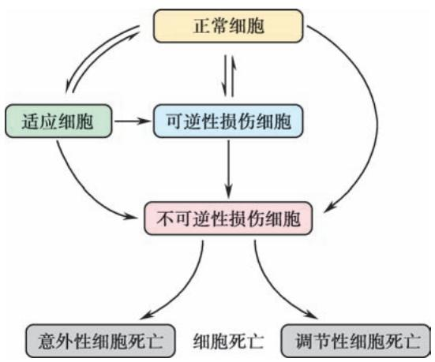

## 绪论 (Introduction)

## 1. 框架

*   **病理学的定义与任务**
    *   研究对象：病因、发病机制、病理变化、结局和转归
    *   学科属性：基础医学与临床医学的桥梁
*   **病理学在医学中的地位**
    *   医学教育：连接基础与临床
    *   医疗工作：提供“最后诊断” (Final Diagnosis)
    *   医学研究：基础研究、转化研究、新药评估
*   **病理学的研究对象和方法**
    *   人体病理学：尸体剖检、活体组织检查、细胞学检查
    *   实验病理学：动物实验、细胞/组织/类器官培养
*   **病理学的发展**
    *   器官病理学 -> 细胞病理学 -> 超微结构病理学 -> 分子病理学 -> 数字病理学/AI病理
*   **中国病理学史**
    *   古代记录与现代建立

## 2. 重要概念及解释（含英文术语）

*   **病理学 (Pathology)**: 研究和明确疾病的病因 (**etiology**)、发病机制 (**pathogenesis**)、病理变化 (**pathological change**)、结局和转归的医学学科。
*   **尸体剖检 (Autopsy)**: 对死者的遗体进行病理解剖和后续的病理学检查。
*   **活体组织检查 (Biopsy)**: 简称活检，即用局部切取、钳取、粗针穿刺和搔刮等手术方法，从活体内获取病变组织进行病理诊断。
*   **细胞学检查 (Cytology)**: 又称脱落细胞学检查，通过采集病变处的细胞，涂片染色后进行诊断。
*   **细针穿刺 (Fine Needle Aspiration, FNA)**: 通过细针穿刺病变部位采集细胞的方法。
*   **动物实验 (Animal Experiment)**: 运用动物实验的方法，在适宜动物身上复制出某些人类疾病的动物模型。
*   **类器官 (Organoid)**: 一种与体内的来源组织或器官高度相似的体外三维 (3D) 研究模型。
*   **器官病理学 (Organ Pathology)**: 认为不同的疾病都是由相应器官的病变引起的概念。
*   **细胞病理学 (Cytopathology)**: 应用光学显微镜来研究正常和病变细胞的形态变化。
*   **超微结构病理学 (Ultrastructural Pathology)**: 用电子显微镜技术观察病变细胞的超微结构变化。
*   **分子病理学 (Molecular Pathology)**: 通过分子手段检测人组织、器官和体液中的遗传与表观遗传改变。
*   **数字病理学 (Digital Pathology)**: 将病理学切片转化为全切片图像 (**Whole Slide Image, WSI**) 进行数据存储、阅片、教学和远程诊断。

## 3. 正文内容（含例子）

### 一、病理学的内容和任务
病理学内容丰富，分为**总论**和**各论**。
*   **总论**（第一至八章）：阐述不同疾病的共同规律与特征，如细胞适应与损伤、炎症、肿瘤等。
*   **各论**（第九至十八章）：解析不同器官疾病的特殊规律。例如，肝炎、肾炎、肺炎的基本病理改变均为**炎症**，但各有不同特征。
*   **其他内容**：探讨病因、发病机制、好发部位、结局和转归及其相应的临床病理联系。
*   **新技术**：第十九章介绍了组织化学、免疫组织化学、分子病理学、时空组学和人工智能等新技术。

### 二、病理学在医学中的地位
*   **医学教育中**：是基础医学和临床医学的**桥梁**。学习病理学需要解剖、组胚、生理、生化等基础，又是学习临床课程的基础。Sir William Osler 曾说：“**As is our pathology, so is our practice**”（病理学为医学之本）。
*   **医疗工作中**：**病理学诊断 (pathologic diagnosis)** 是最具可靠性和权威性的诊断之一，直接指导临床救治方案（用药、手术、放疗等）。尸体剖验是对死因最权威的终极回答。
*   **医学研究中**：是重要的基础研究领域和关键的转化研究阵地。生命科学研究进展需病理学验证；致病机制需建立病理学模型；药物临床试验效果评价离不开病理学诊断。

### 三、病理学的研究对象和方法
病理学分为**人体病理学**和**实验病理学**。

#### （一）人体病理学的研究对象和方法
1.  **尸体剖检 (Autopsy)**
    *   **作用**：确定诊断，查明死因；发现新疾病；积累病理材料；医疗事故鉴定。
    *   **现状**：我国尸检率不高且呈下降趋势，不利于医学发展。
2.  **活体组织检查 (Biopsy)**
    *   **意义**：及时准确诊断，指导治疗和判断预后；术中冷冻切片快速诊断；动态了解疗效；深入分子研究。
    *   **趋势**：不仅限于形态，更注重分子变化。
3.  **细胞学检查 (Cytology)**
    *   **来源**：脱落细胞（口腔、食管、生殖道等）、自然分泌物（痰、积液）、排泄物（尿）、FNA采集细胞。
    *   **特点**：设备简单，痛苦少，易接受，但可靠性不如活检。可用于普查、激素测定、分子诊断标本提供。

#### （二）实验病理学的研究对象和方法
1.  **动物实验 (Animal Experiment)**
    *   **优点**：可复制人类疾病模型，研究病因、发病、病理及转归；可进行人体无法做的研究（如致癌剂研究）。
    *   **缺点**：物种差异，结果仅参考，不能直接套用于人体。
2.  **细胞、组织和类器官培养**
    *   **应用**：研究因子作用下细胞病变发生发展、恶性转化、分子改变、药物影响等。
    *   **类器官 (Organoid)**：体外3D模型，高度相似来源组织，呈现细胞间相互作用和空间形态。
    *   **优缺点**：周期短、见效快、条件可控；但孤立体外环境与体内复杂环境不同，结果不能简单等同。

### 四、病理学的发展
*   **1761年**：Morgagni 提出**器官病理学 (organ pathology)**。
*   **19世纪中叶**：Virchow 创立**细胞病理学 (cytopathology)**。
*   **20世纪**：电子显微镜技术发展形成**超微结构病理学**。
*   **近几十年**：免疫学、分子生物学等进展推动形成**免疫病理学**、**分子病理学**、**遗传病理学**等新分支。
*   **现代**：
    *   **数字病理学 (Digital Pathology)**：基于全切片图像 (WSI)，实现远程诊断、会诊。
    *   **人工智能 (AI)**：2021年FDA批准首款AI辅助前列腺癌病理诊断软件，提高速度和准确率。
    *   **其他分支**：地理病理学、社会病理等。

### 五、中国病理学史
*   **古代**：《黄帝内经》记载最早人体解剖；《宋书》记载“剖腹得蛊”。
*   **近代**：1901年光绪帝颁布法令，将“病理”列为必修；1902年北洋医学堂开设病理课。
*   **现代**：20世纪初起步。徐诵明、胡正详、梁伯强等先驱在学科建设、教材编写（具有中国特色）、诊断推广、科研（传染病、地方病、肿瘤等）和人才培养方面贡献巨大。
*   **展望**：加强人体和实验病理学研究，打破学科界限，汲取新兴学科成果，达到世界领先水平。

## 4. 重要知识点总结、对比（表格）

| 研究方法 | 定义/特点 | 主要用途/意义 | 局限性/注意事项 |
| :--- | :--- | :--- | :--- |
| **尸体剖检 (Autopsy)** | 对死者遗体进行解剖检查 | 确定死因，总结经验，发现新病，积累材料，事故鉴定 | 我国尸检率低，需提高重视 |
| **活体组织检查 (Biopsy)** | 从活体获取病变组织检查 | **最后诊断**，指导治疗，术中快速诊断，动态监测 | 有创，需结合临床 |
| **细胞学检查 (Cytology)** | 采集脱落或穿刺细胞检查 | 筛查普查，痛苦小，操作简便 | 可靠性低于活检，难以判断浸润 |
| **动物实验 (Animal Exp.)** | 复制人类疾病动物模型 | 研究病因、机制、转归，进行人体禁忌研究 | **物种差异**，结果仅供参考 |
| **细胞/类器官培养** | 体外培养细胞、组织或3D模型 | 研究细胞病变、恶性转化、药物反应 | 体外环境与体内整体环境不同 |

| 病理学发展阶段 | 代表人物/时间 | 核心观点/技术 |
| :--- | :--- | :--- |
| **器官病理学** | Morgagni (1761) | 疾病由相应器官病变引起 |
| **细胞病理学** | Virchow (1858) | 疾病发生在细胞水平 |
| **超微结构病理学** | 20世纪 | 电子显微镜观察亚细胞结构 |
| **分子/数字/AI病理** | 近现代 | 基因/蛋白水平检测，WSI数字化，AI辅助诊断 |

*图 1-1 正常细胞、适应细胞、可逆性损伤细胞、不可逆性损伤细胞(细胞死亡)间的关系（注：此图虽在第一章，但体现了病理学对细胞状态连续变化的认识，此处作为病理学观察基础的示意）*
