## 第一章 细胞和组织的适应与损伤

### 一、 知识框架

*   **适应 (Adaptation)**：萎缩（Atrophy）、肥大（Hypertrophy）、增生（Hyperplasia）、化生（Metaplasia）、细胞老化（Cellular aging）。
*   **损伤的原因与机制**：
    *   **原因**：缺氧、生物性因素、物理性、化学性、营养失衡、神经内分泌、免疫、遗传缺陷、社会心理。
    *   **机制**：细胞膜损伤、线粒体损伤、活性氧（ROS）损伤、胞质内游离钙损伤、缺血缺氧、化学性损伤、遗传变异。
*   **细胞可逆性损伤（变性，Degeneration）**：细胞水肿、脂肪变、玻璃样变、淀粉样变、黏液样变、病理性色素沉着、病理性钙化。
*   **细胞不可逆性损伤（细胞死亡）**：
    *   **坏死 (Necrosis)**：基本病变（核固缩、核碎裂、核溶解）、类型（凝固性、液化性、纤维蛋白样、干酪样、脂肪坏死、坏疽）、结局与影响。
    *   **凋亡 (Apoptosis)**：特征、机制、与疾病关系。
    *   **其他死亡形式**：坏死性凋亡、细胞焦亡、铁死亡、自噬。

---

### 二、 重要概念及解释

1.  **适应 (Adaptation)**：细胞和组织对于持续性刺激产生的非损伤性应答反应，处于正常与损伤之间。
2.  **萎缩 (Atrophy)**：已发育正常的细胞、组织或器官体积缩小。
3.  **化生 (Metaplasia)**：一种分化成熟的细胞类型被另一种分化成熟的细胞类型取代的过程（本质是重编程）。
4.  **上皮-间质转化 (EMT)**：上皮细胞通过特定程序转化为具有间质细胞表型的生物学过程。
5.  **变性 (Degeneration)**：即细胞可逆性损伤，受损细胞内出现异常物质或正常物质异常蓄积。
6.  **虎斑心 (Tiger effect heart)**：慢性酒精中毒或缺氧引起心肌脂肪变，在心内膜下呈现黄红色斑纹。
7.  **坏疽 (Gangrene)**：局部组织大块坏死并继发腐败菌感染。
8.  **机化 (Organization)**：由新生肉芽组织长入并取代坏死组织、血栓等的过程。
9.  **凋亡小体 (Apoptotic body)**：凋亡细胞胞质生出芽突并脱落形成的含核碎片或细胞器成分的膜包被结构。
10. **细胞焦亡 (Pyroptosis)**：伴随炎症反应出现的细胞程序性死亡方式，由炎症Caspase介导。

---

### 三、 正文内容详解

#### 1. 细胞和组织的适应
适应在形态学上表现为体积、数目或分化的改变。
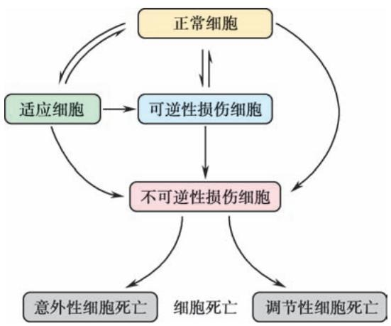
*图 1-1 正常、适应、可逆与不可逆损伤间的关系*

*   **萎缩**：
    *   **生理性**：如青春期胸腺萎缩、更年期后子宫萎缩。
    *   **病理性**：营养不良性（恶病质）、压迫性（肾盂积水导致肾萎缩）、失用性（骨折后肌肉萎缩）、去神经性、内分泌性。
    *   **病变**：细胞内常出现**脂褐素**（未被消化的细胞器残体）。
    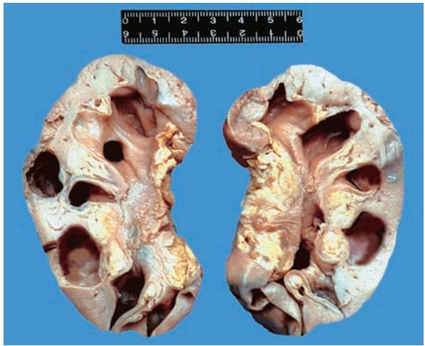
    *图 1-2 肾压迫性萎缩（肾盂积水）*

*   **肥大**：功能增加导致。
    *   **生理性**：举重运动员骨骼肌、妊娠期子宫。
    *   **病理性代偿性**：高血压导致的心脏向心性肥大。
    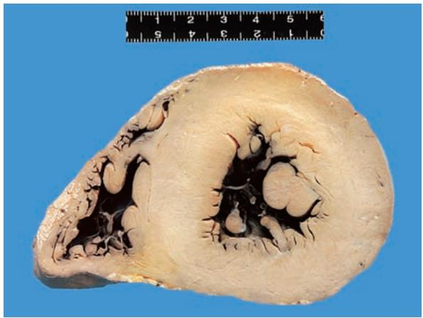
    *图 1-3 心脏向心性肥大（大体）*
    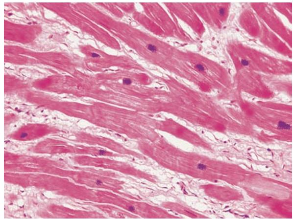
    *图 1-4 心肌肥大（镜下：核大深染，心肌变粗）*

*   **增生**：细胞数目增多。如部分肝切除后的代偿性增生、雌激素过多的子宫内膜增生。
*   **化生**：
    *   **鳞状上皮化生**：支气管纤毛柱状上皮转变为鳞状上皮（最常见）。
    *   **肠上皮化生**：慢性胃炎时，胃黏膜转变为含杯状细胞的肠黏膜。
    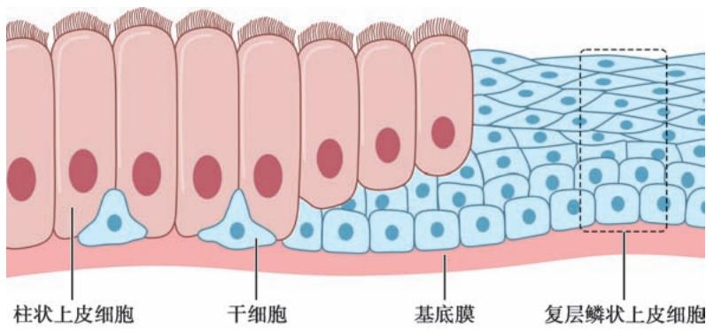
    *图 1-5 柱状上皮的鳞状上皮化生示意图*

#### 2. 细胞和组织损伤的机制
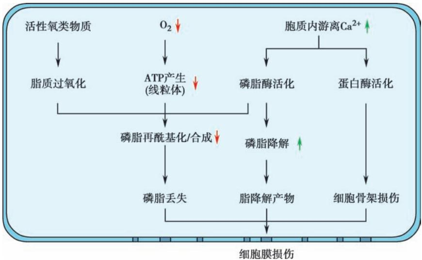
*图 1-6 细胞膜损伤和胞质内游离钙损伤机制*

*   **活性氧 (ROS) 损伤**：引起脂质过氧化、DNA断裂和蛋白交联。
    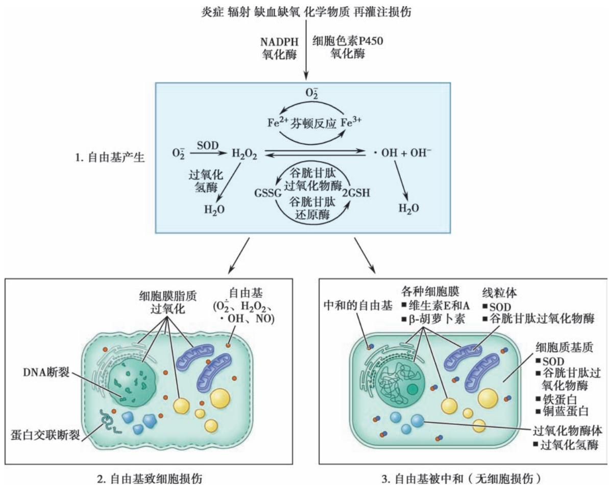
    *图 1-7 活性氧类物质损伤机制*

*   **缺血缺氧**：导致ATP减少，钠泵、钙泵功能障碍，引发细胞水肿和酸中毒。
    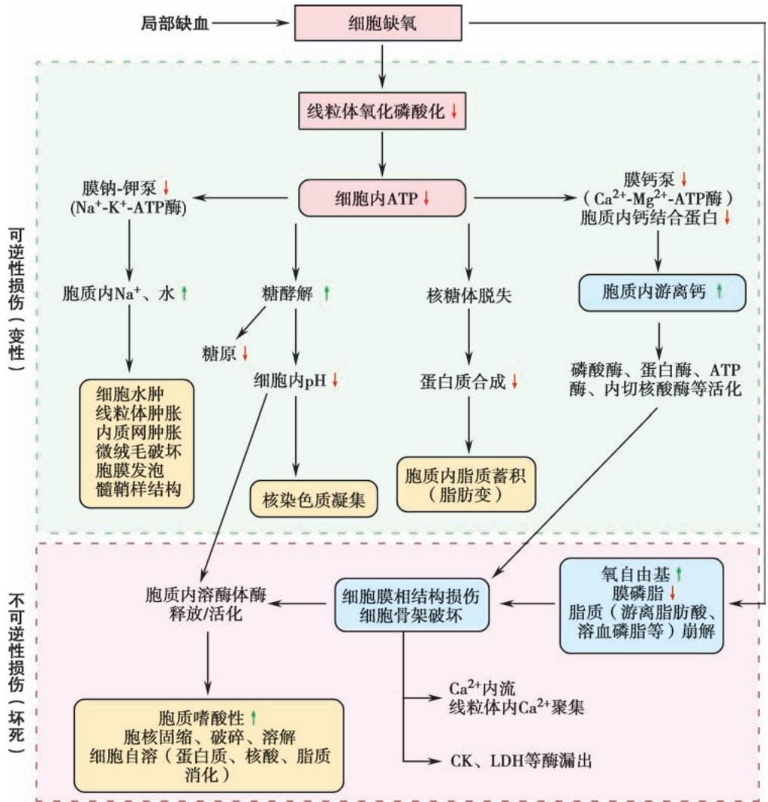
    *图 1-8 缺血、缺氧引起细胞损伤的步骤*

#### 3. 细胞可逆性损伤（变性）
*   **细胞水肿**：早期改变，水、钠蓄积。极期称**气球样变**。
    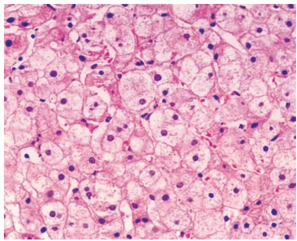
    *图 1-9 肝细胞水肿（气球样变）*

*   **脂肪变**：甘油三酯蓄积于非脂肪细胞。
    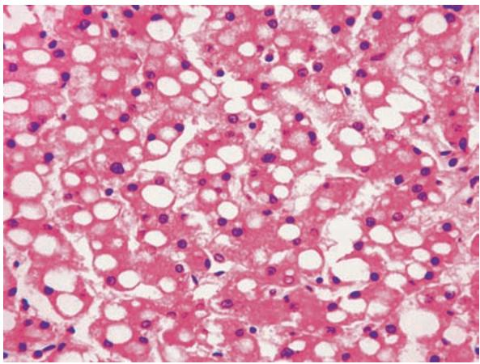
    *图 1-10 肝细胞脂肪变（脂滴空泡）*

*   **玻璃样变**：HE染色呈嗜伊红均质状。
    *   细胞内：Russell小体（浆细胞）、Mallory小体（酒精性肝病）。
    *   血管壁：细小动脉硬化（高血压）。
    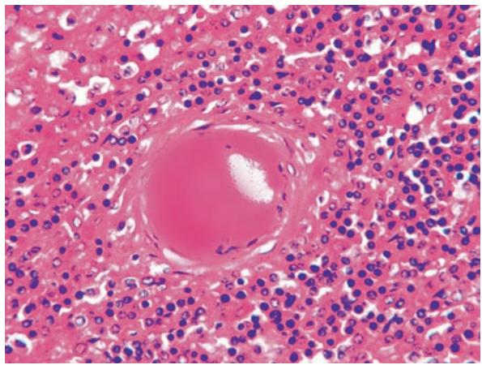
    *图 1-11 脾中央动脉玻璃样变*

*   **病理性色素沉着**：
    *   **含铁血黄素**：铁蛋白聚集体，普鲁士蓝染色呈蓝色。
    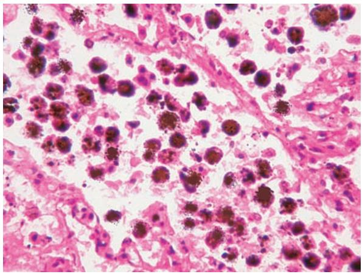
    *图 1-12 心衰细胞中的含铁血黄素颗粒*
    *   **脂褐素**：消耗性色素，见于老年及萎缩细胞。

*   **病理性钙化**：
    *   **营养不良性钙化**：钙磷代谢正常，沉积于坏死组织（如结核病灶）。
    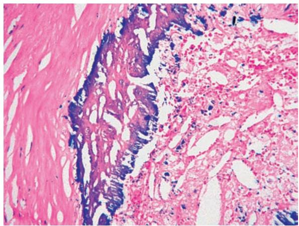
    *图 1-13 动脉壁营养不良性钙化*

#### 4. 细胞不可逆性损伤（细胞死亡）
*   **坏死 (Necrosis)**：
    *   **基本病变**：**核固缩**、**核碎裂**、**核溶解**。
    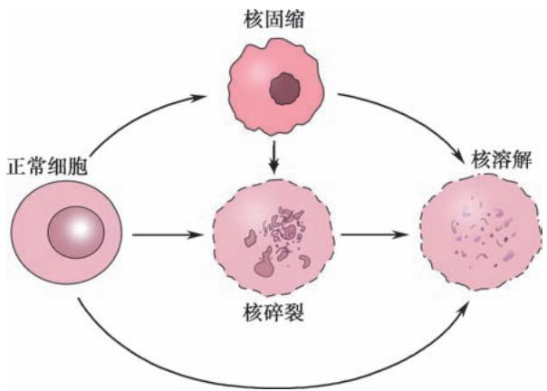
    *图 1-14 坏死时细胞核的变化模式*
    *   **凝固性坏死**：常见于心、肾、脾梗死，形态特征为“**细胞轮廓尚存，细微结构消失**”。
    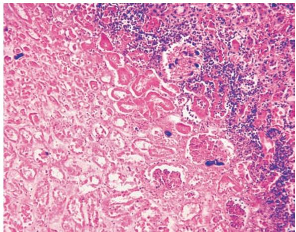
    *图 1-15 肾凝固性坏死（轮廓尚存）*
    *   **液化性坏死**：见于脑软化、脓肿。
    *   **干酪样坏死**：彻底的凝固性坏死，见于结核病。
    *   **坏疽**：干性（血栓闭塞性脉管炎）、湿性（肠坏死）、气性。
    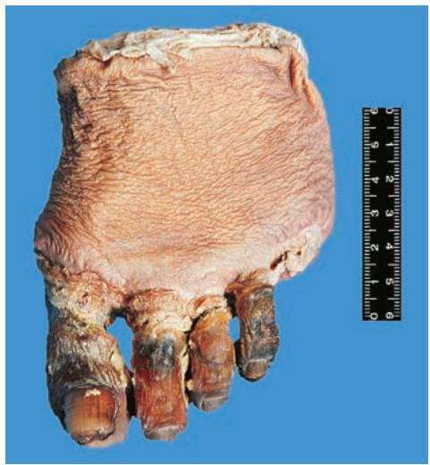
    *图 1-16 足干性坏疽（干燥、发黑）*

*   **凋亡 (Apoptosis)**：
    *   **对比坏死**：不引起周围炎症反应，耗能，DNA呈梯状带。
    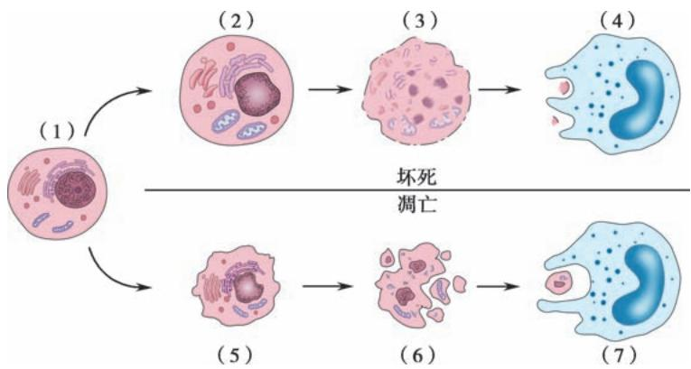
    *图 1-17 坏死与凋亡的过程对比*
    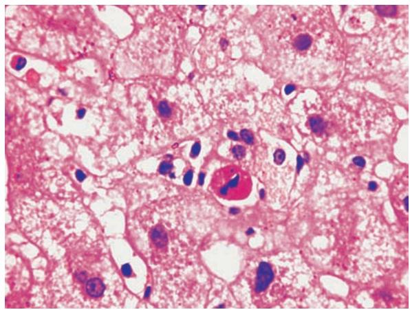
    *图 1-18 肝细胞凋亡（嗜酸性小体）*

*   **调节性细胞死亡新技术名词**：
    *   **坏死性凋亡**：受信号分子调控的“程序性坏死”。
    *   **铁死亡**：依赖铁离子及活性氧诱导的脂质过氧化。
    *   **自噬**：细胞包裹自身成分并在溶酶体中降解。

---

### 四、 重要知识点总结、对比

#### 1. 常见可逆性损伤（变性）对比表

| 类型 | 蓄积物质 | 病变部位 | 特征性形态/例子 |
| :--- | :--- | :--- | :--- |
| **细胞水肿** | 水、$Na^+$ | 细胞内 | 气球样变；见于肝、肾 |
| **脂肪变** | 甘油三酯 | 细胞内 | 肝大黄色、心肌“虎斑心” |
| **玻璃样变** | 变性蛋白 | 胞内/间质 | Russell小体、细小动脉玻璃样变 |
| **淀粉样变** | 淀粉样蛋白 | 间质 | 刚果红染色呈橘红色 |
| **病理性钙化** | 钙盐 | 胞内/间质 | 营养不良性 vs 转移性 |

#### 2. 凋亡与坏死的比较

| 鉴别点 | 凋亡 (Apoptosis) | 坏死 (Necrosis) |
| :--- | :--- | :--- |
| **机制** | 基因调控，主动过程 | 意外损伤，被动过程 |
| **范围** | 单个或散在细胞 | 常累及大量细胞 |
| **细胞膜** | 保持完整，形成凋亡小体 | 早期破裂，溶酶体酶释放 |
| **周围反应** | **无炎症反应**，不修复 | **有炎症反应**，伴修复 |
| **生化特征** | 耗能(ATP)，DNA 180-200bp规律片段 | 不耗能，DNA 随机降解 |

#### 3. 三种坏疽的对比

| 类型 | 好发部位 | 发生条件 | 形态特征 |
| :--- | :--- | :--- | :--- |
| **干性坏疽** | 四肢末端 | 动脉阻塞，静脉回流通畅 | 干燥、黑褐色、界限清楚 |
| **湿性坏疽** | 肠、肺、子宫 | 动静脉均阻塞，含水多 | 肿胀、蓝绿色、恶臭、界限不清 |
| **气性坏疽** | 深部肌肉创伤 | 厌氧菌感染（产气荚膜杆菌） | 坏死区产生气体、捻发感、剧痛 |