## 第二章 损伤的修复 学习笔记

### 一、 知识框架

*   **再生 (Regeneration)**：
    *   **细胞周期与再生潜能**：不稳定细胞、稳定细胞、永久性细胞。
    *   **干细胞及其作用**：胚胎干细胞、成体干细胞（转分化、iPSCs）、在骨髓/肝脏/角膜中的作用。
    *   **组织再生的机制**：上皮、纤维组织、软骨/骨、血管（出芽式/套叠式）、肌组织、神经组织。
    *   **影响因素**：细胞外基质 (ECM)、生长因子、抑素与接触抑制。
*   **纤维性修复 (Fibrous repair)**：
    *   **肉芽组织 (Granulation tissue)**：成分（新生毛细血管、成纤维细胞、炎症细胞）、形态、作用与结局。
    *   **瘢痕组织 (Scar tissue)**：形态、对机体的影响（利与弊）。
    *   **形成过程与机制**：血管生成、纤维化（TGF-β作用）、组织重构（MMPs与TIMPs）。
*   **创伤愈合 (Wound healing)**：
    *   **皮肤创伤愈合**：基本过程（早期变化、伤口收缩、肉芽增生、组织再生）、类型（一期愈合与二期愈合）。
    *   **骨折愈合**：血肿形成、纤维性骨痂形成、骨性骨痂形成、骨痂改建。
    *   **影响因素**：全身因素（年龄、营养、维生素C、锌）与局部因素（感染、血供、神经支配）。

---

### 二、 重要概念及解释

1.  **修复 (Repair)**：机体对丧失的细胞和组织进行修补恢复的过程，包括再生和纤维性修复。
2.  **完全再生 (Complete regeneration)**：由损伤周围同种细胞修复，完全恢复原组织结构及功能。
3.  **不稳定细胞 (Labile cell)**：总在不断增殖以代替衰亡细胞，如表皮、黏膜上皮、造血细胞。
4.  **稳定细胞 (Stable cell)**：平时增殖不明显（$G_0$期），受损刺激后进入$G_1$期，如肝、肾小管上皮、腺体实质。
5.  **永久性细胞 (Permanent cell)**：出生后不具有分裂能力，如神经细胞、心肌细胞。
6.  **干细胞 (Stem cell)**：具有自我更新和多向分化能力的细胞。
7.  **肉芽组织 (Granulation tissue)**：由新生薄壁毛细血管、增生的成纤维细胞及炎症细胞构成。
8.  **血管生成 (Angiogenesis)**：从原有血管通过出芽或套叠方式生成新血管的过程。
9.  **接触抑制 (Contact inhibition)**：细胞增生覆盖创面相互接触后停止生长的现象。
10. **一期愈合 (Healing by first intention)**：见于组织缺损少、创缘整齐、无感染的伤口，愈合快，瘢痕小。

---

### 三、 正文内容详解

#### 1. 再生 (Regeneration)
*   **干细胞的作用**：
    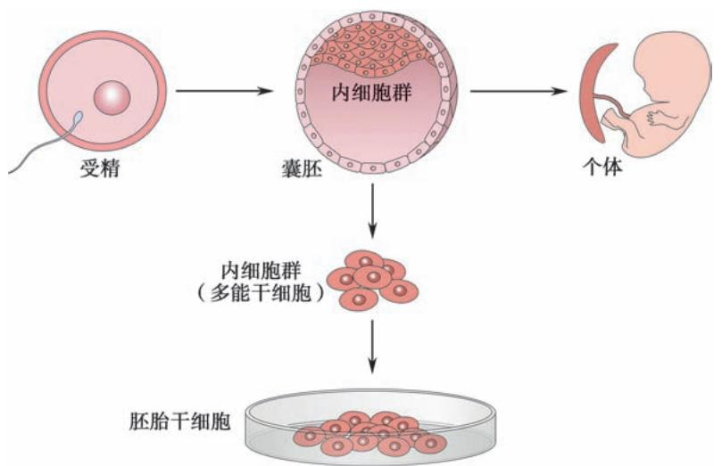
    *图 2-1 胚胎干细胞的提取模式图*
    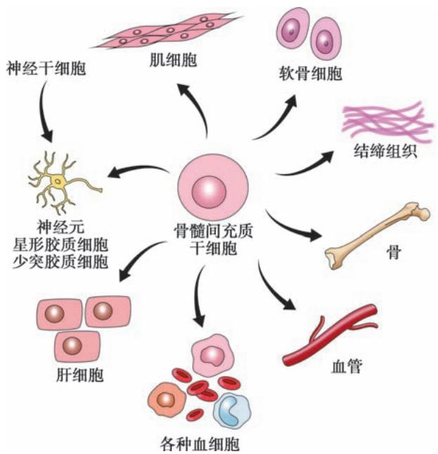
    *图 2-2 骨髓间充质干细胞（MSC）的多向分化能力*

*   **血管再生**：主要通过**出芽式血管生成**实现。
    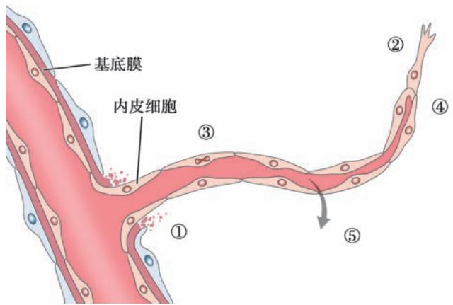
    *图 2-3 出芽式血管生成五个步骤：基底膜溶解 -> 移动 -> 增生 -> 管腔形成 -> 通透性增加*

*   **神经纤维再生**：若神经细胞存活，外周神经断离后可再生。
    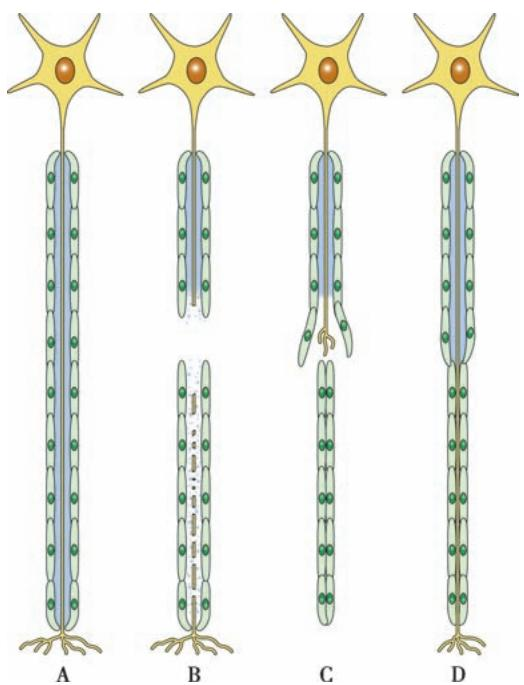
    *图 2-4 神经纤维再生：由施万细胞形成合体细胞带引导轴突生长*

#### 2. 纤维性修复
*   **肉芽组织**：
    *   **外观**：鲜红色、颗粒状、质软湿润。
    *   **作用**：抗感染、填补缺损、机化坏死物或血栓。
    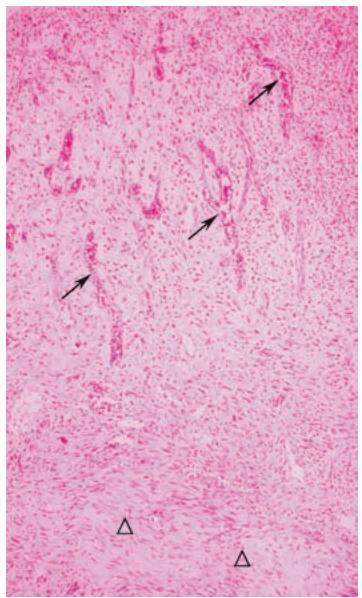
    *图 2-5 肉芽组织低倍镜：可见大量新生毛细血管和成纤维细胞*
    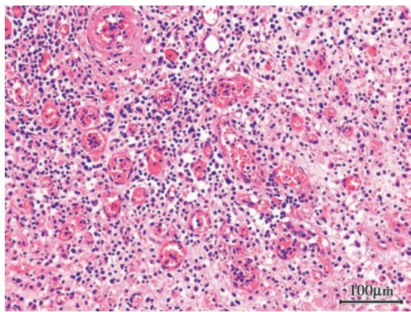
    *图 2-6 高倍镜下：可见新生毛细血管管腔及炎症细胞浸润*
    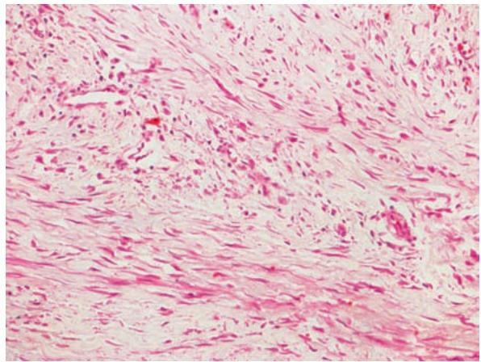
    *图 2-7 成熟阶段：纤维细胞增多，胶原纤维量增加*

*   **瘢痕组织**：肉芽组织老化形成的纤维结缔组织。**肌成纤维细胞**的收缩会导致瘢痕挛缩（如幽门梗阻）。

#### 3. 创伤愈合
*   **皮肤愈合类型**：
    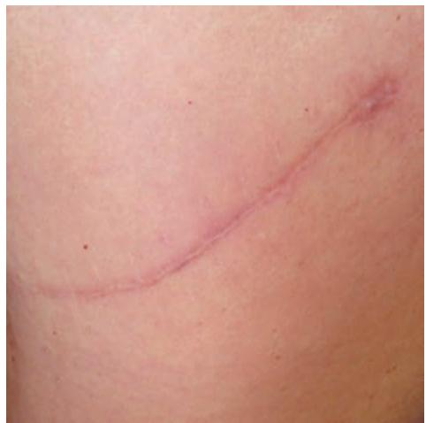
    *图 2-8 一期愈合形成的白色线状瘢痕*
    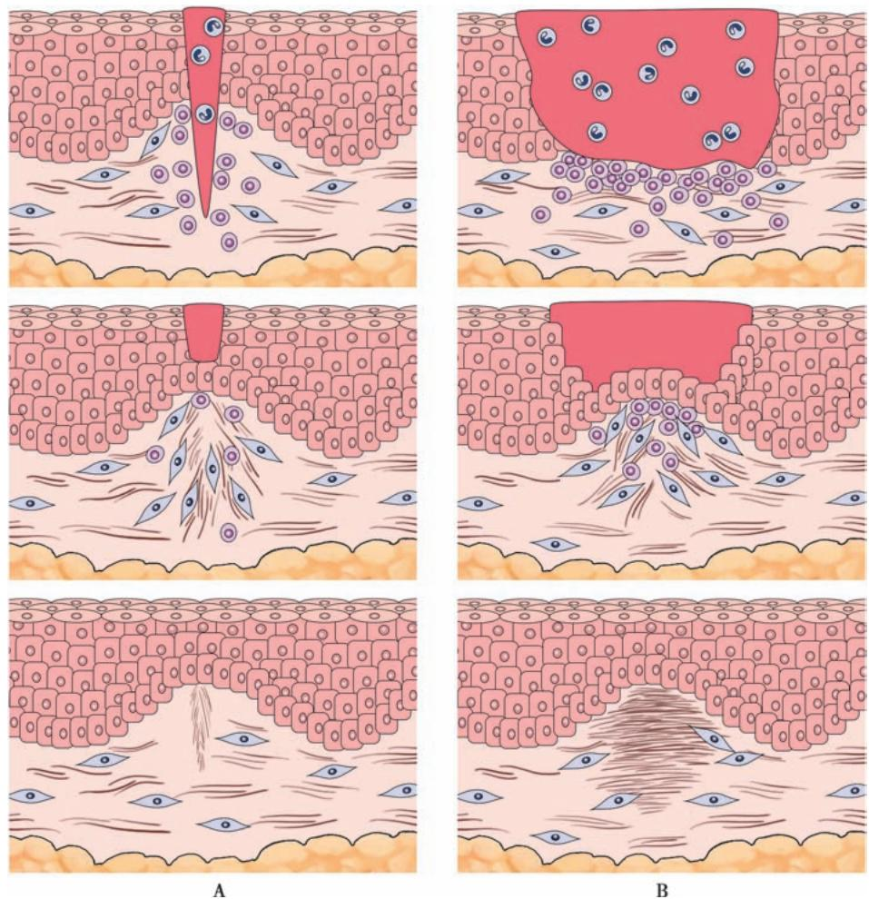
    *图 2-9 一期愈合（左）与二期愈合（右）对比*

*   **骨折愈合过程**：
    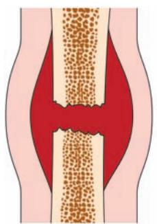
    *1. 血肿形成*
    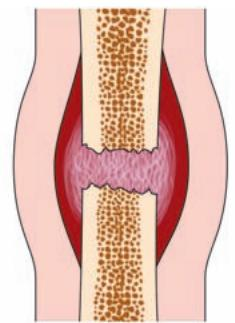
    *2. 纤维性骨痂形成（暂时性骨痂）*
    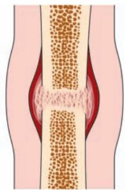
    *3. 骨性骨痂形成（形成编织骨）*
    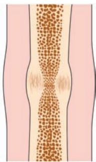
    *4. 骨痂改建（转化为成熟板层骨）*

---

### 四、 重要知识点总结、对比

#### 1. 人体细胞按再生潜能分类表

| 细胞类型 | 特点 | 例子 |
| :--- | :--- | :--- |
| **不稳定细胞** | 持续分裂，再生能力最强 | 表皮细胞、呼吸道/消化道黏膜、造血细胞 |
| **稳定细胞** | 平时静止（$G_0$），受损后强力增殖 | 肝、肾小管上皮、间叶细胞（成纤维细胞等） |
| **永久性细胞** | 失去分裂能力 | **神经细胞**、**心肌细胞**、骨骼肌细胞 |

#### 2. 皮肤创伤一期愈合与二期愈合的比较

| 鉴别点 | 一期愈合 | 二期愈合 |
| :--- | :--- | :--- |
| **条件** | 组织缺损少、创缘整齐、对合严密、**无感染** | 组织缺损大、创缘不整、**有感染**或坏死 |
| **坏死组织/炎症** | 少/轻 | 多/明显 |
| **修复过程** | 肉芽组织少，再生上皮覆盖快 | 肉芽组织多，需从底部填平，愈合慢 |
| **瘢痕** | 线状，小且白 | 大，不规则，常引起功能障碍 |

#### 3. 各种生长因子的主要作用

| 生长因子 | 英文简称 | 主要来源 | 主要功能 |
| :--- | :--- | :--- | :--- |
| **血小板源性** | **PDGF** | 血小板、巨噬细胞 | 成纤维细胞/平滑肌细胞增生、趋化 |
| **成纤维细胞** | **FGF** | 巨噬细胞等 | **毛细血管再生**、间叶细胞增生 |
| **转化生长因子** | **TGF-β** | 血小板、巨噬细胞 | **纤维化的关键因子**，促进胶原合成 |
| **血管内皮** | **VEGF** | 肿瘤细胞、间叶细胞 | **血管生成的关键因子**，增加血管通透性 |

#### 4. 影响愈合的关键营养素
*   **维生素C**：胶原蛋白脯氨酸/赖氨酸羟化所必需（缺乏导致坏血病，伤口不愈合）。
*   **锌**：作为多种氧化酶的成分，促进成纤维细胞和内皮细胞增生。
*   **含硫氨基酸**：提供蛋白质合成基础。