## 第三章 局部血液循环障碍 学习笔记

### 一、 知识框架

*   **充血和淤血 (Hyperemia and Congestion)**：
    *   动脉性充血（生理性、病理性、减压后充血）。
    *   静脉性淤血（原因、病变、重要器官：肺淤血、肝淤血）。
*   **出血 (Hemorrhage)**：
    *   破裂性出血与漏出性出血。
    *   病理变化（血肿、瘀点、紫癜、瘀斑）。
*   **血栓形成 (Thrombosis)**：
    *   形成条件（内皮损伤、血流异常、血液高凝）。
    *   血栓类型（白色、混合、红色、透明血栓）。
    *   结局（机化再通、钙化）。
*   **栓塞 (Embolism)**：
    *   栓子运行途径。
    *   类型（血栓栓塞、脂肪栓塞、气体栓塞、羊水栓塞）。
*   **梗死 (Infarction)**：
    *   原因与影响因素。
    *   类型（贫血性梗死、出血性梗死、败血性梗死）。
*   **水肿 (Edema)**：
    *   发病机制（流体静压、胶体渗透压、淋巴回流）。
    *   病理变化（皮下、肺、脑水肿）。

---

### 二、 重要概念及解释

1.  **动脉性充血 (Arterial hyperemia)**：主动过程，细动脉扩张导致局部组织血液含量增多。
2.  **发绀 (Cyanosis)**：淤血时，血液内还原血红蛋白含量增多，皮肤黏膜呈**紫蓝色**。
3.  **心衰细胞 (Heart failure cell)**：左心衰竭肺淤血时，肺泡腔内吞噬含铁血黄素的巨噬细胞。
4.  **槟榔肝 (Nutmeg liver)**：慢性肝淤血时，肝切面呈红（淤血区）黄（脂肪变区）相间的条纹。
5.  **血栓 (Thrombus)**：活体心血管内，血液有形成分析出、凝集形成的固体质块。
6.  **再通 (Recanalization)**：机化血栓中出现新生的血管，使阻塞的血管部分重建血流。
7.  **栓子 (Embolus)**：在循环血液中出现的、不溶于血液的异常物质。
8.  **骑跨性栓塞 (Saddle embolism)**：较大的血栓栓子阻塞于肺动脉主干分叉处。
9.  **减压病 (Decompression sickness)**：由高气压环境迅速进入常压时，血液中氮气游离形成气泡引起的栓塞。
10. **癌脐 (Cancerous umbilicus)**：器官表面的转移性癌结节，因中央出血坏死而下陷的特征。

---

### 三、 正文内容详解

#### 1. 充血和淤血
*   **充血**：局部组织色鲜红，温度增高。如炎症性充血。
*   **淤血 (Congestion)**：被动过程。
    *   **肺淤血**：多由**左心衰竭**引起。镜下见肺泡壁变厚、毛细血管扩张，肺泡腔内有水肿液、红细胞及**心衰细胞**。
    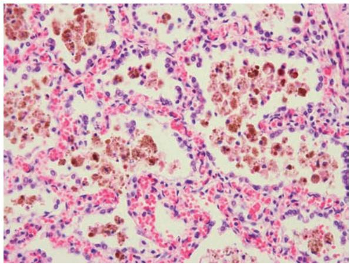
    *图 3-1 慢性肺淤血中的心衰细胞*
    *   **肝淤血**：多由**右心衰竭**引起。小叶中央区淤血萎缩，周边区肝细胞脂肪变，形成**槟榔肝**。
    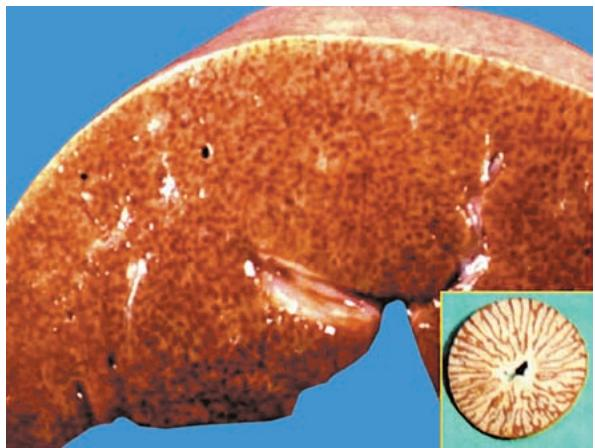
    *图 3-2 槟榔肝大体：红黄相间*
    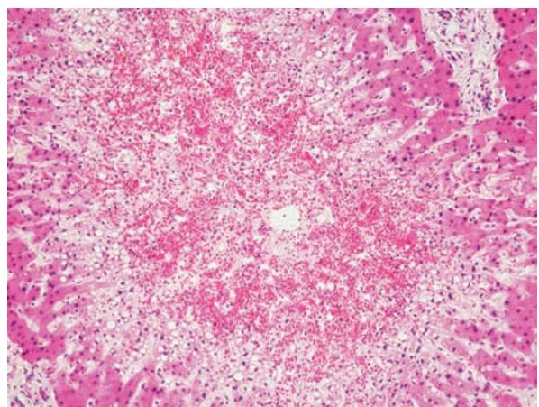
    *图 3-3 慢性肝淤血镜下：中央窦扩张，周边脂肪变*

#### 2. 出血 (Hemorrhage)
*   **破裂性出血**：血管壁坏死（如动脉瘤破裂）。
*   **漏出性出血**：微循环通透性增高。
*   **形态**：直径<2mm为**瘀点**；3~5mm为**紫癜**；>5mm为**瘀斑**。

#### 3. 血栓形成 (Thrombosis)
*   **血栓形成的条件**：
    1.  **心血管内皮细胞损伤**（最重要）：暴露胶原，激活血小板。
    2.  **血流状态异常**：速度减慢或产生漩涡。
    3.  **血液凝固性增加**：如手术后、晚期肿瘤、DIC。
    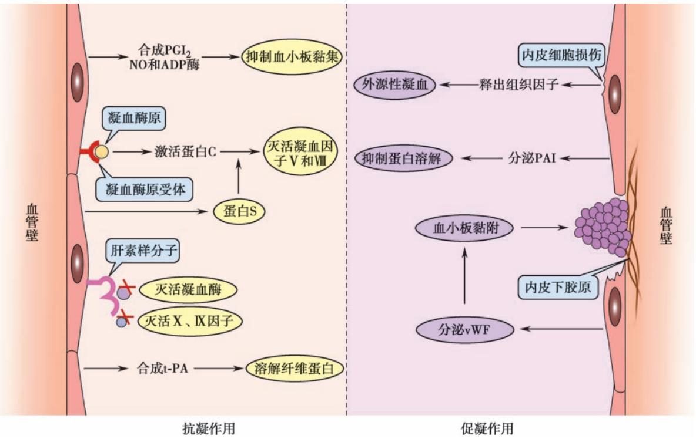
    *图 3-4 内皮细胞的抗凝与促凝作用*
    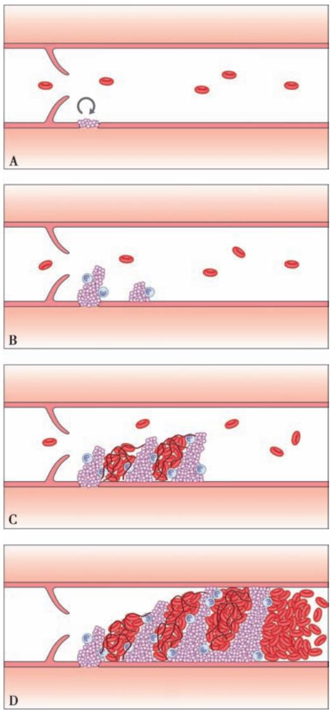
    *图 3-5 静脉内血栓形成过程：血小板沉积->形成小梁->纤维蛋白网*
*   **血栓类型**：
    *   **白色血栓**：瓣膜上，主要由血小板构成。
    *   **混合血栓**：体部，灰白与红褐色相间。
    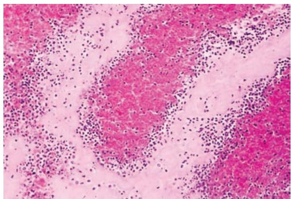
    *图 3-6 混合血栓镜下：血小板小梁与红细胞网*
    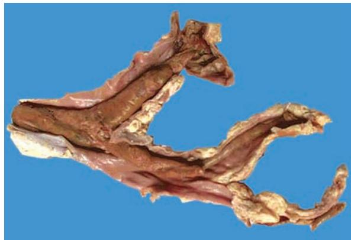
    *图 3-7 髂静脉内的干燥圆柱状混合血栓*
*   **结局**：
    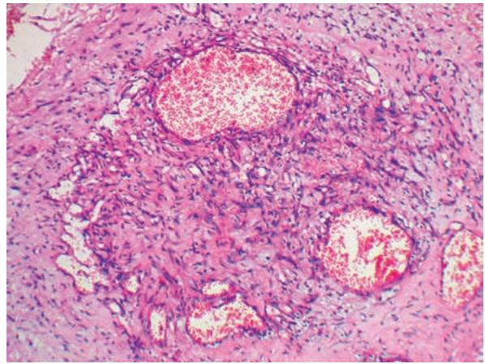
    *图 3-8 血栓机化与再通：新生血管形成*

#### 4. 栓塞 (Embolism)
*   **运行途径**：一般随血流方向。
    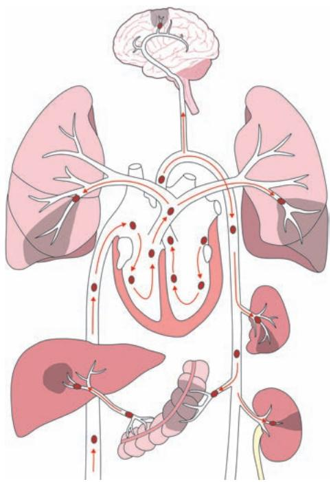
    *图 3-9 栓子运行途径示意图*
*   **血栓栓塞**：95%的肺栓塞来源于下肢深静脉。
    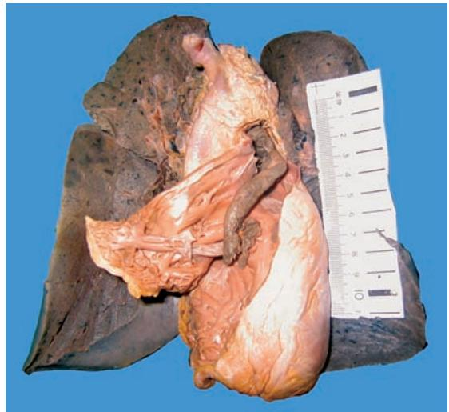
    *图 3-10 肺动脉骑跨性栓塞*
*   **其他栓塞**：**脂肪栓塞**（长骨骨折）、**空气栓塞**（静脉损伤）、**羊水栓塞**（分娩意外，易致DIC）。

#### 5. 梗死 (Infarction)
*   **形状**：由血管分布决定。脾、肾、肺呈**锥形（扇形）**；心肌呈**地图状**；肠呈**节段状**。
    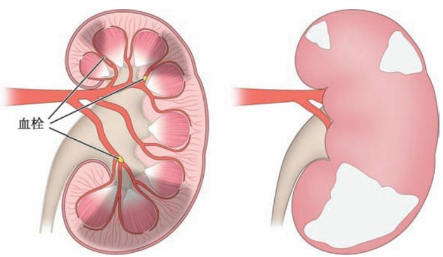
    *图 3-11 肾动脉分支栓塞及锥形梗死模式图*
*   **贫血性梗死**：发生于组织致密的器官（心、肾、脾）。
    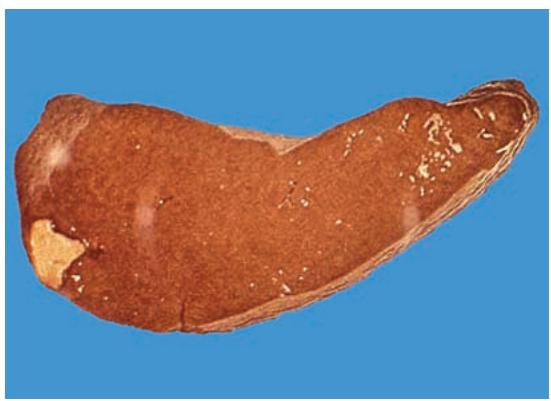
    *图 3-12 脾贫血性梗死大体*
    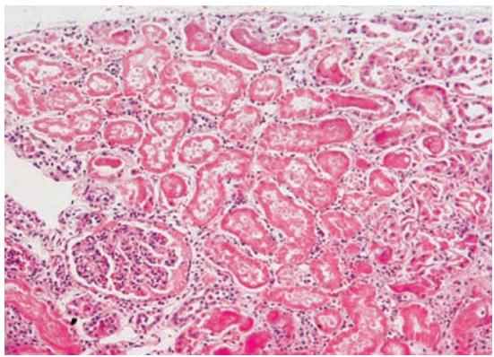
    *图 3-13 肾贫血性梗死镜下：凝固性坏死*
*   **出血性梗死**：需满足**严重淤血**和**组织疏松**两个条件（肺、肠）。
    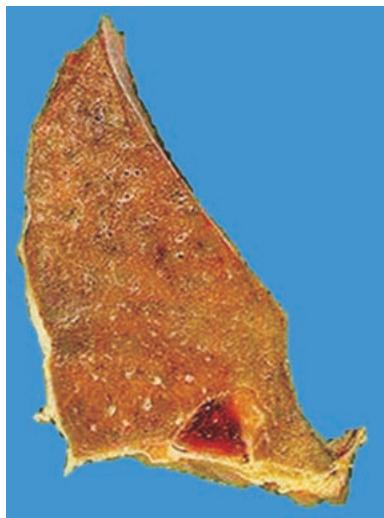
    *图 3-14 肺出血性梗死：楔形暗红色*
    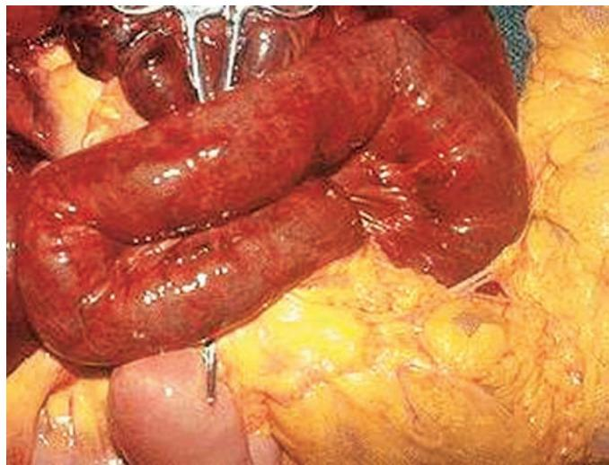
    *图 3-15 肠出血性梗死：节段性坏死*

#### 6. 水肿 (Edema)
*   **机制**：血浆胶体渗透压降低、静脉压增高、淋巴回流受阻。
    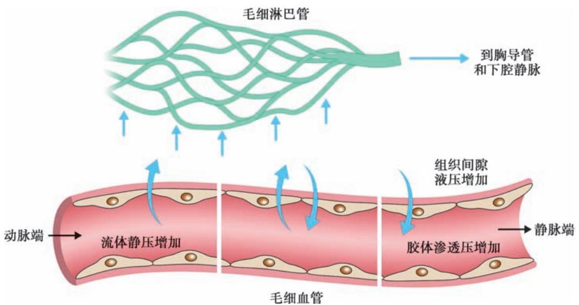
    *图 3-16 影响微循环水分交换的因素*
    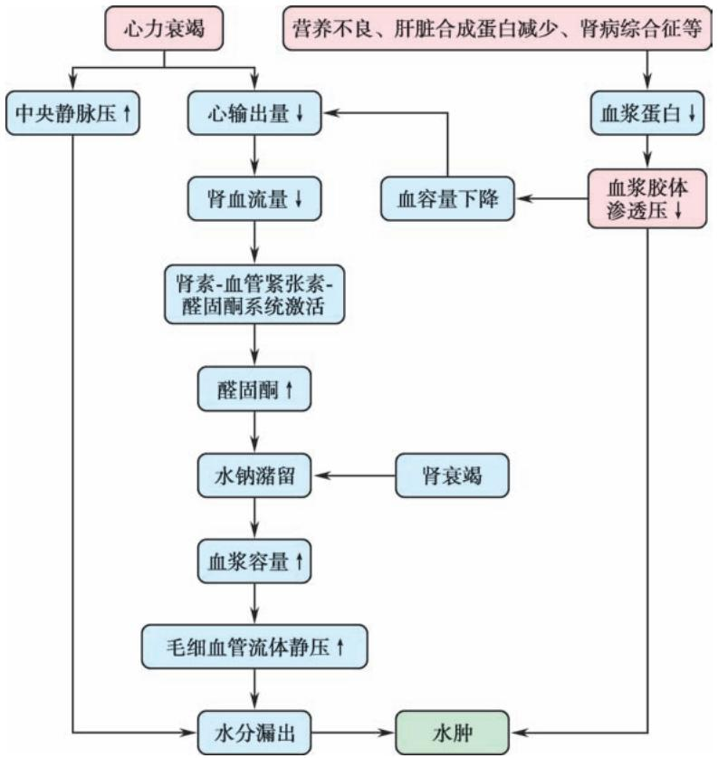
    *图 3-17 心、肾功能衰竭引起全身水肿的机制*

---

### 四、 重要知识点总结、对比

#### 1. 充血与淤血的对比

| 鉴别点 | 动脉性充血 | 静脉性淤血 |
| :--- | :--- | :--- |
| **性质** | 主动过程 | 被动过程 |
| **原因** | 细动脉扩张，输入增多 | 静脉回流受阻 |
| **颜色** | 鲜红色 | 暗红色、发绀 |
| **温度** | 增高 | 降低 |
| **后果** | 暂时性，通常无害 | 水肿、出血、实质萎缩、硬化 |

#### 2. 四种血栓的比较

| 类型 | 主要成分 | 常见部位 | 形态特征 |
| :--- | :--- | :--- | :--- |
| **白色血栓** | 血小板、少量纤维蛋白 | 心瓣膜、血流快处 | 灰白色、质实、与壁粘连紧 |
| **混合血栓** | 血小板小梁、红细胞网 | 静脉延续性血栓体部 | 灰白与褐色相间（条纹状） |
| **红色血栓** | 红细胞、纤维蛋白 | 静脉延续性血栓尾部 | 暗红色、湿润、易脱落 |
| **透明血栓** | 纤维蛋白 | 微循环毛细血管（DIC） | 仅镜下可见，又称微血栓 |

#### 3. 贫血性梗死与出血性梗死的区别

| 鉴别点 | 贫血性梗死 | 出血性梗死 |
| :--- | :--- | :--- |
| **好发器官** | 心、肾、脾（组织致密） | 肺、肠（组织疏松） |
| **发生条件** | 动脉阻塞 | **动脉阻塞+严重淤血**+双重血供 |
| **颜色** | 灰白色 | 暗红色 |
| **形态** | 凝固性坏死为主 | 坏死伴大量出血 |

#### 4. 漏出液与渗出液的比较（水肿液性质）

| 鉴别点 | 漏出液 (Transudate) | 渗出液 (Exudate) |
| :--- | :--- | :--- |
| **原因** | 非炎症（压力/渗透压改变） | 炎症（血管通透性增加） |
| **蛋白含量** | 低 ($<30g/L$) | 高 ($>30g/L$) |
| **比重** | 低 ($<1.018$) | 高 ($\geqslant 1.018$) |
| **细胞数** | 少 | 多 |