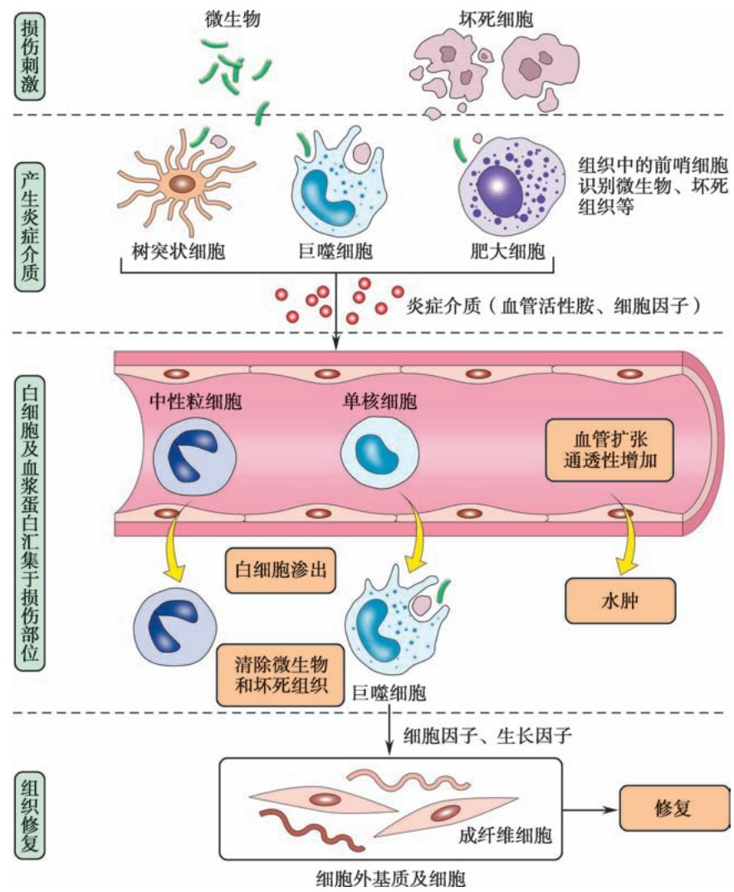
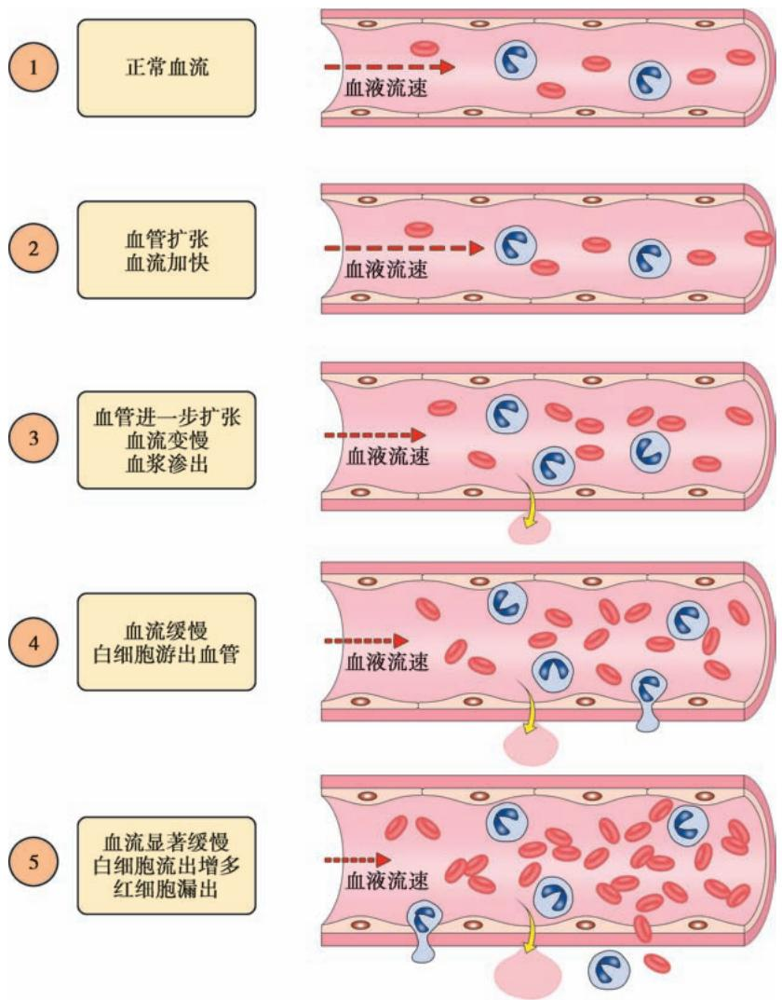
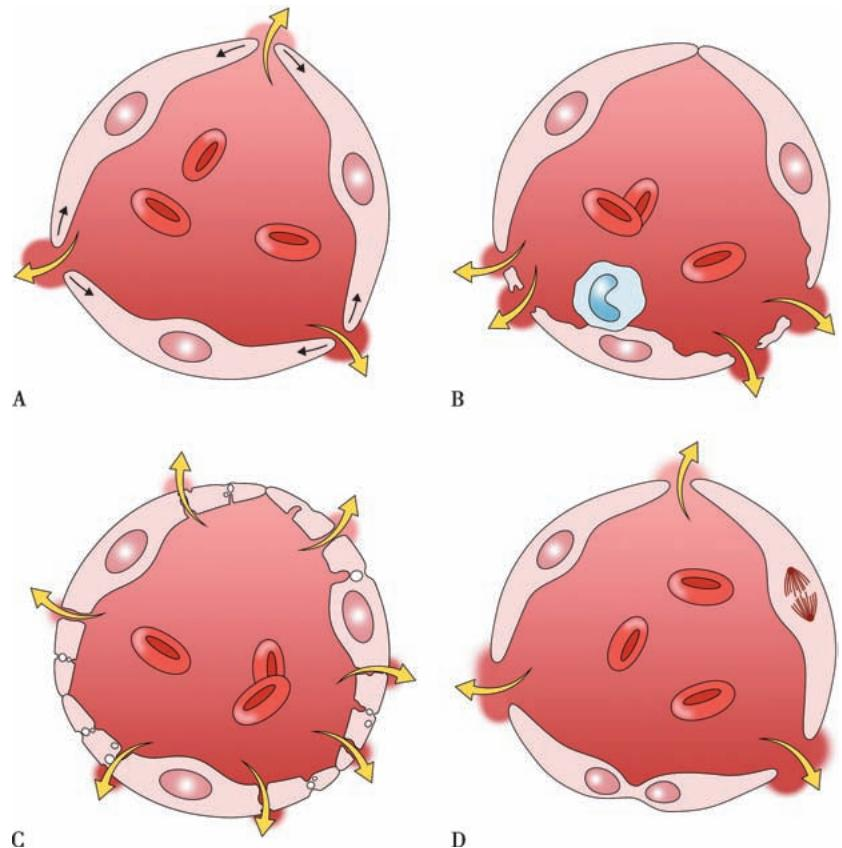
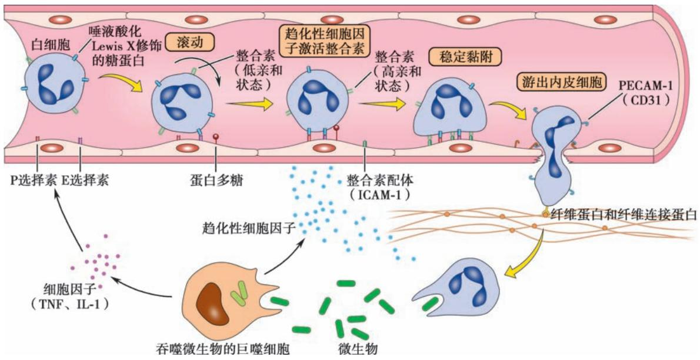
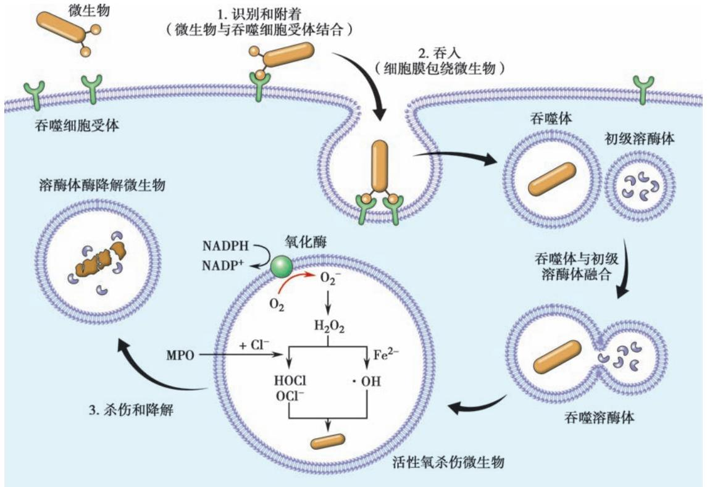
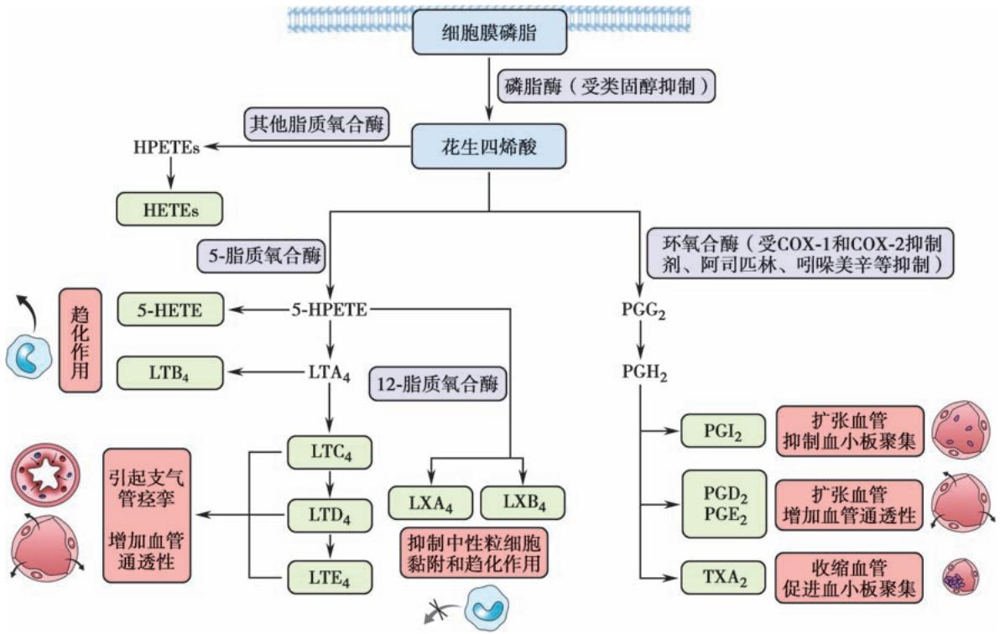
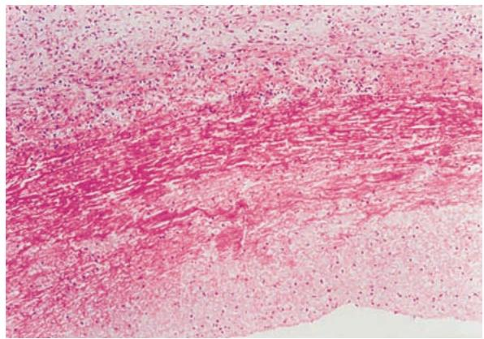
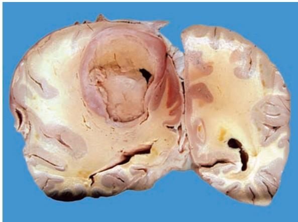
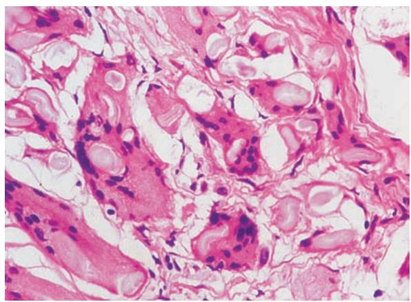

## 第四章 炎症 学习笔记

### 一、 知识框架

*   **炎症概述**：
    *   概念、原因（物理、化学、生物、坏死、超敏反应、异物）。
    *   基本病理变化：**变质**（Alteration）、**渗出**（Exudation）、**增生**（Proliferation）。
    *   局部表现与全身反应（发热、白细胞增多、核左移、隐匿性炎症）。
*   **急性炎症 (Acute Inflammation)**：
    *   **血管反应**：血流动力学改变、血管通透性增加（内皮收缩、损伤、穿胞、新生血管）。
    *   **白细胞反应**：渗出（边集、滚动、黏附、游出）、趋化作用、激活、吞噬、免疫作用。
    *   **炎症介质**：血管活性胺、花生四烯酸代谢产物（PG、LT）、细胞因子（TNF、IL-1）、补体等。
    *   **病理学类型**：浆液性炎、纤维蛋白性炎（假膜性炎）、化脓性炎（蜂窝织炎、脓肿）、出血性炎。
    *   **结局**：痊愈、迁延为慢性、蔓延扩散（菌血症、毒血症、败血症、脓毒败血症）。
*   **慢性炎症 (Chronic Inflammation)**：
    *   一般慢性炎症特点（单核、淋巴、浆细胞浸润）。
    *   **肉芽肿性炎**（Granulomatous inflammation）：感染性、异物性。
    *   肉芽肿成分：上皮样细胞、多核巨细胞（Langhans巨细胞）。

---

### 二、 重要概念及解释

1.  **炎症 (Inflammation)**：具有血管系统的活体组织对损伤因子所发生的以防御反应为主的基本病理过程。
2.  **变质 (Alteration)**：炎症局部组织发生的变性和坏死。
3.  **渗出 (Exudation)**：血管内液体和细胞成分通过血管壁进入组织间隙、体腔或表面的过程。
4.  **趋化作用 (Chemotaxis)**：白细胞沿化学物质浓度梯度向着化学刺激物作定向移动。
5.  **调理素 (Opsonin)**：通过包裹微生物而增强吞噬细胞功能的血清蛋白质（如IgG、C3b）。
6.  **炎症介质 (Inflammatory mediator)**：参与和介导炎症反应的化学因子。
7.  **假膜性炎 (Pseudomembranous inflammation)**：发生在黏膜的纤维蛋白性炎，渗出物形成一层灰白色膜状物。
8.  **蜂窝织炎 (Phlegmonous inflammation)**：指疏松结缔组织的弥漫性化脓性炎，常由溶血性链球菌引起。
9.  **脓肿 (Abscess)**：器官或组织内的局限性化脓性炎症，伴有组织溶解坏死形成脓腔。
10. **肉芽肿 (Granuloma)**：由巨噬细胞及其演化的上皮样细胞、多核巨细胞构成的境界清楚的结节状病灶。

---

### 三、 正文内容详解

#### 1. 炎症的基本病理变化
炎症过程包括损伤、抗损伤和修复的动态平衡。

*图 4-1 炎症反应的多步骤过程*

*   **变质**：损伤性过程，如病毒性肝炎时的肝细胞坏死。
*   **渗出**：炎症的核心特征。渗出液可稀释毒素、带来营养和抗体。
*   **增生**：修复性过程，如慢性肝炎时的成纤维细胞增生。

#### 2. 急性炎症的过程
*   **血管反应**：
    *   **血流动力学**：细动脉短暂收缩 -> 血管扩张、血流加速 -> 血流速度减慢（淤滞）。
    
    *图 4-3 血流动力学变化模式图*
    *   **通透性增加**：内皮细胞收缩是引起通透性增加最常见的机制。
    
    *图 4-4 血管通透性增加的四种机制*

*   **白细胞反应**：
    *   **渗出步骤**：边集与滚动（选择素介导）-> 稳定黏附（整合素介导）-> 游出（PECAM-1介导）。
    
    *图 4-5 中性粒细胞渗出过程*
    *   **吞噬作用**：识别、吞入、杀伤（依赖氧机制：$H_2O_2-MPO-卤素$系统）。
    
    *图 4-6 白细胞吞噬过程模式图*

#### 3. 炎症介质
*   **花生四烯酸代谢产物**：前列腺素（引起发热、疼痛、血管扩张）、白细胞三烯（增加通透性、支气管痉挛）。
    
    *图 4-7 炎症过程中花生四烯酸的代谢*
*   **炎症小体**：激活Caspase-1，产生IL-1β，诱发炎症级联反应及细胞焦亡。

#### 4. 急性炎症的病理学类型
*   **浆液性炎**：渗出物以浆液（白蛋白）为主。如感冒初期的鼻卡他、II度烧伤水疱。
*   **纤维蛋白性炎**：渗出大量纤维蛋白原。如“**绒毛心**”（心外膜）、**大叶性肺炎**、**假膜性炎**（白喉、菌痢）。
    
    *图 4-8 纤维蛋白性胸膜炎*
*   **化脓性炎**：
    *   **蜂窝织炎**：弥漫性，常见于皮肤、肌肉、阑尾。
    *   **脓肿**：局限性，组织溶解形成脓腔。
    
    *图 4-9 脑脓肿*

#### 5. 慢性炎症与肉芽肿
*   **慢性炎症**：浸润细胞为单核细胞、淋巴细胞、浆细胞。常伴有显著的组织破坏和纤维化。
*   **肉芽肿性炎**：
    *   **结核肉芽肿**：中心干酪样坏死，周围上皮样细胞、Langhans巨细胞。
    *   **异物肉芽肿**：围绕手术缝线、滑石粉等形成的肉芽肿。
    
    *图 4-10 异物肉芽肿（异物多核巨细胞）*

---

### 四、 重要知识点总结、对比

#### 1. 渗出液与漏出液的鉴别

| 鉴别点 | 渗出液 (Exudate) | 漏出液 (Transudate) |
| :--- | :--- | :--- |
| **原因** | 炎症 | 非炎症（如心衰、肝硬化） |
| **蛋白量** | **$>30g/L$** | $<30g/L$ |
| **比重** | **$\geqslant 1.018$** | $<1.018$ |
| **外观** | 浑浊，易自凝 | 清亮，不自凝 |
| **细胞数** | 多 ($>500\times 10^{6}/L$) | 少 ($<100\times 10^{6}/L$) |

#### 2. 蜂窝织炎与脓肿的比较

| 鉴别点 | 蜂窝织炎 | 脓肿 |
| :--- | :--- | :--- |
| **主要致病菌** | **溶血性链球菌** | **金黄色葡萄球菌** |
| **分泌酶类** | 透明质酸酶、链激酶（易扩散） | 血浆凝固酶（易局限） |
| **病变特征** | 弥漫性浸润，界限不清 | 局限性，组织溶解坏死，形成脓腔 |
| **好发部位** | 皮肤、肌肉、阑尾 | 皮下、内脏 |

#### 3. 炎症蔓延扩散的全身表现

| 类型 | 定义 | 特点 |
| :--- | :--- | :--- |
| **菌血症** | 细菌入血 | 无全身中毒症状，仅血培养阳性 |
| **毒血症** | 细菌毒素入血 | 严重中毒症状，实质细胞变性，**血培养阴性** |
| **败血症** | 细菌入血并大量繁殖 | 严重中毒症状，皮肤黏膜出血点，肝脾大 |
| **脓毒败血症** | 化脓菌引起的败血症 | 伴有全身多发性**栓塞性脓肿**（转移性脓肿） |

#### 4. 常见炎症介质及其主要功能

| 功能 | 炎症介质 |
| :--- | :--- |
| **血管扩张** | 前列腺素 (PG)、NO、组胺 |
| **通透性升高** | 组胺、5-HT、缓激肽、白细胞三烯 ($LTC_4, D_4, E_4$)、PAF |
| **趋化作用** | C5a、白细胞三烯 ($LTB_4$)、趋化因子 (IL-8)、细菌产物 |
| **发热** | **IL-1、TNF**、前列腺素 |
| **疼痛** | 前列腺素、缓激肽、P物质 |
| **组织损伤** | 活性氧 (ROS)、溶酶体酶、NO |