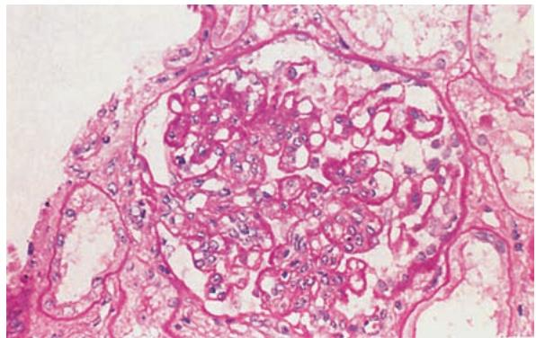
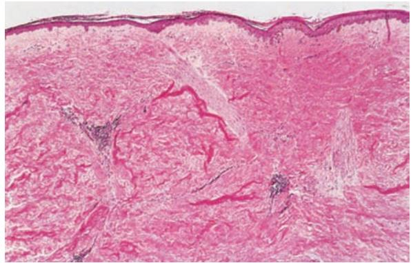
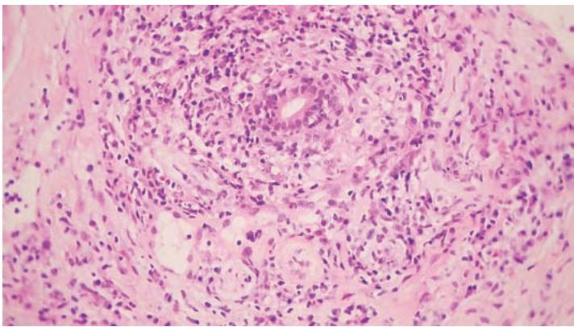
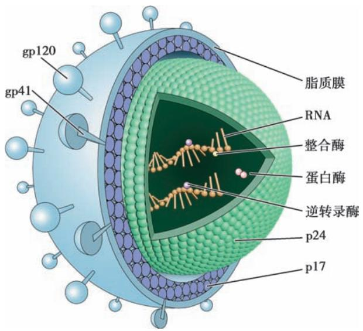
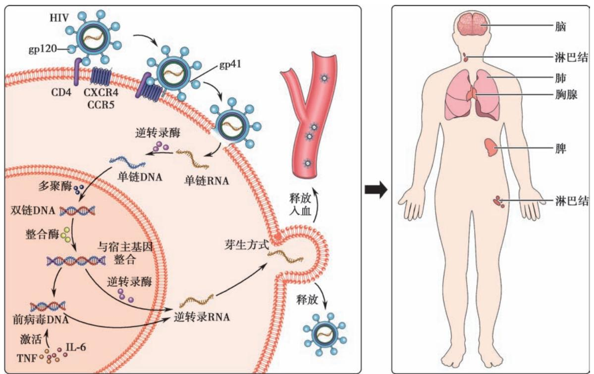
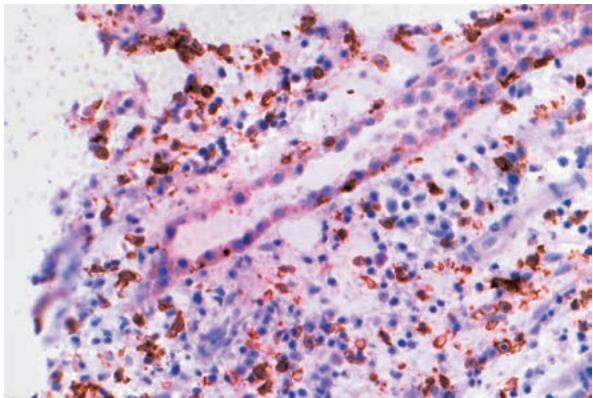
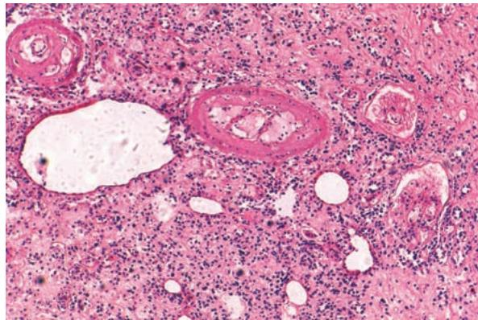
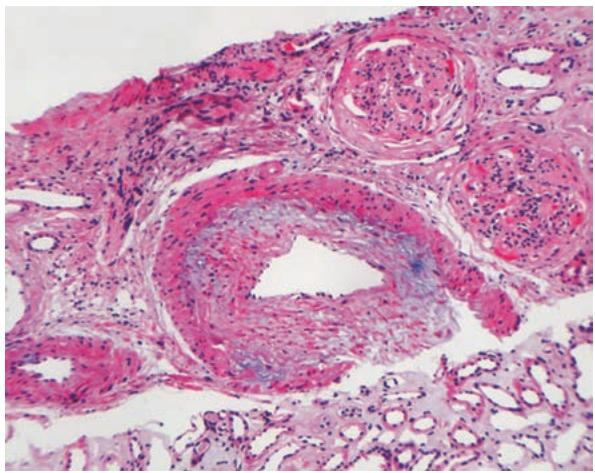

## 第五章 免疫性疾病 学习笔记

### 一、 知识框架

*   **自身免疫病 (AID)**：
    *   **发病机制**：免疫耐受丧失（中枢/外周）、自身抗原改变（隐蔽抗原、分子模拟）、遗传、性别。
    *   **系统性红斑狼疮 (SLE)**：抗核抗体、狼疮小体、狼疮带、狼疮性肾炎。
    *   **类风湿关节炎 (RA)**：滑膜炎、血管翳、类风湿小结、类风湿因子。
    *   **其他**：干燥综合征、特发性炎性肌病、系统性硬化、IgG4相关性疾病。
*   **免疫缺陷病**：
    *   **原发性**：先天性，如 DiGeorge 综合征。
    *   **继发性 (AIDS)**：HIV 感染、CD4$^+$ T 细胞受损、机会性感染、卡波西肉瘤。
*   **移植排斥反应**：
    *   **机制**：宿主抗移植物 (HVGR)、移植物抗宿主 (GVHR)。
    *   **类型**：超急性（血管炎）、急性（细胞型/血管型）、慢性（血管内膜纤维化）。

---

### 二、 重要概念及解释

1.  **自身免疫病 (AID)**：机体对自身抗原产生免疫应答，导致组织损伤和功能障碍。
2.  **免疫耐受 (Immune tolerance)**：机体对特定抗原不产生免疫应答的状态。
3.  **狼疮小体 (Lupus body)**：抗核抗体攻击受损细胞核，使其肿胀呈均质状并被挤出，具有诊断意义。
4.  **血管翳 (Pannus)**：类风湿关节炎时，高度血管化、炎症细胞浸润的增生滑膜覆盖于关节软骨表面。
5.  **艾滋病 (AIDS)**：由人类免疫缺陷病毒 (HIV) 引起，以严重免疫抑制、机会性感染和肿瘤为特征。
6.  **机会性感染**：在免疫功能低下时，由通常不致病的微生物引起的感染（如肺孢子菌）。
7.  **超急性排斥反应**：移植后数分钟至数小时发生，由受者体内预存的抗体介导。
8.  **移植物抗宿主病 (GVHD)**：移植物中的免疫活性细胞攻击宿主组织，常见于骨髓移植。

---

### 三、 正文内容详解

#### 1. 系统性红斑狼疮 (SLE)
*   **机制**：B 细胞功能亢进产生大量自身抗体（如抗双链 DNA 抗体）。
*   **特征性病变**：
    *   **肾脏**：典型“**白金耳样**”改变（内皮下免疫复合物沉积）。
    
    *图 5-1 狼疮性肾炎（PAS 染色）：基膜增厚，典型白金耳*
    *   **皮肤**：面部蝶形红斑，真皮与表皮交界处有“**狼疮带**”。
    *   **心脏**：非细菌性疣赘性心内膜炎。

#### 2. 其他自身免疫病
*   **系统性硬化**：真皮及器官间质广泛纤维化。
    
    *图 5-2 系统性硬化的皮肤：胶原纤维明显增加，表皮萎缩*
*   **IgG4 相关性疾病**：血清 IgG4 升高，组织内大量 IgG4$^+$ 浆细胞浸润。
    
    *图 5-3 IgG4 相关性疾病：腮腺内大量浆细胞浸润*

#### 3. 获得性免疫缺陷综合征 (AIDS)
*   **HIV 结构**：核心含两条单链 RNA、逆转录酶，外膜含 **gp120**（结合 CD4）和 **gp41**。
    
    *图 5-4 HIV-1 结构模式图*
*   **发病机制**：HIV 攻击 **CD4$^+$ T 细胞**，导致免疫系统核心瓦解。
    
    *图 5-5 HIV 感染发病机制：逆转录与整合过程*
*   **病理表现**：淋巴结早期增生，晚期“一片荒芜”；常伴**肺孢子菌肺炎**和**卡波西肉瘤**。

#### 4. 移植排斥反应
*   **急性排斥反应**：
    *   **细胞型**：间质水肿，淋巴细胞浸润，累及肾小管。
    
    *图 5-6 移植肾急性排斥（细胞型）：肾小管炎*
    *   **血管型**：血管内膜增厚，管腔狭窄。
    
    *图 5-7 移植肾急性排斥（血管型）：内膜增生*
*   **慢性排斥反应**：突出病变是**血管内膜纤维化**导致管腔严重狭窄。
    
    *图 5-8 移植肾慢性排斥：肾小球萎缩，间质纤维化*

---

### 四、 重要知识点总结、对比

#### 1. 自身免疫病分类举例

| 类别 | 疾病举例 | 特征性抗体/标志 |
| :--- | :--- | :--- |
| **单器官受累** | 桥本甲状腺炎、重症肌无力、胰岛素依赖型糖尿病 | 抗甲状腺球蛋白抗体、抗乙酰胆碱受体抗体 |
| **系统性受累** | **系统性红斑狼疮 (SLE)**、类风湿关节炎 (RA) | **抗核抗体 (ANA)**、类风湿因子 (RF) |

#### 2. 实体器官移植排斥反应对比

| 类型 | 发生时间 | 机制 | 主要病理变化 |
| :--- | :--- | :--- | :--- |
| **超急性** | 数分钟至数小时 | 预存抗体 (III型超敏) | 急性小动脉炎、血栓形成、坏死 |
| **急性** | 数天至数月 | T 细胞介导或抗体介导 | **细胞型**：间质淋巴细胞浸润；**血管型**：血管内膜炎 |
| **慢性** | 数月至数年 | 体液免疫为主 | **血管内膜纤维化**、管腔狭窄、实质萎缩 |

#### 3. HIV 感染导致 CD4$^+$ T 细胞减少的后果
*   **细胞免疫丧失**：CD8$^+$ 杀伤力下降，巨噬细胞功能减弱。
*   **体液免疫紊乱**：B 细胞异常激活，多克隆高丙种球蛋白血症，但不产生有效抗体。
*   **临床终点**：严重的**机会性感染**（如结核、真菌）和**继发性肿瘤**。