## 第六章 肿瘤 学习笔记

### 一、 知识框架

*   **肿瘤的概念**：肿瘤性增殖（克隆性、自主性、分化障碍）与非肿瘤性增殖的区别。
*   **肿瘤的形态与结构**：
    *   **大体形态**：数目、大小、形状、颜色、质地。
    *   **组织结构**：实质（决定分化方向）与间质（支持营养）。
    *   **异型性 (Atypia)**：结构异型性、细胞异型性（核质比、多形性、核分裂象）。
*   **命名与分类**：
    *   **命名原则**：良性（-瘤）、恶性（癌、肉瘤）、特殊命名（母细胞瘤、畸胎瘤）。
    *   **分类依据**：组织来源、生物学行为。
*   **生长与扩散**：
    *   **生长**：方式（膨胀性、外生性、浸润性）、速度（倍增时间、生长分数）、演进与异质性。
    *   **扩散**：局部侵袭、转移（淋巴道、血道、种植性）。
*   **分级与分期**：分级（I~III 级）、分期（TNM 系统）。
*   **对机体的影响**：良性（压迫、阻塞）、恶性（破坏、出血、恶病质、副肿瘤综合征）。
*   **癌前病变、异型增生与原位癌**：概念及常见例子。
*   **分子基础与致瘤因素**：
    *   **分子机制**：癌基因活化、抑癌基因失活（RB、TP53）、代谢重编程、端粒酶、血管生成、EMT。
    *   **环境因素**：化学（3,4-苯并芘、黄曲霉毒素）、物理（紫外线、辐射）、生物（HPV、EBV、HBV、幽门螺杆菌）。
*   **肿瘤与遗传**：遗传性肿瘤综合征。

---

### 二、 重要概念及解释

1.  **肿瘤 (Tumor/Neoplasm)**：机体细胞在致瘤因素作用下，基因水平发生异常，导致的异常增殖形成的新生物。
2.  **异型性 (Atypia)**：肿瘤组织结构和细胞形态与相应正常组织的差异。**异型性越大，分化程度越低，恶性程度越高**。
3.  **间变 (Anaplasia)**：肿瘤细胞呈显著异型性，失去分化状态，常见于高度恶性肿瘤。
4.  **癌 (Carcinoma)**：来源于**上皮组织**的恶性肿瘤。
5.  **肉瘤 (Sarcoma)**：来源于**间叶组织**的恶性肿瘤。
6.  **转移 (Metastasis)**：瘤细胞从原发部位侵入淋巴管、血管或体腔，迁徙到他处继续生长形成相同类型肿瘤的过程。
7.  **原位癌 (Carcinoma in situ)**：癌变仅限于上皮层内，**未突破基底膜**。
8.  **恶病质 (Cachexia)**：晚期恶性肿瘤患者出现的严重消瘦、贫血、全身衰弱状态。
9.  **副肿瘤综合征 (Paraneoplastic syndrome)**：由肿瘤产物或异常免疫反应引起，不能用肿瘤直接蔓延或转移解释的临床表现。
10. **癌基因 (Oncogene)**：原癌基因激活后，编码的癌蛋白可持续刺激细胞自主生长。

---

### 三、 正文内容详解

#### 1. 肿瘤的形态与生长方式
肿瘤的形状多样，与其性质和发生部位有关。
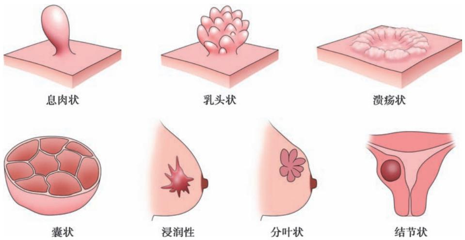
*图 6-1 肿瘤的常见大体形态和生长方式*

*   **膨胀性生长**：良性肿瘤特征，常有**包膜**，易手术摘除。
*   **浸润性生长**：恶性肿瘤特征，无包膜，界限不清，易复发。
*   **外生性生长**：突向表面，良恶性均可，但恶性者基底常有浸润。

#### 2. 肿瘤的异型性
异型性是诊断恶性肿瘤的主要组织学依据。
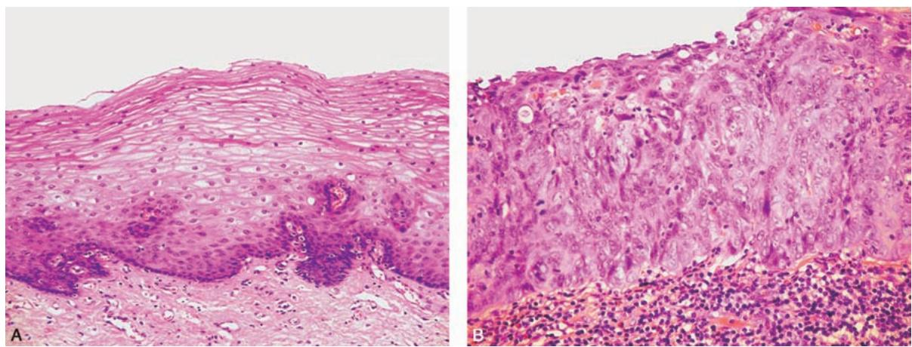
*图 6-2 正常鳞状上皮（左）与原位癌（右）对比：核大深染，极性紊乱*
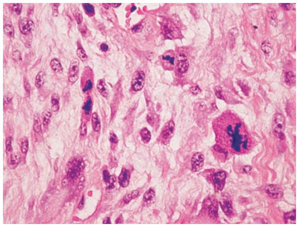
*图 6-3 恶性肿瘤细胞异型性：可见瘤巨细胞和病理性核分裂象*

#### 3. 肿瘤的免疫标记与诊断
利用 IHC 检测特定蛋白判定肿瘤来源。
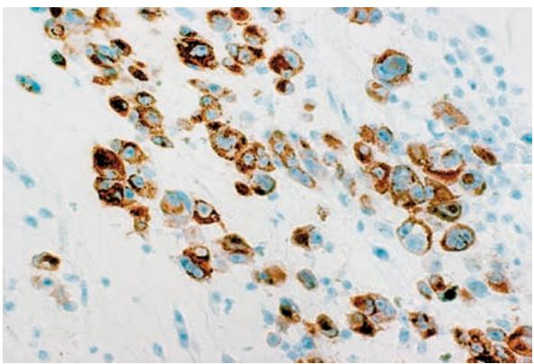
*图 6-4 黑色素瘤 HMB45 阳性（胞质棕黄色）*
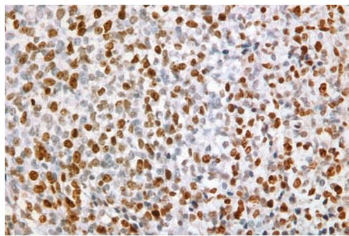
*图 6-5 横纹肌肉瘤 Ki-67 阳性（核棕黄色，示高增殖活性）*

#### 4. 肿瘤的演进与转移
*   **演进与异质性**：肿瘤在生长中通过自然选择，形成侵袭性更强的亚克隆。
    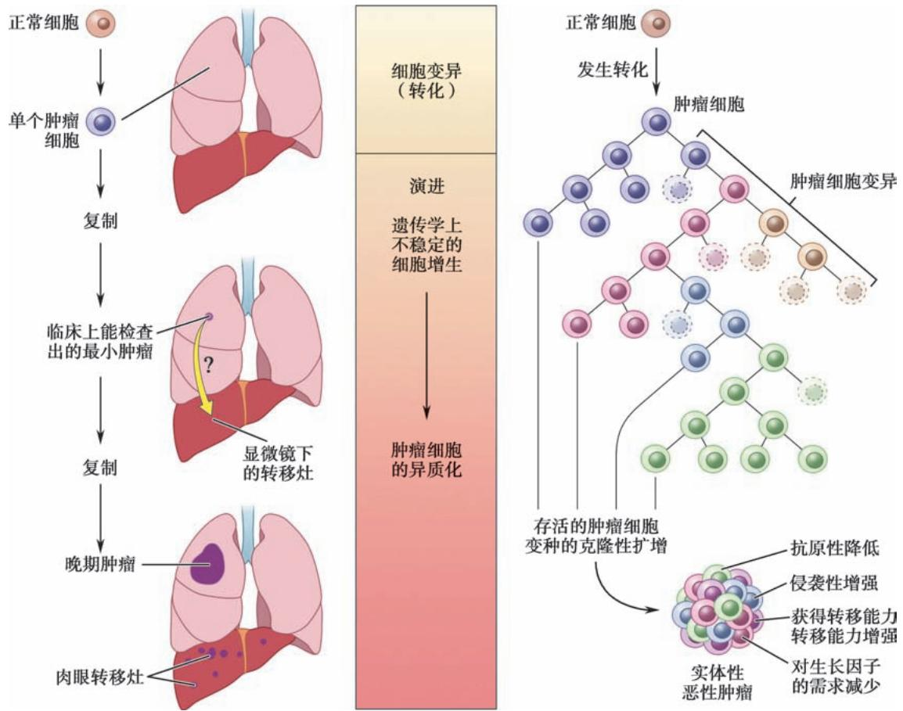
    *图 6-6 肿瘤演进与异质性模式图*
*   **转移途径**：
    *   **淋巴道转移**：癌的首选途径。
        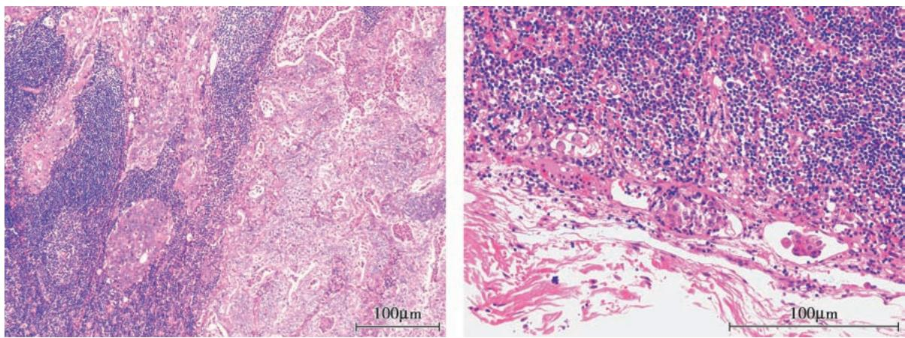
        *图 6-7 侵入淋巴管的癌细胞团*
    *   **血道转移**：肉瘤首选，常累及肺、肝。
    *   **种植性转移**：如胃癌种植至卵巢形成的 **Krukenberg 瘤**。
        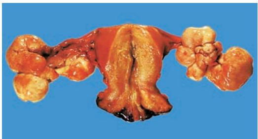
        *图 6-8 卵巢 Krukenberg 瘤*

#### 5. 肿瘤的分期 (TNM)
以乳腺癌为例，T 代表原发灶，N 代表淋巴结，M 代表远处转移。
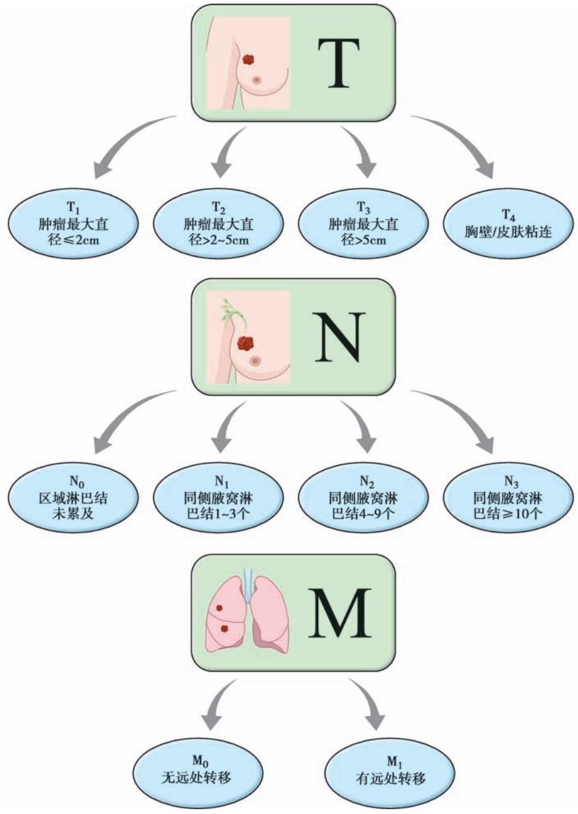
*图 6-9 乳腺癌 TNM 分期主要指标*

#### 6. 常见肿瘤举例
*   **上皮性**：鳞状细胞癌（见角化珠）、腺癌。
    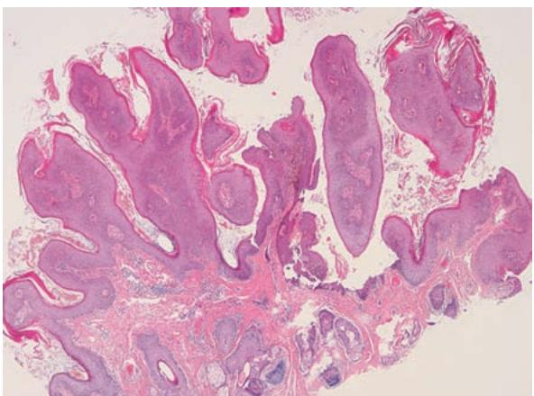
    *图 6-10 皮肤鳞状上皮乳头状瘤*
    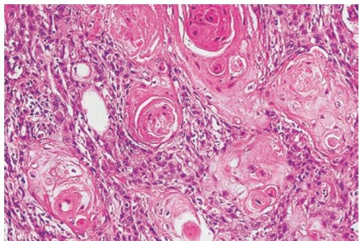
    *图 6-12 高分化鳞癌：可见角化珠*
    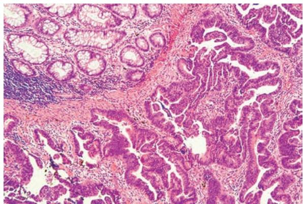
    *图 6-13 结肠腺癌：浸润性腺样结构*
*   **间叶性**：脂肪瘤、血管瘤、骨肉瘤。
    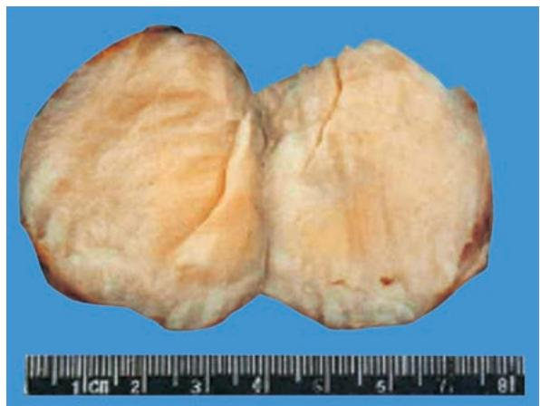
    *图 6-18 脂肪肉瘤大体*
    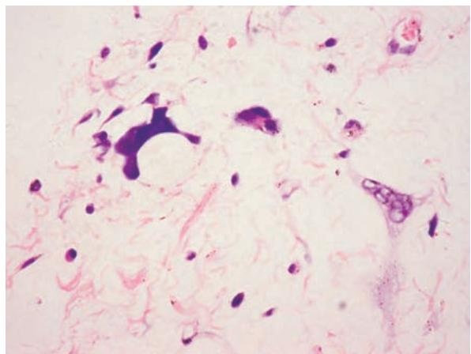
    *图 6-19 脂肪肉瘤镜下：见脂肪母细胞*

#### 7. 肿瘤发生的分子基础
*   **细胞周期调控**：RB 蛋白是重要的制动器。
    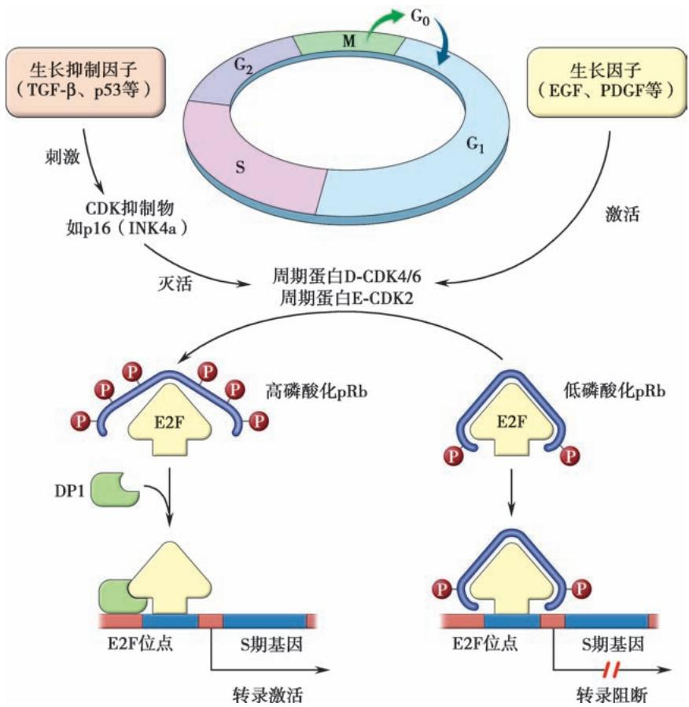
    *图 6-25 细胞周期调控机制*
*   **TP53 基因**：基因组守护者，突变导致 DNA 损伤无法修复。
    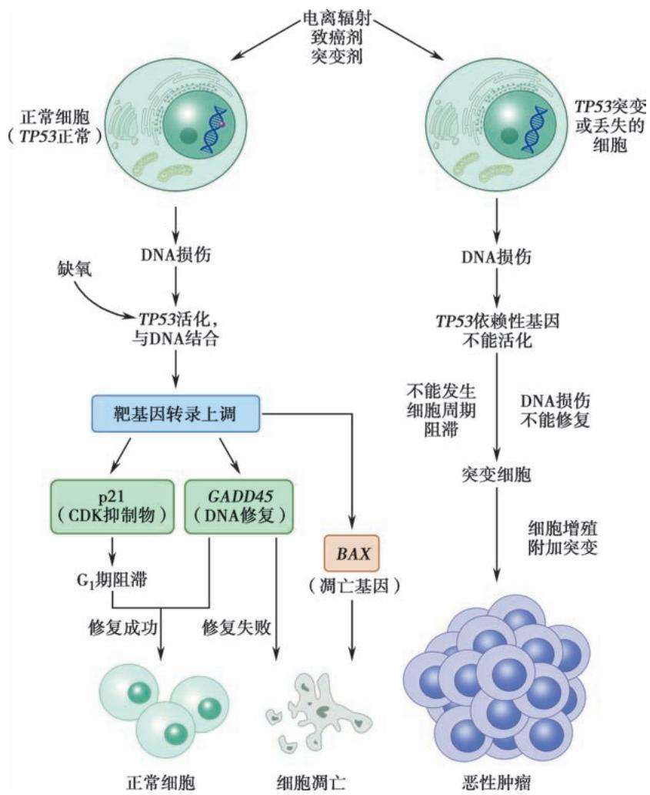
    *图 6-27 TP53 基因功能与肿瘤形成*
*   **多步骤发生**：如结直肠癌的“腺瘤-癌序贯模型”。
    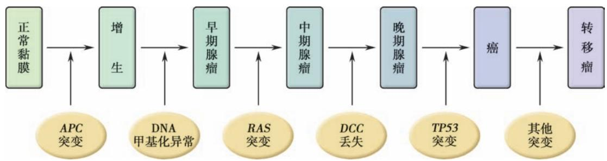
    *图 6-30 结直肠癌多步骤发生模式*
    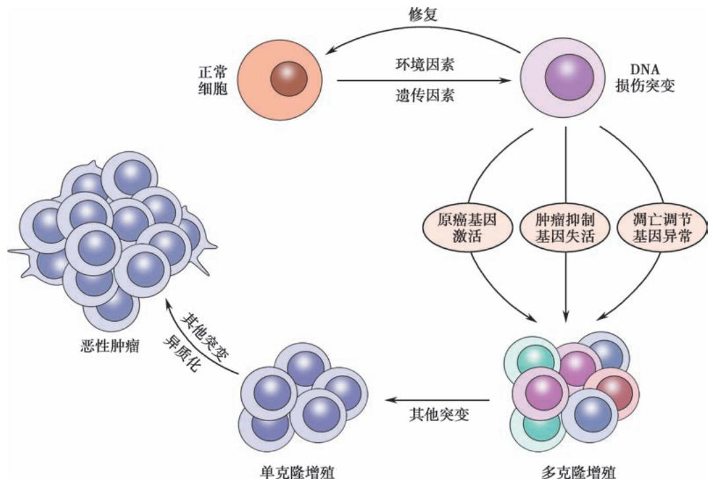
    *图 6-31 肿瘤形成和演进的基本模式*

---

### 四、 重要知识点总结、对比

#### 1. 良性肿瘤与恶性肿瘤的区别

| 鉴别点 | 良性肿瘤 | 恶性肿瘤 |
| :--- | :--- | :--- |
| **分化/异型性** | 分化好，异型性小 | 分化差，异型性大 |
| **核分裂象** | 无或少，无病理性核分裂 | 多，可见**病理性核分裂** |
| **生长方式** | 膨胀性、外生性（常有包膜） | **浸润性**、外生性（无包膜） |
| **转移** | **不转移** | **常有转移** |
| **复发** | 手术切除后不复发 | 易复发 |
| **对机体影响** | 较小（压迫、阻塞） | 很大（破坏、出血、恶病质） |

#### 2. 癌与肉瘤的鉴别

| 鉴别点 | 癌 (Carcinoma) | 肉瘤 (Sarcoma) |
| :--- | :--- | :--- |
| **组织来源** | 上皮组织 | 间叶组织 |
| **发病率** | 高（约为肉瘤的 9 倍），多见于中老年 | 低，多见于青少年 |
| **大体特征** | 质硬，色灰白，干燥 | 质软，色灰红，**鱼肉状** |
| **镜下特征** | 形成**癌巢**，实质间质分界清 | 弥漫分布，实质间质分界不清 |
| **网状纤维** | 见于癌巢周围，癌细胞间无 | 癌细胞间**多有**网状纤维 |
| **转移方式** | 多经**淋巴道** | 多经**血道** |

#### 3. 常见抑癌基因及其功能

| 基因 | 主要功能 | 相关肿瘤 |
| :--- | :--- | :--- |
| **RB** | 调节细胞周期 ($G_1 \to S$) | 视网膜母细胞瘤、骨肉瘤 |
| **TP53** | DNA 修复、细胞周期阻滞、凋亡 | **50% 以上的人类肿瘤** |
| **APC** | 抑制 WNT 信号转导 | 家族性腺瘤性息肉病、结直肠癌 |
| **VHL** | 调节低氧诱导因子 (HIF) | 透明细胞肾细胞癌 |

#### 4. 常见致癌因素

| 类别 | 因素 | 相关肿瘤 |
| :--- | :--- | :--- |
| **化学** | 3,4-苯并芘 | 肺癌 |
| | 黄曲霉毒素 $B_1$ | **肝细胞癌** |
| | 亚硝胺 | 食管癌、胃癌 |
| **物理** | 紫外线 | 皮肤癌、黑色素瘤 |
| **生物** | HPV (16, 18型) | **子宫颈癌** |
| | EB 病毒 (EBV) | 鼻咽癌、Burkitt 淋巴瘤 |
| | 幽门螺杆菌 | 胃癌、MALT 淋巴瘤 |