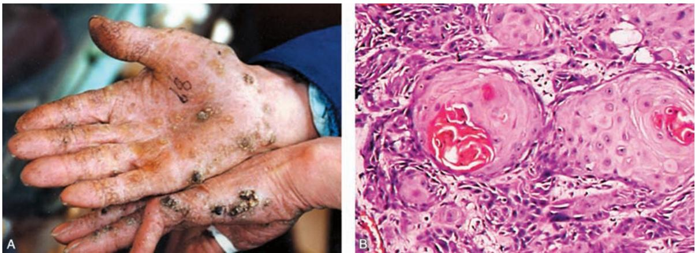
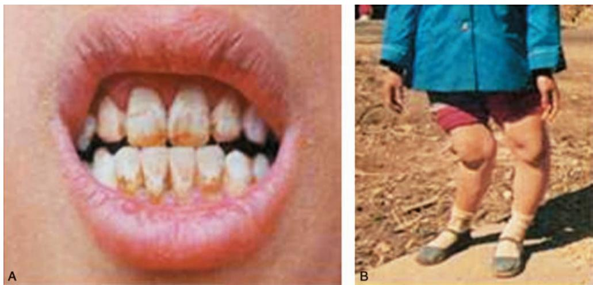
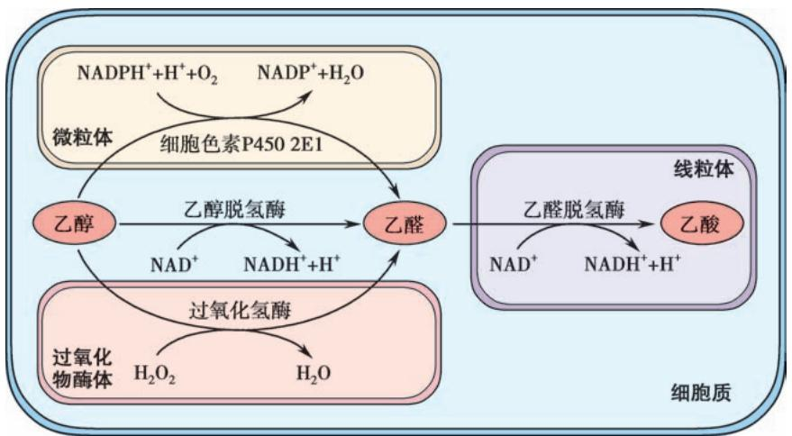
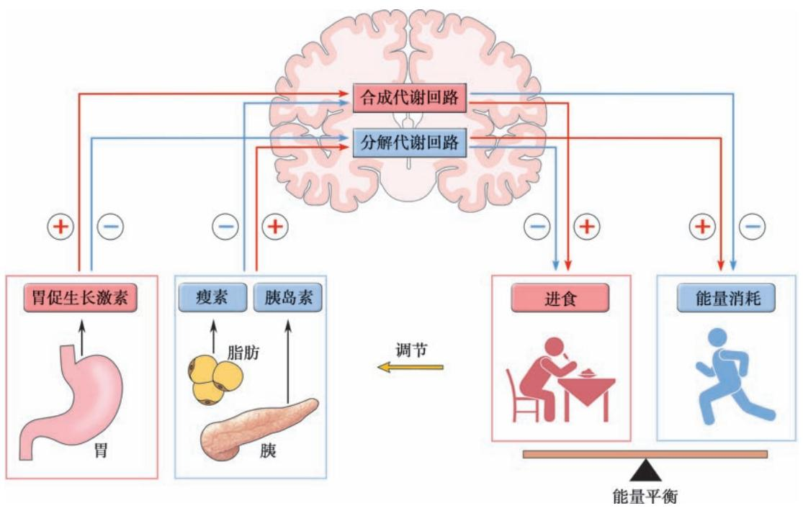

## 第七章 环境和营养性疾病 学习笔记

### 一、 知识框架

*   **环境污染和职业暴露**：
    *   **空气污染**：室外（臭氧、微粒 $\mathrm{PM}_{2.5}$、酸性气溶胶、CO）；室内（一氧化碳、甲醛、木材烟雾、氡）。
    *   **职业/环境暴露**：有机溶剂、塑料/高分子聚合物、金属元素（铅、汞、砷、镉）、非金属元素（氟、碘）、农药及灭鼠药。
*   **个人暴露——成瘾及药物毒性**：
    *   **吸烟**：尼古丁成瘾、心血管疾病、肺癌及其他肿瘤。
    *   **酒精中毒**：代谢途径（ADH/ALDH）、急性与慢性中毒、器官损害（肝、神经、心、胎儿酒精综合征）。
    *   **医源性药物损伤**：激素替代疗法、口服避孕药。
    *   **药物滥用**：阿片类、可卡因、苯丙胺类（冰毒、摇头丸）、致幻剂（大麻、PCP）。
*   **营养性疾病**：
    *   **肥胖**：BMI标准、发病机制（瘦素、胰岛素、胃促生长激素）、危害。
    *   **营养不良**：蛋白质-能量营养不良（消瘦症、恶性营养不良）、维生素缺乏症。

---

### 二、 重要概念及解释

1.  **环境污染 (Environmental pollution)**：有害化学物质或能量排放超过环境自净能力，损害生态与健康。
2.  **职业暴露 (Occupational exposure)**：因职业关系暴露于危险因素，可能损害健康或危及生命。
3.  **一氧化碳中毒**：吸入 CO 形成**碳氧血红蛋白**，导致全身皮肤黏膜呈特殊的**樱桃红色**。
4.  **氟骨症 (Fluorosis of bone)**：长期摄入过量氟导致骨硬化、骨软化或骨质疏松。
5.  **胎儿酒精综合征**：母亲孕期酗酒导致胎儿永久性出生缺陷（智力下降、行为异常）。
6.  **体重指数 (BMI)**：体重(kg)/身高²($\mathrm{m}^2$)，用于衡量肥胖程度。
7.  **消瘦症 (Marasmus)**：长期缺乏热量、蛋白质及其他营养素导致的营养不良。
8.  **恶性营养不良 (Kwashiorkor)**：蛋白质严重缺乏但热量供应尚可，表现为**水肿、肝大、腹腔积液**。

---

### 三、 正文内容详解

#### 1. 环境污染与金属中毒
*   **空气污染**：$\mathrm{PM}_{2.5}$（直径 $\leqslant 2.5\mu\mathrm{m}$）最易沉积于肺泡。室内**氡气**是导致肺癌的重要因素。
*   **金属中毒**：
    *   **铅 (Lead)**：累及脑（脑水肿）、周围神经（**腕下垂、足下垂**）、肾（纤维化）及骨（**铅线**）。
    *   **砷 (Arsenic)**：引起皮肤过度角化及**皮肤癌（鳞癌）**。
    
    *图 7-1 砷中毒：A. 手掌过度角化；B. 皮肤高分化鳞状细胞癌*
    *   **氟 (Fluorine)**：典型表现为**氟斑牙**和**氟骨症**。
    
    *图 7-2 慢性氟中毒：A. 氟斑牙；B. 氟骨症（X形腿）*

#### 2. 酒精中毒与代谢
*   **代谢途径**：$90\%$ 在肝脏代谢，经**乙醇脱氢酶 (ADH)** 转为乙醛，再经**乙醛脱氢酶 (ALDH)** 转为乙酸。
    
    *图 7-3 乙醇代谢途径*
*   **器官损害**：
    *   **肝脏**：脂肪肝 -> 酒精性肝炎 -> 酒精性肝硬化。
    *   **心脏**：酒精性心肌病（扩张型）。
    *   **神经**：大脑皮质萎缩、维生素 $B_1$ 缺乏（Wernicke-Korsakoff 综合征）。

#### 3. 肥胖与能量调节
*   **发病机制**：涉及**瘦素 (Leptin)** 和**胰岛素**的负反馈调节，以及**胃促生长激素 (Ghrelin)** 的正反馈调节。
    
    *图 7-4 能量调节模式图*
*   **危害**：增加 2 型糖尿病、高血压、胆结石及多种癌症（子宫内膜癌、乳腺癌等）的风险。

#### 4. 营养不良
*   **蛋白质-能量营养不良 (PEM)**：
    *   **消瘦症**：皮下脂肪消失，骨瘦如柴。
    *   **恶性营养不良**：虽然有热量（如米粉喂养），但缺蛋白质，导致**低蛋白血症水肿**，外观可能并不消瘦。

---

### 四、 重要知识点总结、对比

#### 1. 常见金属中毒临床病理特征对比表

| 金属 | 主要受累器官 | 特征性表现 | 备注 |
| :--- | :--- | :--- | :--- |
| **铅 (Pb)** | 脑、周围神经、骨、肾 | **腕下垂**、骨干骺端“**铅线**” | 抑制血红蛋白合成 |
| **汞 (Hg)** | 脑、肾 | 视皮质海绵状软化、肾小管坏死 | **水俣病**（有机汞） |
| **砷 (As)** | 皮肤、中枢神经 | 掌跖**过度角化**、皮肤鳞癌 | 砒霜中毒 |
| **镉 (Cd)** | 肺、肾、骨 | 肺纤维化、肾小管损伤 | **痛痛病** |

#### 2. 肥胖程度分级 (WHO 亚太标准)

| 体重指数 (BMI) | 肥胖程度 | 危险度 |
| :--- | :--- | :--- |
| $<18.5$ | 体重不足 | 增加 |
| $18.5 \sim 24.9$ | **正常** | 正常 |
| $25.0 \sim 29.9$ | 超重 | 增加 |
| $30.0 \sim 34.9$ | 肥胖 I | 高 |
| $\geqslant 40.0$ | 肥胖 III | **极度高** |

#### 3. 两种主要营养不良的鉴别

| 鉴别点 | 营养不良性消瘦 (Marasmus) | 恶性营养不良 (Kwashiorkor) |
| :--- | :--- | :--- |
| **缺乏成分** | 热量、蛋白质均严重缺乏 | **蛋白质**严重缺乏，热量尚可 |
| **主要人群** | 1 岁以内婴儿 | 断奶后以谷物喂养的儿童 |
| **皮下脂肪** | 消失 | 正常或减少 |
| **水肿** | 无 | **明显水肿**（低蛋白血症） |
| **肝脏病变** | 无明显变化 | **显著肝脂肪变**、肝大 |

#### 4. 常见药物滥用的后果

| 药物类别 | 代表药物 | 主要危害 |
| :--- | :--- | :--- |
| **阿片类** | 海洛因、吗啡 | 呼吸抑制、急性肺水肿、猝死 |
| **兴奋剂** | 冰毒、摇头丸 | 神经异常、心律不齐、脑出血 |
| **可卡因** | - | 冠脉痉挛、心肌缺血、扩张型心肌病 |
| **致幻剂** | 大麻、PCP | 精神障碍、行为失控 |