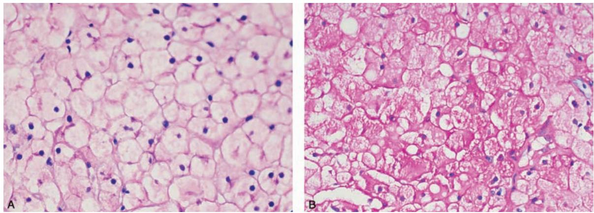
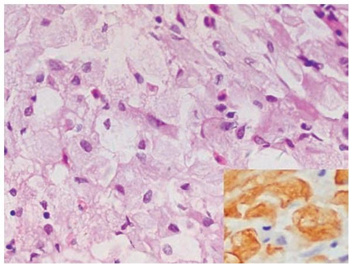
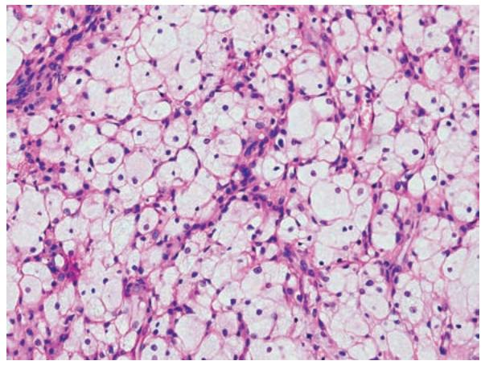

## 第八章 遗传性疾病和儿童疾病 学习笔记

### 一、 知识框架

*   **遗传性疾病的遗传学基础**：
    *   **蛋白质编码基因突变**：点突变、移码突变、拷贝数扩增/缺失/易位、三核苷酸重复序列突变。
    *   **非编码 RNA 异常**：miRNA、lncRNA 异常。
*   **遗传性疾病的类型**：
    *   **单基因遗传病（孟德尔遗传病）**：常染色体显性/隐性、X 连锁显性/隐性、Y 连锁。
    *   **多基因遗传病**：多个微效基因与环境共同作用。
    *   **染色体病**：数目异常（整倍体/非整倍体）、结构畸变。
    *   **其他**：线粒体病（母系遗传）、遗传印记异常。
*   **常见遗传病举例**：
    *   **先天性代谢缺陷**：糖原贮积症、戈谢病、苯丙酮尿症。
    *   **分子病**：地中海贫血、Duchenne 型肌营养不良（DMD）、家族性高胆固醇血症。
    *   **染色体病**：唐氏综合征、特纳综合征、克兰费尔特综合征。
*   **儿童疾病**：
    *   **出生缺陷**：畸形、畸化、变形、序列征、综合征。
    *   **坏死性小肠结肠炎 (NEC)**。
    *   **儿童肿瘤**：良性（血管瘤、错构瘤）、恶性（白血病、神经母细胞瘤、肾母细胞瘤等）。

---

### 二、 重要概念及解释

1.  **点突变 (Point mutation)**：DNA 链中单个碱基被替换，可导致**错义突变**（氨基酸改变）或**无义突变**（产生终止密码子）。
2.  **三核苷酸重复序列突变**：基因组中脱氧三核苷酸串联重复拷贝数异常扩增，如**脆性 X 综合征**。
3.  **戈谢细胞 (Gaucher cell)**：戈谢病患者体内吞噬了葡萄糖脑苷脂的巨噬细胞，胞质呈“**皱纹纸**”样。
4.  **本周蛋白 (Bence-Jones protein)**：浆细胞肿瘤产生的单克隆免疫球蛋白轻链，分子量小，可经尿排出。
5.  **出生缺陷 (Birth defect)**：患儿出生时在外形或体内形成的结构或功能缺陷。
6.  **错构瘤 (Hamartoma)**：器官内成熟组织细胞过度增生并排列紊乱，属于瘤样病变而非真性肿瘤。
7.  **异位 (Heterotopia)**：正常的组织或细胞出现在异常部位，又称**迷芽**。

---

### 三、 正文内容详解

#### 1. 先天性代谢缺陷
*   **糖原贮积症 (GSD)**：
    *   **Ia 型**：最常见，缺乏 G-6-P 酶。肝细胞弥漫肿胀，胞质空亮，**PAS 染色**可见大量红染糖原颗粒。
    
    *图 8-1 肝糖原贮积症：A. 胞质着色浅；B. PAS 染色示红染糖原*

*   **戈谢病 (Gaucher disease)**：
    *   由于 GBA 酶缺乏，葡萄糖脑苷脂在巨噬细胞内贮积。
    *   **病理特征**：骨髓、肝、脾内出现大量**戈谢细胞**。
    
    *图 8-2 骨髓戈谢病：细胞质呈“皱纹纸”样*

#### 2. 分子病与受体病
*   **家族性高胆固醇血症**：
    *   **LDL 受体缺陷**导致血浆胆固醇极度升高。
    *   **临床表现**：早发动脉粥样硬化、皮肤**黄色瘤**。
    
    *图 8-3 黄色瘤：皮下大量泡沫细胞聚集*

#### 3. 染色体病
*   **唐氏综合征 (Down syndrome)**：即 21-三体综合征。表现为智力落后、特殊面容（眼距宽、面平）、贯通手。
*   **特纳综合征 (Turner syndrome)**：核型 **45,XO**。女性患者身材矮小、颈蹼、原发闭经。
*   **克兰费尔特综合征 (Klinefelter syndrome)**：核型 **47,XXY**。男性患者睾丸小、不育、乳房发育。

#### 4. 儿童疾病与肿瘤
*   **出生缺陷类型**：
    *   **畸形**：原发性发育阻滞。
    *   **畸化**：继发性干扰（如缺血、感染）。
    *   **变形**：机械力扭曲（如子宫内受压）。
*   **儿童恶性肿瘤**：
    *   **白血病**：儿童发病率第一。
    *   **肾母细胞瘤 (Wilms 瘤)**：起源于后肾胚基，含上皮、间叶和胚基三种成分。
    *   **神经母细胞瘤**：好发于肾上腺及交感神经链。

---

### 四、 重要知识点总结、对比

#### 1. 常见单基因遗传病分类表

| 类别 | 疾病名称 | 遗传方式 | 关键缺陷 |
| :--- | :--- | :--- | :--- |
| **代谢缺陷** | 苯丙酮尿症 | 常隐 | 苯丙氨酸羟化酶 (PAH) 缺乏 |
| **代谢缺陷** | 戈谢病 | 常隐 | β-葡萄糖脑苷脂酶 (GBA) 缺乏 |
| **分子病** | 地中海贫血 | 常隐 | 珠蛋白合成障碍 |
| **分子病** | 肌营养不良 (DMD) | **X 隐** | 抗肌萎缩蛋白 (Dystrophin) 缺失 |
| **受体病** | 家族性高胆固醇血症 | **常显** | LDL 受体缺陷 |

#### 2. 常见染色体病对比表

| 疾病名称 | 常用核型 | 性别 | 主要临床特征 |
| :--- | :--- | :--- | :--- |
| **唐氏综合征** | 47, XX/XY, +21 | 男女均可 | 智力低下、特殊面容、贯通手、先天性心脏病 |
| **特纳综合征** | **45, XO** | 女性 | 身材矮小、**颈蹼**、肘外翻、卵巢条索状纤维化 |
| **克兰费尔特综合征** | **47, XXY** | 男性 | 睾丸小而硬、第二性征发育差、**女性化乳房** |

#### 3. 出生缺陷的术语鉴别

| 术语 | 定义 | 例子 |
| :--- | :--- | :--- |
| **畸形 (Malformation)** | 胚胎发育过程中的原发性缺失 | 唇裂、先天性心脏病 |
| **畸化 (Disruption)** | 外界因素干扰导致的继发性畸形 | 羊膜带综合征导致的肢体残缺 |
| **变形 (Deformation)** | 机械力挤压导致的形状改变 | 足内翻（因子宫空间狭小） |
| **序列征 (Sequence)** | 一种异常因素引发的一系列继发畸形 | **Potter 序列征**（羊水过少引起） |

#### 4. 儿童恶性肿瘤的年龄分布特点
*   **0～4 岁**：白血病、**神经母细胞瘤**、肾母细胞瘤、肝母细胞瘤。
*   **5～9 岁**：白血病、淋巴瘤、**尤因肉瘤**。
*   **10～14 岁**：**骨肉瘤**、霍奇金淋巴瘤。