## 第九章 心血管系统疾病 学习笔记

### 一、 知识框架

*   **动脉粥样硬化 (AS)**：
    *   **危险因素与机制**：高脂血症（LDL/VLDL升高、HDL降低）、损伤-应答反应学说、炎症学说。
    *   **基本病理变化**：脂纹、纤维斑块、**粥样斑块**（典型病变）、继发性病变（出血、破裂、血栓、钙化、动脉瘤）。
    *   **重要器官病变**：主动脉、**冠状动脉（心绞痛、心肌梗死）**、脑（脑软化、出血）、肾（颗粒性固缩肾）。
*   **高血压病**：
    *   **发病机制**：RAAS系统激活、交感神经亢进、胰岛素抵抗。
    *   **良性高血压**：机能紊乱期、动脉病变期（**细动脉玻璃样变**）、内脏病变期（左心肥大、原发性颗粒性固缩肾、脑出血）。
    *   **恶性高血压**：增生性小动脉硬化、坏死性细动脉炎。
*   **动脉瘤**：囊状、梭形、夹层动脉瘤等。
*   **风湿病 (Rheumatism)**：
    *   **基本病变**：变质渗出期、增生期（**风湿小体/Aschoff小体**）、纤维化期。
    *   **器官病变**：风湿性心脏炎（**绒毛心**、疣状心内膜炎）、关节炎、皮肤病变（环形红斑）、小舞蹈病。
*   **感染性心内膜炎 (IE)**：急性与亚急性（赘生物特点对比）。
*   **心瓣膜病**：二尖瓣/主动脉瓣的狭窄与关闭不全。
*   **心肌病与心肌炎**：扩张型、肥厚型、克山病；病毒性心肌炎。
*   **心包炎**：纤维蛋白性心包炎（绒毛心）。
*   **先天性心脏病**：房间隔缺损 (ASD)、室间隔缺损 (VSD)、**法洛四联症**、动脉导管未闭 (PDA)。

---

### 二、 重要概念及解释

1.  **动脉粥样硬化 (Atherosclerosis, AS)**：累及大中动脉，内膜形成粥样斑块，导致管壁变硬、管腔狭窄。
2.  **泡沫细胞 (Foam cell)**：吞噬了大量脂质的巨噬细胞或平滑肌细胞，是 AS 早期病变的特征。
3.  **心肌梗死 (Myocardial infarction, MI)**：冠状动脉供血中断导致的心肌坏死，常表现为**凝固性坏死**。
4.  **向心性肥大 (Concentric hypertrophy)**：高血压早期，左心室壁增厚但心腔不扩张。
5.  **原发性颗粒性固缩肾**：良性高血压晚期，双肾对称性缩小，表面呈细颗粒状。
6.  **风湿小体 (Aschoff body)**：风湿病增生期的特征性病变，由纤维蛋白样坏死、风湿细胞及炎症细胞构成。
7.  **绒毛心 (Cor villosum)**：干性心包炎时，心外膜表面覆盖大量纤维蛋白，随心脏搏动呈绒毛状。
8.  **疣状赘生物 (Verrucous vegetation)**：风湿性心内膜炎时，瓣膜闭锁缘形成的灰白色、附着牢固的血栓。
9.  **法洛四联症 (Tetralogy of Fallot)**：包括室间隔缺损、肺动脉口狭窄、主动脉骑跨、右心室肥厚。

---

### 三、 正文内容详解

#### 1. 动脉粥样硬化 (AS)
*   **发病机制**：核心是内皮损伤和脂质渗入。
    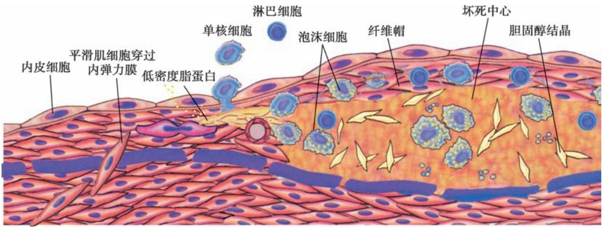
    *图 9-1 动脉粥样硬化发病机制示意图*
*   **基本病变**：
    *   **脂纹**：肉眼见黄色条纹，镜下为**泡沫细胞**。
        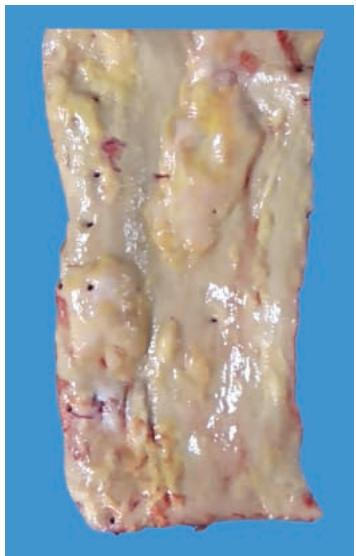
        *图 9-2 主动脉脂纹与斑块*
        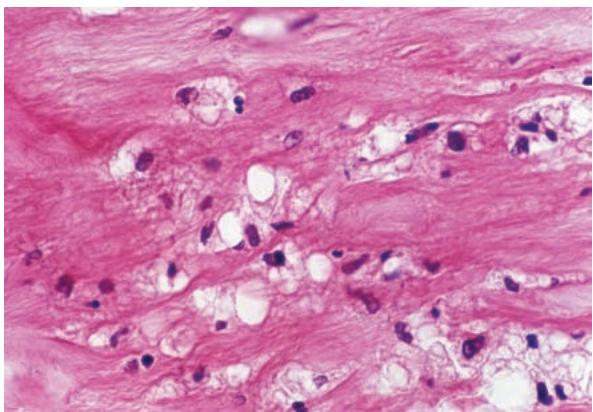
        *图 9-3 泡沫细胞（胞质空泡状）*
    *   **粥样斑块**：表面为纤维帽，深层为坏死物质和**胆固醇结晶**。
        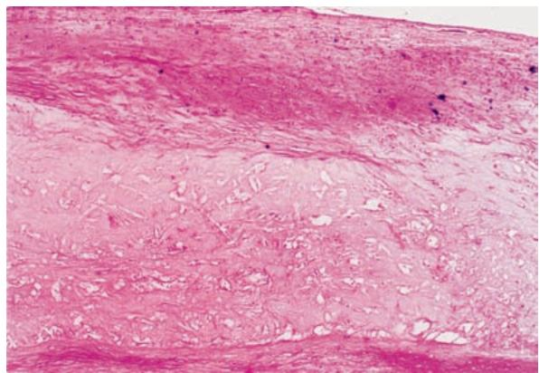
        *图 9-4 粥样斑块镜下结构*
*   **冠心病**：
    *   **心肌梗死**：镜下可见**收缩带**，间质中性粒细胞浸润。
        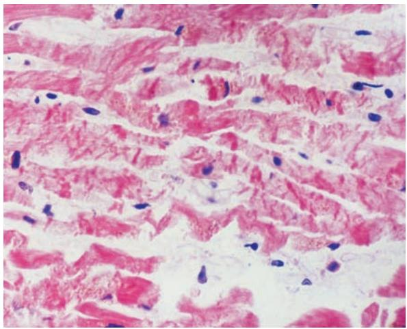
        *图 9-9 心肌梗死（收缩带）*

#### 2. 高血压病
*   **血管病变**：特征是**细动脉玻璃样变**。
    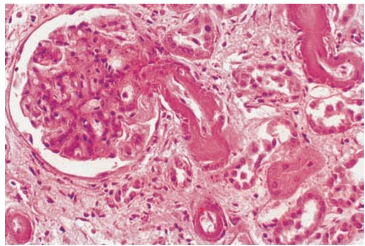
    *图 9-14 肾入球动脉玻璃样变（管壁增厚、红染均质）*
*   **心脏病变**：左心室向心性肥大。
    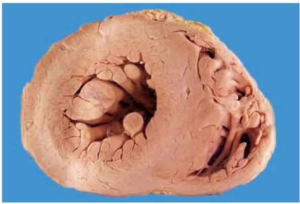
    *图 9-15 左心室向心性肥大（大体）*
*   **肾脏病变**：原发性颗粒性固缩肾。
    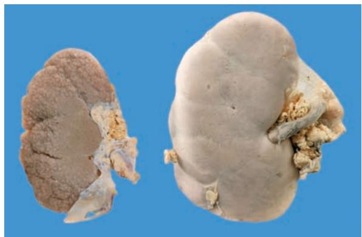
    *图 9-17 原发性颗粒性固缩肾（左）与正常肾（右）对比*
*   **脑病变**：脑出血最常发生于**基底节、内囊**（豆纹动脉破裂）。
    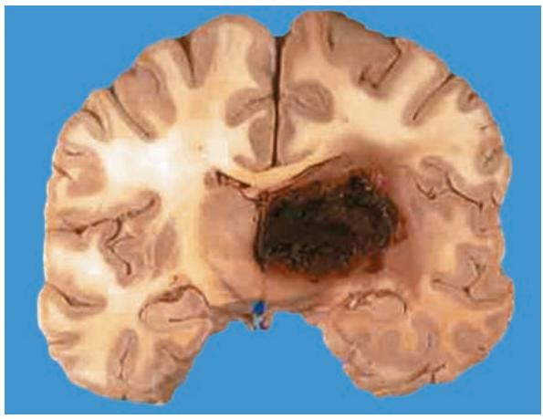
    *图 9-18 高血压脑出血*

#### 3. 风湿病
*   **基本病变**：**Aschoff 小体**是诊断依据。
    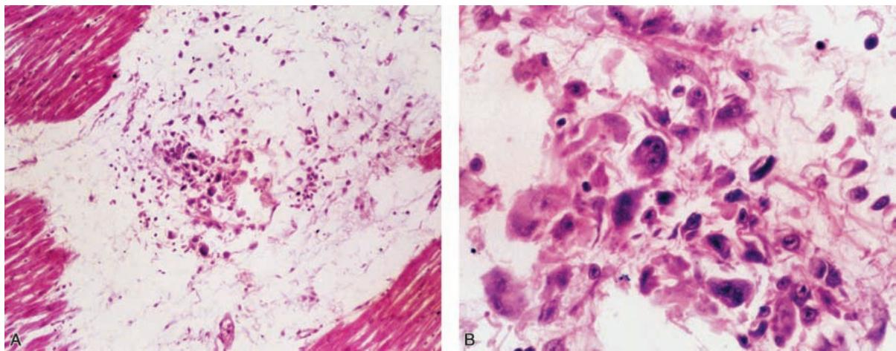
    *图 9-21 风湿性心肌炎：可见枭眼状或毛虫状 Aschoff 细胞*
*   **心脏表现**：
    *   心内膜：**疣状心内膜炎**。
        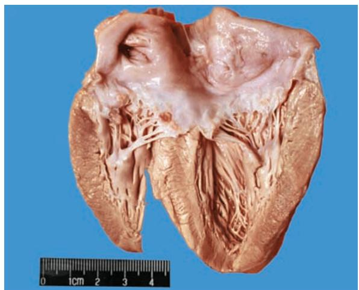
        *图 9-22 二尖瓣闭锁缘的疣状赘生物*
    *   心外膜：**绒毛心**。
        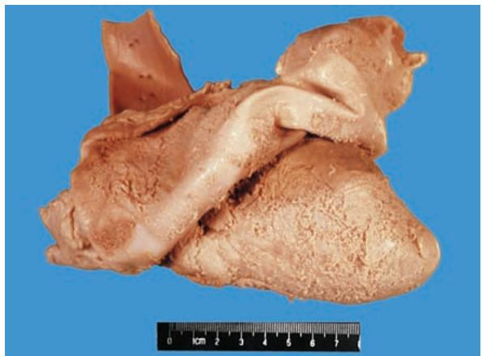
        *图 9-23 绒毛心（大体）*

#### 4. 感染性心内膜炎 (IE)
*   **亚急性 IE**：常在原有瓣膜病基础上发生，赘生物大而松脆，易脱落引起栓塞。
    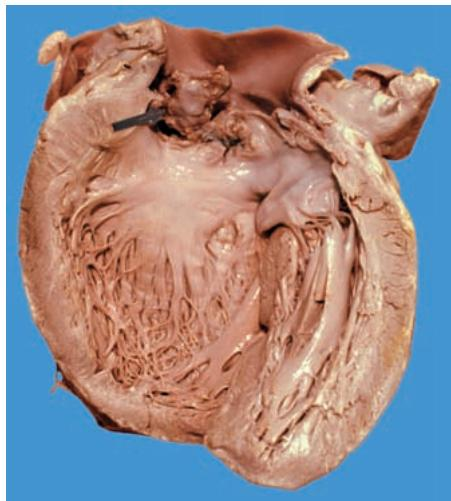
    *图 9-25 细菌性心内膜炎：主动脉瓣上的鸡冠状赘生物*

#### 5. 心肌病
*   **扩张型 (DCM)**：心腔显著扩张，心尖变钝。
    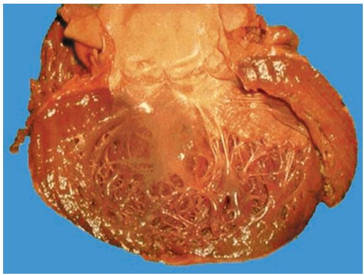
    *图 9-27 扩张型心肌病*
*   **肥厚型 (HCM)**：**室间隔非对称性肥厚**。
    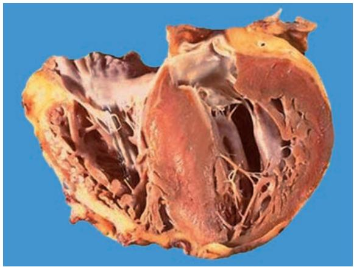
    *图 9-28 肥厚型心肌病*
*   **克山病**：地方性心肌病，心肌弥漫性变性坏死。
    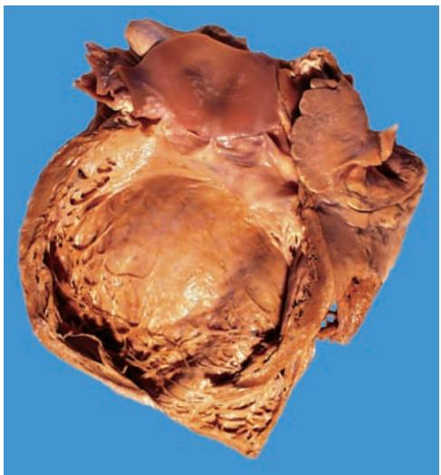
    *图 9-30 克山病大体*

#### 6. 先天性心脏病
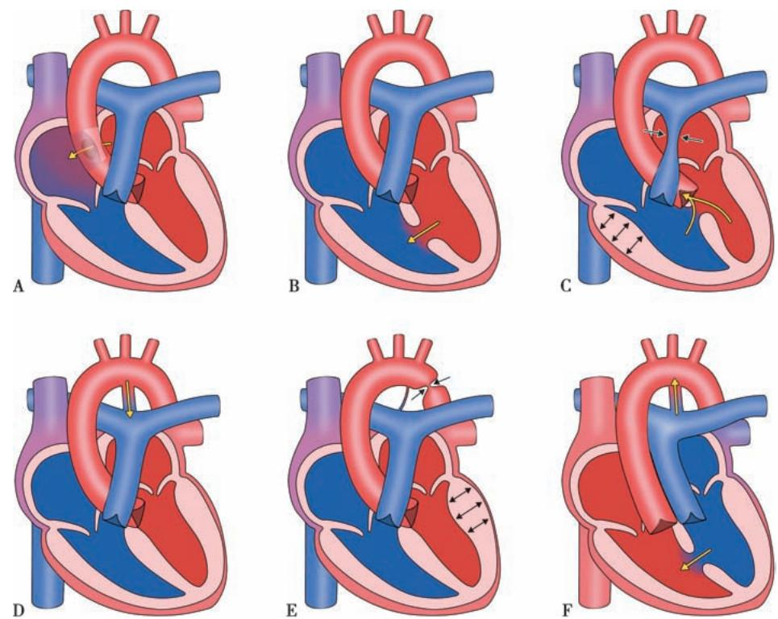
*图 9-33 先天性心脏病类型：A.房间隔缺损；B.室间隔缺损；C.法洛四联症；D.动脉导管未闭*

---

### 四、 重要知识点总结、对比

#### 1. 动脉粥样硬化四种基本病变的对比

| 病变时期 | 肉眼特征 | 镜下特征 |
| :--- | :--- | :--- |
| **脂纹** | 黄色点状或条纹，不隆起 | 大量**泡沫细胞**聚集 |
| **纤维斑块** | 隆起，浅黄或瓷白色 | 表面为**纤维帽**，下方为平滑肌、细胞外基质 |
| **粥样斑块** | 灰黄色，切面见黄色粥样物 | 坏死中心、**胆固醇结晶**、钙化 |
| **继发性病变** | 溃疡、血栓、出血 | 斑块破裂、血栓形成、管腔完全闭塞 |

#### 2. 急性与亚急性感染性心内膜炎的鉴别

| 鉴别点 | 急性 IE | 亚急性 IE |
| :--- | :--- | :--- |
| **致病菌** | 金黄色葡萄球菌（毒力强） | **甲型溶血性链球菌**（毒力弱） |
| **瓣膜基础** | 常为正常瓣膜 | **常有病变瓣膜**（如风湿性） |
| **赘生物特点** | 大、松脆、易破碎、**含大量细菌** | 较大、息肉状/菜花状、**含细菌菌落** |
| **后果** | 瓣膜穿孔、急性心衰、病程短 | 瓣膜变形、慢性心衰、病程长 |

#### 3. 风湿性心内膜炎与亚急性细菌性心内膜炎赘生物对比

| 鉴别点 | 风湿性心内膜炎 | 亚急性细菌性心内膜炎 |
| :--- | :--- | :--- |
| **赘生物大小** | 极小（1~2mm），疣状 | 较大，息肉状/菜花状 |
| **附着程度** | **牢固**，不易脱落 | **松脆**，极易脱落 |
| **成分** | 血小板、纤维蛋白（无菌） | 血小板、纤维蛋白、**细菌菌落** |
| **后果** | 瓣膜增厚、粘连（慢性心瓣膜病） | 栓塞、瓣膜溃疡、穿孔 |

#### 4. 心肌病类型对比

| 类型 | 核心病变 | 临床特征 |
| :--- | :--- | :--- |
| **扩张型 (DCM)** | 心腔扩张，室壁变薄/略厚 | 充血性心力衰竭、心律失常 |
| **肥厚型 (HCM)** | **室间隔非对称性肥厚** | 猝死（青年）、心室充盈受阻 |
| **限制型 (RCM)** | 心内膜及下纤维化 | 舒张受限、心室充盈障碍 |
| **克山病** | 心肌变性、坏死、瘢痕 | 地方性，与缺硒有关 |