## 第十章 呼吸系统疾病 学习笔记

### 一、 知识框架

*   **呼吸道和肺的炎症性疾病**：
    *   鼻炎、鼻窦炎、咽炎、喉炎。
    *   急性气管支气管炎与细支气管炎。
    *   **肺炎 (Pneumonia)**：
        *   **细菌性**：大叶性肺炎（四期演变）、小叶性肺炎（支气管肺炎）、军团菌肺炎。
        *   **病毒性**：间质性炎症、透明膜形成、**病毒包涵体**。
        *   **严重急性呼吸综合征 (SARS)**：弥漫性肺泡损伤。
        *   **支原体肺炎**：间质性肺炎。
*   **慢性阻塞性肺疾病 (COPD)**：
    *   **慢性支气管炎**：黏液-纤毛排送系统受损、腺体增生、鳞化。
    *   **肺气肿 (Emphysema)**：肺泡性（腺泡中央型、全腺泡型、隔旁型）、间质性。
*   **支气管哮喘**：过敏性、支气管痉挛、夏科-莱登结晶。
*   **支气管扩张症**：持久性不可逆扩张、慢性化脓性炎。
*   **肺尘埃沉着病 (尘肺)**：
    *   **肺硅沉着病 (硅肺)**：**硅结节**、弥漫性纤维化。
    *   **肺石棉沉着病**：**石棉小体**、胸膜斑、致癌性。
*   **慢性肺源性心脏病**：右心肥大、肺动脉高压。
*   **呼吸窘迫综合征**：成人 (ARDS) 与 新生儿 (NRDS)。
*   **呼吸系统常见肿瘤**：
    *   **鼻咽癌**：EBV 相关、泡状核细胞癌、颈淋巴结转移。
    *   **喉癌**：鳞癌为主。
    *   **肺癌**：中央型、周围型、弥漫型；组织学（腺癌、鳞癌、小细胞癌）。
*   **胸膜疾病**：胸膜炎、胸膜间皮瘤。

---

### 二、 重要概念及解释

1.  **大叶性肺炎 (Lobar pneumonia)**：由肺炎链球菌引起，累及整个肺大叶，以**纤维蛋白渗出**为特征。
2.  **小叶性肺炎 (Lobular pneumonia)**：又称支气管肺炎，以**细支气管为中心**的化脓性炎症。
3.  **肺肉质变 (Pulmonary carnification)**：大叶性肺炎时，渗出的纤维蛋白未能及时溶解吸收，由肉芽组织取代机化，使肺组织呈肉样。
4.  **病毒包涵体 (Inclusion body)**：病毒性肺炎时，在增生的上皮或巨细胞核/胞质内出现的特征性结构，具有诊断意义。
5.  **肺气肿 (Emphysema)**：末梢肺组织含气量过多伴肺泡间隔破坏，导致肺体积膨大、弹性减弱。
6.  **硅结节 (Silicotic nodule)**：硅肺的特征病变，由胶原纤维呈同心圆或旋涡状排列构成。
7.  **石棉小体 (Asbestos body)**：铁蛋白包裹的石棉纤维，呈黄褐色、棒状或蝌蚪形。
8.  **肺心病 (Cor pulmonale)**：慢性肺疾病引起肺循环阻力增加，导致**右心室肥厚扩张**。
9.  **透明膜 (Hyaline membrane)**：ARDS 或 NRDS 时，肺泡表面贴附的均质红染膜状物。
10. **角化珠 (Keratin pearl)**：高分化鳞状细胞癌中，癌巢中央出现的层状角化物。

---

### 三、 正文内容详解

#### 1. 细菌性肺炎
*   **大叶性肺炎**：典型病程分四期。
    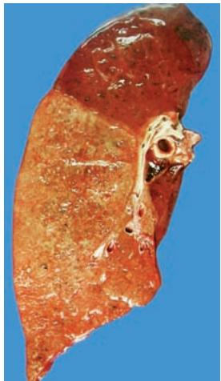
    *图 10-1 大叶性肺炎（灰色肝样变期）：灰黄色，质实如肝*
    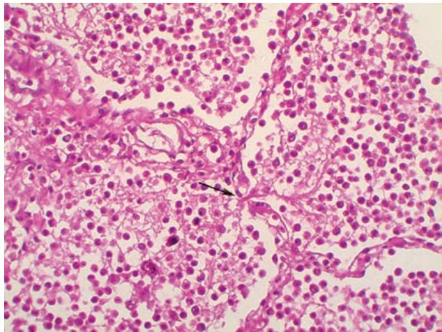
    *图 10-2 镜下：纤维蛋白丝经肺泡间孔（Cohn孔）互相连接*
    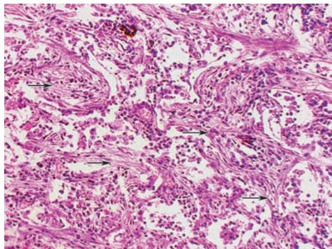
    *图 10-3 肺肉质变：纤维蛋白被肉芽组织取代*
*   **小叶性肺炎**：
    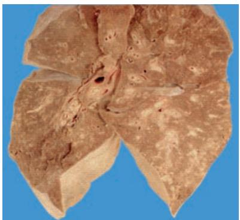
    *图 10-4 小叶性肺炎大体：散在灰黄化脓灶*
    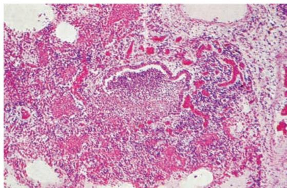
    *图 10-5 镜下：以细支气管为中心的化脓性炎*

#### 2. 病毒性肺炎与 SARS
*   **病毒性肺炎**：表现为间质性肺炎。
    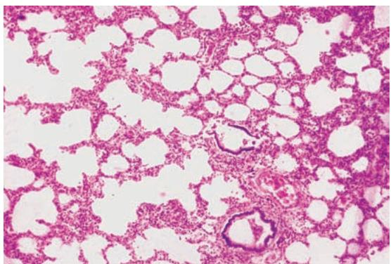
    *图 10-6 间质性肺炎：肺泡间隔增宽*
    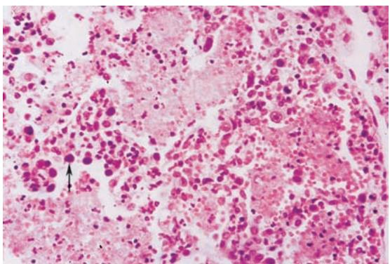
    *图 10-7 病毒包涵体（核内嗜碱性）*
*   **SARS**：
    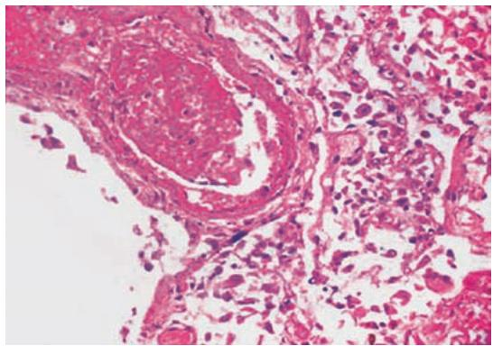
    *图 10-8 SARS 肺部病变：透明膜形成、血管内血栓*

#### 3. 慢性阻塞性肺疾病 (COPD)
*   **慢性支气管炎**：
    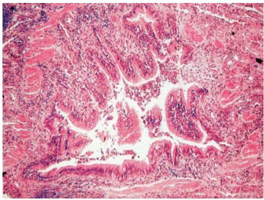
    *图 10-9 慢性支气管炎：腺体增生、平滑肌肥大*
*   **肺气肿**：
    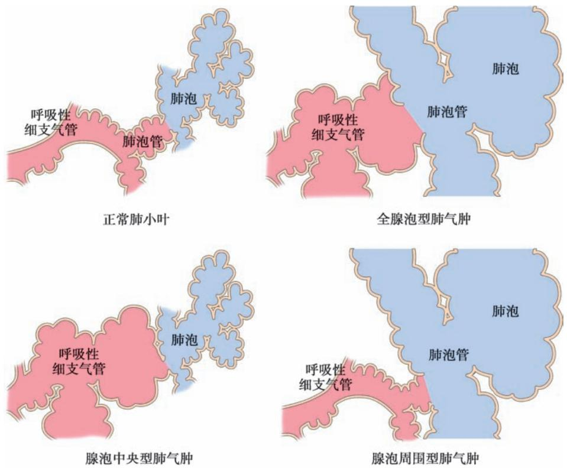
    *图 10-10 肺气肿类型：腺泡中央型、全腺泡型、隔旁型*
    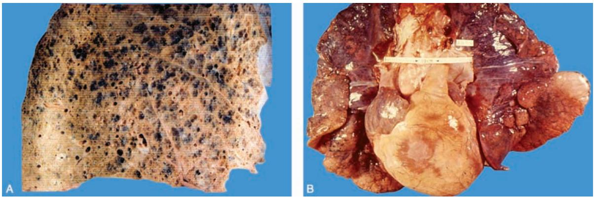
    *图 10-11 肺气肿伴肺心病：肺大疱形成、右心肥大*
    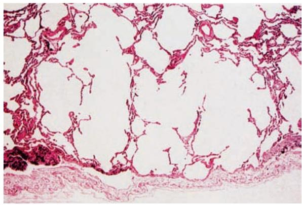
    *图 10-12 肺气肿镜下：肺泡融合、间隔断裂*

#### 4. 支气管扩张症与尘肺
*   **支气管扩张症**：
    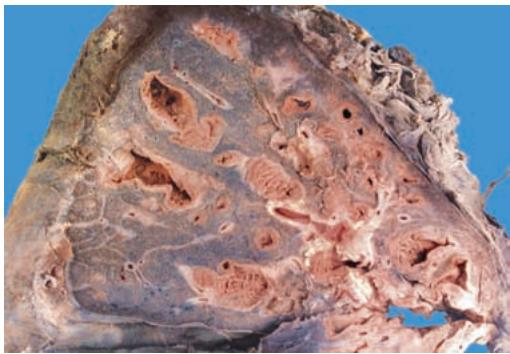
    *图 10-13 支气管扩张：呈蜂窝状*
*   **硅肺**：
    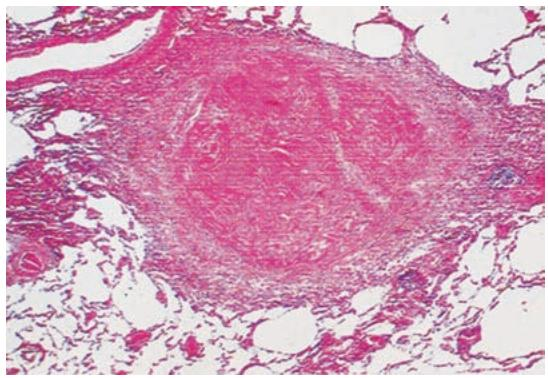
    *图 10-14 硅结节：旋涡状胶原纤维*
    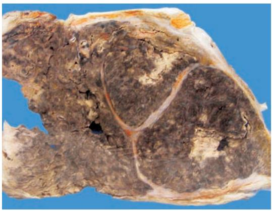
    *图 10-15 Ⅲ期硅肺：肺硬化、空洞形成*
*   **石棉肺**：
    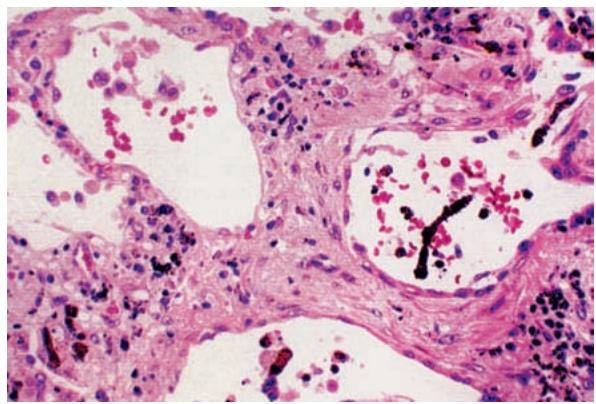
    *图 10-16 石棉小体：分节棒状*

#### 5. 呼吸系统肿瘤
*   **鼻咽癌**：
    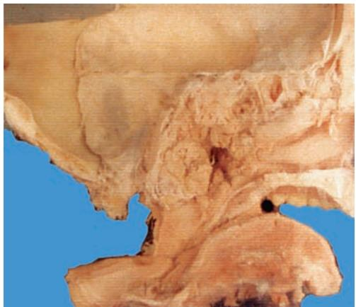
    *图 10-17 鼻咽癌大体*
    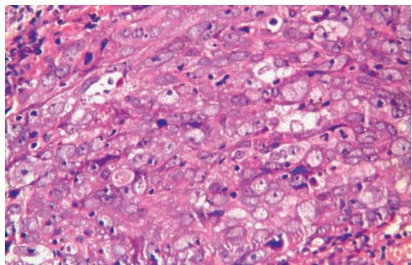
    *图 10-19 泡状核细胞癌：核空泡状、大核仁*
*   **肺癌**：
    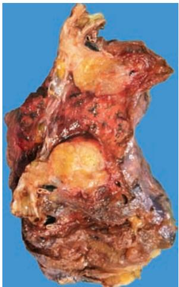
    *图 10-20 中央型肺癌：包绕支气管*
    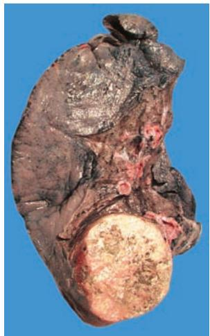
    *图 10-21 周围型肺癌：近胸膜*
    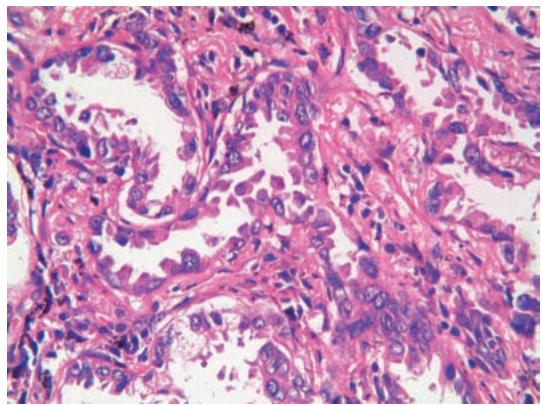
    *图 10-22 肺腺癌：贴壁生长*
    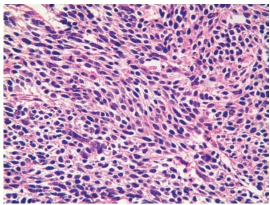
    *图 10-23 小细胞癌：燕麦细胞样*

---

### 四、 重要知识点总结、对比

#### 1. 大叶性肺炎与小叶性肺炎的鉴别

| 鉴别点 | 大叶性肺炎 | 小叶性肺炎 |
| :--- | :--- | :--- |
| **病原体** | 肺炎链球菌（主要） | 多种化脓菌（葡萄球菌等） |
| **病变性质** | **纤维蛋白性炎** | **化脓性炎** |
| **病变范围** | 肺大叶（弥漫） | 肺小叶（散在、灶状） |
| **临床特征** | 青壮年、铁锈色痰、肺实变 | 老幼弱、黏液脓痰、湿啰音 |
| **并发症** | 肺肉质变（少见） | 呼吸衰竭、心衰、脓肿（多见） |

#### 2. 大叶性肺炎四期病变对比

| 时期 | 肺泡腔渗出物 | 肉眼观 | 临床联系 |
| :--- | :--- | :--- | :--- |
| **充血水肿期** | 浆液、细菌 | 暗红、肿胀 | 寒战、高热 |
| **红色肝样变期** | **红细胞**、纤维蛋白 | 暗红、质实如肝 | **铁锈色痰**、缺氧 |
| **灰色肝样变期** | **中性粒细胞**、纤维蛋白 | 灰白、质实如肝 | 黏液脓痰、缺氧减轻 |
| **溶解消散期** | 渗出物溶解、吸收 | 质地变软、实变消失 | 症状消退、体温下降 |

#### 3. 肺癌主要组织学类型对比

| 类型 | 好发人群 | 发病部位 | 生物学行为 | 备注 |
| :--- | :--- | :--- | :--- | :--- |
| **鳞癌** | 老年男性、吸烟者 | **中央型**多见 | 生长慢、转移晚 | 见角化珠、细胞间桥 |
| **腺癌** | 女性、非吸烟者 | **周围型**多见 | 转移较早 | 贴壁生长、分泌黏液 |
| **小细胞癌** | 男性、重度吸烟者 | **中央型**为主 | **恶性度最高** | 燕麦细胞、神经内分泌 |

#### 4. 硅肺与石棉肺的比较

| 鉴别点 | 肺硅沉着病 (硅肺) | 肺石棉沉着病 (石棉肺) |
| :--- | :--- | :--- |
| **致病物** | 游离二氧化硅 ($SiO_2$) | 石棉纤维 |
| **特征病变** | **硅结节**（旋涡状胶原） | **石棉小体**、胸膜斑 |
| **病变分布** | 肺门部、中下叶近肺门 | 双肺下部、胸膜下 |
| **并发症** | 肺结核（极常见） | **恶性间皮瘤**、肺癌 |