## 第十一章 消化系统疾病 学习笔记

### 一、 知识框架

*   **食管疾病**：
    *   炎症：反流性食管炎、**Barrett 食管**（癌前病变）。
    *   狭窄与扩张：憩室、贲门失弛缓症。
*   **胃部疾病**：
    *   **胃炎**：急性（刺激性、出血性）；慢性（非萎缩性、**萎缩性 A/B 型**、肠上皮化生）。
    *   **消化性溃疡病**：病因（H.pylori）、病理（四层结构）、并发症（出血、穿孔、梗阻、癌变）。
*   **阑尾炎**：急性（单纯性、蜂窝织炎性、坏疽性）、慢性。
*   **非特异性肠炎**：**炎症性肠病 (IBD)**（克罗恩病 CD、溃疡性结肠炎 UC）、急性出血性坏死性肠炎。
*   **肝脏疾病**：
    *   **病毒性肝炎**：基本病变（气球样变、嗜酸性变、各类坏死）；临床类型（普通型、重型）。
    *   脂肪肝：酒精性与非酒精性。
    *   **肝硬化**：病理特征（**假小叶**）、门静脉高压症、肝功能障碍。
*   **胆囊与胰腺**：胆囊炎、胆石症；胰腺炎（水肿型、出血坏死型）。
*   **消化系统肿瘤**：
    *   食管癌、胃癌（早期与中晚期、**革囊胃**、**Krukenberg 瘤**）。
    *   结直肠癌（分子路径、Dukes 分期）、原发性肝癌（HCC）、胃肠道间质瘤 (GIST)。

---

### 二、 重要概念及解释

1.  **Barrett 食管**：食管下段鳞状上皮被柱状上皮取代，是食管腺癌的主要癌前病变。
2.  **肠上皮化生 (Intestinal metaplasia)**：胃黏膜上皮转变为含有杯状细胞等的肠黏膜上皮。
3.  **假小叶 (Pseudobulule)**：肝硬化时，由广泛增生的纤维组织包绕再生肝细胞团形成的结构，是**肝硬化的特征性病变**。
4.  **气球样变 (Ballooning degeneration)**：肝细胞高度水肿，胞质透明，细胞肿大如气球。
5.  **碎片状坏死 (Piecemeal necrosis)**：肝小叶周边界板肝细胞的灶性坏死，常见于慢性肝炎。
6.  **桥接坏死 (Bridging necrosis)**：相邻中央静脉间、门管区间或中央静脉与门管区间的肝细胞坏死带。
7.  **早期胃癌**：癌组织浸润仅限于**黏膜层或黏膜下层**，不论有无淋巴结转移。
8.  **革囊胃 (Linitis plastica)**：浸润型胃癌使胃壁弥漫增厚、变硬，状如皮革。
9.  **Krukenberg 瘤**：胃肠道黏液癌（尤其是印戒细胞癌）转移至双侧卵巢形成的转移性肿瘤。
10. **小肝癌**：单发肿瘤直径 $\leqslant 5\mathrm{cm}$，或多发结节数目 $\leqslant 3$ 个且最大径 $\leqslant 3\mathrm{cm}$。

---

### 三、 正文内容详解

#### 1. 胃炎与溃疡
*   **慢性萎缩性胃炎**：伴有肠上皮化生。
    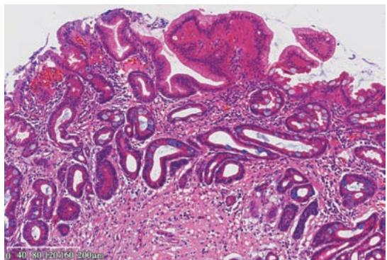
    *图 11-1 慢性萎缩性胃炎伴肠上皮化生*
*   **消化性溃疡**：H.pylori 是主因。
    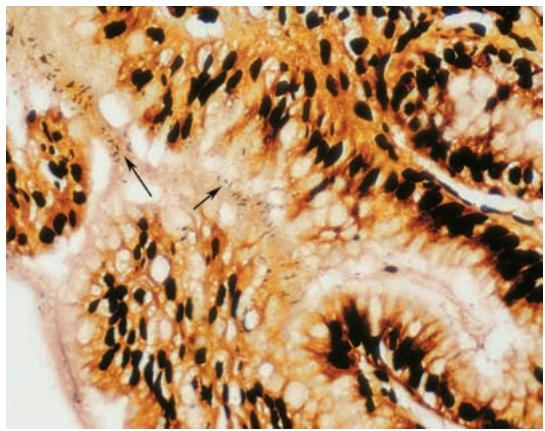
    *图 11-2 银染色示胃黏膜表面的幽门螺杆菌*
    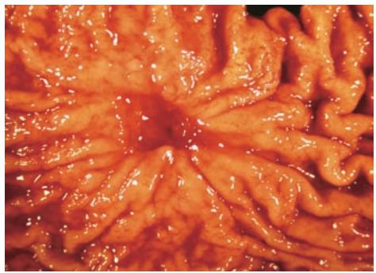
    *图 11-3 胃溃疡大体：边缘整齐，皱襞放射状*
    *   **溃疡底四层结构**：渗出层、坏死层、肉芽组织层、瘢痕层。
    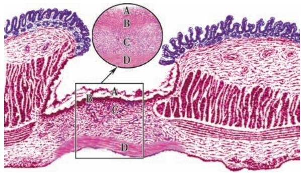
    *图 11-4 胃溃疡底部的四层结构模式图*

#### 2. 阑尾炎与肠炎
*   **急性阑尾炎**：蜂窝织炎性最常见。
    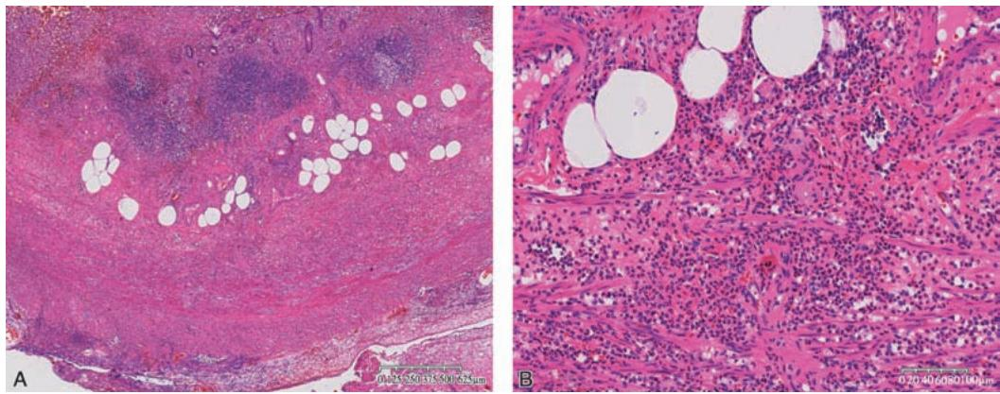
    *图 11-6 急性蜂窝织炎性阑尾炎：中性粒细胞弥漫浸润*
*   **细菌性痢疾**：特征为**假膜性炎**，脱落形成“地图状”溃疡。
    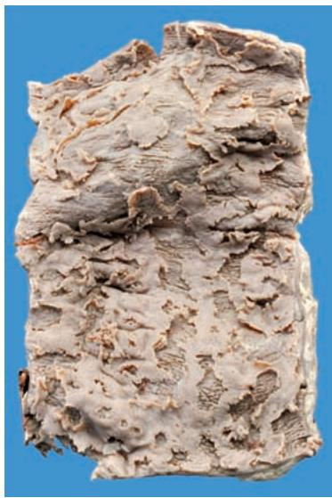
    *图 11-11 细菌性痢疾：地图状溃疡*

#### 3. 病毒性肝炎
*   **基本病变**：
    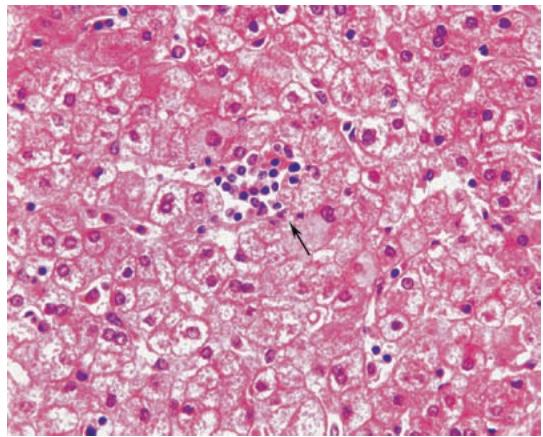
    *图 11-7 急性普通型肝炎：点状坏死*
*   **急性重型肝炎**：大块坏死，肝体积缩小，称“急性黄色肝萎缩”。
    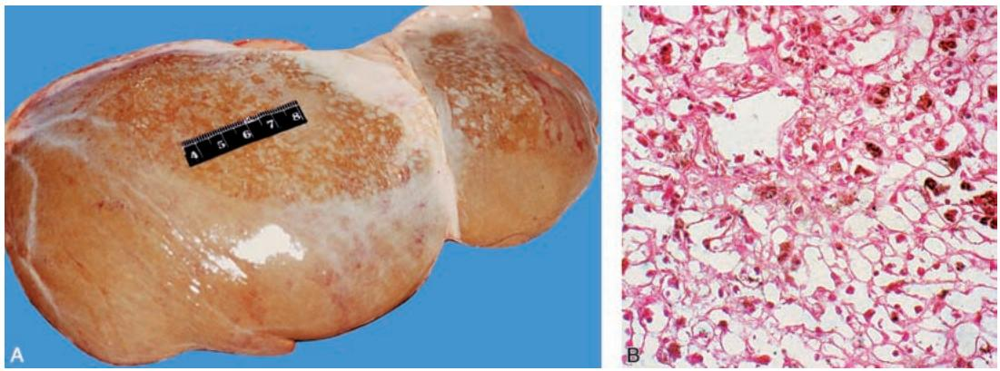
    *图 11-8 急性重型肝炎：大体萎缩与镜下大块坏死*

#### 4. 肝硬化 (Liver Cirrhosis)
*   **病理特征**：正常肝小叶结构消失，被**假小叶**取代。
    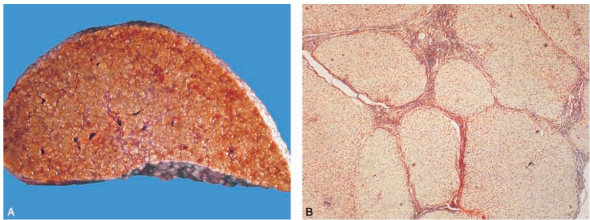
    *图 11-9 肝硬化：弥漫小结节与假小叶形成*
*   **门脉高压**：导致侧支循环开放（食管胃底静脉曲张、海蛇头、痔）、脾大、腹水。
    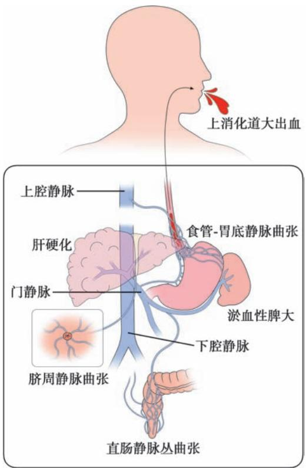
    *图 11-10 门脉高压侧支循环示意图*

#### 5. 消化系统肿瘤
*   **食管癌**：髓质型最常见。
    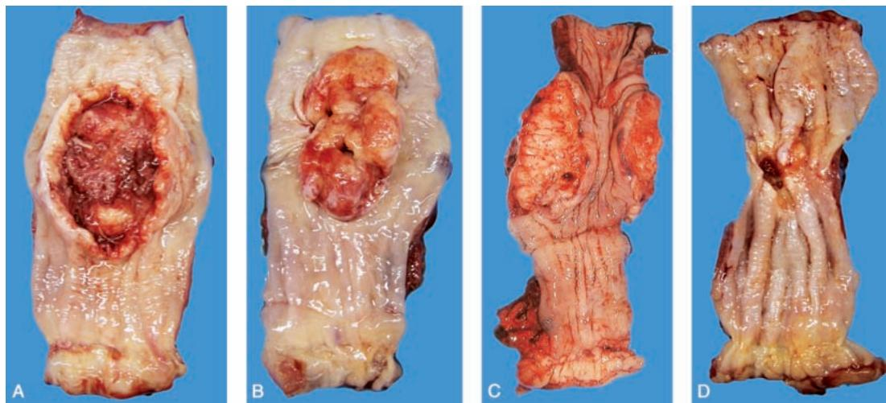
    *图 11-11 食管癌大体类型*
*   **胃癌**：
    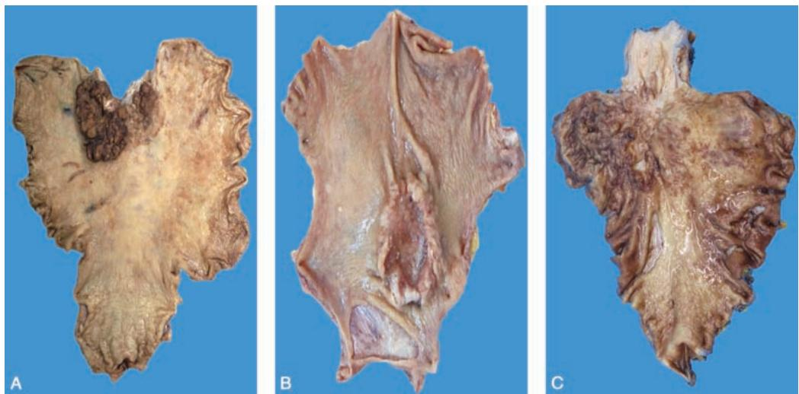
    *图 11-12 胃癌大体：溃疡型、革囊胃*
    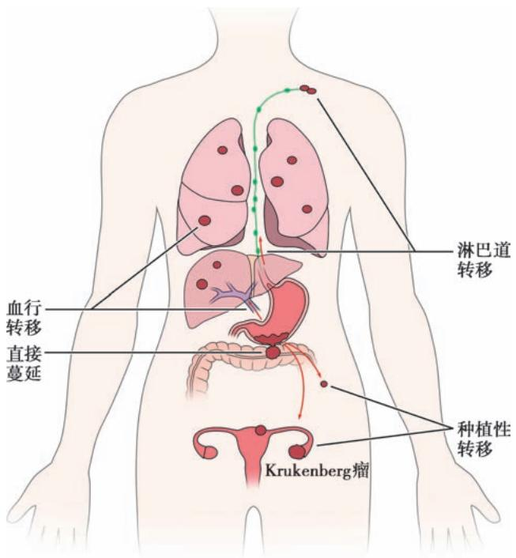
    *图 11-13 胃癌转移途径：淋巴、血行、种植（Krukenberg瘤）*
*   **结直肠癌**：
    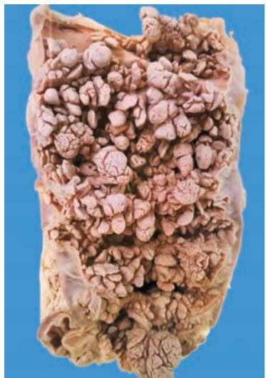
    *图 11-14 家族性腺瘤性息肉病 (FAP)*
    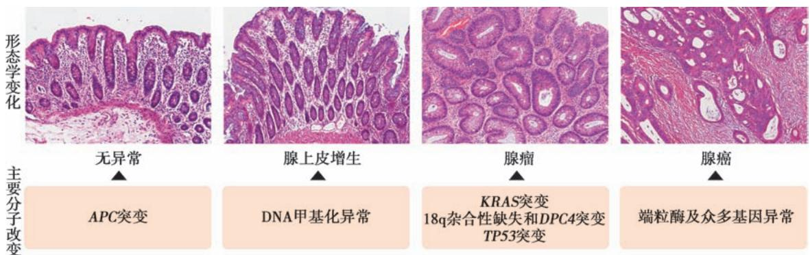
    *图 11-15 结直肠癌分子演进过程*
    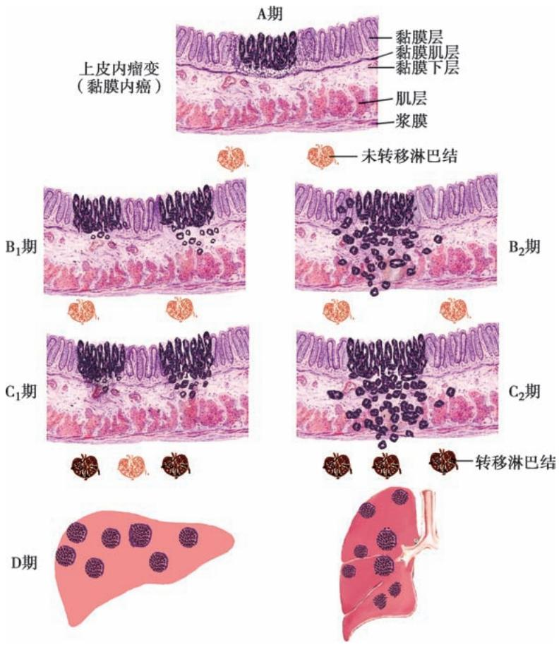
    *图 11-16 结直肠癌 Dukes 分期*
*   **肝癌**：
    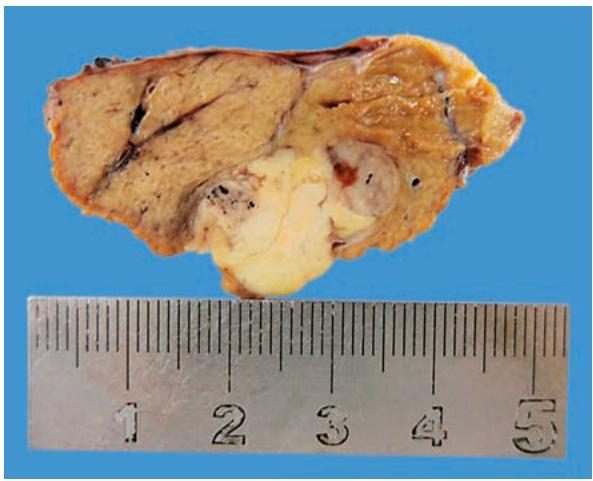
    *图 11-17 小肝癌肉眼形态*
    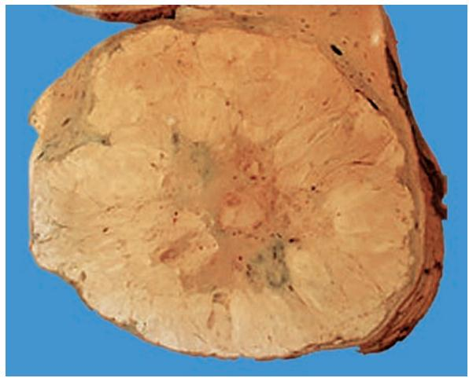
    *图 11-18 巨块型肝癌*

---

### 四、 重要知识点总结、对比

#### 1. 慢性萎缩性胃炎 A 型与 B 型的鉴别

| 鉴别点 | A 型 (自身免疫性) | B 型 (H.pylori 相关) |
| :--- | :--- | :--- |
| **病变部位** | 胃体、胃底 | **胃窦部**（我国多见） |
| **抗体** | 抗壁细胞抗体(+) | 阴性 |
| **胃酸** | 显著降低 | 正常或轻度降低 |
| **恶性贫血** | **常有** | 无 |
| **主要病因** | 自身免疫 | **幽门螺杆菌感染** |

#### 2. 胃良性溃疡与恶性溃疡（溃疡型癌）的鉴别

| 鉴别点 | 良性溃疡 (胃溃疡) | 恶性溃疡 (溃疡型胃癌) |
| :--- | :--- | :--- |
| **形状** | 圆形或椭圆形 | 不规则、皿状或火山口状 |
| **大小** | 直径常 $<2\mathrm{cm}$ | 直径常 $>2\mathrm{cm}$ |
| **边缘** | 整齐、不隆起 | **不整齐、隆起** |
| **底部** | 平坦、洁净 | 凹凸不平、坏死出血明显 |
| **周围黏膜** | 皱襞向溃疡集中 | 皱襞中断、呈结节状肥厚 |

#### 3. 克罗恩病 (CD) 与 溃疡性结肠炎 (UC) 的鉴别

| 鉴别点 | 克罗恩病 (CD) | 溃疡性结肠炎 (UC) |
| :--- | :--- | :--- |
| **好发部位** | 回肠末端、升结肠 | **直肠、乙状结肠** |
| **分布特点** | **节段性**、跳跃式 | 连续性、弥漫性 |
| **溃疡形态** | 纵行、裂隙状、**铺路石样** | 浅表、大片坏死、**假息肉** |
| **炎症深度** | **全层炎** | 仅限于黏膜及黏膜下层 |
| **肉芽肿** | **非干酪样肉芽肿** | 无 |

#### 4. 病毒性肝炎临床病理类型对比

| 类型 | 坏死程度 | 预后 |
| :--- | :--- | :--- |
| **急性普通型** | **点状坏死** | 良好，多自愈 |
| **慢性普通型** | **碎片状坏死**、桥接坏死 | 部分演变为肝硬化 |
| **急性重型** | **大块坏死** | 极差，短期内死亡 |
| **亚急性重型** | **亚大块坏死**+结节状再生 | 差，多转为肝硬化 |