## 第十二章 淋巴造血系统疾病 学习笔记

### 一、 知识框架

*   **淋巴结良性病变**：
    *   **反应性淋巴结炎**：急性、慢性（淋巴滤泡增生、副皮质区增生、窦组织细胞增生）。
    *   **特异性淋巴结炎**：真菌感染、猫抓病、传染性单核细胞增多症（EBV相关）、组织细胞性坏死性淋巴结炎（Kikuchi病）。
*   **淋巴组织肿瘤 (Lymphoid Neoplasms)**：
    *   **概述**：分类原则（细胞谱系、形态、免疫表型、遗传学）、生物学行为（惰性、侵袭性）。
    *   **非霍奇金淋巴瘤 (NHL)**：
        *   前体 B/T 细胞肿瘤：急性淋巴母细胞白血病/淋巴瘤 (ALL)。
        *   成熟 B 细胞肿瘤：CLL/SLL、滤泡性淋巴瘤 (FL)、弥漫性大 B 细胞淋巴瘤 (DLBCL)、Burkitt 淋巴瘤 (BL)、MALT 淋巴瘤、浆细胞骨髓瘤。
        *   成熟 T/NK 细胞肿瘤：外周 T 细胞淋巴瘤 (PTCL)、NK/T 细胞淋巴瘤、蕈样肉芽肿 (MF)。
    *   **霍奇金淋巴瘤 (HL)**：
        *   特征：**R-S 细胞**、炎症背景、由近及远扩散。
        *   分类：结节性淋巴细胞为主型 (NLPHL)、经典型 (CHL：结节硬化型、混合细胞型等)。
*   **髓系肿瘤 (Myeloid Neoplasms)**：
    *   **急性髓系白血病 (AML)**：原始细胞 $\geqslant 20\%$、Auer 小体、绿色瘤。
    *   **骨髓增殖性肿瘤 (MPN)**：慢性髓系白血病 (CML，**Ph 染色体**、BCR::ABL1)。
*   **组织细胞和树突状细胞肿瘤**：
    *   **朗格汉斯细胞组织细胞增生症 (LCH)**：**Birbeck 颗粒**、核沟、CD1a/Langerin 阳性。

---

### 二、 重要概念及解释

1.  **淋巴瘤 (Lymphoma)**：原发于淋巴结和结外淋巴组织的恶性肿瘤。
2.  **R-S 细胞 (Reed-Sternberg cell)**：霍奇金淋巴瘤的特征性瘤巨细胞，典型者为双核“**镜影细胞**”。
3.  **陷窝细胞 (Lacunar cell)**：结节硬化型 HL 的特征性 R-S 变异细胞，固定后胞质收缩使细胞位于“陷窝”内。
4.  **满天星 (Starry sky)**：Burkitt 淋巴瘤的特征性图像，由弥漫的瘤细胞（天）和散在的吞噬核碎片的巨噬细胞（星）构成。
5.  **血管免疫母细胞性 T 细胞淋巴瘤 (AITL)**：起源于滤泡辅助 T 细胞，伴有显著的高内皮小静脉增生。
6.  **白血病 (Leukemia)**：骨髓造血干细胞克隆性增生，异常白细胞弥漫浸润骨髓并进入外周血。
7.  **Ph 染色体 (Philadelphia chromosome)**：$t(9;22)(q34;q11)$ 形成的异常染色体，是 **CML** 的特征标志。
8.  **Birbeck 颗粒**：LCH 瘤细胞电镜下的特征结构，呈杆状或网球拍状。
9.  **绿色瘤 (Chloroma)**：髓系肉瘤，因含大量髓过氧化物酶 (MPO) 在新鲜时肉眼呈绿色。

---

### 三、 正文内容详解

#### 1. 淋巴结良性病变
*   **反应性增生**：生发中心扩大，细胞成分多样。
    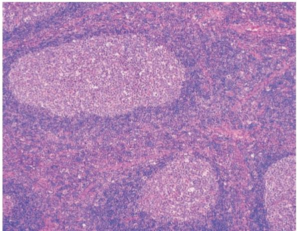
    *图 12-1 淋巴结反应性增生：生发中心明显*
*   **Kikuchi 病**：坏死灶内见大量核碎片，无中性粒细胞。
    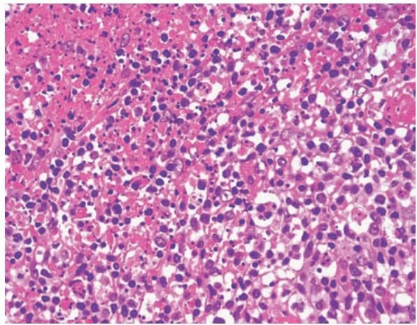
    *图 12-2 组织细胞性坏死性淋巴结炎*

#### 2. 非霍奇金淋巴瘤 (NHL)
*   **淋巴母细胞淋巴瘤 (ALL)**：细胞形态一致，**TdT 阳性**。
    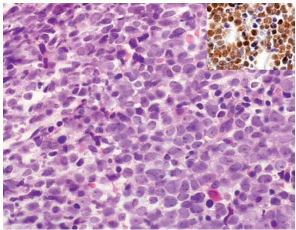
    *图 12-4 淋巴母细胞淋巴瘤*
*   **CLL/SLL**：弥漫浸润的小淋巴细胞，可见**增殖中心**。
    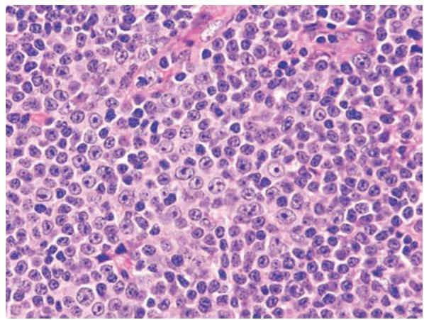
    *图 12-5 CLL/SLL 镜下表现*
*   **滤泡性淋巴瘤 (FL)**：形成大小相近的肿瘤性滤泡，**Bcl-2 阳性**。
    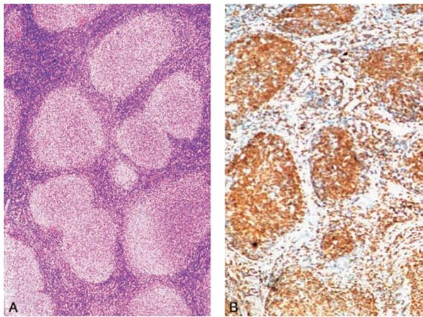
    *图 12-6 滤泡性淋巴瘤及 Bcl-2 染色*
*   **弥漫大 B 细胞淋巴瘤 (DLBCL)**：最常见，瘤细胞大，核仁明显。
    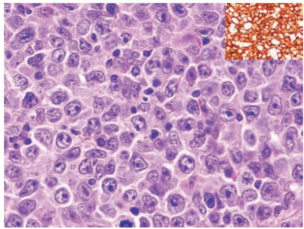
    *图 12-7 DLBCL 镜下及 CD20 染色*
*   **Burkitt 淋巴瘤 (BL)**：高度恶性，典型“**满天星**”图像。
    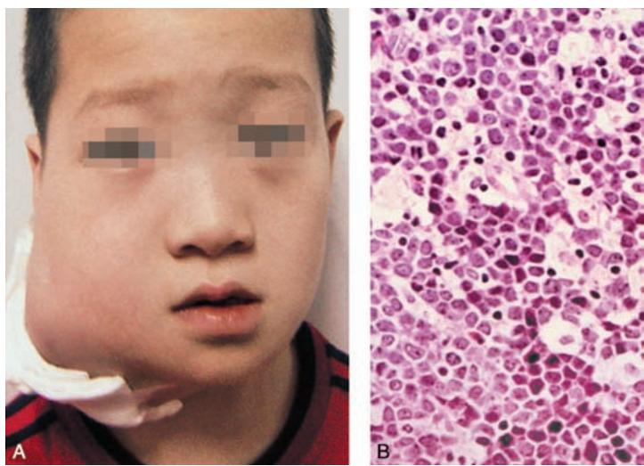
    *图 12-8 Burkitt 淋巴瘤大体与“满天星”*
*   **浆细胞骨髓瘤**：溶骨性破坏（**穿凿样缺损**），浆细胞浸润。
    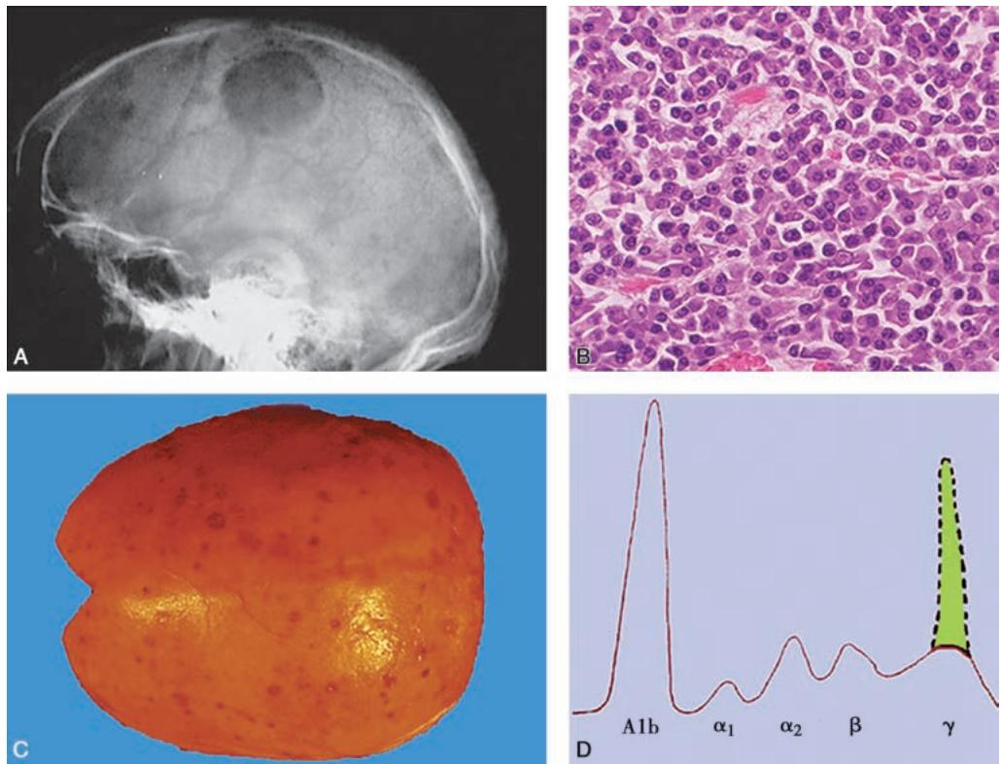
    *图 12-9 浆细胞骨髓瘤：X线破坏、浆细胞浸润、M蛋白峰*
*   **NK/T 细胞淋巴瘤**：中线面部破坏，大片坏死。
    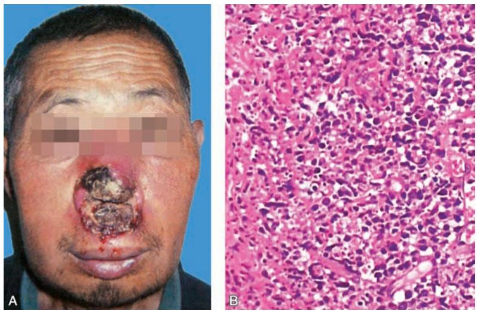
    *图 12-10 鼻型 NK/T 细胞淋巴瘤*
*   **蕈样肉芽肿 (MF)**：皮肤受累，形成 **Pautrier 微脓肿**。
    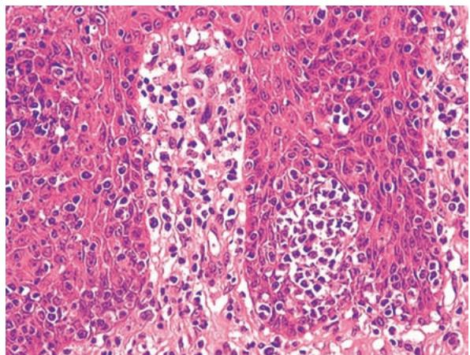
    *图 12-11 蕈样肉芽肿：Pautrier 微脓肿*

#### 3. 霍奇金淋巴瘤 (HL)
*   **特征**：肿瘤细胞为 **R-S 细胞**，背景为多种炎症细胞。
    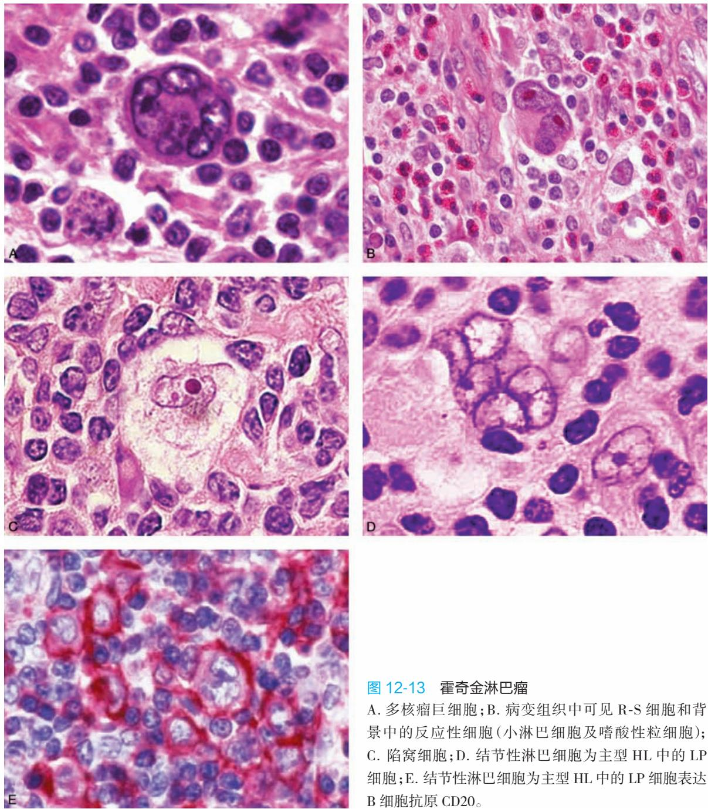
    *图 12-13 R-S 细胞类型：A.多核；B.镜影；C.陷窝细胞；D.LP细胞*
    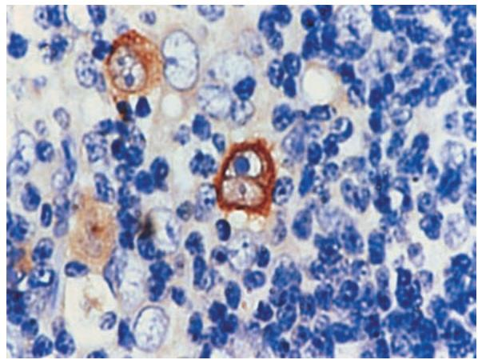
    *图 12-14 经典型 HL：R-S 细胞表达 CD30*

#### 4. 髓系肿瘤
*   **急性髓系白血病 (AML)**：
    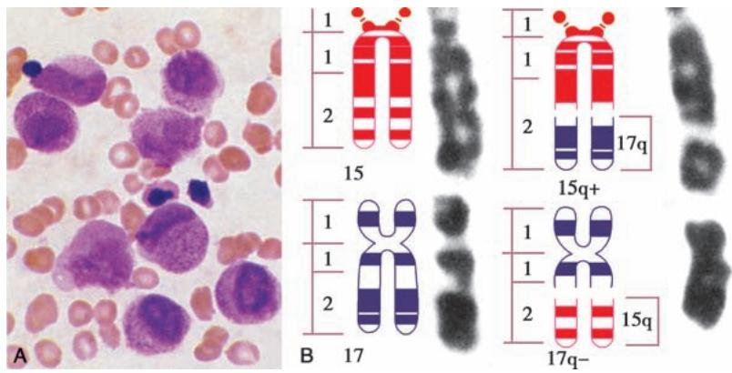
    *图 12-15 M3 型：早幼粒细胞与 t(15;17) 易位*
    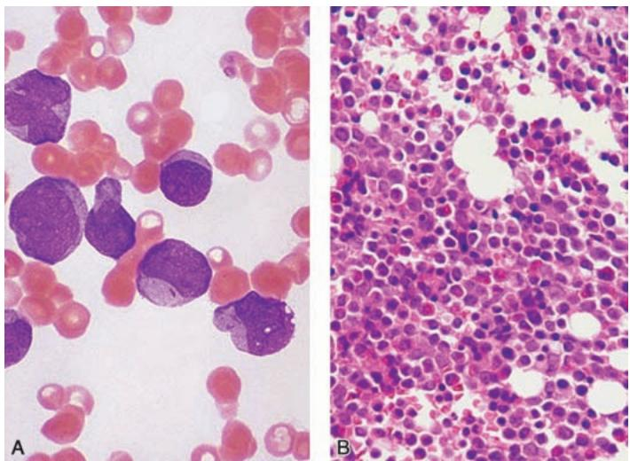
    *图 12-16 AML 骨髓活检：幼稚细胞弥漫增生*
*   **慢性髓系白血病 (CML)**：粒系极度增生，以分叶核为主。
    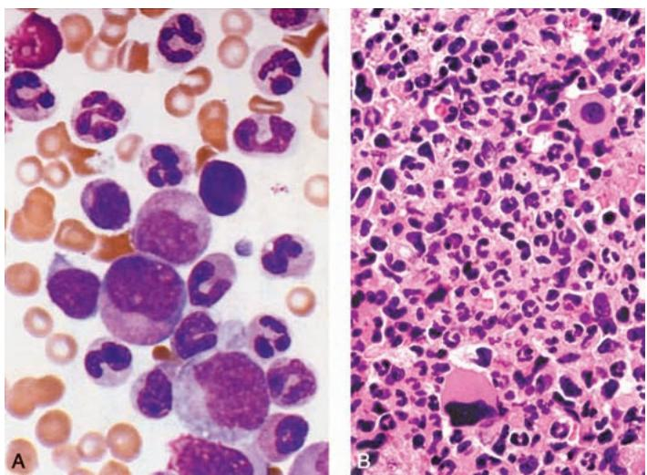
    *图 12-17 CML 骨髓象：各阶段粒细胞*

#### 5. 组织细胞肿瘤
*   **LCH**：核有纵行**核沟**，像咖啡豆。
    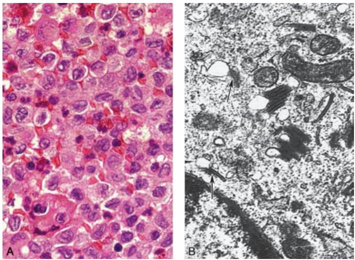
    *图 12-18 LCH：核沟与电镜下的 Birbeck 颗粒*

---

### 四、 重要知识点总结、对比

#### 1. 霍奇金淋巴瘤 (HL) 与 非霍奇金淋巴瘤 (NHL) 的区别

| 鉴别点 | 霍奇金淋巴瘤 (HL) | 非霍奇金淋巴瘤 (NHL) |
| :--- | :--- | :--- |
| **原发部位** | 多为淋巴结，由近及远扩散 | 1/3 为结外，扩散呈跳跃性 |
| **肿瘤细胞** | **R-S 细胞**及其变异型（少数） | 肿瘤性淋巴细胞（占绝大多数） |
| **背景成分** | 大量反应性炎症细胞 | 较单一，炎症细胞少 |
| **免疫表型** | **CD30(+)**、CD15(+)、CD20(-) | 表达 B 或 T/NK 细胞标志 |

#### 2. 经典型霍奇金淋巴瘤 (CHL) 亚型对比

| 亚型 | 特点 | 预后 |
| :--- | :--- | :--- |
| **结节硬化型** | 粗大胶原纤维分隔，见**陷窝细胞** | 较好 |
| **混合细胞型** | 多种炎症细胞混合，典型 R-S 细胞多 | 一般 |
| **富于淋巴细胞型** | 背景以小淋巴细胞为主 | 最好 |
| **淋巴细胞减少型** | 淋巴细胞极少，R-S 细胞多 | 最差 |

#### 3. 常见 B 细胞淋巴瘤的遗传学特征

| 肿瘤名称 | 特征性染色体易位 | 涉及基因 |
| :--- | :--- | :--- |
| **滤泡性淋巴瘤 (FL)** | $t(14;18)$ | **BCL2** 激活（抗凋亡） |
| **Burkitt 淋巴瘤 (BL)** | $t(8;14)$ | **MYC** 激活（促进增殖） |
| **套细胞淋巴瘤 (MCL)** | $t(11;14)$ | **CCND1** (Cyclin D1) 激活 |
| **MALT 淋巴瘤** | $t(11;18)$ | API2-MALT1 融合 |

#### 4. 急性白血病与慢性白血病的区别

| 鉴别点 | 急性白血病 (AL) | 慢性白血病 (CL) |
| :--- | :--- | :--- |
| **细胞分化** | 停滞在原始/早期幼稚阶段 | 分化较好，以中晚幼/成熟为主 |
| **起病与病程** | 急、进展快、数月 | 缓、进展慢、数年 |
| **外周血原始细胞** | **$\geqslant 20\%$** | 极少 |
| **临床表现** | 贫血、出血、高热显著 | **巨脾**显著（尤其是 CML） |