## 第十三章 泌尿系统疾病 学习笔记

### 一、 知识框架

*   **肾小球疾病 (Glomerular Disease)**：
    *   **发病机制**：循环免疫复合物沉积、原位免疫复合物沉积（抗GBM抗体、Heymann肾炎）。
    *   **基本病理变化**：细胞增多、基膜增厚、炎性渗出、玻璃样变与硬化。
    *   **各型原发性肾炎**：
        *   急性弥漫性增生性（大红肾、驼峰状沉积）。
        *   急进性（新月体性）。
        *   膜性（大白肾、钉突形成）。
        *   膜增生性（双轨征）。
        *   微小病变性（脂性肾病、足突消失）。
        *   IgA 肾病（系膜区 IgA 沉积）。
        *   慢性肾小球肾炎（继发性颗粒性固缩肾）。
    *   **临床综合征**：急性肾炎综合征、肾病综合征、慢性肾炎综合征。
*   **肾小管间质性肾炎**：
    *   **肾盂肾炎**：急性（化脓性、上行性感染为主）、慢性（反流性、不规则瘢痕）。
    *   **药物/中毒性**：急性过敏性间质性肾炎、镇痛药性肾炎、马兜铃酸肾病。
*   **肾和膀胱常见肿瘤**：
    *   **肾细胞癌**：透明细胞癌（最常见）、多彩性、血尿。
    *   **肾母细胞瘤 (Wilms 瘤)**：儿童多见、三相性成分。
    *   **尿路上皮肿瘤**：膀胱癌、乳头状、无痛性血尿。

---

### 二、 重要概念及解释

1.  **肾小球疾病**：以肾小球损伤和病变为主的一组疾病，多由免疫介导。
2.  **驼峰 (Hump)**：急性弥漫性增生性肾炎时，电镜下见脏层上皮细胞与基膜间的**上皮下电子致密沉积物**。
3.  **新月体 (Crescent)**：急进性肾炎时，由增生的**壁层上皮细胞**和单核细胞构成的结构，充满球囊腔。
4.  **钉突 (Spike)**：膜性肾小球病时，增厚的基膜向皮下沉积物间延伸形成的梳齿状突起（PASM染色可见）。
5.  **双轨征 (Tram-track)**：膜增生性肾炎时，系膜基质插入内皮下，使基膜呈**双层结构**。
6.  **大红肾/蚤咬肾**：急性弥漫性增生性肾炎，肾体积增大，表面充血并有点状出血。
7.  **大白肾**：膜性肾小球病或微小病变性肾病，肾体积增大，色苍白。
8.  **继发性颗粒性固缩肾**：慢性肾小球肾炎晚期，双肾对称性缩小，表面弥漫性细颗粒状。
9.  **肾病综合征 (Nephrotic syndrome)**：大量蛋白尿、明显水肿、低白蛋白血症、高脂血症。
10. **氮质血症 (Azotemia)**：肾小球滤过率下降，导致血尿素氮（BUN）和肌酐水平增高。

---

### 三、 正文内容详解

#### 1. 肾小球结构与发病机制
*   **滤过膜**：内皮、基膜（GBM）、足细胞。
    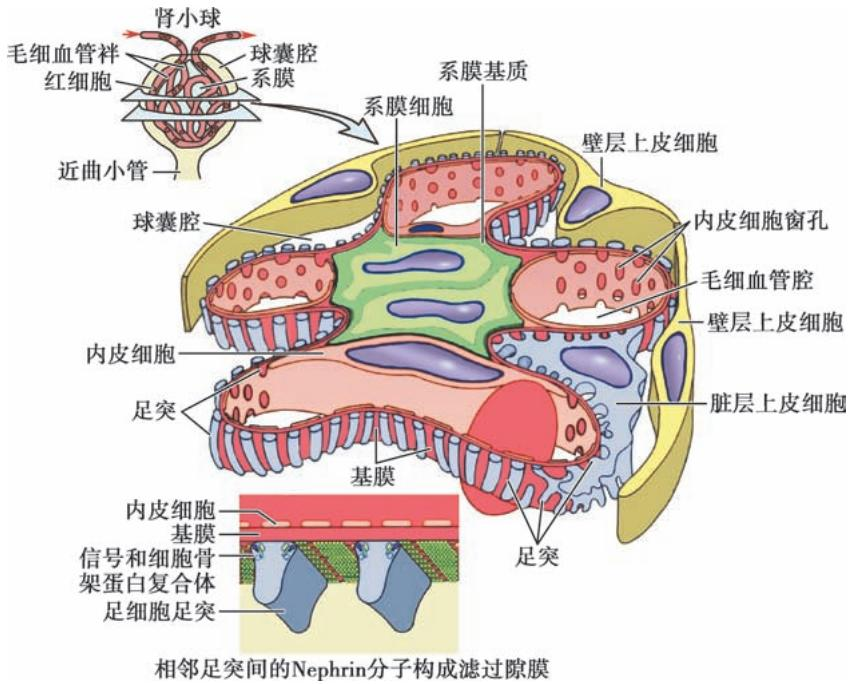
    *图 13-1 肾小球结构示意图*
    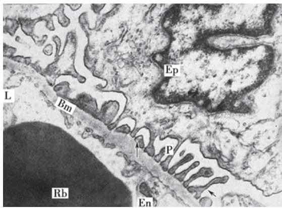
    *图 13-2 正常肾小球滤过膜电镜图*
*   **免疫沉积模式**：
    *   **颗粒状荧光**：循环免疫复合物沉积。
        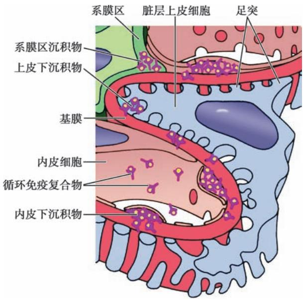
        *图 13-3 循环免疫复合物沉积部位*
        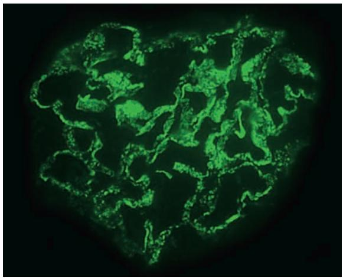
        *图 13-4 颗粒状荧光*
    *   **线性荧光**：抗GBM抗体引起。
        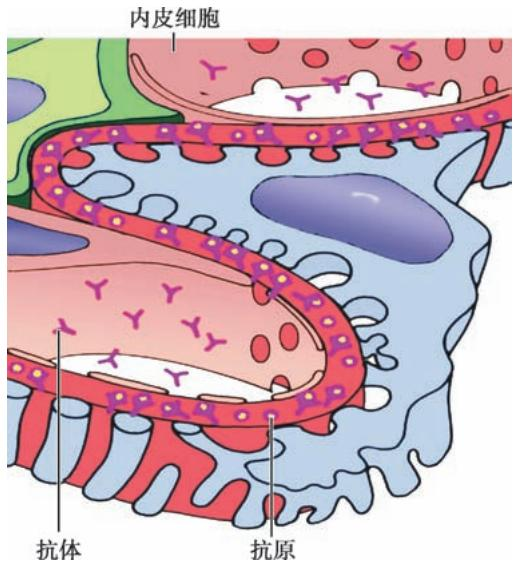
        *图 13-5 抗GBM抗体机制*
        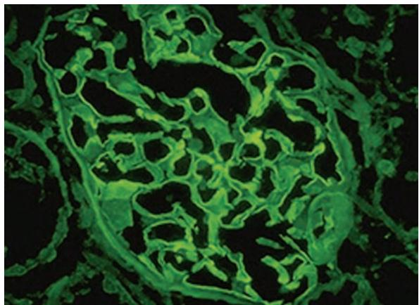
        *图 13-6 连续线性荧光*

#### 2. 各型原发性肾小球肾炎
*   **急性弥漫性增生性**：内皮和系膜细胞增生。
    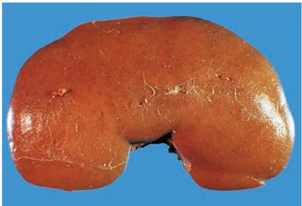
    *图 13-8 大红肾（蚤咬肾）*
    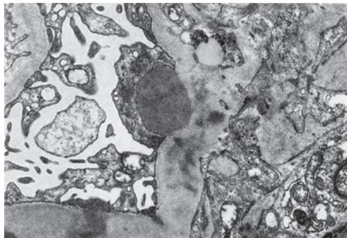
    *图 13-9 电镜下的“驼峰”*
*   **急进性（新月体性）**：
    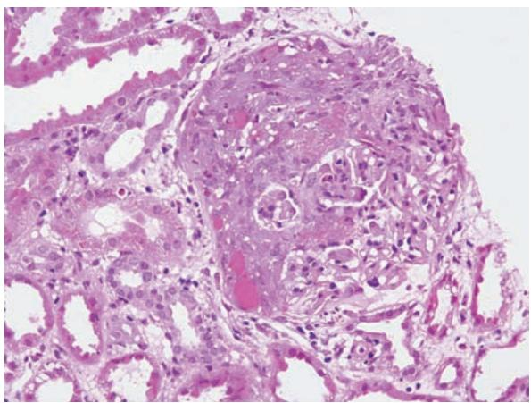
    *图 13-10 新月体形成（HE染色）*
    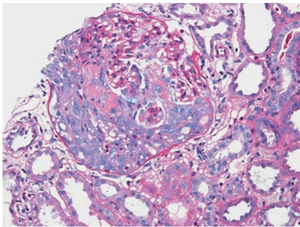
    *图 13-11 壁层上皮细胞增生（PAS染色）*
*   **膜性肾小球病**：基膜弥漫增厚。
    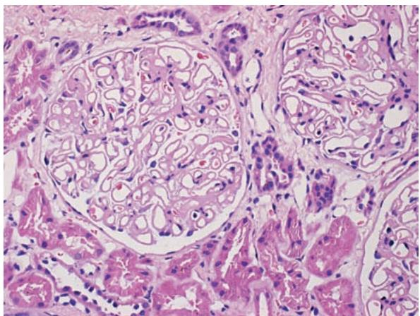
    *图 13-12 基膜弥漫增厚*
    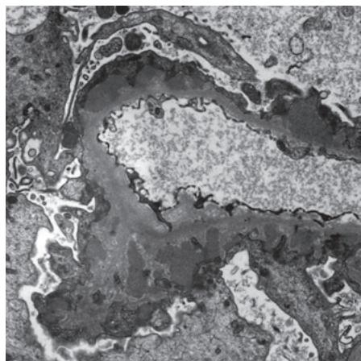
    *图 13-13 上皮下电子致密物沉积*
    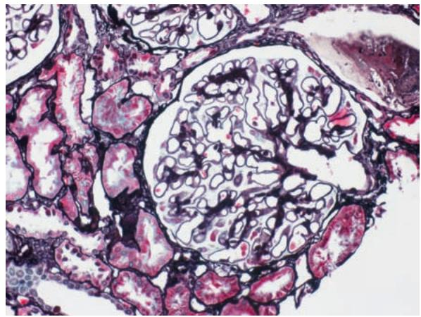
    *图 13-15 PASM 染色示基膜增厚*
*   **膜增生性**：系膜插入。
    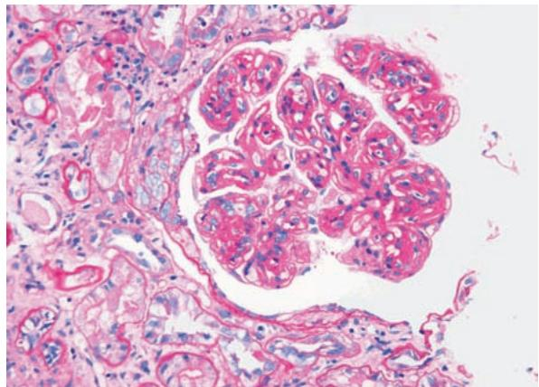
    *图 13-19 血管球分叶状*
    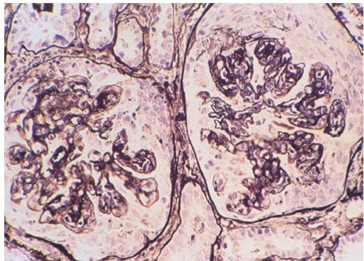
    *图 13-20 双轨征*
*   **微小病变性**：足突消失。
    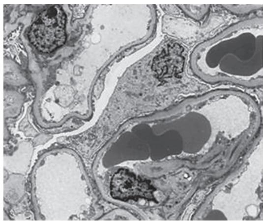
    *图 13-22 弥漫性足突消失*
*   **慢性肾小球肾炎**：
    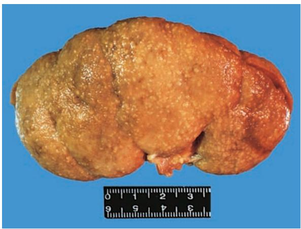
    *图 13-23 继发性颗粒性固缩肾*
    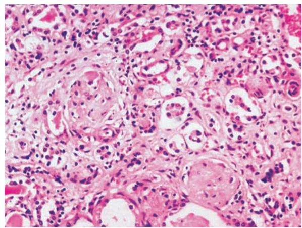
    *图 13-24 肾小球硬化与间质纤维化*

#### 3. 肾盂肾炎
*   **慢性肾盂肾炎**：不规则瘢痕，肾盏变形。
    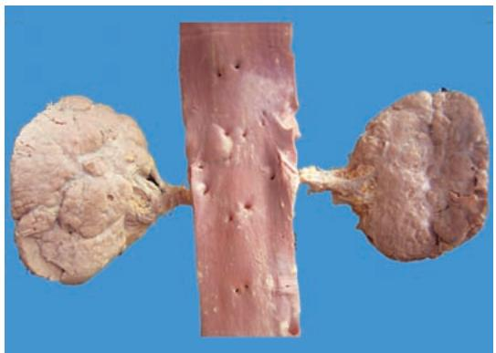
    *图 13-25 慢性肾盂肾炎大体：不对称缩小*
    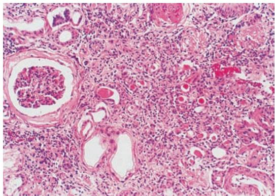
    *图 13-26 镜下：胶样管型（类甲状腺样变）*

#### 4. 泌尿系统肿瘤
*   **肾细胞癌**：多彩性切面。
    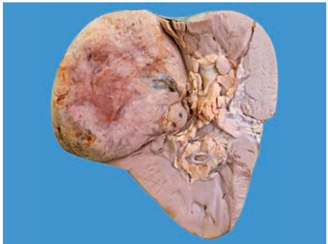
    *图 13-27 肾癌大体*
    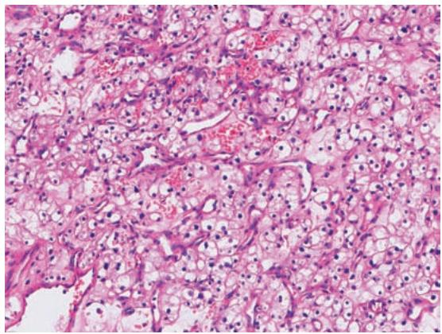
    *图 13-28 透明细胞癌镜下*
*   **膀胱癌**：
    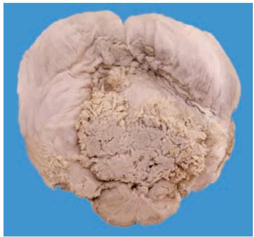
    *图 13-29 膀胱乳头状癌*

---

### 四、 重要知识点总结、对比

#### 1. 常见原发性肾小球疾病病理特征对比表

| 类型 | 核心病变 (光镜) | 电镜特征 | 免疫荧光 | 临床表现 |
| :--- | :--- | :--- | :--- | :--- |
| **急性弥漫增生性** | 内皮、系膜细胞增生 | **上皮下驼峰状**沉积 | 颗粒状 (IgG, C3) | 急性肾炎综合征 |
| **急进性 (新月体性)** | **大量新月体**形成 | 基膜断裂 | 依类型而异 | 急进性肾炎综合征 |
| **膜性肾小球病** | 基膜弥漫增厚、**钉突** | **上皮下**电子致密物 | 颗粒状 (IgG, C3) | **肾病综合征** |
| **膜增生性** | 系膜增生、**双轨征** | 内皮下沉积物 | 颗粒状 | 肾病综合征/血尿 |
| **微小病变性** | 肾小球基本正常 | **弥漫足突消失** | 阴性 | **肾病综合征** (儿童) |
| **IgA 肾病** | 系膜增生 | **系膜区**沉积物 | **系膜区 IgA** 沉积 | 反复血尿 |

#### 2. 肾病综合征与急性肾炎综合征的鉴别

| 综合征 | 蛋白尿 | 血尿 | 水肿 | 高血压 | 备注 |
| :--- | :--- | :--- | :--- | :--- | :--- |
| **急性肾炎综合征** | + ~ ++ | **+++ (肉眼)** | 轻 ~ 中度 | 常有 | 链感后多见 |
| **肾病综合征** | **++++ (大量)** | + / - | **重度 (全身)** | 可有可无 | 四大特征 |

#### 3. 急性与慢性肾盂肾炎的鉴别

| 鉴别点 | 急性肾盂肾炎 | 慢性肾盂肾炎 |
| :--- | :--- | :--- |
| **病变性质** | 急性化脓性炎 | 慢性间质性炎伴纤维化 |
| **肾脏形态** | 肿大，表面小脓肿 | 缩小，**不规则凹陷瘢痕** |
| **肾盂肾盏** | 充血、积脓 | **纤维化、变形** |
| **临床特征** | 尿频尿急尿痛、腰痛、发热 | 肾功能不全、多尿、夜尿 |

#### 4. 原发性与继发性颗粒性固缩肾的鉴别

| 鉴别点 | 原发性 (高血压) | 继发性 (慢性肾炎) |
| :--- | :--- | :--- |
| **病变基础** | 细动脉硬化 | 肾小球硬化 |
| **肾脏形态** | 双肾对称、细颗粒 | 双肾对称、细颗粒 (更重) |
| **镜下特征** | 细动脉玻璃样变 | 大量肾小球玻璃样变、硬化 |
| **临床联系** | 长期高血压后出现肾衰 | 肾炎病史，早期即有尿异常 |