## 第十四章 生殖系统和乳腺疾病 学习笔记

### 一、 知识框架

*   **子宫颈疾病**：
    *   **慢性子宫颈炎**：纳博特囊肿、子宫颈息肉、子宫颈糜烂（假性）。
    *   **子宫颈上皮内病变 (SIL/CIN)**：LSIL (I级)、HSIL (II、III级)、HPV 感染、挖空细胞。
    *   **子宫颈癌**：大体类型（糜烂、菜花、内生浸润、溃疡型）、鳞癌与腺癌。
*   **子宫体疾病**：
    *   **子宫内膜异位症**：巧克力囊肿、子宫腺肌病。
    *   **子宫内膜增生症**：单纯性增生、不典型增生（癌前病变）。
    *   **子宫肿瘤**：子宫内膜样腺癌（分子分型）、子宫平滑肌瘤（红色变性）与平滑肌肉瘤。
*   **妊娠滋养细胞疾病 (GTD)**：
    *   **葡萄胎**：完全性与部分性、侵袭性葡萄胎（水泡状绒毛）。
    *   **绒毛膜癌**：高度恶性、无绒毛结构、血行转移（肺）。
    *   **胎盘部位/上皮样滋养细胞肿瘤**。
*   **卵巢肿瘤**：
    *   **上皮性**：浆液性、黏液性（良性、交界性、恶性）。
    *   **性索间质**：粒层细胞瘤（Call-Exner小体）、卵泡膜细胞瘤。
    *   **生殖细胞**：畸胎瘤（成熟/未成熟）、无性细胞瘤、卵黄囊瘤（S-D小体）。
*   **前列腺疾病**：前列腺增生症（尿道梗阻）、前列腺癌（Gleason评分、PSA）。
*   **乳腺疾病**：
    *   **增生性病变**：普通型 (UDH) 与非典型导管增生 (ADH)、硬化性腺病。
    *   **乳腺纤维腺瘤**：最常见良性肿瘤。
    *   **乳腺癌**：非浸润性（DCIS、LCIS）、浸润性（非特殊型、小叶癌）、分子分型（Luminal、HER2、三阴性）。

---

### 二、 重要概念及解释

1.  **挖空细胞 (Koilocyte)**：HPV 感染的特征细胞，核大深染、核周有明显空晕。
2.  **子宫颈上皮内瘤变 (CIN)**：子宫颈癌的癌前病变，分 I、II、III 三级。
3.  **巧克力囊肿**：卵巢子宫内膜异位症，因反复周期性出血形成内含咖啡色液体的囊肿。
4.  **子宫腺肌病 (Adenomyosis)**：子宫内膜腺体和间质异位于子宫肌层内。
5.  **粉刺癌 (Comedocarcinoma)**：高级别导管原位癌，导管内含灰黄色软膏样坏死物，挤压如粉刺。
6.  **Call-Exner 小体**：粒层细胞瘤的特征结构，瘤细胞围绕腔隙排列，中央为蛋白液体。
7.  **S-D 小体 (Schiller-Duval body)**：卵黄囊瘤的特征结构，形似肾小球样。
8.  **红色变性**：子宫平滑肌瘤间质血管血栓形成引起梗死出血，肉眼呈暗红色。
9.  **酒窝征**：乳腺癌侵及悬韧带导致皮肤凹陷的体征。
10. **橘皮样外观**：乳腺癌阻塞真皮淋巴管导致皮肤水肿，毛囊处凹陷的体征。

---

### 三、 正文内容详解

#### 1. 子宫颈疾病
*   **CIN 与 原位癌**：
    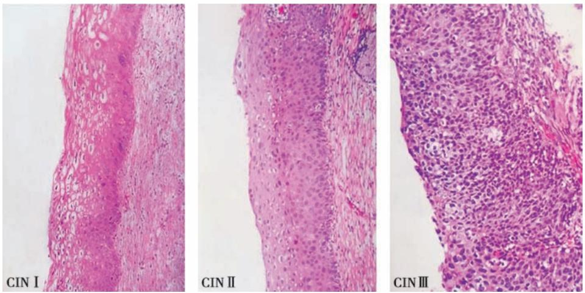
    *图 14-1 CIN 分级示意图*
    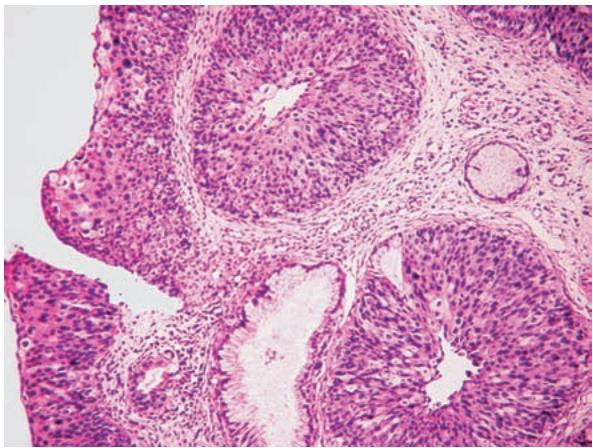
    *图 14-2 原位癌累及腺体（基膜完整）*
*   **浸润癌**：
    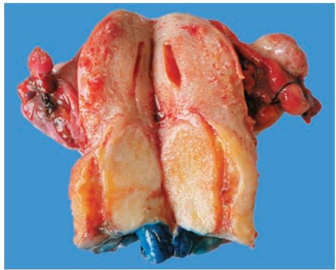
    *图 14-3 内生浸润型宫颈癌*
    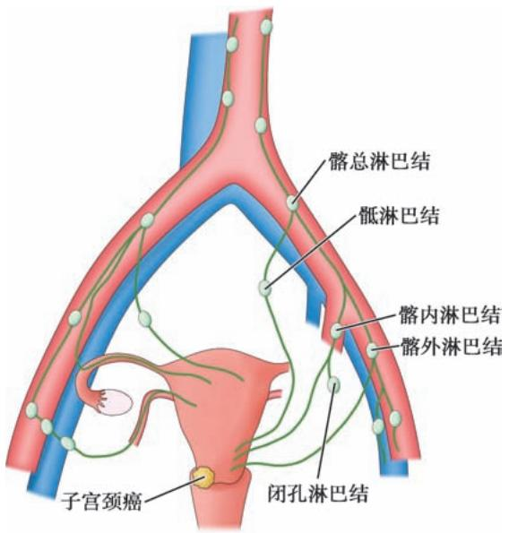
    *图 14-4 宫颈癌淋巴道转移途径*

#### 2. 子宫体疾病
*   **子宫腺肌病**：
    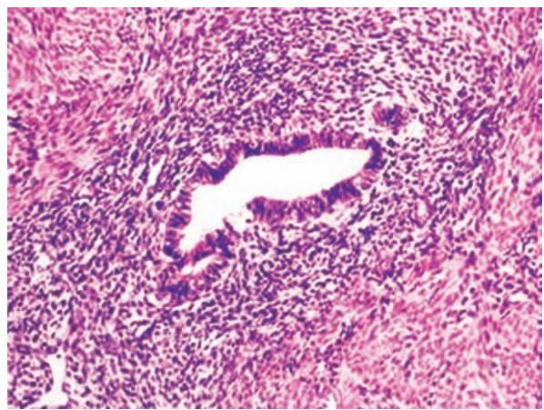
    *图 14-5 子宫肌层内的内膜腺体*
*   **子宫内膜癌**：
    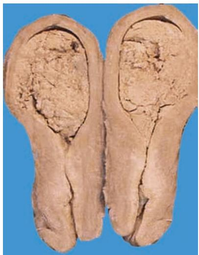
    *图 14-6 弥漫型子宫内膜癌*
*   **平滑肌肿瘤**：
    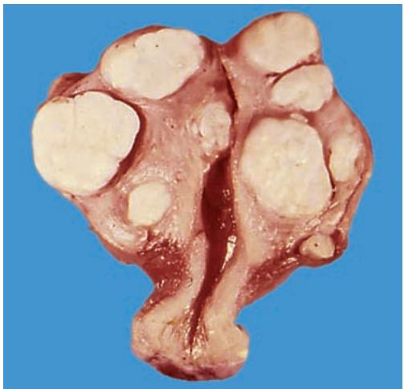
    *图 14-7 子宫平滑肌瘤大体*
    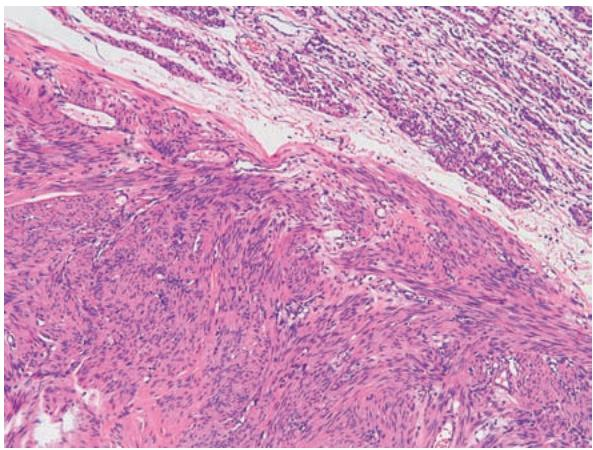
    *图 14-8 平滑肌瘤镜下（旋涡状排列）*
    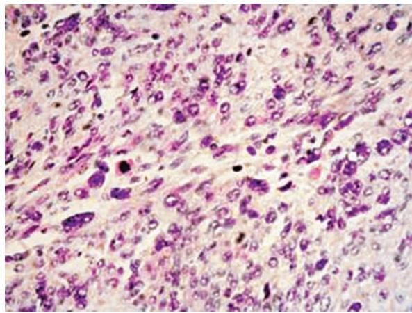
    *图 14-9 平滑肌肉瘤（核异型、分裂象多）*

#### 3. 妊娠滋养细胞疾病
*   **葡萄胎**：特征是**滋养层细胞增生**。
    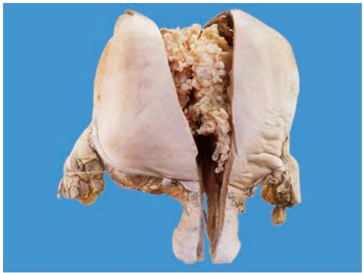
    *图 14-10 葡萄胎大体：透明水泡*
    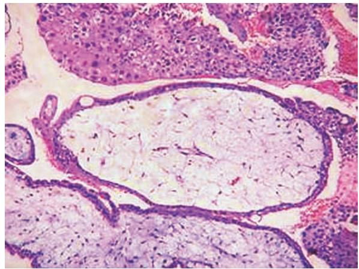
    *图 14-11 葡萄胎镜下：绒毛水肿、无血管*
*   **绒毛膜癌**：
    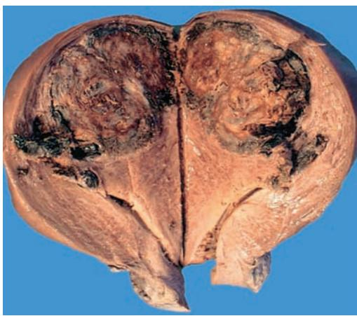
    *图 14-12 绒癌大体：暗紫红色、出血坏死*
    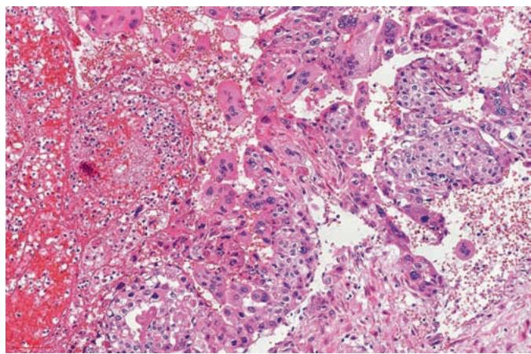
    *图 14-13 绒癌镜下：无绒毛结构、无间质血管*

#### 4. 卵巢肿瘤
*   **上皮性肿瘤**：
    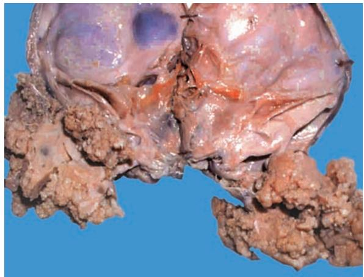
    *图 14-14 交界性浆液性肿瘤*
    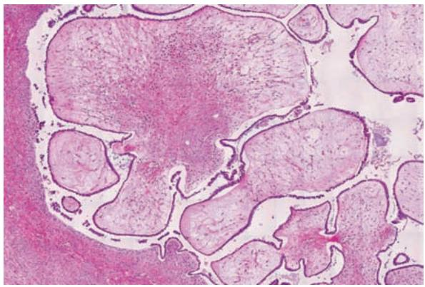
    *图 14-15 浆液性囊腺瘤镜下*
    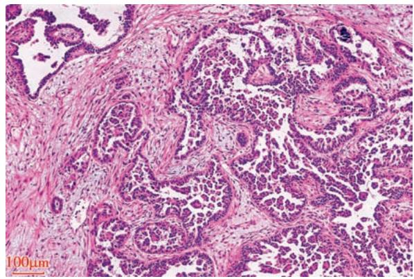
    *图 14-16 浆液性癌：见砂粒体*
    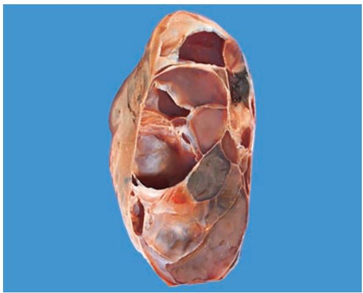
    *图 14-17 黏液性囊腺瘤大体*
    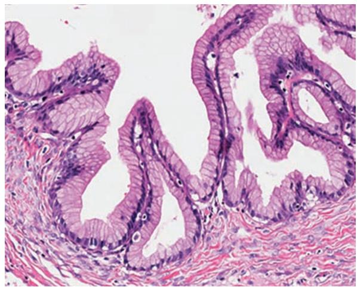
    *图 14-18 黏液性囊腺瘤镜下（高柱状分泌黏液上皮）*
*   **生殖细胞肿瘤**：
    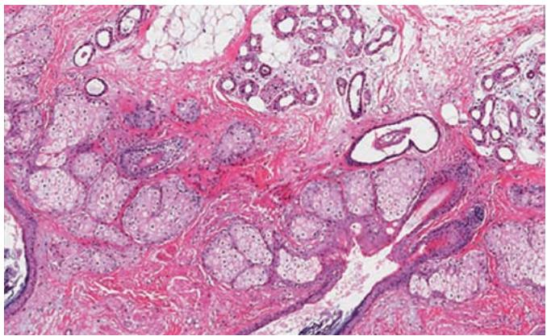
    *图 14-19 成熟性畸胎瘤：见皮肤附件*

#### 5. 前列腺与乳腺
*   **前列腺增生**：
    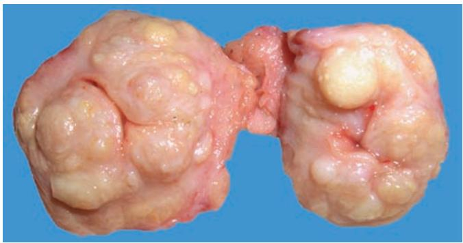
    *图 14-20 前列腺增生大体*
*   **乳腺疾病**：
    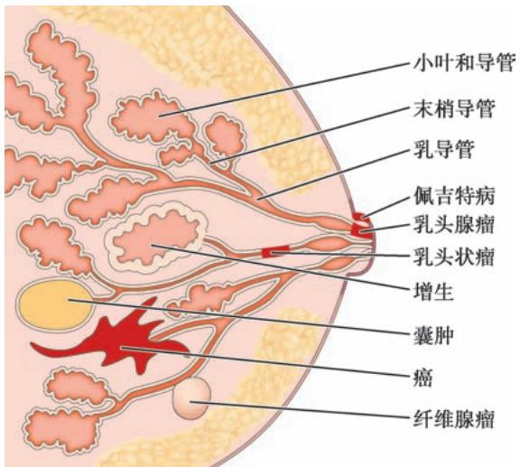
    *图 14-21 乳腺解剖与病变部位*
    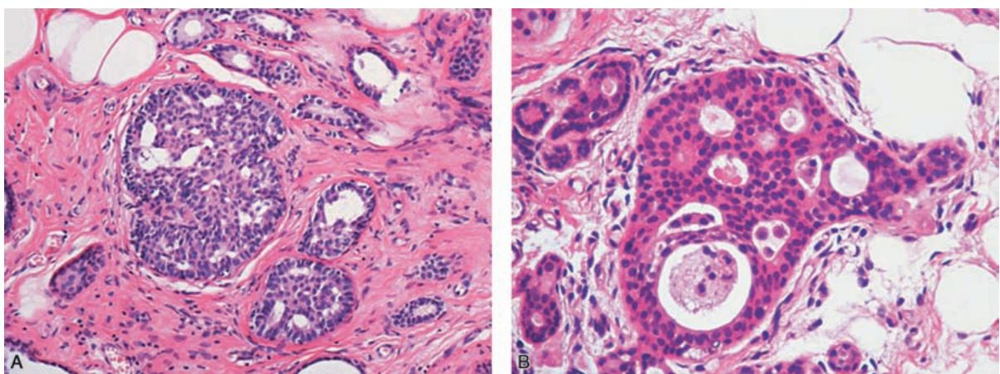
    *图 14-22 UDH（左）与 ADH（右）*
    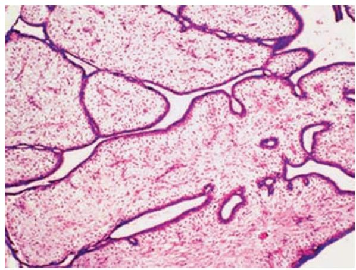
    *图 14-23 乳腺纤维腺瘤*
    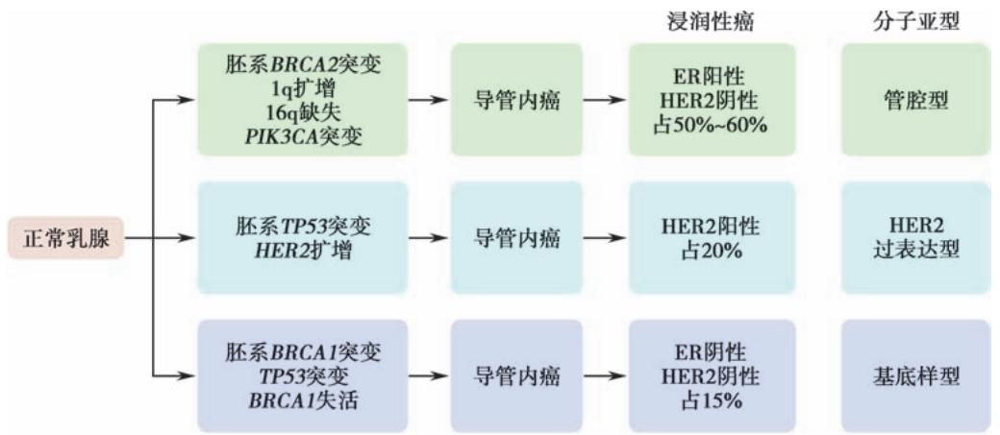
    *图 14-24 乳腺癌发生途径*
    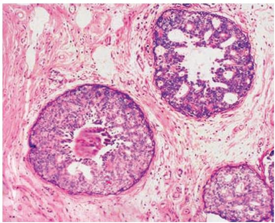
    *图 14-25 粉刺癌（DCIS 高级别）*
    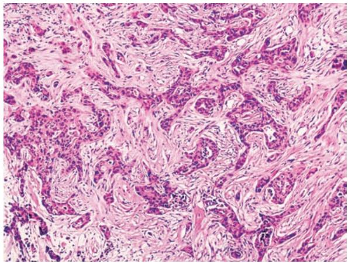
    *图 14-26 浸润性癌，非特殊型*
    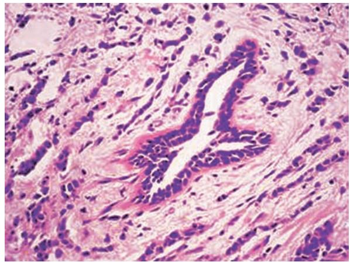
    *图 14-27 浸润性小叶癌（列兵样排列）*

---

### 四、 重要知识点总结、对比

#### 1. 葡萄胎、侵袭性葡萄胎与绒毛膜癌的鉴别

| 鉴别点 | 葡萄胎 | 侵袭性葡萄胎 | 绒毛膜癌 |
| :--- | :--- | :--- | :--- |
| **绒毛结构** | **有** | **有** | **无** |
| **滋养层细胞增生** | 轻至中度 | 显著、异型 | 极显著、高度异型 |
| **间质血管** | 无或极少 | 无 | **完全无** |
| **浸润深度** | 限于宫腔 | **侵入肌层** | 深达肌层，穿透浆膜 |
| **转移** | 不转移 | 可转移（能自愈） | **血行转移（肺、脑）** |

#### 2. 乳腺癌分子分型与预后

| 分型 | 分子标志 | 预后 | 治疗反应 |
| :--- | :--- | :--- | :--- |
| **管腔 A 型** | $ER+/PR+, HER2-$ | **最好** | 内分泌治疗敏感 |
| **管腔 B 型** | $ER+/PR+, HER2+$ | 较好 | 内分泌+靶向治疗 |
| **HER2 过表达型** | $ER-, PR-, HER2+$ | 较差 | **曲妥珠单抗**靶向治疗 |
| **三阴性 (基底样)** | **ER-, PR-, HER2-** | **最差** | 仅对化疗敏感 |

#### 3. 卵巢浆液性与黏液性肿瘤的区别

| 鉴别点 | 浆液性肿瘤 | 黏液性肿瘤 |
| :--- | :--- | :--- |
| **发生率** | 最常见 | 较常见 |
| **大体特征** | 多房、含清亮液、**多乳头** | 多房、含黏液、**乳头少** |
| **双侧性** | **多见** | 少见 |
| **镜下特征** | 输卵管样上皮、**砂粒体** | 宫颈样/肠样上皮、分泌黏液 |

#### 4. 子宫颈 SIL (CIN) 分级

| 级别 | 异型细胞范围 | 对应 SIL 类型 |
| :--- | :--- | :--- |
| **I 级** | 局限于上皮下 **1/3** | **LSIL** |
| **II 级** | 累及上皮下 **2/3** | **HSIL** |
| **III 级** | 超过上皮下 2/3 或**全层** | **HSIL** |