## 第十五章 内分泌系统疾病 学习笔记

### 一、 知识框架

*   **垂体疾病**：
    *   **下丘脑、垂体后叶**：尿崩症（ADH缺乏）。
    *   **垂体前叶功能亢进**：性早熟、**巨人症与肢端肥大症**（GH过多）、高催乳素血症。
    *   **垂体前叶功能低下**：**希恩综合征 (Sheehan)**、西蒙兹综合征。
    *   **垂体肿瘤**：**垂体神经内分泌瘤 (PitNETs)**（PIT1、TPIT、SF1谱系）。
*   **甲状腺疾病**：
    *   **甲状腺肿**：弥漫性非毒性（缺碘）、**弥漫性毒性 (Graves病)**。
    *   **甲状腺功能低下**：克汀病（呆小症）、黏液水肿。
    *   **甲状腺炎**：亚急性（肉芽肿性）、**慢性淋巴细胞性 (桥本甲状腺炎)**。
    *   **甲状腺肿瘤**：腺瘤、**甲状腺癌**（乳头状癌、滤泡癌、髓样癌、未分化癌）。
*   **甲状旁腺疾病**：功能亢进（原发、继发、三发）、腺瘤与癌。
*   **肾上腺疾病**：
    *   **皮质功能亢进**：**Cushing 综合征**（皮质醇增多）、醛固酮增多症。
    *   **皮质功能低下**：**艾迪生病 (Addison病)**、特发性肾上腺萎缩。
    *   **肾上腺肿瘤**：皮质腺瘤/癌、**嗜铬细胞瘤**（髓质）。
*   **胰岛疾病**：
    *   **糖尿病**：1型 (IDDM)、2型 (NIDDM)、并发症（肾病、血管病变）。
    *   **胰岛细胞瘤**：胰岛素瘤、胃泌素瘤。
*   **神经内分泌肿瘤 (NEN)**：NET (G1-G3)、NEC、类癌。

---

### 二、 重要概念及解释

1.  **肢端肥大症 (Acromegaly)**：成年后 GH 分泌过多，表现为头颅骨增厚、下颌突出、手足粗大。
2.  **希恩综合征 (Sheehan syndrome)**：分娩大出血导致垂体缺血性坏死，引起前叶功能低下。
3.  **砂粒体 (Psammoma bodies)**：甲状腺乳头状癌中常见的同心圆状钙化小体。
4.  **毛玻璃样核 (Ground glass nuclei)**：甲状腺乳头状癌特征，核染色质少、透明，有核沟。
5.  **Cushing 综合征**：长期糖皮质激素过多，表现为**满月脸、向心性肥胖、皮肤紫纹**。
6.  **艾迪生病 (Addison disease)**：慢性肾上腺皮质功能低下，表现为**皮肤黏膜黑色素沉着**。
7.  **嗜铬细胞瘤 (Pheochromocytoma)**：源自肾上腺髓质，分泌儿茶酚胺，引起阵发性高血压。
8.  **糖尿病肾病**：特征病变为**结节性肾小球硬化**（K-W结节）。
9.  **类癌 (Carcinoid)**：起源于神经内分泌细胞的低度恶性肿瘤，常分泌 5-HT 引起类癌综合征。

---

### 三、 正文内容详解

#### 1. 垂体疾病
*   **功能亢进**：
    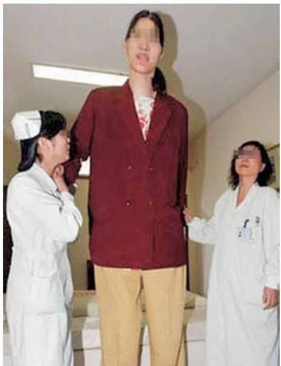
    *图 15-1 垂体性巨人症（GH 分泌于骨骺闭合前）*
    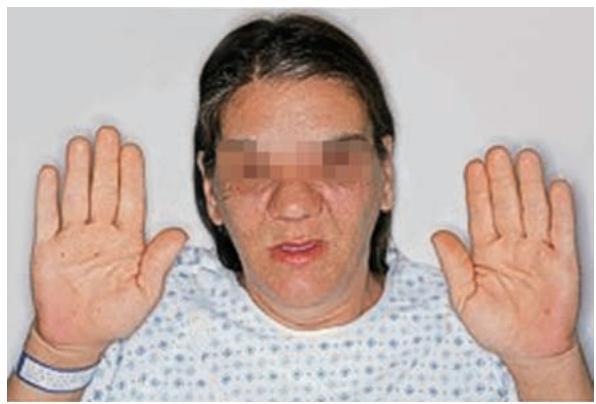
    *图 15-2 肢端肥大症（GH 分泌于骨骺闭合后）*
*   **垂体肿瘤**：
    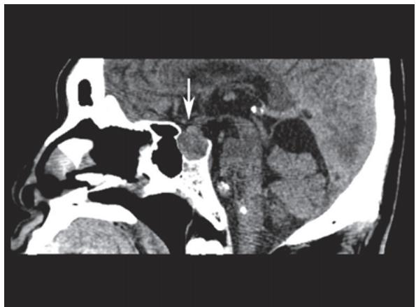
    *图 15-3 垂体神经内分泌瘤影像*
    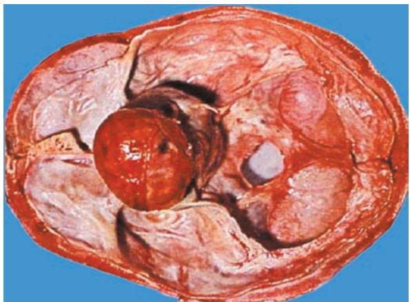
    *图 15-4 垂体神经内分泌瘤大体*

#### 2. 甲状腺疾病
*   **非毒性甲状腺肿**：
    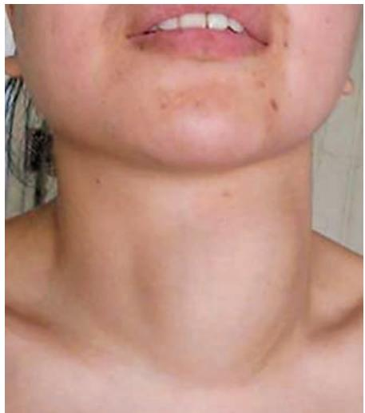
    *图 15-5 颈部甲状腺肿大*
    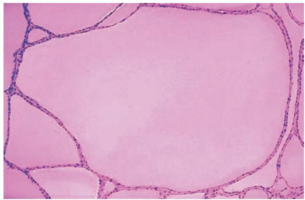
    *图 15-6 胶质贮积期：滤泡高度扩大，充满胶质*
    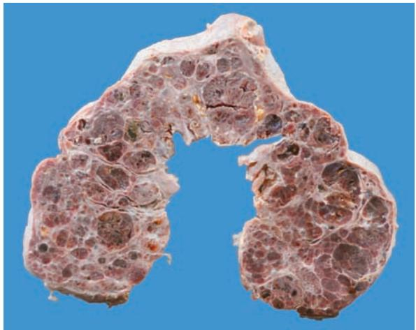
    *图 15-7 结节性甲状腺肿大体*
    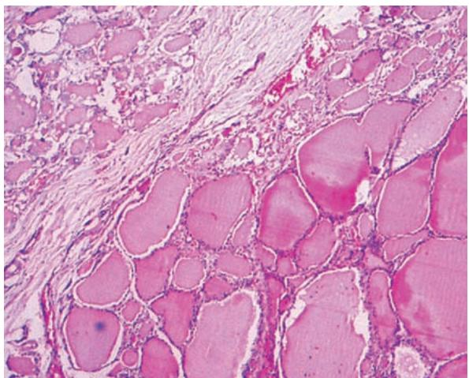
    *图 15-8 结节期镜下：纤维分割*
*   **毒性甲状腺肿 (Graves 病)**：
    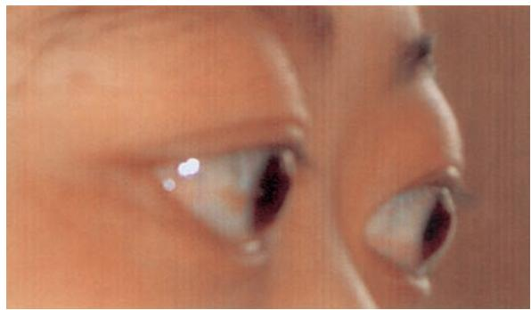
    *图 15-9 突眼性甲状腺肿*
    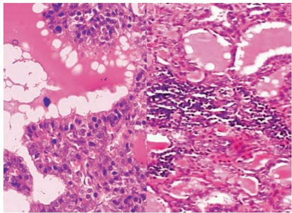
    *图 15-10 镜下：上皮增生、胶质稀薄、吸收空泡*
*   **甲状腺肿瘤**：
    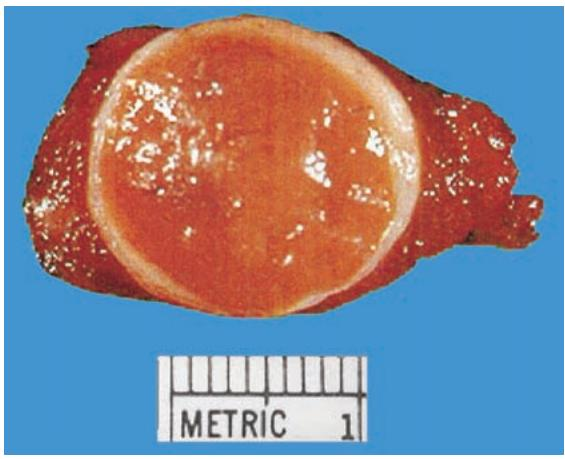
    *图 15-11 甲状腺腺瘤：完整包膜*
    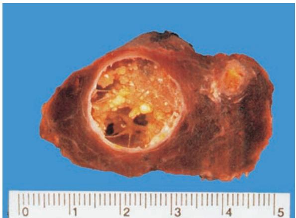
    *图 15-12 乳头状癌：囊内乳头*
    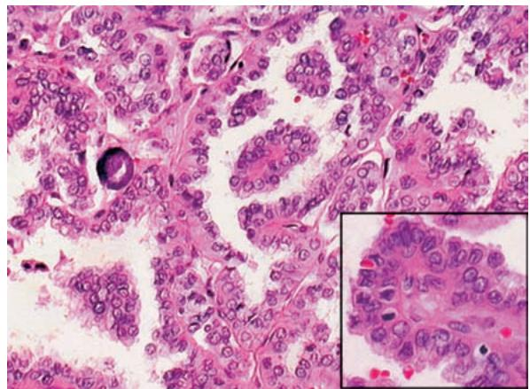
    *图 15-13 乳头状癌镜下：毛玻璃核、砂粒体*
    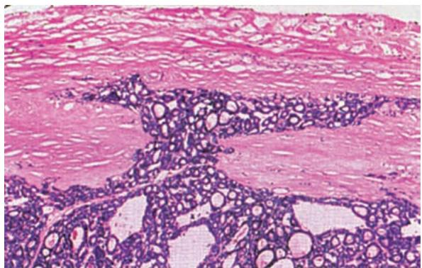
    *图 15-14 滤泡癌*
    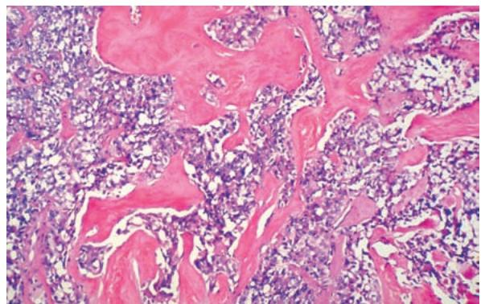
    *图 15-15 髓样癌：间质淀粉样物质沉着*

#### 3. 肾上腺与胰岛
*   **肾上腺皮质腺瘤**：
    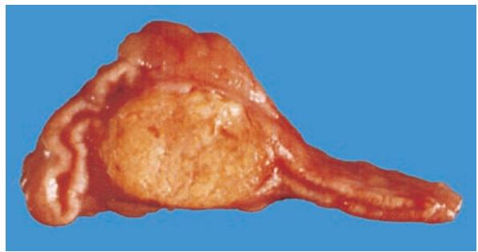
    *图 15-16 肾上腺皮质腺瘤：金黄色切面*
*   **糖尿病**：
    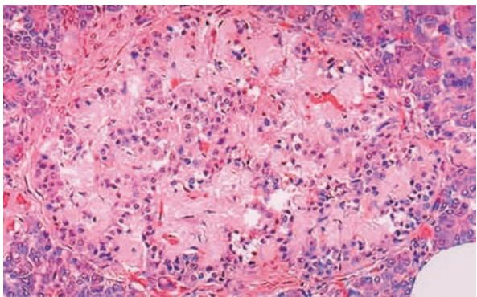
    *图 15-17 胰岛淀粉样变（2型糖尿病常见）*
*   **胰岛细胞瘤**：
    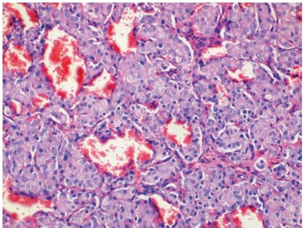
    *图 15-18 胰腺神经内分泌瘤镜下*

---

### 四、 重要知识点总结、对比

#### 1. 甲状腺癌四种主要类型的鉴别

| 类型 | 发生率 | 组织学特征 | 转移途径 | 预后 |
| :--- | :--- | :--- | :--- | :--- |
| **乳头状癌** | **最常见 (60%)** | **毛玻璃核、砂粒体**、乳头结构 | 淋巴道为主 | **最好** |
| **滤泡癌** | 较常见 (20%) | 滤泡结构、**侵犯包膜/血管** | **血行转移** | 较好 |
| **髓样癌** | 5%~10% | 间质**淀粉样物质**、分泌降钙素 | 淋巴/血行 | 中等 |
| **未分化癌** | 5%~10% | 细胞高度异型、坏死多 | 早期广泛转移 | **最差** |

#### 2. 1型与2型糖尿病的鉴别

| 鉴别点 | 1 型 (IDDM) | 2 型 (NIDDM) |
| :--- | :--- | :--- |
| **发病年龄** | 青少年 | **成年/老年** |
| **发病机制** | **自身免疫**导致 B 细胞破坏 | 胰岛素抵抗、相对不足 |
| **胰岛病变** | B 细胞消失、胰岛炎 | B 细胞减少、**淀粉样变** |
| **血胰岛素** | 显著降低 | 正常、升高或降低 |
| **酮症酸中毒** | **易发生** | 少见 |

#### 3. 弥漫性非毒性与毒性甲状腺肿的鉴别

| 鉴别点 | 非毒性 (单纯性) | 毒性 (Graves 病) |
| :--- | :--- | :--- |
| **甲状腺功能** | 正常 | **亢进 (甲亢)** |
| **病因** | **缺碘**、致甲状腺肿因子 | **自身免疫 (TRAb 抗体)** |
| **镜下特征** | 滤泡扩大、胶质大量贮积 | 上皮高柱状、**吸收空泡**、间质淋巴浸润 |
| **临床表现** | 仅甲状腺肿大 | 甲亢症状、**突眼** |

#### 4. 肾上腺皮质功能亢进与低下

| 综合征 | 激素变化 | 核心临床表现 |
| :--- | :--- | :--- |
| **Cushing 综合征** | 糖皮质激素 $\uparrow$ | 满月脸、向心性肥胖、紫纹 |
| **醛固酮增多症** | 盐皮质激素 $\uparrow$ | 高血压、高钠低钾血症 |
| **Addison 病** | 皮质激素 $\downarrow$ | **皮肤色素沉着**、低血压、低血糖 |