## 第十六章 神经系统疾病 学习笔记

### 一、 知识框架

*   **基本病变**：
    *   **神经元**：急性坏死（红色神经元）、萎缩、中央性尼氏小体溶解、包涵体（Lewy小体、Negri小体）、神经原纤维缠结。
    *   **神经纤维**：轴突反应（沃勒变性）、脱髓鞘。
    *   **神经胶质细胞**：星形胶质细胞（肿胀、胶质瘢痕、Rosenthal纤维）、少突胶质细胞（卫星现象）、小胶质细胞（噬神经细胞现象、格子细胞）。
*   **常见并发症**：
    *   **颅内压增高与脑疝**：扣带回疝、小脑幕裂孔疝、小脑扁桃体疝（枕骨大孔疝）。
    *   **脑水肿**：血管源性、细胞毒性。
    *   **脑积水**：阻塞性（非交通性）、非阻塞性（交通性）。
*   **中枢神经系统感染**：
    *   **细菌性**：流行性脑脊髓膜炎（化脓性、脑膜刺激征）、脑脓肿。
    *   **病毒性**：流行性乙型脑炎（变质性炎、淋巴细胞套、筛状软化灶）。
    *   **海绵状脑病**：朊蛋白病（CJD）、海绵状变性。
*   **变性疾病**：
    *   **阿尔茨海默病 (AD)**：痴呆、神经突起斑、神经原纤维缠结。
    *   **帕金森病 (PD)**：运动障碍、黑质脱色、Lewy小体。
*   **缺氧与脑血管病**：缺血性脑病、脑梗死、脑出血（高血压性、蛛网膜下腔出血）。
*   **脱髓鞘疾病**：多发性硬化症 (MS)、急性播散性脑脊髓炎。
*   **神经系统肿瘤**：
    *   **胶质瘤**：星形细胞瘤、少突胶质细胞瘤、胶质母细胞瘤、室管膜瘤。
    *   **胚胎性肿瘤**：髓母细胞瘤（Homer-Wright菊形团）。
    *   **脑膜瘤**：旋涡状排列、砂粒体。
    *   **外周神经肿瘤**：神经鞘瘤（Antoni A/B型）、神经纤维瘤。

---

### 二、 重要概念及解释

1.  **红色神经元 (Red neuron)**：急性缺血缺氧引起的神经元凝固性坏死，HE染色胞质呈深红色。
2.  **沃勒变性 (Wallerian degeneration)**：神经纤维被切断后，断端远侧轴突和髓鞘发生的崩解、吸收过程。
3.  **噬神经细胞现象 (Neuronophagia)**：坏死的神经元被增生的小胶质细胞或巨噬细胞吞噬的现象。
4.  **脑膜刺激征**：脑膜受累时出现的颈项强直、克尼格征（Kernig sign）阳性。
5.  **淋巴细胞套**：流行性乙型脑炎时，炎症细胞围绕血管周围间隙形成的袖套状外观。
6.  **筛状软化灶**：乙脑时，灶性神经组织液化坏死形成的镂空筛网状病灶，具特征性。
7.  **神经突起斑 (Neuritic plaque)**：AD的特征病变，中心为Aβ淀粉样物质，外围为退变突起。
8.  **Verocay 小体**：神经鞘瘤 Antoni A 型结构中，梭形细胞核平行排列呈栅栏状。
9.  **Homer-Wright 菊形团**：髓母细胞瘤中，瘤细胞环绕嗜银性神经纤维中心呈放射状排列。

---

### 三、 正文内容详解

#### 1. 神经系统基本病变
*   **神经元损伤**：
    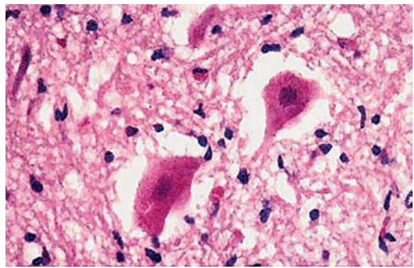
    *图 16-1 红色神经元：胞体缩小，深红染*
    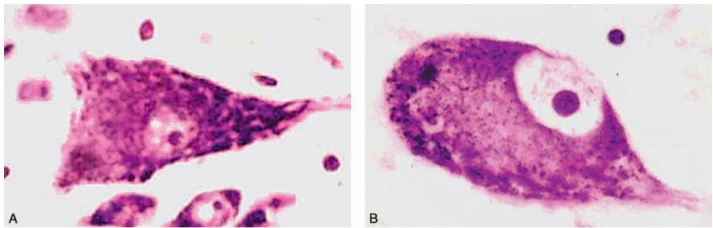
    *图 16-2 中央性尼氏小体溶解：核偏位，中央苍白*
    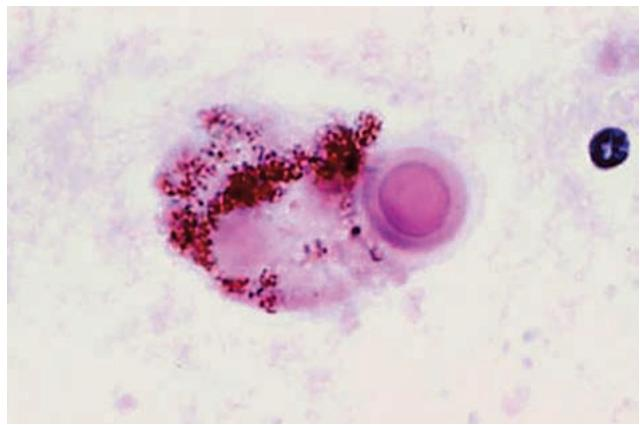
    *图 16-3 帕金森病黑质中的 Lewy 小体*
*   **胶质细胞反应**：
    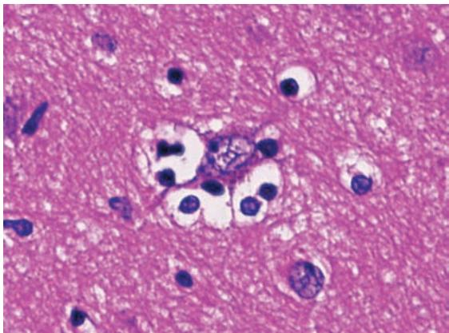
    *图 16-6 卫星现象：少突胶质细胞环绕神经元*
    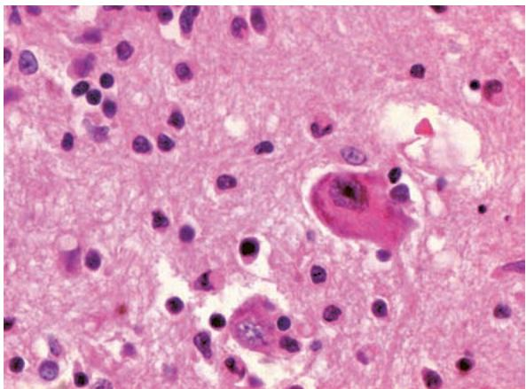
    *图 16-7 噬神经细胞现象*

#### 2. 脑疝与脑积水
*   **脑疝**：颅内压增高导致脑组织移位。
    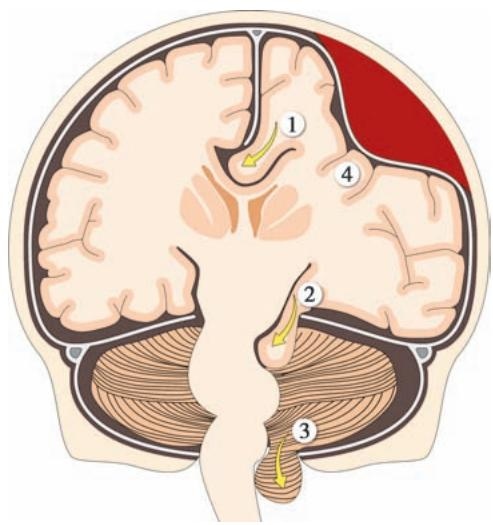
    *图 16-9 脑疝模式图：1.扣带回疝；2.小脑幕裂孔疝；3.小脑扁桃体疝*
*   **脑积水**：
    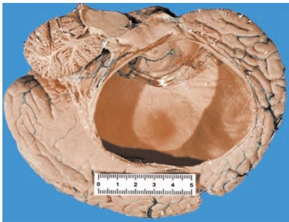
    *图 16-10 严重脑积水：脑室高度扩张，脑实质萎缩*

#### 3. 中枢神经系统感染
*   **流脑（化脓性）**：
    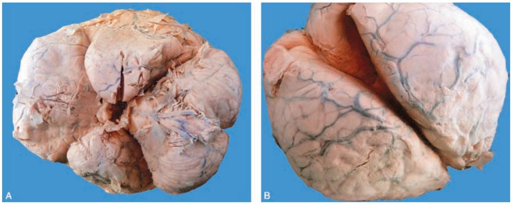
    *图 16-11 流脑大体：蛛网膜下腔充满脓液*
    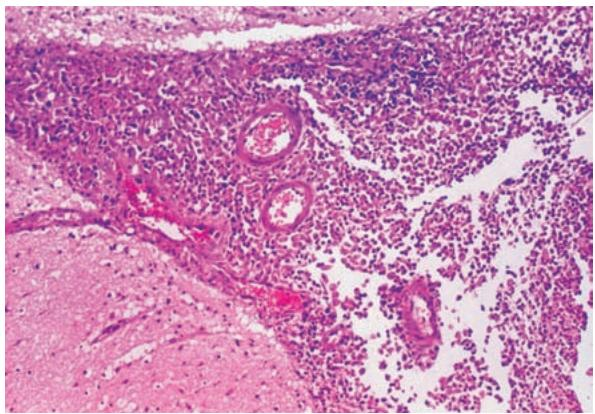
    *图 16-12 流脑镜下：大量中性粒细胞浸润*
*   **乙脑（变质性）**：
    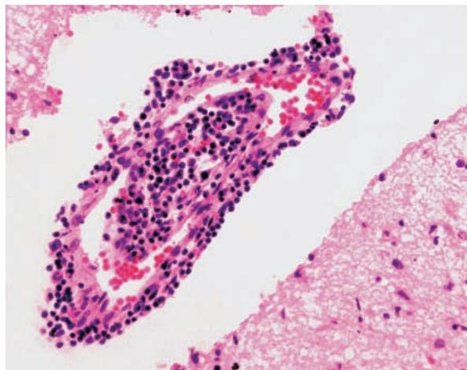
    *图 16-14 淋巴细胞套*
    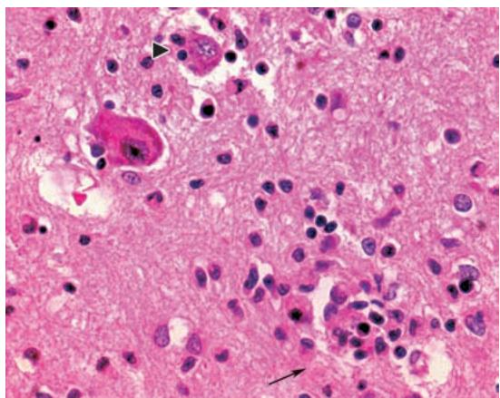
    *图 16-15 噬神经细胞现象与胶质结节*
    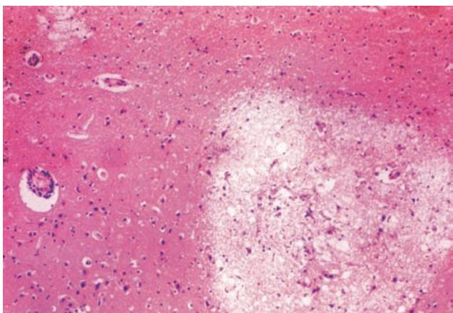
    *图 16-16 筛状软化灶（特征病变）*

#### 4. 变性疾病与脱髓鞘
*   **阿尔茨海默病 (AD)**：
    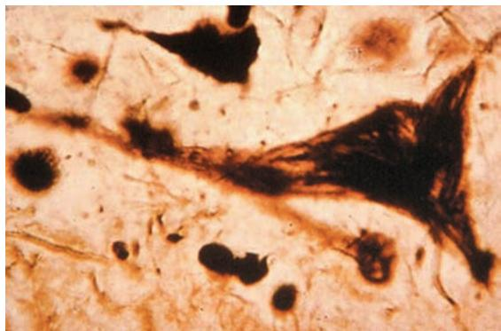
    *图 16-5 神经原纤维缠结（银染色）*
    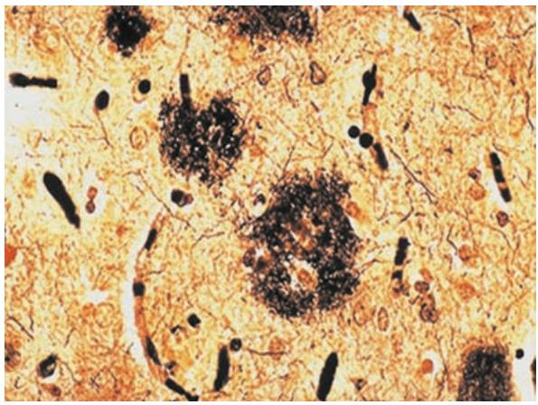
    *图 16-18 神经突起斑*
*   **多发性硬化 (MS)**：
    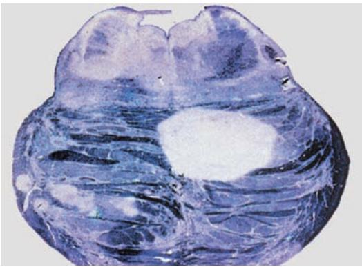
    *图 16-22 脱髓鞘病灶：境界清楚的髓鞘脱失区*

#### 5. 神经系统肿瘤
*   **胶质瘤**：
    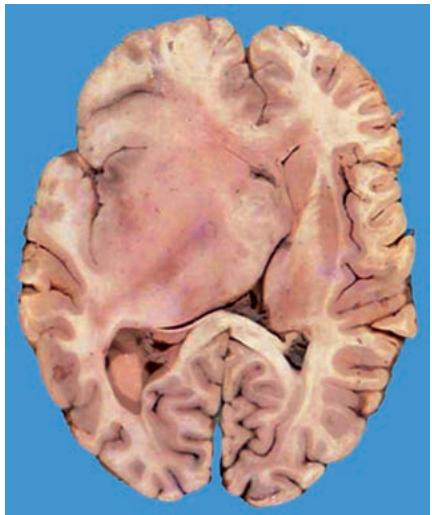
    *图 16-23 星形细胞瘤浸润生长*
    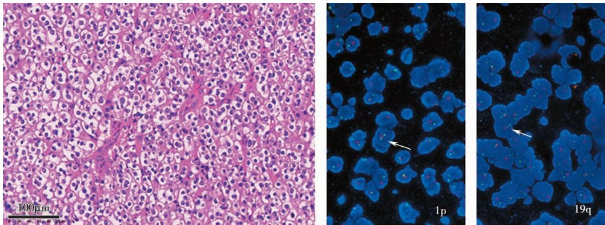
    *图 16-24 少突胶质细胞瘤：核周空晕、鸡爪样血管*
    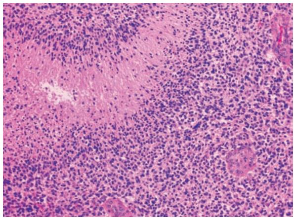
    *图 16-25 胶质母细胞瘤：假栅栏状坏死、肾小球样小体*
*   **髓母细胞瘤与脑膜瘤**：
    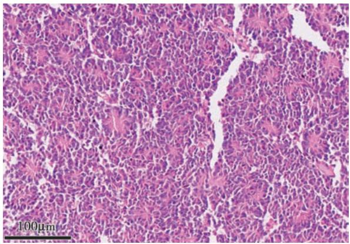
    *图 16-29 髓母细胞瘤：Homer-Wright 菊形团*
    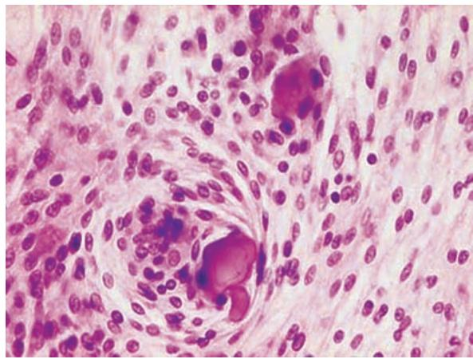
    *图 16-31 脑膜瘤：旋涡状排列、砂粒体*
*   **外周神经肿瘤**：
    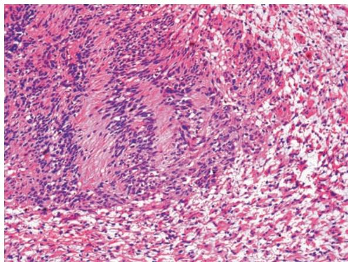
    *图 16-32 神经鞘瘤：Antoni A 型栅栏状排列*

---

### 四、 重要知识点总结、对比

#### 1. 流行性脑脊髓膜炎与流行性乙型脑炎的鉴别

| 鉴别点 | 流行性脑脊髓膜炎 (流脑) | 流行性乙型脑炎 (乙脑) |
| :--- | :--- | :--- |
| **病原体** | 脑膜炎双球菌（细菌） | 乙型脑炎病毒 |
| **传播途径** | 呼吸道飞沫 | **蚊虫叮咬** |
| **病变性质** | **化脓性炎** | **变质性炎** |
| **病变部位** | **软脑膜、蛛网膜** | **脑实质**（皮质、基底节） |
| **特征病变** | 蛛网膜下腔脓性渗出 | **淋巴细胞套、筛状软化灶**、胶质结节 |
| **临床表现** | 脑膜刺激征、脓性脑脊液 | 意识障碍、抽搐、昏迷 |

#### 2. 脑水肿两种类型的比较

| 鉴别点 | 血管源性脑水肿 | 细胞毒性脑水肿 |
| :--- | :--- | :--- |
| **发生机制** | 血脑屏障破坏，通透性 $\uparrow$ | 细胞膜损伤，钠钾泵失灵 |
| **液体部位** | **细胞外间隙** | **细胞内** |
| **常见原因** | 肿瘤、出血、炎症 | 缺氧、中毒 |

#### 3. 常见脑疝的临床后果

| 脑疝名称 | 疝入部位 | 压迫结构 | 后果 |
| :--- | :--- | :--- | :--- |
| **扣带回疝** | 大脑镰下 | 扣带回 | 局部缺血坏死 |
| **小脑幕裂孔疝** | 小脑幕裂孔 | 动眼神经、大脑后动脉 | 瞳孔改变、对侧偏瘫 |
| **小脑扁桃体疝** | **枕骨大孔** | **延髓（生命中枢）** | **呼吸心跳骤停（猝死）** |

#### 4. 神经系统常见包涵体/斑块

| 名称 | 组成/来源 | 相关疾病 |
| :--- | :--- | :--- |
| **Lewy 小体** | $\alpha$-突触核蛋白 | 帕金森病 (PD) |
| **Negri 小体** | 狂犬病毒 | 狂犬病 |
| **神经突起斑** | **A$\beta$ 淀粉样蛋白** | 阿尔茨海默病 (AD) |
| **Rosenthal 纤维** | 变性星形胶质细胞 | 毛细胞型星形细胞瘤 |