## 第十七章 骨关节和软组织疾病 学习笔记

### 一、 知识框架

*   **基本病变**：骨质破坏、骨质软化、骨质疏松、骨质增生硬化、骨质坏死；软骨排列不规则、增生。
*   **骨代谢性疾病**：
    *   **佝偻病与骨软化症**：维生素 D 缺乏，类骨质矿化障碍。
    *   **骨质疏松症**：单位体积骨量减少，骨脆性增加。
*   **骨髓炎**：化脓性骨髓炎（金黄色葡萄球菌）、Brodie 脓肿、死骨形成。
*   **非化脓性关节炎**：
    *   **骨关节炎**：退行性变、骨赘（骨刺）、骨质“象牙化”。
    *   **痛风性关节炎**：尿酸盐沉积、**痛风石**、痛风肉芽肿。
*   **骨和软骨肿瘤**：
    *   **良性/中间性**：动脉瘤样骨囊肿（USP6重排）、骨巨细胞瘤（H3F3A突变）、纤维结构不良（GNAS突变）、骨软骨瘤（EXT突变）。
    *   **恶性**：软骨肉瘤、**骨肉瘤**（肿瘤性骨形成、Codman三角）、**尤因肉瘤**（小圆细胞、EWSR1融合）。
*   **软组织疾病**：
    *   **非肿瘤性**：神经源性肌萎缩（同型肌群化）、肌营养不良（DMD，Dystrophin缺失）。
    *   **肿瘤性**：孤立性纤维性肿瘤（STAT6阳性）、隆突性皮肤纤维肉瘤（车辐状）、上皮样血管内皮瘤、滑膜肉瘤（双相分化、SYT::SSX融合）。

---

### 二、 重要概念及解释

1.  **骨样组织 (Osteoid)**：成骨细胞产生的未矿化的骨基质。
2.  **死骨 (Sequestrum)**：骨髓炎时，因血供中断导致的坏死骨组织，在 X 线上呈高密度阴影。
3.  **痛风石 (Tophus)**：慢性痛风时，尿酸盐结晶沉积在关节周围形成的灰白色硬结。
4.  **骨赘 (Osteophyte)**：骨关节炎时，关节边缘形成的骨性突起，俗称“骨刺”。
5.  **Codman 三角**：骨肉瘤侵犯骨膜，使之抬高，在肿瘤两端形成的三角形骨膜反应。
6.  **肿瘤性骨 (Tumor bone)**：由恶性成骨细胞直接形成的骨样组织或骨组织，是诊断骨肉瘤的关键。
7.  **同型肌群化**：神经源性肌萎缩后，神经再支配使同一运动单位的肌纤维类型趋于一致。
8.  **Birbeck 颗粒**：LCH 瘤细胞电镜下的特征结构（见第十二章，本章相关肿瘤亦涉及鉴别）。
9.  **车辐状结构 (Storiform pattern)**：隆突性皮肤纤维肉瘤中，梭形细胞围绕中心呈放射状排列的特征。

---

### 三、 正文内容详解

#### 1. 骨髓炎与关节炎
*   **化脓性骨髓炎**：
    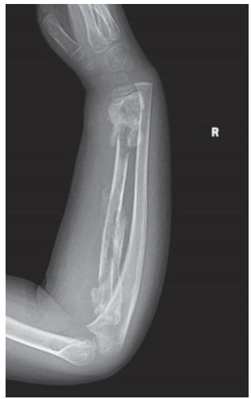
    *图 17-1 X 线示骨髓炎伴病理性骨折*
    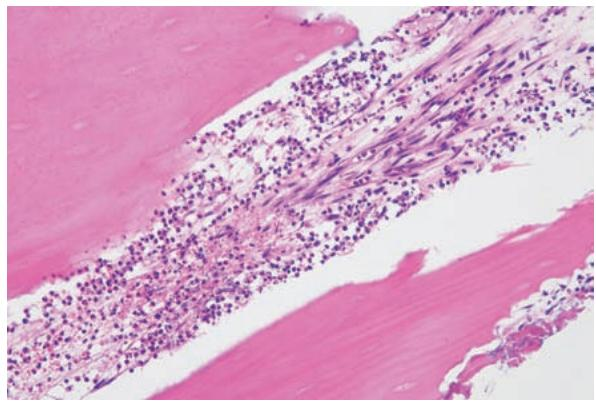
    *图 17-2 骨髓腔内大量中性粒细胞浸润*
*   **痛风**：
    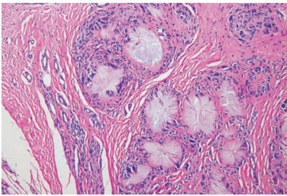
    *图 17-3 痛风肉芽肿：针状尿酸盐结晶及异物巨细胞*

#### 2. 骨肿瘤（良性与中间性）
*   **动脉瘤样骨囊肿 (ABC)**：
    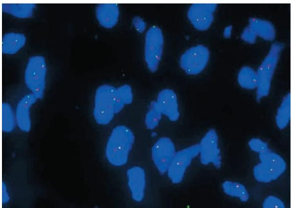
    *图 17-5 FISH 检测 USP6 基因重排*
    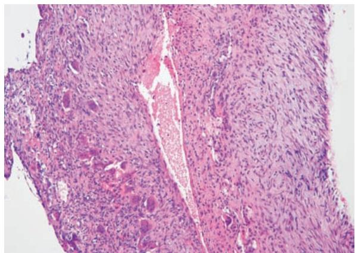
    *图 17-6 ABC 囊壁：含破骨细胞样巨细胞*
*   **骨巨细胞瘤**：
    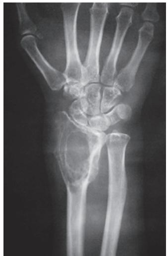
    *图 17-7 溶骨性膨胀性改变*
    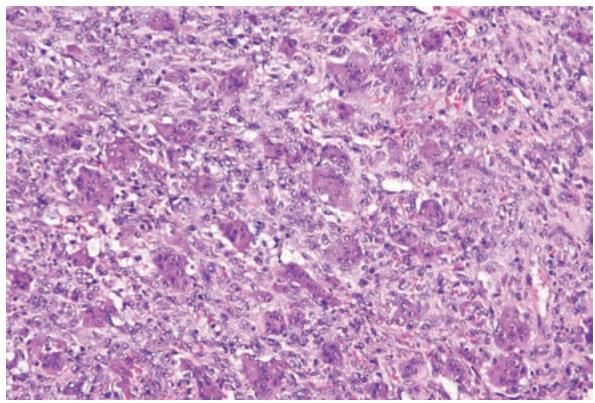
    *图 17-9 典型的单核肿瘤细胞与多核巨细胞*
*   **纤维结构不良**：
    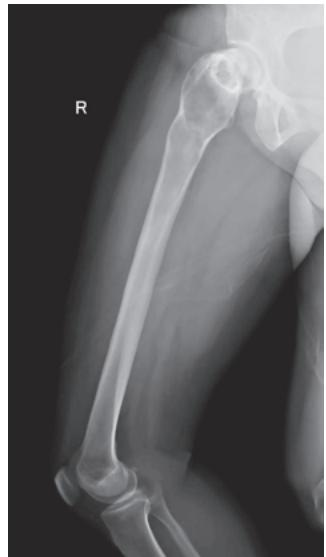
    *图 17-10 磨玻璃样低密度影*
    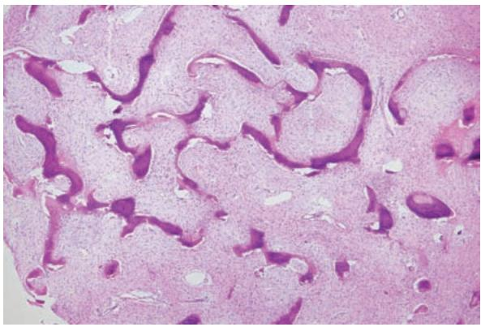
    *图 17-12 字母形（C、W形）骨小梁*
*   **骨软骨瘤**：
    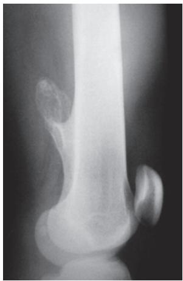
    *图 17-13 骨表面突起的背向关节生长的肿块*
    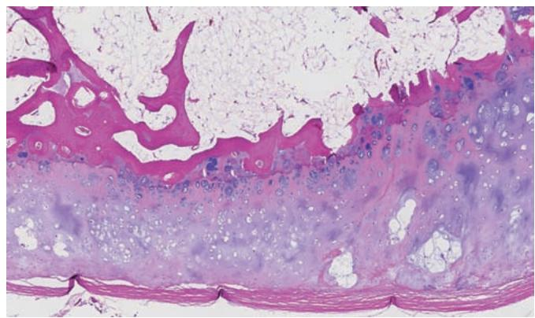
    *图 17-14 结构：纤维膜、软骨帽、骨性基底*

#### 3. 骨肿瘤（恶性）
*   **软骨肉瘤**：
    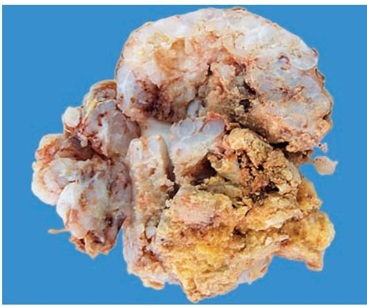
    *图 17-15 软骨肉瘤大体：分叶状、半透明*
    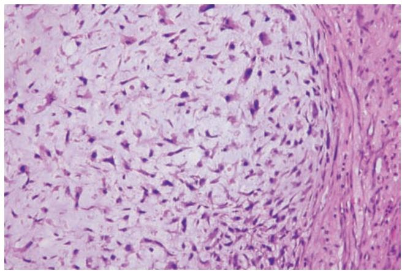
    *图 17-16 软骨肉瘤 III 级：核多形性明显*
*   **骨肉瘤**：
    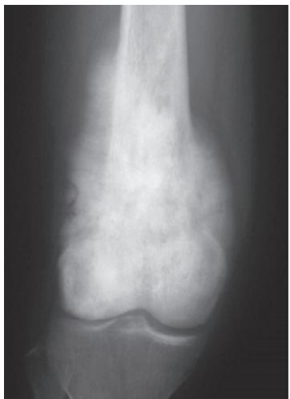
    *图 17-17 X 线示“日光射线”征*
    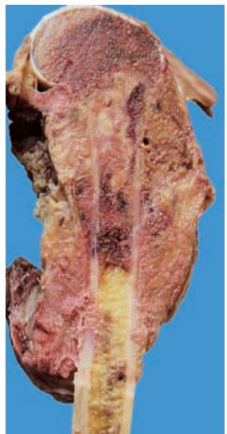
    *图 17-18 骨肉瘤侵犯软组织*
    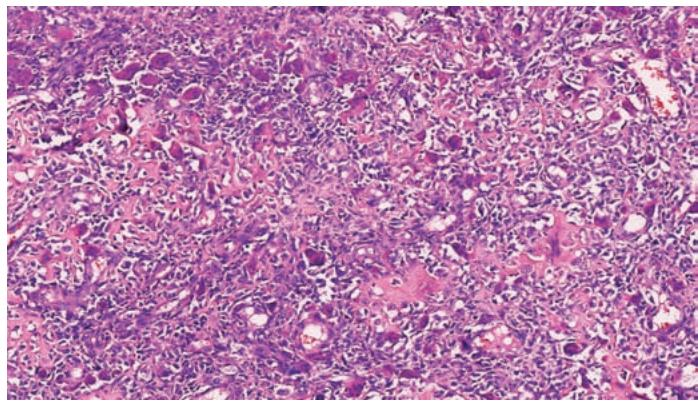
    *图 17-19 花边状肿瘤性骨样组织*
*   **尤因肉瘤**：
    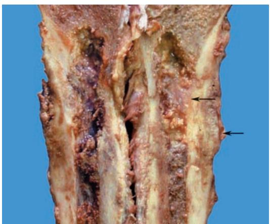
    *图 17-20 尤因肉瘤大体：鱼肉样*
    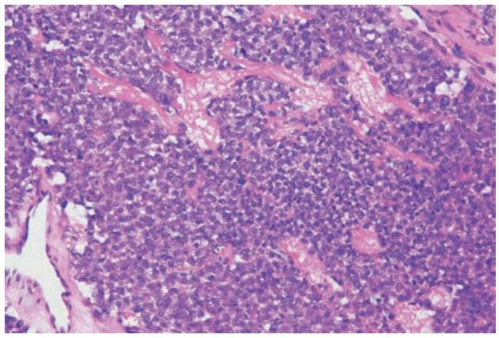
    *图 17-21 镜下：弥漫的小圆细胞*
    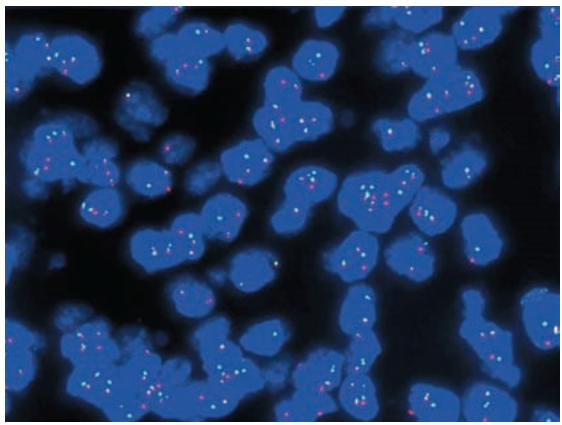
    *图 17-22 FISH 证实 EWSR1::FLI1 融合*

#### 4. 软组织疾病
*   **肌肉疾病**：
    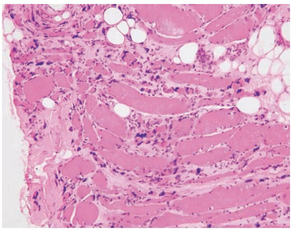
    *图 17-23 神经源性肌萎缩：成群萎缩*
    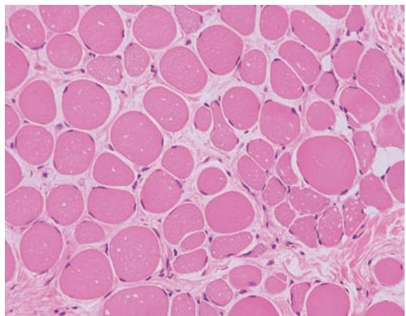
    *图 17-24 肌营养不良：肌纤维大小不等、肥大与萎缩并存*
*   **软组织肿瘤**：
    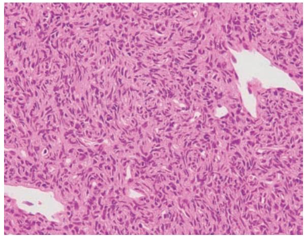
    *图 17-25 孤立性纤维性肿瘤：鹿角样血管*
    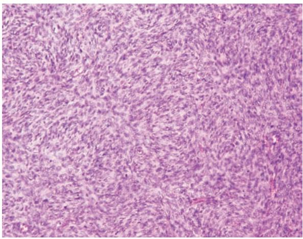
    *图 17-26 隆突性皮肤纤维肉瘤：车辐状排列*
    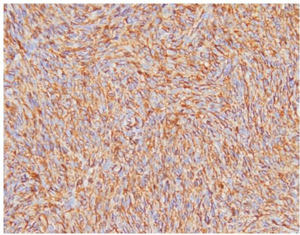
    *图 17-27 CD34 弥漫阳性*
    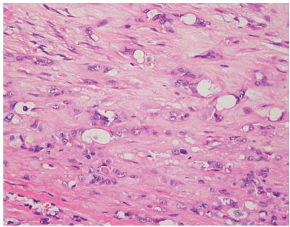
    *图 17-28 上皮样血管内皮瘤：胞质内原始血管腔（空泡）*
    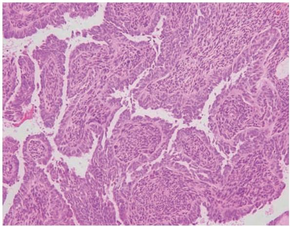
    *图 17-29 双相型滑膜肉瘤：腺样上皮与梭形细胞*

---

### 四、 重要知识点总结、对比

#### 1. 常见恶性骨肿瘤的鉴别

| 肿瘤名称 | 好发年龄 | 好发部位 | 影像学特征 | 组织学特征 | 分子/免疫标志 |
| :--- | :--- | :--- | :--- | :--- | :--- |
| **骨肉瘤** | 青少年 | 长骨干骺端 | **Codman三角**、日光放射状 | **肿瘤性骨形成** | TP53/RB突变 |
| **软骨肉瘤** | 中老年 | 骨盆、肩胛骨 | 溶骨伴点状/环状钙化 | 异型软骨、分叶状 | IDH1/2突变 |
| **尤因肉瘤** | 儿童/青年 | 长骨骨干 | **葱皮样**骨膜反应 | **小圆细胞**、菊形团 | **EWSR1融合**、CD99(+) |

#### 2. 骨关节炎与痛风性关节炎的鉴别

| 鉴别点 | 骨关节炎 | 痛风性关节炎 |
| :--- | :--- | :--- |
| **性质** | 退行性变 | 代谢性疾病（尿酸盐沉积） |
| **好发部位** | 负重关节（髋、膝） | **第一跖趾关节** |
| **特征病变** | 骨赘（骨刺）、骨质象牙化 | **痛风石**、痛风肉芽肿 |
| **镜下** | 软骨剥脱、无明显炎症 | 针状结晶、异物巨细胞反应 |

#### 3. 神经源性肌萎缩与肌营养不良的鉴别

| 鉴别点 | 神经源性肌萎缩 | 肌营养不良 (DMD) |
| :--- | :--- | :--- |
| **病因** | 运动神经元或轴突损伤 | **Dystrophin 基因缺陷** |
| **分布** | **成群萎缩**、同型肌群化 | 随机分布、**假性肥大** |
| **再生** | 罕见 | 常见（核大、肌质嗜碱） |
| **酶学** | CK 正常或轻度升高 | **CK 显著升高** |

#### 4. 常见骨肿瘤的分子驱动基因

| 肿瘤名称 | 驱动基因 | 备注 |
| :--- | :--- | :--- |
| **动脉瘤样骨囊肿** | **USP6** | 17p13 重排 |
| **骨巨细胞瘤** | **H3F3A** | G34W 突变 |
| **纤维结构不良** | **GNAS** | 导致成骨细胞成熟障碍 |
| **尤因肉瘤** | **EWSR1::FLI1** | $t(11;22)$ 易位 |