## 第十八章 传染病 学习笔记

### 一、 知识框架

*   **传染病概述**：
    *   侵入途径：皮肤、消化道、呼吸道、泌尿生殖道、垂直传播。
    *   体内播散：局部蔓延、淋巴道、血道（菌血症、败血症等）、神经播散。
    *   致病机制：直接杀伤、毒素作用、免疫损伤。
*   **结核病 (Tuberculosis)**：
    *   基本病变：渗出、增生（**结核结节**）、坏死（**干酪样坏死**）。
    *   **肺结核**：原发性（原发复合征）、继发性（局灶型、浸润型、空洞型、结核球、干酪性肺炎）。
    *   **肺外结核**：肠、腹膜、脑膜、肾、骨与关节、淋巴结结核。
*   **伤寒 (Typhoid Fever)**：
    *   病变特征：全身单核巨噬细胞系统增生。
    *   特征病变：**伤寒细胞**、**伤寒肉芽肿**。
    *   肠道四期：髓样肿胀期、坏死期、溃疡期、愈合期。
*   **细菌性痢疾 (Bacillary Dysentery)**：
    *   病变性质：**假膜性肠炎**。
    *   类型：急性、慢性、中毒性。
*   **钩端螺旋体病**：出血性血管炎、腓肠肌压痛。
*   **流行性出血热 (EHF)**：汉坦病毒、出血性血管炎、肾损害。
*   **冠状病毒感染**：SARS、**新型冠状病毒感染 (COVID-19)**（弥漫性肺泡损伤、透明膜）。
*   **性传播疾病 (STD)**：淋病、**尖锐湿疣**（挖空细胞）、**梅毒**（硬下疳、树胶样肿）。
*   **深部真菌病**：念珠菌、曲菌、隐球菌。
*   **寄生虫病**：
    *   **阿米巴病**：**烧瓶状溃疡**、肝脓肿。
    *   **血吸虫病**：**虫卵结节**（嗜酸性脓肿、假结核结节）、干线型肝硬化。
    *   **棘球蚴病 (包虫病)**：肝/肺囊肿、角皮层。

---

### 二、 重要概念及解释

1.  **结核结节 (Tubercle)**：由上皮样细胞、Langhans 巨细胞及外周淋巴细胞构成的肉芽肿。
2.  **原发复合征 (Primary complex)**：原发性肺结核的特征，包括原发病灶、结核性淋巴管炎和肺门淋巴结结核。
3.  **伤寒细胞 (Typhoid cell)**：吞噬了伤寒杆菌、红细胞和细胞碎片的巨噬细胞。
4.  **假膜性炎 (Pseudomembranous inflammation)**：菌痢特征，纤维蛋白、坏死组织和中性粒细胞在肠黏膜表面形成灰白色膜。
5.  **挖空细胞 (Koilocyte)**：尖锐湿疣特征，核大深染，核周有明显空晕。
6.  **树胶样肿 (Gumma)**：三期梅毒特征，中央为凝固性坏死，质韧如树胶。
7.  **烧瓶状溃疡 (Flask shaped ulcer)**：阿米巴痢疾特征，溃疡口小底大，边缘潜行。
8.  **干线型肝硬化 (Pipe stem cirrhosis)**：血吸虫病晚期，纤维组织沿门静脉分支呈树枝状增生。
9.  **冷脓肿 (Cold abscess)**：骨结核时，坏死物液化在骨旁形成的无红、热、痛的脓肿。

---

### 三、 正文内容详解

#### 1. 结核病 (Tuberculosis)
*   **基本病变**：
    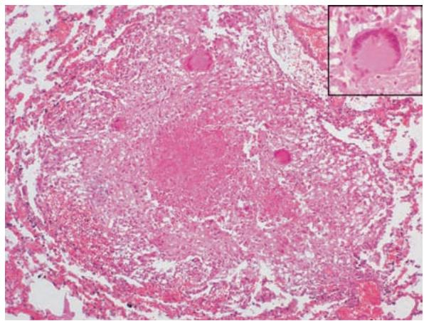
    *图 18-3 结核结节：中央干酪样坏死，周围见 Langhans 巨细胞*
*   **肺结核**：
    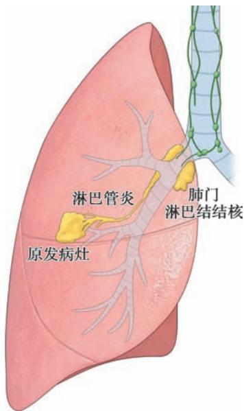
    *图 18-4 原发复合征：哑铃状阴影的基础*
    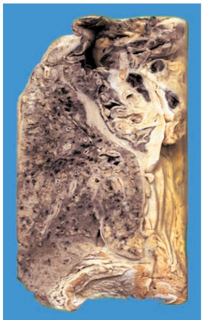
    *图 18-5 慢性纤维空洞型肺结核：厚壁空洞*
    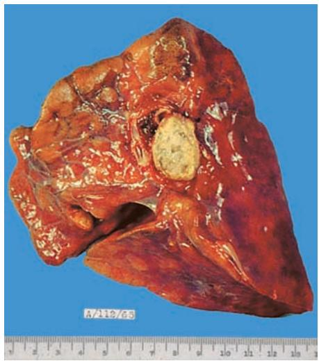
    *图 18-6 肺结核球：纤维包裹的干酪样坏死*
*   **肺外结核**：
    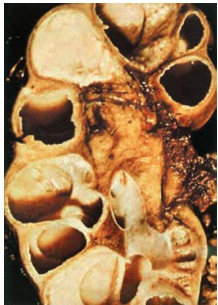
    *图 18-8 肾结核：干酪样坏死与空洞*

#### 2. 伤寒与菌痢
*   **伤寒**：特征是**伤寒肉芽肿**。
    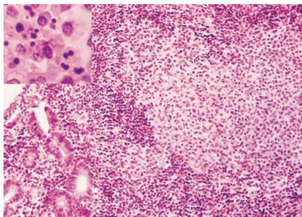
    *图 18-9 伤寒肉芽肿：巨噬细胞聚集成团*
    *图 18-10 伤寒髓样肿胀期：淋巴小结隆起如脑沟回*
*   **细菌性痢疾**：
    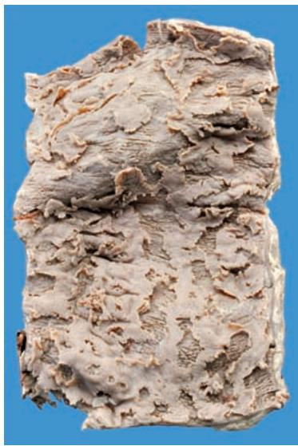
    *图 18-11 菌痢：地图状溃疡*

#### 3. 冠状病毒感染 (COVID-19)
*   **病理表现**：弥漫性肺泡损伤。
    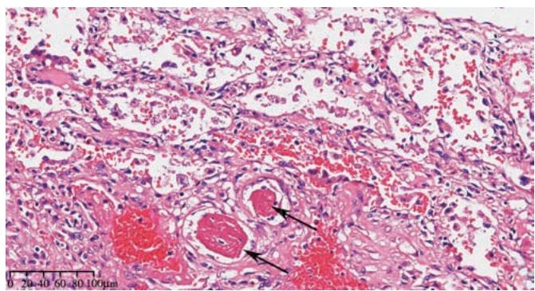
    *图 18-12 新冠肺炎：肺泡内透明膜、微血管血栓*
    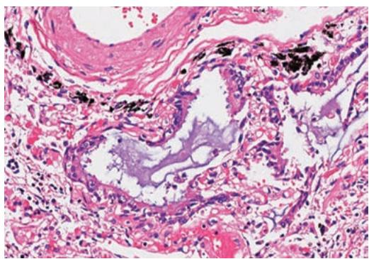
    *图 18-13 支气管内黏液栓阻塞*

#### 4. 性传播疾病
*   **尖锐湿疣**：
    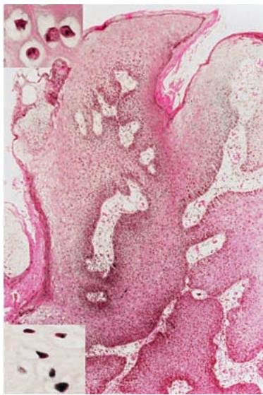
    *图 18-14 尖锐湿疣：表皮棘层肥厚、挖空细胞*
    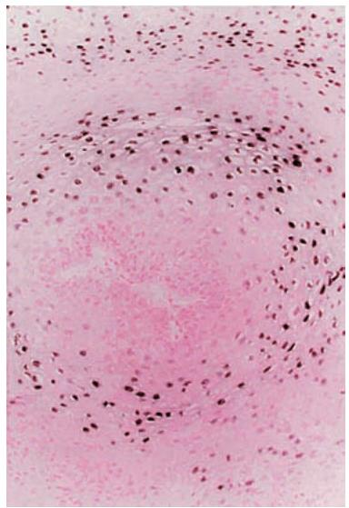
    *图 18-15 原位杂交检测 HPV DNA*

#### 5. 寄生虫病
*   **阿米巴病**：
    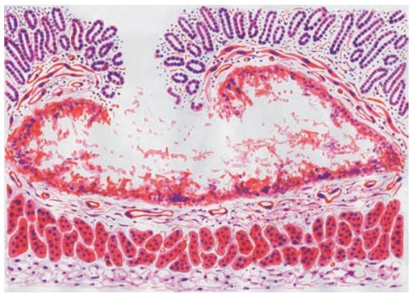
    *图 18-16 烧瓶状溃疡模式图*
    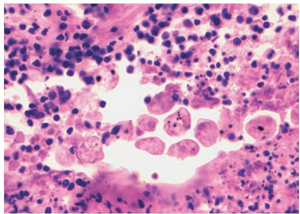
    *图 18-17 组织内的阿米巴滋养体*
    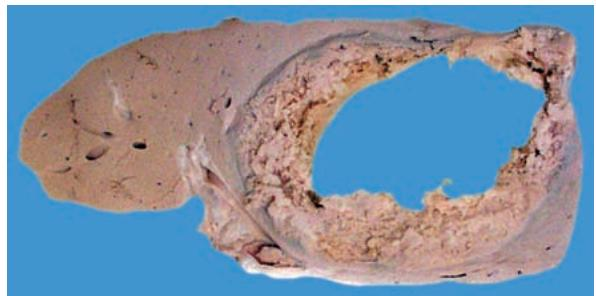
    *图 18-19 阿米巴肝脓肿：破絮状脓肿壁*
*   **血吸虫病**：
    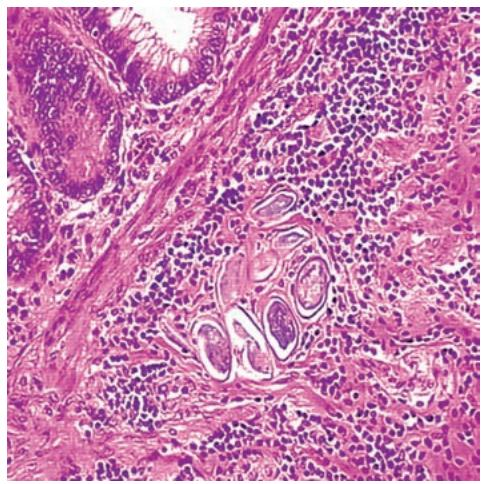
    *图 18-20 慢性虫卵结节：钙化虫卵与上皮样细胞*
    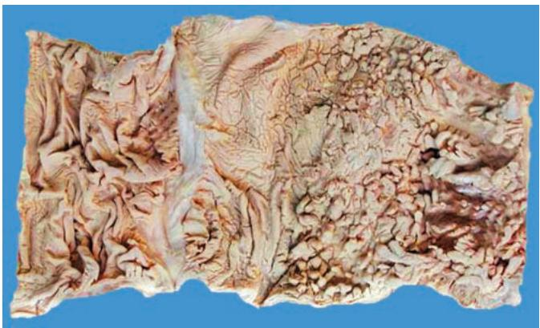
    *图 18-21 慢性血吸虫性结肠：息肉与溃疡*
*   **棘球蚴病**：
    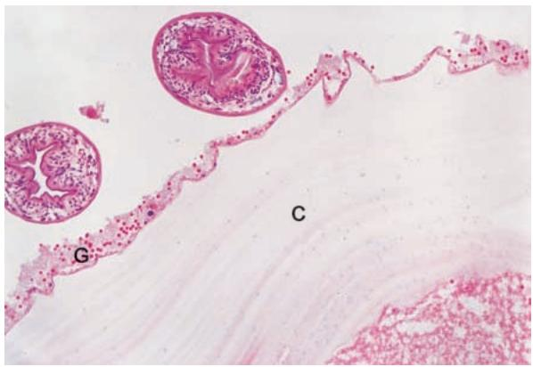
    *图 18-22 细粒棘球蚴：角皮层与生发层*

---

### 四、 重要知识点总结、对比

#### 1. 原发性与继发性肺结核的鉴别

| 鉴别点 | 原发性肺结核 | 继发性肺结核 |
| :--- | :--- | :--- |
| **结核菌感染** | 初次 | 再次（内源或外源） |
| **好发人群** | 儿童 | **成人** |
| **免疫力** | 无 | **有** |
| **病变特征** | **原发复合征** | 病变多样、新旧并存 |
| **起始部位** | 上叶下部/下叶上部近胸膜 | **肺尖部** |
| **播散途径** | 淋巴道、血道为主 | **支气管**为主 |

#### 2. 伤寒与细菌性痢疾的肠道病变鉴别

| 鉴别点 | 伤寒 | 细菌性痢疾 |
| :--- | :--- | :--- |
| **病原体** | 伤寒沙门菌 | 志贺菌 |
| **病变性质** | **急性增生性炎** | **假膜性炎** |
| **好发部位** | **回肠末端**淋巴小结 | **大肠**（乙状结肠、直肠） |
| **溃疡特征** | 长轴与肠长轴平行 | 地图状、表浅 |
| **特征细胞** | **伤寒细胞** | 中性粒细胞 |

#### 3. 肠阿米巴病与细菌性痢疾的鉴别

| 鉴别点 | 肠阿米巴病 | 细菌性痢疾 |
| :--- | :--- | :--- |
| **病变性质** | 液化性坏死（变质性炎） | 纤维蛋白性渗出（假膜性炎） |
| **溃疡形态** | **烧瓶状**、边缘潜行 | 地图状、表浅 |
| **粪便特征** | **暗红色果酱样**、腥臭 | **黏液脓血便** |
| **临床表现** | 腹痛、里急后重轻 | 腹痛、里急后重明显 |

#### 4. 梅毒的分期与病变

| 分期 | 发生时间 | 主要病变 | 传染性 |
| :--- | :--- | :--- | :--- |
| **一期梅毒** | 感染后 3 周 | **硬下疳** | 强 |
| **二期梅毒** | 感染后 7-8 周 | 全身**梅毒疹**、淋巴结肿大 | 强 |
| **三期梅毒** | 感染后 4-5 年 | **树胶样肿**、主动脉炎、脊髓痨 | 弱 |