## 第十九章 病理学诊断与研究技术 学习笔记

### 一、 知识框架

*   **形态学观察技术**：
    *   **大体观察**：肉眼检查。
    *   **组织病理学**：HE 染色（最基本）。
    *   **细胞病理学**：脱落细胞、细针穿刺 (FNA)。
    *   **液体活检**：CTCs、ctDNA、ctRNA。
*   **组织/免疫化学技术**：
    *   **组织化学**：特殊染色（如苏丹 III、普鲁士蓝）。
    *   **免疫组织化学 (IHC)**：抗原-抗体结合，DAB 显色。
*   **显微成像技术**：
    *   **电子显微镜**：透射电镜 (TEM)、扫描电镜 (SEM)、冷冻电镜。
    *   **激光扫描共聚焦 (LSCM)**：细胞 CT、三维重建。
    *   **超分辨成像**：突破衍射极限（STED、SIM 等）。
*   **分子生物学技术**：
    *   **原位杂交 (ISH/FISH)**：核酸定位。
    *   **聚合酶链反应 (PCR)**：RT-PCR、qPCR、原位 PCR。
    *   **流式细胞术 (FCM)**：细胞分选、免疫分型。
    *   **比较基因组杂交 (CGH)**：检测染色体拷贝数变化。
    *   **基因测序**：一代 (Sanger)、二代 (NGS)、三代 (单分子)。
*   **高通量与组学技术**：
    *   **生物芯片**：基因芯片、蛋白质芯片、**组织芯片 (TMA)**。
    *   **转录组学**：单细胞转录组 (scRNA-seq)、空间转录组。
    *   **表观遗传**：DNA 甲基化检测 (MSP)。
*   **数字与人工智能**：数字切片 (WSI)、图像分析、人工智能 (AI) 辅助诊断。

---

### 二、 重要概念及解释

1.  **HE 染色 (Hematoxylin-Eosin staining)**：苏木素-伊红染色，病理学最常用的基本染色方法。
2.  **液体活检 (Liquid biopsy)**：通过血液或体液检测循环肿瘤细胞 (CTCs) 或游离 DNA (ctDNA) 的技术。
3.  **免疫组织化学 (IHC)**：利用抗原抗体特异性结合原理，原位检测组织内蛋白质表达的技术。
4.  **DAB (Diaminobenzidine)**：IHC 最常用的显色剂，阳性结果呈**棕黄色**颗粒。
5.  **荧光原位杂交 (FISH)**：利用荧光标记的核酸探针检测染色体或细胞核内特定 DNA 序列的技术。
6.  **组织芯片 (Tissue microarray, TMA)**：将数百个小组织片整齐排列在同一载体上的微缩组织切片。
7.  **二代测序 (NGS)**：高通量测序，可同时对数百万条 DNA 分子进行序列测定。
8.  **空间转录组**：在保留细胞空间坐标的同时进行转录组分析的技术。
9.  **数字切片 (Digital slide/WSI)**：将全切片图像数字化，实现计算机阅片和远程诊断。

---

### 三、 正文内容详解

#### 1. 免疫组织化学 (IHC)
IHC 是临床病理诊断的核心技术，用于判定细胞属性和肿瘤来源。
*   **阳性定位**：
    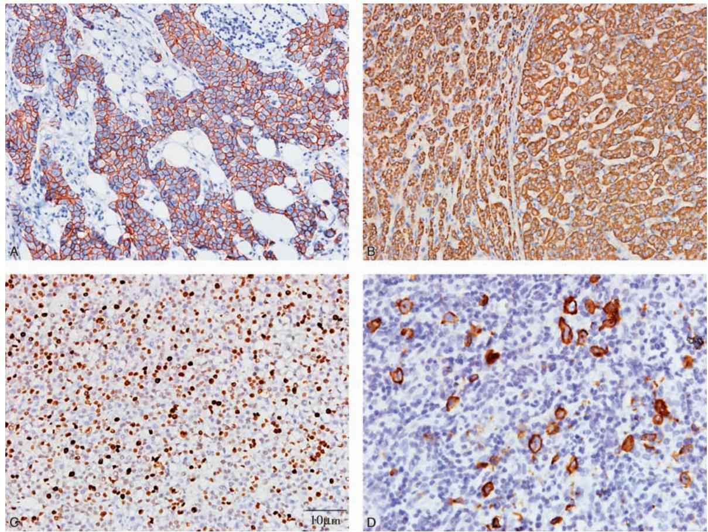
    *图 19-1 IHC 信号定位：A.胞膜；B.胞质弥漫；C.胞核；D.点状*

#### 2. 电子显微镜技术
用于观察亚细胞水平的超微结构。
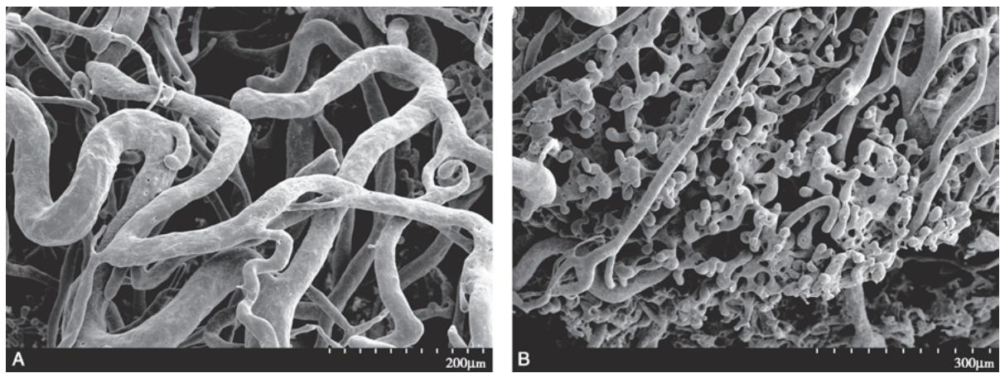
*图 19-2 扫描电镜 (SEM)：观察肿瘤微血管三维形态*
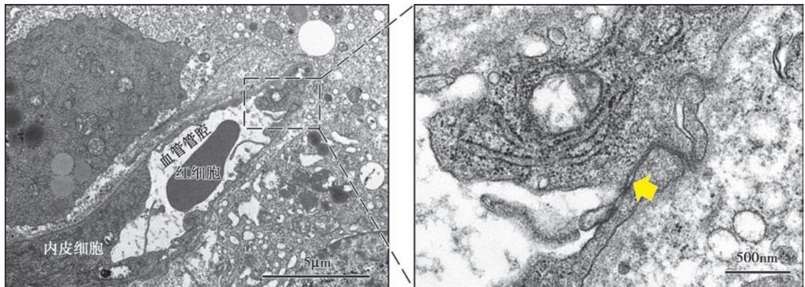
*图 19-3 透射电镜 (TEM)：观察内皮细胞间隙*

#### 3. 显微切割与共聚焦技术
*   **显微切割**：获取纯净的特定细胞群。
    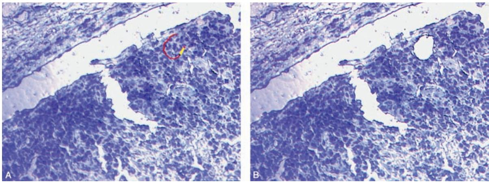
    *图 19-4 激光显微切割 (LCM) 过程*
*   **LSCM**：实现“细胞 CT”断层扫描。
    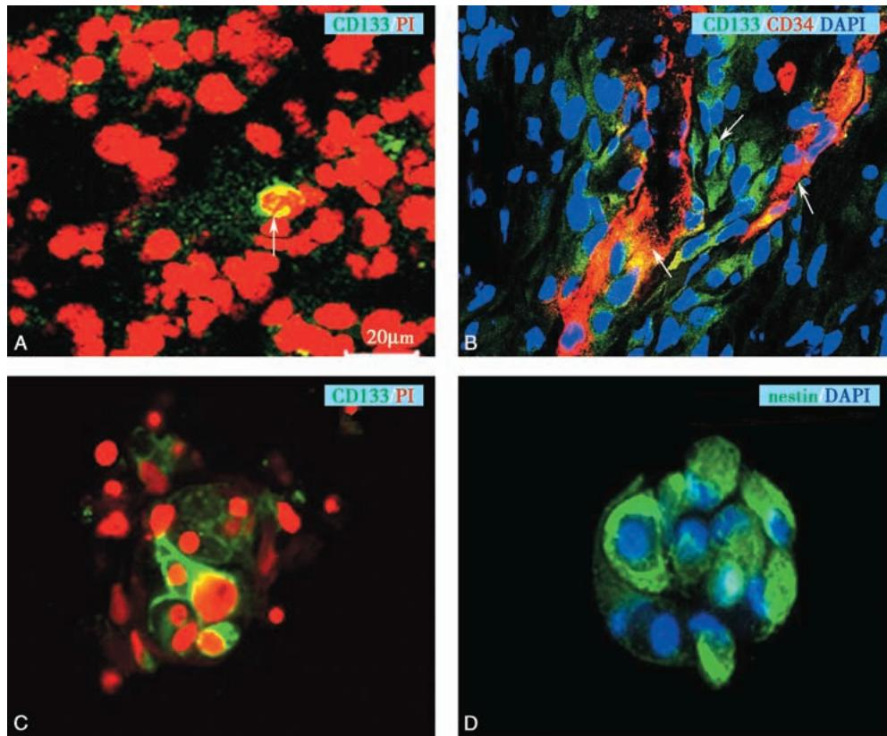
    *图 19-5 LSCM 观察胶质瘤干细胞分布*
*   **超分辨成像**：
    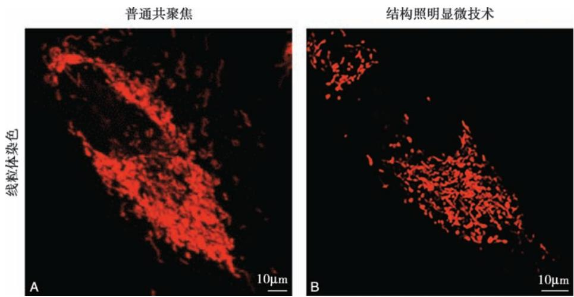
    *图 19-6 结构照明显微技术 (SIM) 观察线粒体*

#### 4. 原位杂交与 PCR
*   **FISH**：检测染色体易位或扩增。
    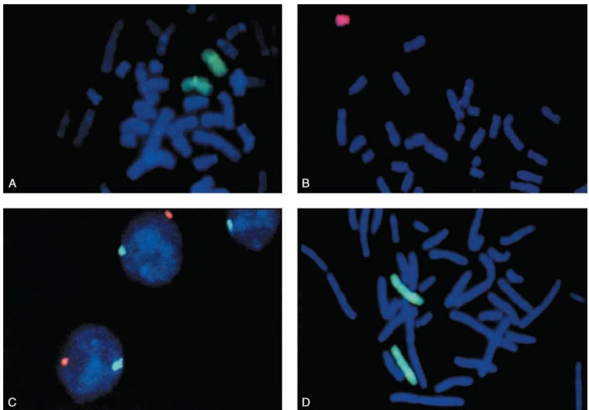
    *图 19-7 染色体 FISH 图像*
*   **ISH**：病毒检测。
    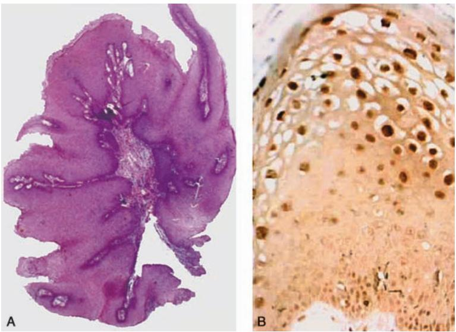
    *图 19-8 ISH 检测 HPV DNA（胞核阳性）*

#### 5. 流式细胞术与 CGH
*   **FCM**：精确分选细胞。
    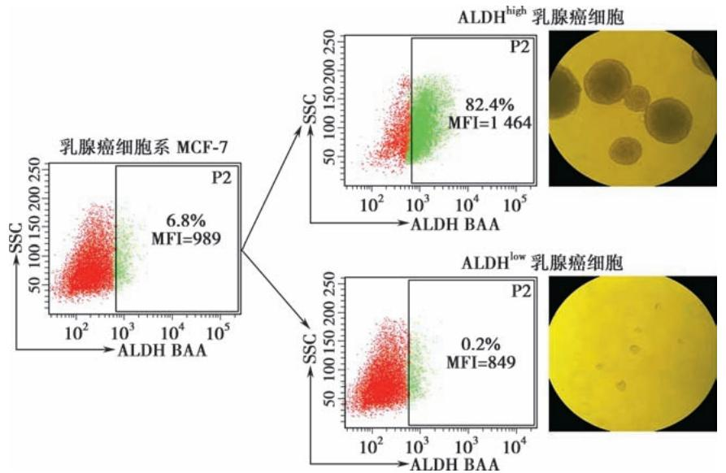
    *图 19-9 流式细胞术进行乳腺癌干细胞分选*
*   **CGH**：全基因组拷贝数分析。
    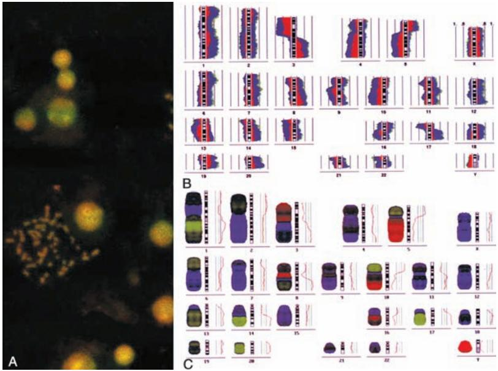
    *图 19-10 比较基因组杂交 (CGH) 结果图*

#### 6. 生物芯片技术
*   **基因芯片**：大规模检测基因表达差异。
    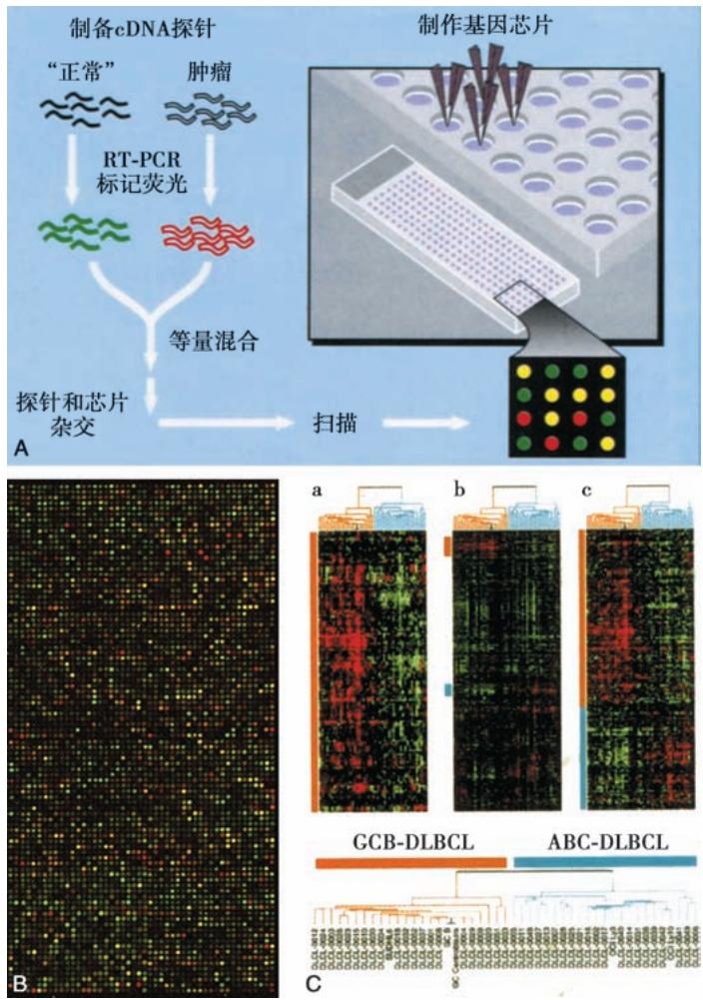
    *图 19-11 基因芯片原理与聚类分析*
*   **组织芯片 (TMA)**：
    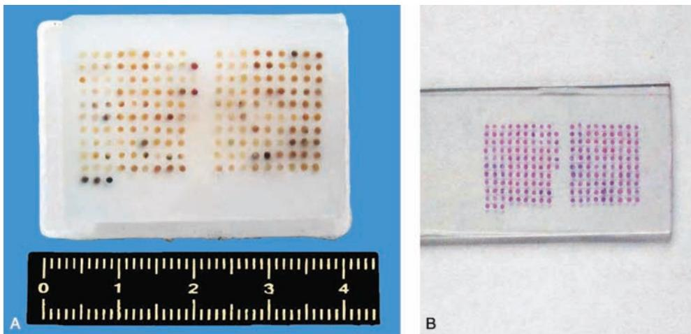
    *图 19-12 组织芯片阵列蜡块与 HE 切片*

---

### 四、 重要知识点总结、对比

#### 1. 免疫组织化学 (IHC) 与 原位杂交 (ISH) 的区别

| 比较项目 | 免疫组织化学 (IHC) | 原位杂交 (ISH) |
| :--- | :--- | :--- |
| **检测对象** | **蛋白质/多肽** | **DNA/RNA (核酸)** |
| **基本原理** | 抗原-抗体特异性结合 | 碱基互补配对 (杂交) |
| **主要应用** | 肿瘤分型、蛋白表达、预后评估 | 病毒检测、基因扩增/易位、基因定位 |
| **常用显色** | 酶促显色 (DAB) 或荧光 | 荧光 (FISH) 或酶促显色 (CISH) |

#### 2. 三代基因测序技术的对比

| 技术代次 | 代表名称 | 特点 | 局限性 |
| :--- | :--- | :--- | :--- |
| **第一代** | **Sanger 测序** | 准确率极高，金标准 | 通量低，读长有限 |
| **第二代** | **高通量测序 (NGS)** | **大规模、并行测序**，成本低 | 读长短，依赖生物信息拼接 |
| **第三代** | **单分子测序** | 读长极长，无需 PCR 扩增 | 错误率相对较高 |

#### 3. 电子显微镜两种主要类型的区别

| 比较项目 | 透射电镜 (TEM) | 扫描电镜 (SEM) |
| :--- | :--- | :--- |
| **信号来源** | 透射电子 | 二次电子/背散射电子 |
| **观察内容** | **内部超微结构**（细胞器、膜） | **表面三维形貌**（立体感强） |
| **切片要求** | 超薄切片 ($50\sim 70\mathrm{nm}$) | 块状样本表面喷金 |

#### 4. 液体活检的主要检测对象

| 对象 | 英文全称 | 临床意义 |
| :--- | :--- | :--- |
| **CTCs** | Circulating Tumor Cells | 监测肿瘤脱落、转移风险 |
| **ctDNA** | Circulating Tumor DNA | 发现早期突变、耐药基因检测 |
| **ctRNA** | Circulating Tumor RNA | 主要是 miRNA，反映基因转录状态 |